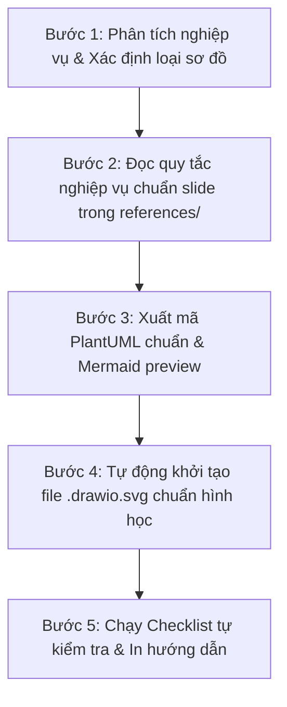

# UML Designer Skill (Chuẩn Slide ĐHQG-HCM & Ian Sommerville)

Kỹ năng chuyên gia phân tích thiết kế phần mềm và mô hình hóa hệ thống bằng các biểu đồ UML chuẩn hóa. **Nguồn chuẩn mực tối cao (Supreme Law):** Bộ slide bài giảng môn **Software Engineering (CO3001)** - Khoa KH&KT Máy tính, Trường ĐH Bách Khoa - ĐHQG-HCM (Giảng viên: Anh Nguyen-Duc, Tho Quan Thanh), biên soạn dựa trên giáo trình quốc tế **Ian Sommerville - Software Engineering (10th Edition)** lưu trữ tại `00_Slides/`.

Tối ưu hóa sâu cho việc hiển thị trực tiếp và chỉnh sửa kéo thả offline bằng **Draw.io Integration trong VS Code** (`hediet.vscode-drawio`) và **Visual Paradigm Online**.

---

## I. Trigger Condition (Điều kiện kích hoạt)

Kỹ năng này được kích hoạt khi:
- Người dùng yêu cầu phân tích yêu cầu phần mềm, đặc tả chức năng, hoặc mô hình hóa quy trình nghiệp vụ.
- Người dùng yêu cầu thiết kế hoặc vẽ bất kỳ sơ đồ UML nào:
  - **Use Case Diagram & Tabular Scenarios** (Slide Ch3 p.53-56, Ch6 p.16-20)
  - **Activity Diagram** (Slide Ch6 p.12-13, p.39, p.51, p.52)
  - **Sequence Diagram** (Slide Ch6 p.21-26, p.40, p.50)
  - **Class Diagram** (Slide Ch6 p.28-35)
  - **State-chart Diagram** (Slide Ch6 p.41-45)
  - **Architecture 4+1 View Model** (Slide Ch7 p.17-18)
- Người dùng yêu cầu tạo file biểu đồ `.drawio.svg` để chỉnh sửa trực tiếp trên canvas Draw.io trong VS Code.
- Người dùng cần thẩm định (review), kiểm tra lỗi logic hoặc chuẩn hóa sơ đồ UML sẵn có.

---

## II. BỘ QUY CHUẨN THIẾT KẾ KỸ THUẬT DRAW.IO & SVG (BẮT BUỘC)

Để đảm bảo sơ đồ xuất ra **chuẩn thẩm mỹ, không bị đè hình, không thò hình và không mất nhãn**, Agent bắt buộc tuân thủ 4 nguyên tắc kỹ thuật sau:

### 1. Quy tắc Màu nền Khung Ranh giới (Light Ocean Blue `#e0f2fe` & Pointer Events)
- Khung `sys_boundary` **bắt buộc có màu nền xanh nước biển nhạt**:
  `fillColor=#e0f2fe;strokeColor=#0284c7;strokeWidth=2;pointerEvents=0;`
- **Ý nghĩa kỹ thuật:**
  - `fillColor=#e0f2fe` mang lại màu nền xanh nước biển nhạt tiêu chuẩn nhận diện hệ thống, tạo độ tương phản rõ rệt với Use Case con nền trắng (`#ffffff`) và Use Case chính (`#bae6fd`).
  - `pointerEvents=0` cho phép nhấp chuột xuyên qua màu nền khung, giúp người dùng chọn và kéo thả Use Case bên trong một cách mượt mà mà không bao giờ bị chọn nhầm khung bao ngoài.
- Trong phần SVG visual: Đặt thẻ `<rect fill="#e0f2fe" stroke="#0284c7" stroke-width="2"/>` ở **Layer 0 (ngay đầu tiên)** trước toàn bộ đường line và Use Case.

### 2. Quy tắc Tính toán Động Khung Ranh giới (Dynamic Boundary & Safe Padding $\ge$ 60px)
- Kích thước của `sys_boundary` **bắt buộc phải được tính toán động** dựa trên Bounding Box của tất cả các Use Case bên trong:
  - `sys_x = min(uc_x) - 60px` (đảm bảo lề trái luôn cách Use Case ngoài cùng tối thiểu 60px).
  - `sys_w = max(uc_x + uc_w) + 60px - sys_x` (đảm bảo lề phải cách Use Case ngoài cùng tối thiểu 60px).
  - `sys_y = min(uc_y) - 55px` (đảm bảo khoảng trống phía trên cho tiêu đề hệ thống).
  - `sys_h = max(uc_y + uc_h) + 50px - sys_y` (đảm bảo lề dưới không bị chật chội).
- **Tác dụng:** Tuyệt đối chống tình trạng Use Case bị thò ra ngoài khung hoặc đường viền khung chém ngang qua hình elip.

### 3. Quy tắc đường nối Actor (Anti-Overlap: Không đè xuyên qua Use Case khác)
- Khi Actor nối tới cột Use Case xếp dọc:
  - Phía Actor: Bắt điểm tại bàn tay `exitX=1;exitY=0.33` (Actor bên trái) hoặc `entryX=0;entryY=0.33` (Actor bên phải).
  - Phía Use Case: Bắt điểm chính xác tại **đỉnh ngoài cùng** của hình elip:
    - Cột bên trái: `entryX=0;entryY=0.5;entryDx=0;entryDy=0;` (đỉnh cực trái).
    - Cột bên phải: `exitX=1;exitY=0.5;exitDx=0;exitDy=0;` (đỉnh cực phải).
  - **Lưu ý kỹ thuật:** Tuyệt đối không để Draw.io tự động tính đường nối hướng về tâm `(0.5, 0.5)` của elip vì đường chéo sẽ cắt xuyên qua các Use Case trung gian.

### 4. Quy tắc chống nuốt nhãn `<<include>>` và `<<extend>>`
- Mỗi quan hệ có chữ bắt buộc tạo một cell `edgeLabel` con:
  ```xml
  <mxCell id="lbl_id" value="&amp;lt;&amp;lt;include&amp;gt;&amp;gt;" style="edgeLabel;html=0;align=center;verticalAlign=middle;resizable=0;points=[];fontSize=11;fontColor=#0369a1;fontStyle=1;labelBackgroundColor=#e0f2fe;" vertex="1" connectable="0" parent="edge_id">
    <mxGeometry relative="1" as="geometry">
      <mxPoint as="offset"/>
    </mxGeometry>
  </mxCell>
  ```
- **Lưu ý kỹ thuật:**
  - Dùng `html=0` để Draw.io render dạng text thuần, ngăn chặn trình duyệt hiểu nhầm `<include>` là thẻ HTML.
  - Dùng `labelBackgroundColor=#e0f2fe` tệp màu với nền khung ranh giới để nhãn nổi bật, không bị đường nét đứt cắt ngang qua chữ.

---

## III. Execution Workflow (Quy trình thực thi 5 bước)



### Bước 1: Phân tích nghiệp vụ & Xác định loại sơ đồ
- **Use Case Diagram:** Phạm vi hệ thống, Actor (trái/phải), ca sử dụng elip, `<<include>>`, `<<extend>>`, `Generalization`.
- **Activity Diagram:** Luồng công việc, rẽ nhánh guard `[...]`, tiến trình song song fork/join, swimlanes, object flow.
- **Sequence Diagram:** Tương tác thời gian, lifelines (`:Class`, `name:Class`, `<<datastore>>`), activation box, sync `->`, return `<--`, numbering `1:`, `1.1:`, fragments `alt`/`opt`/`loop`.
- **Class Diagram:** Cấu trúc 3 ngăn, phạm vi `+`, `-`, `#`, `~`, multiplicities `1`, `0..1`, `*`, `1..*`, quan hệ `*--`, `<>--`, `<|--`.
- **State-chart Diagram:** Vòng đời thực thể, state 2 ngăn (`entry /`, `do:`, `exit /`), chuyển trạng thái `event [guard] / action`, superstate.
- **Architecture 4+1 View:** Phân bổ sơ đồ vào Logical, Process, Development, Physical, và Use-Case Scenarios.

### Bước 2: Đọc quy tắc nghiệp vụ chuẩn slide trong `references/`
- [00_Usecase_diagram.md](./references/00_Usecase_diagram.md)
- [01_Activity_diagram.md](./references/01_Activity_diagram.md)
- [02_Sequence_diagram.md](./references/02_Sequence_diagram.md)
- [03_Class_diagram.md](./references/03_Class_diagram.md)
- [04_Statechart_diagram.md](./references/04_Statechart_diagram.md)
- [05_Architecture_4plus1_views.md](./references/05_Architecture_4plus1_views.md)

### Bước 3: Xuất 2 Block Code song song
1. **Khối PlantUML Code (` ```plantuml `):** Chuẩn `@startuml ... @enduml`, tối ưu cho Draw.io và Visual Paradigm Online.
2. **Khối Mermaid Code (` ```mermaid `):** Hiển thị trực quan ngay trên Markdown preview.

### Bước 4: Tự động tạo file `<ten_diagram>.drawio.svg`
- Áp dụng đầy đủ 4 nguyên tắc kỹ thuật tại Mục II (Nền xanh `#e0f2fe`, Padding động $\ge 60\text{px}$, Anti-overlap, `edgeLabel`).

### Bước 5: Checklist tự kiểm tra theo Slide & Hướng dẫn sử dụng
- Kiểm tra theo bảng checklist trích từ slide bài giảng.
- In 3 dòng hướng dẫn mở và import trực tiếp.

---

**Hướng dẫn thao tác nhanh:**
- **Chỉnh sửa offline trong VS Code:** Nhấp đúp vào file `<ten_diagram>.drawio.svg` để mở trực tiếp canvas Draw.io trong VS Code.
- **Dán code PlantUML vào Draw.io:** Trên thanh menu Draw.io, nhấn dấu `+` -> `Advanced` -> `PlantUML`, dán đoạn mã PlantUML vào và nhấn `Insert`.
- **Import vào Visual Paradigm Online:** Vào `File` -> `Import` -> `PlantUML...`, dán toàn bộ đoạn mã trong block PlantUML rồi nhấn `OK`.
