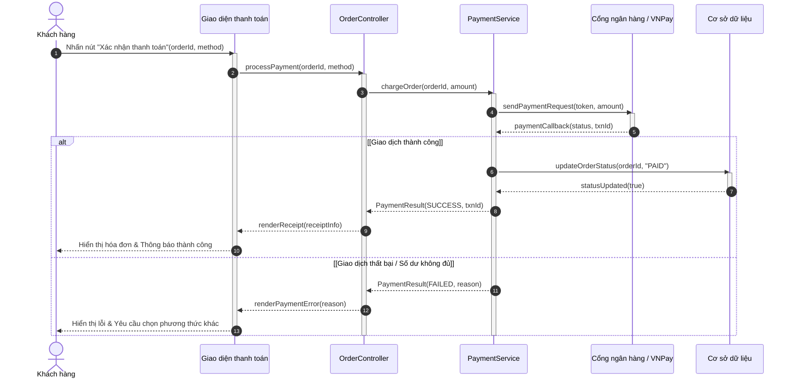
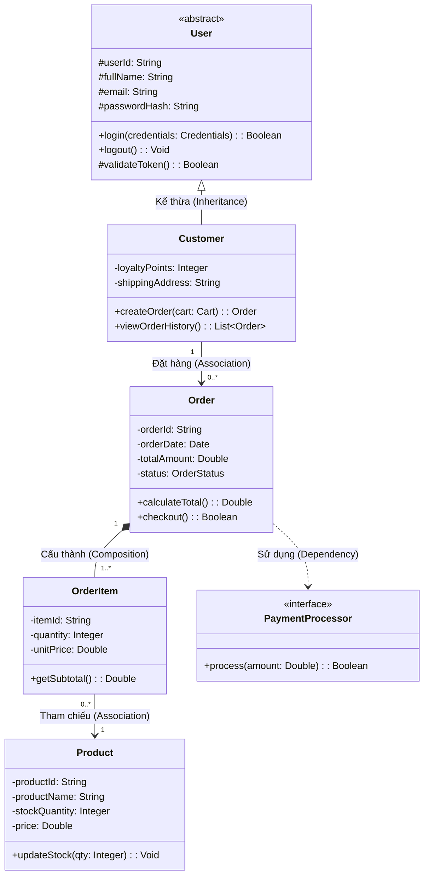

# HƯỚNG DẪN BIỂU DIỄN CÁC LOẠI BIỂU ĐỒ UML BẰNG MÃ NGUỒN MERMAID

Tài liệu này cung cấp cú pháp chuẩn, cấu trúc mẫu và các lưu ý kỹ thuật khi chuyển đổi các quy tắc UML sang Mermaid code, đảm bảo hiển thị trực quan và chính xác trên Markdown preview.

---

## 1. Use Case Diagram (Biểu đồ ca sử dụng)
*Do Mermaid chưa hỗ trợ native keyword `usecaseDiagram`, ta sử dụng `flowchart LR` để mô hình hóa chuẩn xác nhất theo quy tắc bố cục UML.*

### Quy tắc triển khai trong Mermaid:
- **Hướng đồ thị:** Bắt buộc dùng `flowchart LR` (Left to Right) để tách biệt rõ Actor chính (bên trái), System boundary (ở giữa), và Actor phụ (bên phải).
- **System Boundary:** Dùng `subgraph SystemBoundary ["Tên Hệ Thống"] ... end`.
- **Actor:** Đặt trong subgraph không viền ở bên trái hoặc bên phải ngoài SystemBoundary. Đặt icon `👤` hoặc hình tượng trưng.
- **Use Case:** Dùng hình stadium/elip `(["Động từ + Tân ngữ"])`.
- **Association:** Nét liền không mũi tên: `Actor --- UC`.
- **Include:** Nét đứt có mũi tên từ Base sang Included: `UC_Base -.->|"<<include>>"| UC_Included`.
- **Extend:** Nét đứt có mũi tên từ Extension về Base: `UC_Extension -.->|"<<extend>>"| UC_Base`.
- **Generalization:** `UC_Child --|> UC_Parent` hoặc `Actor_Child --|> Actor_Parent`.

### Code mẫu chuẩn:
```mermaid
flowchart LR
    %% Định nghĩa các Actor chính bên trái
    subgraph PrimaryActors [" "]
        KhachHang(["👤 Khách hàng"])
    end

    %% Ranh giới hệ thống (System Boundary)
    subgraph SystemBoundary ["Hệ Thống Đặt Món Trực Tuyến"]
        UC_Login(["Đăng nhập"])
        UC_CheckOTP(["Kiểm tra mã OTP"])
        UC_WrongPwd(["Hiển thị cảnh báo sai mật khẩu"])
        UC_Search(["Tìm kiếm món ăn"])
        UC_PlaceOrder(["Đặt món"])
        UC_PayCard(["Thanh toán qua thẻ"])
        UC_PayCash(["Thanh toán tiền mặt"])
        UC_Payment(["Thanh toán"])
    end

    %% Định nghĩa các Actor phụ bên phải
    subgraph SecondaryActors [" "]
        PaymentGateway(["💳 Cổng thanh toán"])
        DeliveryStaff(["🛵 Nhân viên giao hàng"])
    end

    %% Associations (Actor <-> Use Case)
    KhachHang --- UC_Login
    KhachHang --- UC_Search
    KhachHang --- UC_PlaceOrder
    UC_Payment --- PaymentGateway
    UC_PlaceOrder --- DeliveryStaff

    %% Include: Base -> Included
    UC_Login -.->|"<<include>>"| UC_CheckOTP

    %% Extend: Extension -> Base
    UC_WrongPwd -.->|"<<extend>>"| UC_Login

    %% Generalization: Con -> Cha
    UC_PayCard --|> UC_Payment
    UC_PayCash --|> UC_Payment

    %% Style cho đẹp
    style PrimaryActors fill:none,stroke:none
    style SecondaryActors fill:none,stroke:none
    style SystemBoundary fill:#f9f9fb,stroke:#333,stroke-width:2px
```

---

## 2. Activity Diagram (Biểu đồ hoạt động)
*Sử dụng `flowchart TD` để mô hình luồng điều khiển nghiệp vụ.*

### Quy tắc triển khai trong Mermaid:
- **Bắt đầu:** `Start([● Bắt đầu])`.
- **Hành động (Action):** `Node["Động từ + Tân ngữ"]` (hình chữ nhật bo góc).
- **Rẽ nhánh (Decision):** `Check{"Kiểm tra điều kiện?"}` (hình thoi).
- **Nhánh rẽ:** Bắt buộc có nhãn điều kiện `-->|[Điều kiện A]|` và `-->|[Điều kiện B]|`.
- **Thanh song song (Fork/Join):**
  - Fork: `ForkBar["══════════════ Fork ══════════════"]`
  - Join: `JoinBar["══════════════ Join ══════════════"]`
- **Kết thúc:** `EndSuccess([◉ Kết thúc: Thành công])` hoặc `EndFail([◉ Kết thúc: Hủy])`.
- **Tránh vô tận:** Có đường thoát (Cancel/Thoát) và đếm số lần thử lại trước khi khóa/kết thúc.

### Code mẫu chuẩn:
```mermaid
flowchart TD
    Start([● Bắt đầu]) --> InputCredentials["Nhập tên đăng nhập & Mật khẩu"]
    InputCredentials --> CheckInput{"Thông tin hợp lệ?"}

    CheckInput -->|[Hợp lệ]| CheckRole{"Kiểm tra quyền hạn"}
    CheckInput -->|[Không hợp lệ]| CheckAttempts{"Số lần sai >= 3?"}

    CheckAttempts -->|[Đúng]| LockAccount["Khóa tài khoản 15 phút"]
    LockAccount --> EndLocked([◉ Kết thúc: Bị khóa])

    CheckAttempts -->|[Sai]| ShowError["Hiển thị thông báo sai thông tin"]
    ShowError --> InputCredentials

    CheckRole -->|[Quản trị viên]| AdminDashboard["Chuyển hướng đến Dashboard Admin"]
    CheckRole -->|[Khách hàng]| UserHome["Chuyển hướng đến Trang chủ Khách hàng"]

    AdminDashboard --> ForkBar["══════════════ Fork ══════════════"]
    UserHome --> ForkBar

    ForkBar --> LoadProfile["Tải dữ liệu thông tin cá nhân"]
    ForkBar --> LoadNotifications["Tải danh sách thông báo mới"]

    LoadProfile --> JoinBar["══════════════ Join ══════════════"]
    LoadNotifications --> JoinBar

    JoinBar --> RenderScreen["Hiển thị màn hình hoàn chỉnh"]
    RenderScreen --> EndSuccess([◉ Kết thúc: Đăng nhập thành công])
```

---

## 3. Sequence Diagram (Biểu đồ tuần tự)
*Sử dụng `sequenceDiagram` native của Mermaid.*

### Quy tắc triển khai trong Mermaid:
- Thêm `autonumber` để đánh số bước tự động.
- Khai báo `actor` cho người dùng/hệ thống ngoài và `participant` cho các thành phần phần mềm (sắp xếp từ trái qua phải theo kiến trúc: View/UI -> Controller -> Service -> Repository/DB).
- **Request (Lời gọi hàm):** Dùng nét liền có mũi tên nhọn `->>`.
- **Response (Phản hồi dữ liệu):** Dùng nét đứt có mũi tên nhọn `-->>`.
- **Activation:** Dùng `activate Object` và `deactivate Object`.
- **Rẽ nhánh:** Dùng khối `alt [Điều kiện]` ... `else [Điều kiện]` ... `end`.
- **Trường hợp tùy chọn:** Dùng `opt [Điều kiện]` ... `end`.
- **Vòng lặp:** Dùng `loop [Điều kiện lặp]` ... `end`.

### Code mẫu chuẩn:


---

## 4. Class Diagram (Biểu đồ lớp)
*Sử dụng `classDiagram` native của Mermaid.*

### Quy tắc triển khai trong Mermaid:
- Khối lớp gồm tên lớp, thuộc tính (`-attr: Type`), phương thức (`+method(params): ReturnType`).
- **Phạm vi truy cập:**
  - `-` Private
  - `+` Public
  - `#` Protected
  - `~` Package / Internal
- **Quan hệ giữa các lớp:**
  - **Inheritance (Kế thừa):** `ParentClass <|-- ChildClass`
  - **Composition (Cấu thành - has-a mạnh):** `Container *-- Component`
  - **Aggregation (Thu nạp - has-a yếu):** `Container o-- Component`
  - **Association (Liên kết):** `ClassA --> ClassB` hoặc `ClassA -- ClassB`
  - **Dependency (Phụ thuộc):** `ClassA ..> ClassB`
- **Bội số quan hệ (Multiplicity):** Đặt trong ngoặc kép ở 2 đầu quan hệ: `"1" *-- "0..*"`.

### Code mẫu chuẩn:

