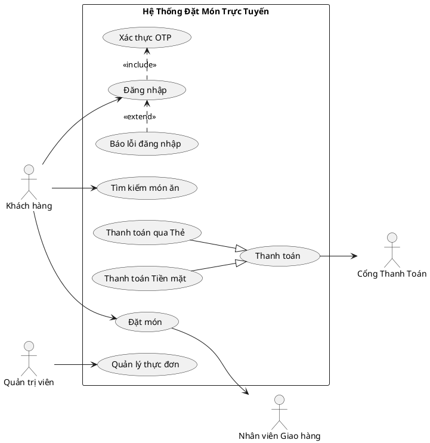
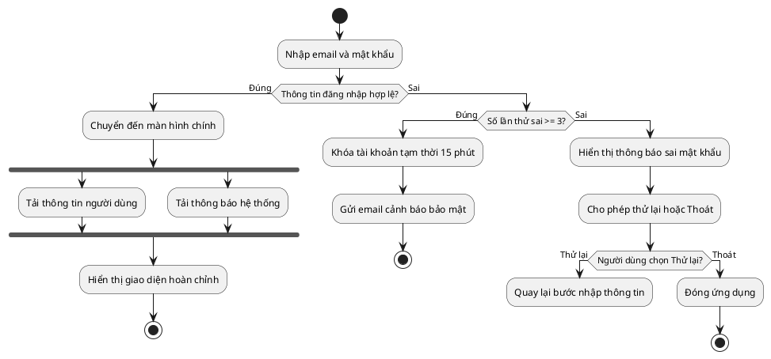
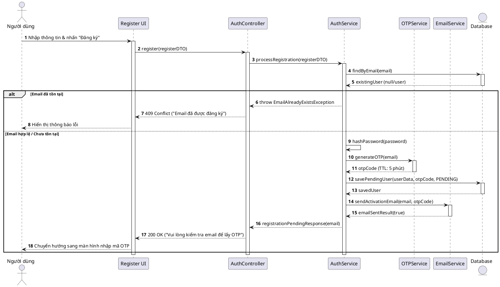
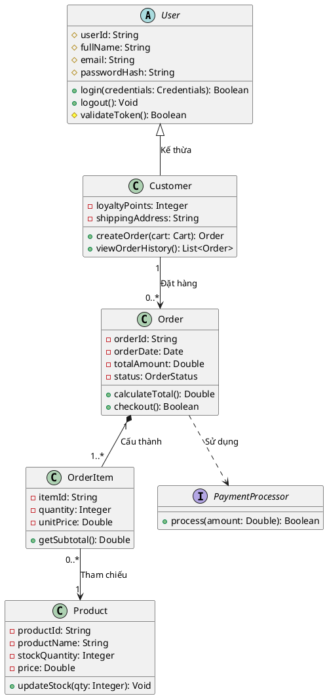

# HƯỚNG DẪN CÚ PHÁP PLANTUML CHUẨN ĐỂ IMPORT DRAW.IO & VISUAL PARADIGM ONLINE

Tài liệu này cung cấp các mẫu cú pháp PlantUML chuẩn cho 4 loại biểu đồ (Use Case, Activity, Sequence, Class Diagram). Toàn bộ code bắt đầu bằng `@startuml` và kết thúc bằng `@enduml`, tương thích 100% với:
- **draw.io:** Menu `Arrange` -> `Insert` -> `Advanced` -> `PlantUML` (hoặc `+` -> `Advanced` -> `PlantUML`).
- **Visual Paradigm Online:** Menu `File` -> `Import` -> `PlantUML`.

---

## 1. Use Case Diagram (PlantUML)

### Quy tắc triển khai:
- Thêm chỉ thị `left to right direction` để Actor chính nằm bên trái và Actor phụ nằm bên phải.
- Ranh giới hệ thống: `rectangle "Tên Hệ Thống" { ... }`.
- Actor chính (bên trái): Khai báo trước khung `rectangle`.
- Actor phụ (bên phải): Khai báo sau khung `rectangle`.
- Use Case: `usecase "Động từ + Tân ngữ" as UC1`.
- Association: `Actor --> UC1` hoặc `Actor -- UC1`.
- Include: `UC_Base .> UC_Include : <<include>>` (Mũi tên trỏ từ Ca chính sang Ca phụ).
- Extend: `UC_Extend .> UC_Base : <<extend>>` (Mũi tên trỏ từ Ca mở rộng về Ca cơ sở).
- Generalization: `UC_Child --|> UC_Parent` hoặc `Actor_Child --|> Actor_Parent`.

### Code mẫu chuẩn:

---

## 2. Activity Diagram (PlantUML)

### Quy tắc triển khai:
- Sử dụng cú pháp Activity Diagram mới (Beta syntax) của PlantUML với `start`, `stop`, `:Action;`.
- Action: Bắt đầu bằng động từ, kết thúc bằng dấu chấm phẩy `;`.
- Rẽ nhánh Decision: `if (Điều kiện?) then (yes/hợp lệ) ... else (no/lỗi) ... endif`.
- Luôn có nhánh thoát (Cancel/Hủy) hoặc đếm lần thử tránh vòng lặp vô tận.
- Tiến trình song song: `fork` ... `fork again` ... `end fork`.
- Kết thúc: `stop` hoặc `end`.

### Code mẫu chuẩn:

---

## 3. Sequence Diagram (PlantUML)

### Quy tắc triển khai:
- `autonumber` để đánh số thứ tự thông điệp.
- Khai báo các Actor và Participants theo đúng trật tự từ trái qua phải.
- Request (Gọi hàm): Mũi tên nét liền `->`.
- Response (Trả dữ liệu): Mũi tên nét đứt `-->`.
- Activation Box: `activate Participant` và `deactivate Participant`.
- Rẽ nhánh điều kiện: Khung `alt [Điều kiện A]` ... `else [Điều kiện B]` ... `end`.
- Tùy chọn: `opt [Điều kiện]` ... `end`.
- Vòng lặp: `loop [Điều kiện lặp]` ... `end`.

### Code mẫu chuẩn:

---

## 4. Class Diagram (PlantUML)

### Quy tắc triển khai:
- Khối 3 ngăn: Tên Class, Thuộc tính, Phương thức.
- Access Modifiers: `-` Private, `+` Public, `#` Protected, `~` Package.
- Quan hệ:
  - Kế thừa: `Parent <|-- Child`
  - Cấu thành mạnh (Composition): `Container *-- Component`
  - Thu nạp yếu (Aggregation): `Container o-- Component`
  - Liên kết (Association): `ClassA --> ClassB`
  - Phụ thuộc (Dependency): `ClassA ..> ClassB`
- Bội số quan hệ (Multiplicity): Ghi trong ngoặc kép `"1" *-- "1..*"`.

### Code mẫu chuẩn:

