# Use-case diagrams: PlantUML and Mermaid

Source: original PNGs in `refs/uc_uml/USE_CASE/`. Native Draw.io files and editable SVG exports use checked, separate edge routes. Mermaid is a flowchart approximation of UML notation; Draw.io is the layout reference.

## general_usecase_diagram

[Editable Draw.io](GENERAL/general_usecase_diagram.drawio) | [SVG preview](GENERAL/general_usecase_diagram.drawio.svg)

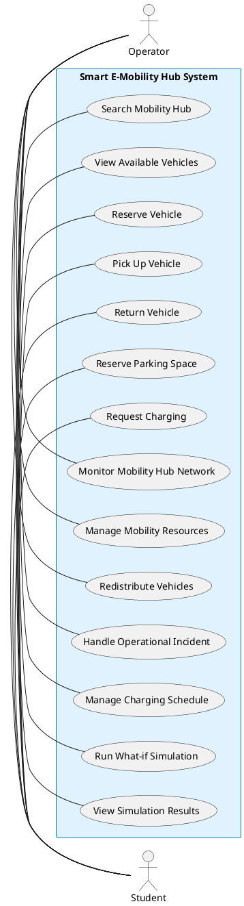

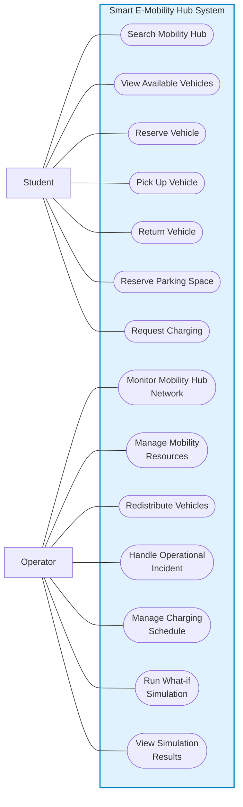

## UC01-Search_Mobility_Hub

[Editable Draw.io](STUDENTS/UC01-Search_Mobility_Hub.drawio) | [SVG preview](STUDENTS/UC01-Search_Mobility_Hub.drawio.svg)

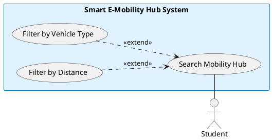

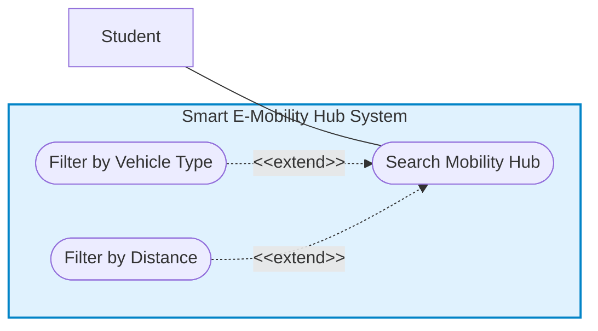

## UC02-View_Available_Vehicles

[Editable Draw.io](STUDENTS/UC02-View_Available_Vehicles.drawio) | [SVG preview](STUDENTS/UC02-View_Available_Vehicles.drawio.svg)

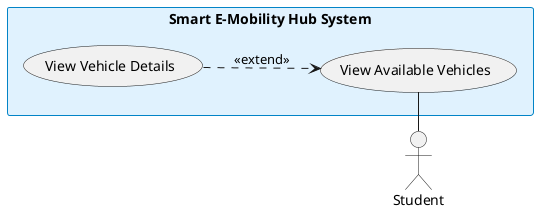

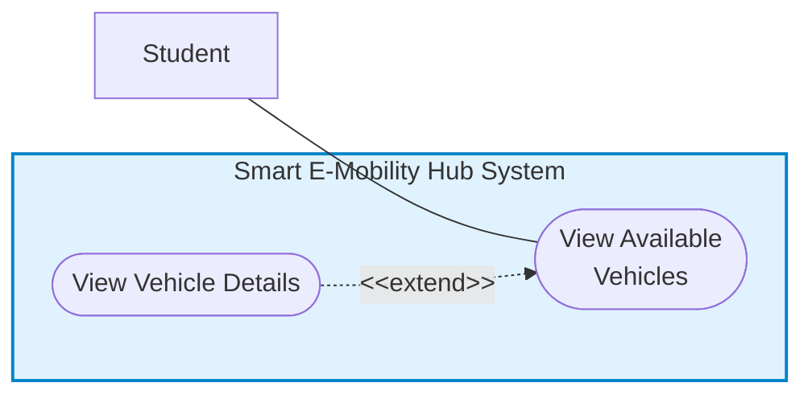

## UC03-Reserve_Vehicle

[Editable Draw.io](STUDENTS/UC03-Reserve_Vehicle.drawio) | [SVG preview](STUDENTS/UC03-Reserve_Vehicle.drawio.svg)

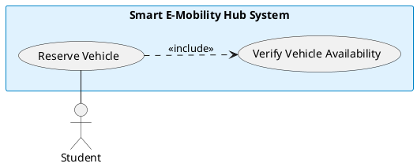

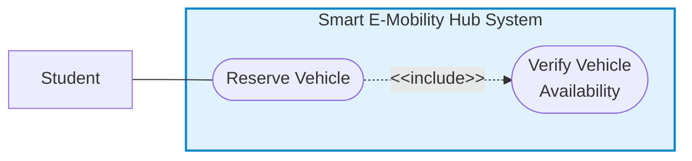

## UC04-Pick_Up_Vehicle

[Editable Draw.io](STUDENTS/UC04-Pick_Up_Vehicle.drawio) | [SVG preview](STUDENTS/UC04-Pick_Up_Vehicle.drawio.svg)

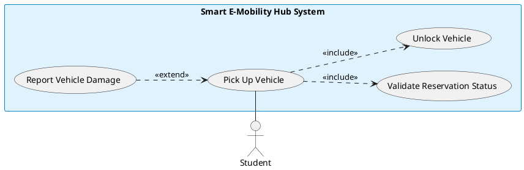

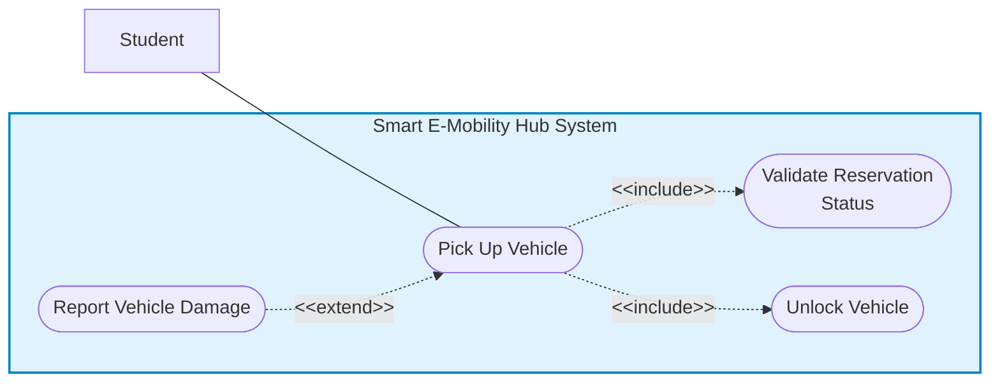

## UC05-Return_Vehicle

[Editable Draw.io](STUDENTS/UC05-Return_Vehicle.drawio) | [SVG preview](STUDENTS/UC05-Return_Vehicle.drawio.svg)

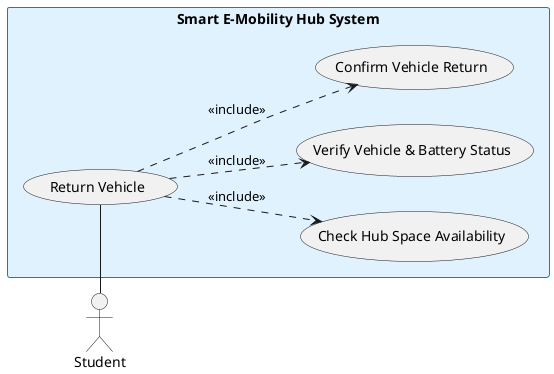

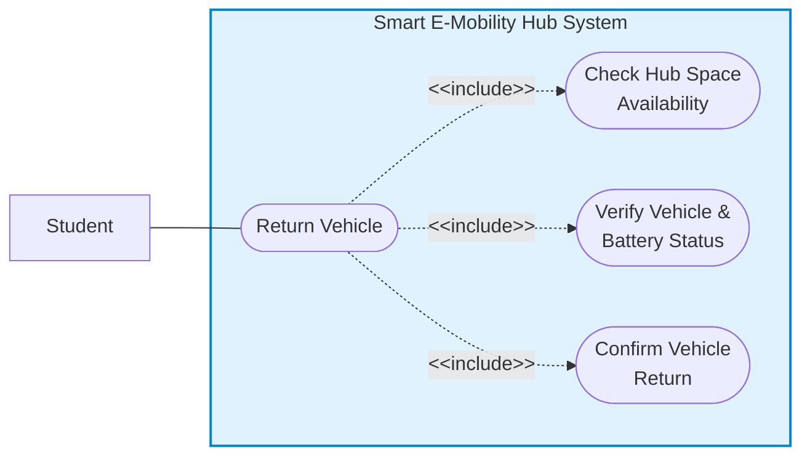

## UC06-Reserve_Parking_Space

[Editable Draw.io](STUDENTS/UC06-Reserve_Parking_Space.drawio) | [SVG preview](STUDENTS/UC06-Reserve_Parking_Space.drawio.svg)

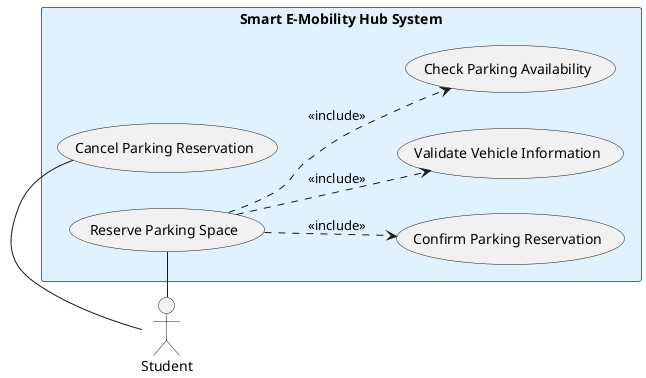

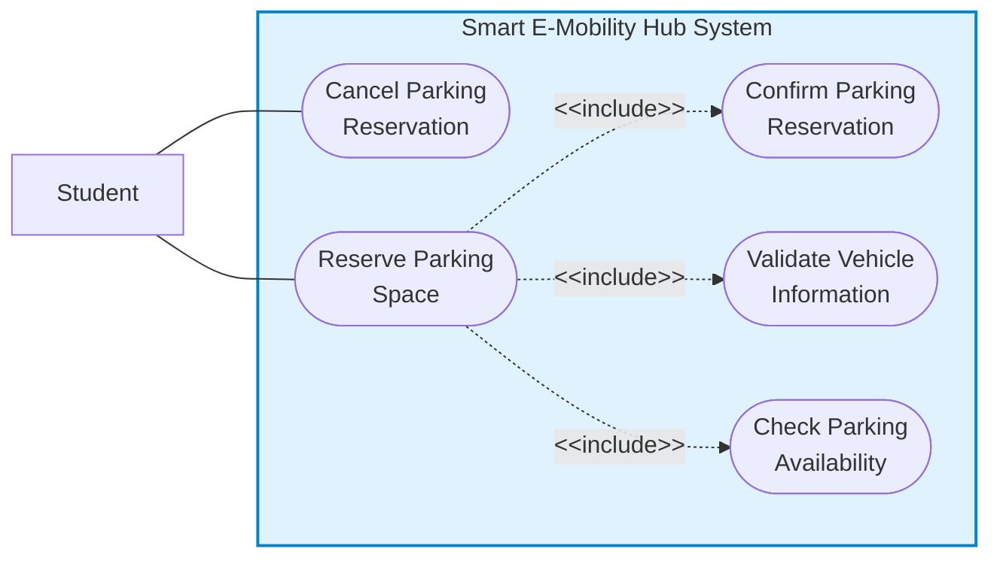

## UC07-Request_Charging

[Editable Draw.io](STUDENTS/UC07-Request_Charging.drawio) | [SVG preview](STUDENTS/UC07-Request_Charging.drawio.svg)

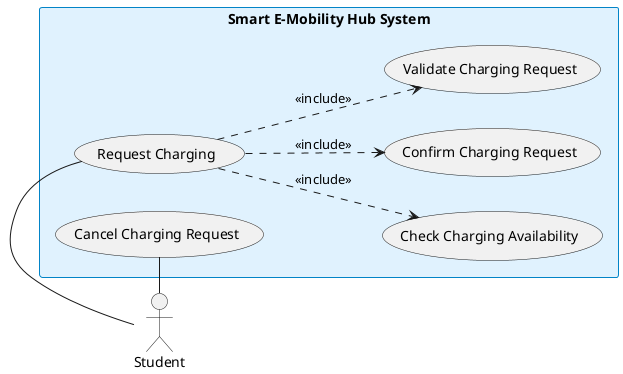

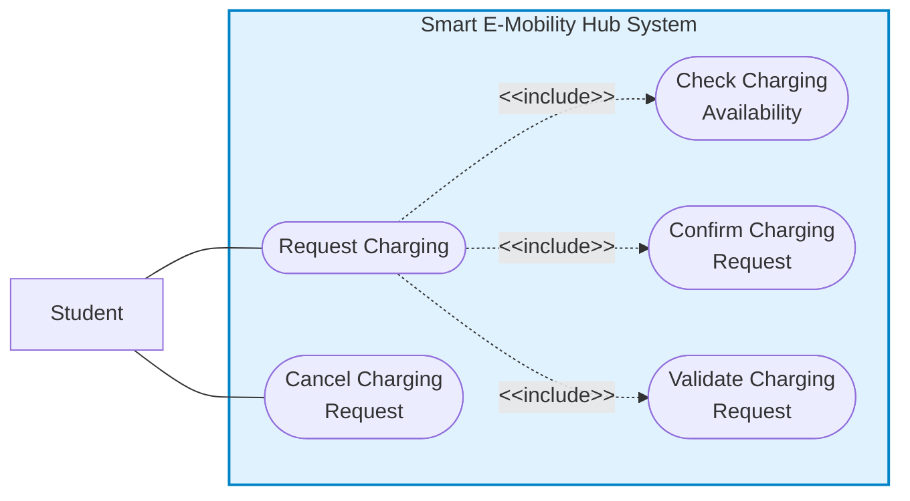

## UC8-Monitor_Mobility_Hub_Network

[Editable Draw.io](OPERATOR/UC8-Monitor_Mobility_Hub_Network.drawio) | [SVG preview](OPERATOR/UC8-Monitor_Mobility_Hub_Network.drawio.svg)

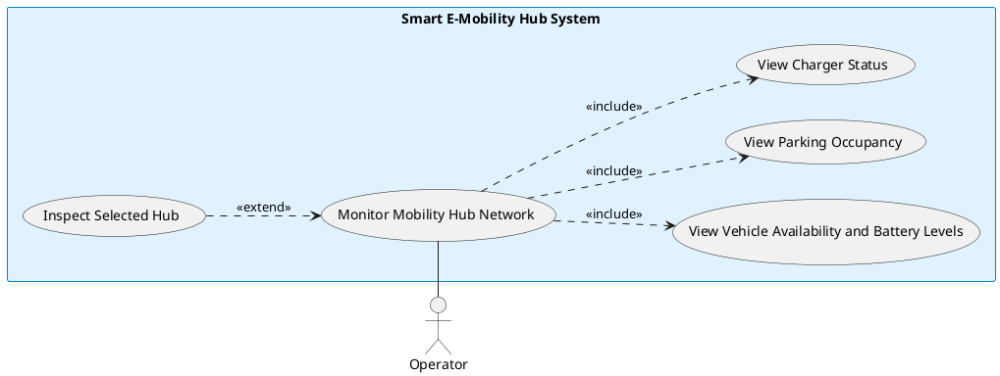

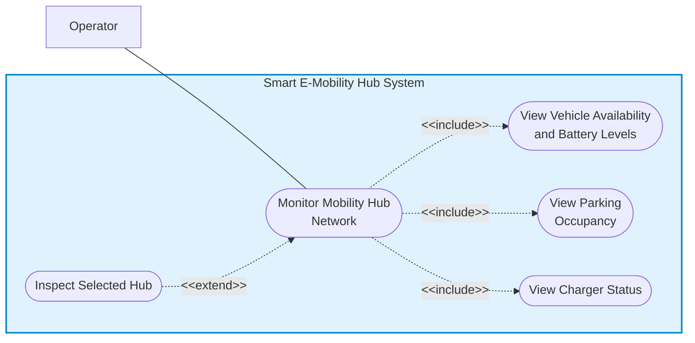

## UC9-Manage_Mobility_Resources

[Editable Draw.io](OPERATOR/UC9-Manage_Mobility_Resources.drawio) | [SVG preview](OPERATOR/UC9-Manage_Mobility_Resources.drawio.svg)

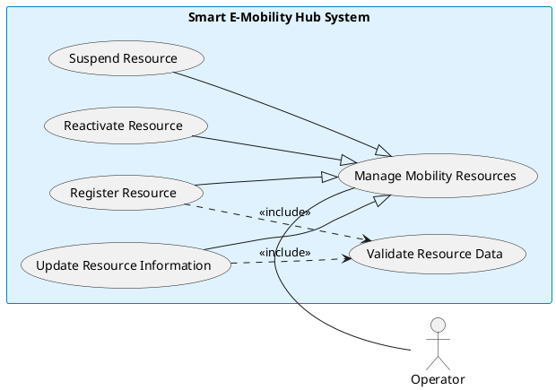

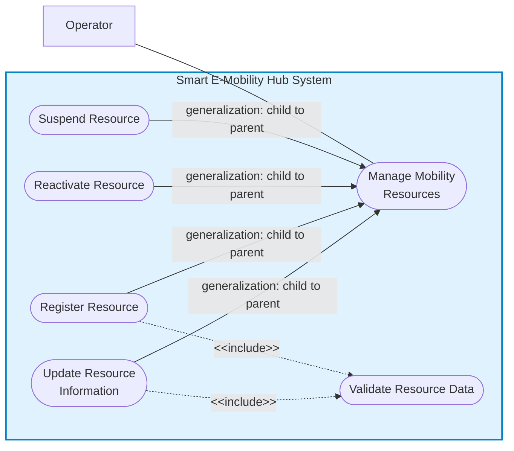

## UC10-Redistribute_Vehicles

[Editable Draw.io](OPERATOR/UC10-Redistribute_Vehicles.drawio) | [SVG preview](OPERATOR/UC10-Redistribute_Vehicles.drawio.svg)

```plantuml
@startuml
left to right direction
skinparam shadowing false
skinparam rectangleBackgroundColor #e0f2fe
skinparam rectangleBorderColor #0284c7
actor "Operator" as actor_left
rectangle "Smart E-Mobility Hub System" {
  usecase "Find Alternative Destination Hub" as uc_ext
  usecase "Redistribute Vehicles" as uc_base
  usecase "Check Transferable Vehicles" as uc_inc1
  usecase "Check Destination Parking Capacity" as uc_inc2
  usecase "Create Transfer Order" as uc_inc3
}
actor_left -right- uc_base
uc_ext ..> uc_base : <<extend>>
uc_base ..> uc_inc1 : <<include>>
uc_base ..> uc_inc2 : <<include>>
uc_base ..> uc_inc3 : <<include>>
@enduml
```

```mermaid
flowchart LR
  actor_left["Operator"]
  subgraph sys_boundary["Smart E-Mobility Hub System"]
    uc_ext(["Find Alternative<br/>Destination Hub"])
    uc_base(["Redistribute Vehicles"])
    uc_inc1(["Check Transferable<br/>Vehicles"])
    uc_inc2(["Check Destination<br/>Parking Capacity"])
    uc_inc3(["Create Transfer Order"])
  end
  actor_left --- uc_base
  uc_ext -. "&lt;&lt;extend&gt;&gt;" .-> uc_base
  uc_base -. "&lt;&lt;include&gt;&gt;" .-> uc_inc1
  uc_base -. "&lt;&lt;include&gt;&gt;" .-> uc_inc2
  uc_base -. "&lt;&lt;include&gt;&gt;" .-> uc_inc3
  style sys_boundary fill:#e0f2fe,stroke:#0284c7,stroke-width:2px
```

## UC11-Handle_Operational_Incident

[Editable Draw.io](OPERATOR/UC11-Handle_Operational_Incident.drawio) | [SVG preview](OPERATOR/UC11-Handle_Operational_Incident.drawio.svg)

```plantuml
@startuml
left to right direction
skinparam shadowing false
skinparam rectangleBackgroundColor #e0f2fe
skinparam rectangleBorderColor #0284c7
actor "Operator" as actor_left
rectangle "Smart E-Mobility Hub System" {
  usecase "Isolate Faulty Resource" as uc_ext1
  usecase "Schedule Maintenance" as uc_ext2
  usecase "Handle Operational Incident" as uc_base
  usecase "Review Incident Details" as uc_inc1
  usecase "Assess Incident Impact" as uc_inc2
  usecase "Update Incident Status" as uc_inc3
}
actor_left -right- uc_base
uc_base ..> uc_ext1 : <<include>>
uc_base ..> uc_ext2 : <<include>>
uc_base ..> uc_inc1 : <<include>>
uc_base ..> uc_inc2 : <<include>>
uc_base ..> uc_inc3 : <<include>>
@enduml
```

```mermaid
flowchart LR
  actor_left["Operator"]
  subgraph sys_boundary["Smart E-Mobility Hub System"]
    uc_ext1(["Isolate Faulty Resource"])
    uc_ext2(["Schedule Maintenance"])
    uc_base(["Handle Operational<br/>Incident"])
    uc_inc1(["Review Incident Details"])
    uc_inc2(["Assess Incident Impact"])
    uc_inc3(["Update Incident Status"])
  end
  actor_left --- uc_base
  uc_base -. "&lt;&lt;include&gt;&gt;" .-> uc_ext1
  uc_base -. "&lt;&lt;include&gt;&gt;" .-> uc_ext2
  uc_base -. "&lt;&lt;include&gt;&gt;" .-> uc_inc1
  uc_base -. "&lt;&lt;include&gt;&gt;" .-> uc_inc2
  uc_base -. "&lt;&lt;include&gt;&gt;" .-> uc_inc3
  style sys_boundary fill:#e0f2fe,stroke:#0284c7,stroke-width:2px
```

## UC12-Manage_Charging_Schedule

[Editable Draw.io](OPERATOR/UC12-Manage_Charging_Schedule.drawio) | [SVG preview](OPERATOR/UC12-Manage_Charging_Schedule.drawio.svg)

```plantuml
@startuml
left to right direction
skinparam shadowing false
skinparam rectangleBackgroundColor #e0f2fe
skinparam rectangleBorderColor #0284c7
actor "Operator" as actor_left
rectangle "Smart E-Mobility Hub System" {
  usecase "Reassign on Port Malfunction" as uc_ext1
  usecase "Manage Charging Schedule" as uc_base
  usecase "Override Charging Schedule" as uc_ext2
  usecase "Monitor Charging Queue" as uc_inc1
  usecase "Prioritize Charging Order" as uc_inc2
  usecase "Allocate Charging Points" as uc_inc3
}
actor_left -right- uc_base
uc_ext1 ..> uc_base : <<extend>>
uc_ext2 ..> uc_base : <<extend>>
uc_base ..> uc_inc1 : <<include>>
uc_base ..> uc_inc2 : <<include>>
uc_base ..> uc_inc3 : <<include>>
@enduml
```

```mermaid
flowchart LR
  actor_left["Operator"]
  subgraph sys_boundary["Smart E-Mobility Hub System"]
    uc_ext1(["Reassign on Port<br/>Malfunction"])
    uc_base(["Manage Charging<br/>Schedule"])
    uc_ext2(["Override Charging<br/>Schedule"])
    uc_inc1(["Monitor Charging<br/>Queue"])
    uc_inc2(["Prioritize Charging<br/>Order"])
    uc_inc3(["Allocate Charging<br/>Points"])
  end
  actor_left --- uc_base
  uc_ext1 -. "&lt;&lt;extend&gt;&gt;" .-> uc_base
  uc_ext2 -. "&lt;&lt;extend&gt;&gt;" .-> uc_base
  uc_base -. "&lt;&lt;include&gt;&gt;" .-> uc_inc1
  uc_base -. "&lt;&lt;include&gt;&gt;" .-> uc_inc2
  uc_base -. "&lt;&lt;include&gt;&gt;" .-> uc_inc3
  style sys_boundary fill:#e0f2fe,stroke:#0284c7,stroke-width:2px
```

## UC13-Run_What-if_Simulation

[Editable Draw.io](OPERATOR/UC13-Run_What-if_Simulation.drawio) | [SVG preview](OPERATOR/UC13-Run_What-if_Simulation.drawio.svg)

```plantuml
@startuml
left to right direction
skinparam shadowing false
skinparam rectangleBackgroundColor #e0f2fe
skinparam rectangleBorderColor #0284c7
actor "Operator" as actor_left
rectangle "Smart E-Mobility Hub System" {
  usecase "Export Simulation Report" as uc_ext1
  usecase "Apply Coordination Recommendations" as uc_ext2
  usecase "Run What-if Simulation" as uc_base
  usecase "Select Simulation Scenario" as uc_inc1
  usecase "Configure Scenario Parameters" as uc_inc2
  usecase "Execute Network Simulation" as uc_inc3
  usecase "View Simulation Results (UC-14)" as uc_inc4
}
actor_left -right- uc_base
uc_ext1 ..> uc_base : <<extend>>
uc_ext2 ..> uc_base : <<extend>>
uc_base ..> uc_inc1 : <<include>>
uc_base ..> uc_inc2 : <<include>>
uc_base ..> uc_inc3 : <<include>>
uc_base ..> uc_inc4 : <<include>>
@enduml
```

```mermaid
flowchart LR
  actor_left["Operator"]
  subgraph sys_boundary["Smart E-Mobility Hub System"]
    uc_ext1(["Export Simulation<br/>Report"])
    uc_ext2(["Apply Coordination<br/>Recommendations"])
    uc_base(["Run What-if<br/>Simulation"])
    uc_inc1(["Select Simulation<br/>Scenario"])
    uc_inc2(["Configure Scenario<br/>Parameters"])
    uc_inc3(["Execute Network<br/>Simulation"])
    uc_inc4(["View Simulation<br/>Results (UC-14)"])
  end
  actor_left --- uc_base
  uc_ext1 -. "&lt;&lt;extend&gt;&gt;" .-> uc_base
  uc_ext2 -. "&lt;&lt;extend&gt;&gt;" .-> uc_base
  uc_base -. "&lt;&lt;include&gt;&gt;" .-> uc_inc1
  uc_base -. "&lt;&lt;include&gt;&gt;" .-> uc_inc2
  uc_base -. "&lt;&lt;include&gt;&gt;" .-> uc_inc3
  uc_base -. "&lt;&lt;include&gt;&gt;" .-> uc_inc4
  style sys_boundary fill:#e0f2fe,stroke:#0284c7,stroke-width:2px
```

## UC14-View_Simulation_Results

[Editable Draw.io](OPERATOR/UC14-View_Simulation_Results.drawio) | [SVG preview](OPERATOR/UC14-View_Simulation_Results.drawio.svg)

```plantuml
@startuml
left to right direction
skinparam shadowing false
skinparam rectangleBackgroundColor #e0f2fe
skinparam rectangleBorderColor #0284c7
actor "Operator" as actor_left
rectangle "Smart E-Mobility Hub System" {
  usecase "Export Simulation Results" as uc_ext1
  usecase "Filter Simulation Results" as uc_ext2
  usecase "Compare Simulation Results" as uc_ext3
  usecase "View Simulation Results" as uc_base
  usecase "Display Recommendations" as uc_inc1
  usecase "Retrieve Simulation Results" as uc_inc2
  usecase "Display Simulation Metrics" as uc_inc3
}
actor_left -right- uc_base
uc_ext1 ..> uc_base : <<extend>>
uc_ext2 ..> uc_base : <<extend>>
uc_ext3 ..> uc_base : <<extend>>
uc_base ..> uc_inc1 : <<include>>
uc_base ..> uc_inc2 : <<include>>
uc_base ..> uc_inc3 : <<include>>
@enduml
```

```mermaid
flowchart LR
  actor_left["Operator"]
  subgraph sys_boundary["Smart E-Mobility Hub System"]
    uc_ext1(["Export Simulation<br/>Results"])
    uc_ext2(["Filter Simulation<br/>Results"])
    uc_ext3(["Compare Simulation<br/>Results"])
    uc_base(["View Simulation<br/>Results"])
    uc_inc1(["Display<br/>Recommendations"])
    uc_inc2(["Retrieve Simulation<br/>Results"])
    uc_inc3(["Display Simulation<br/>Metrics"])
  end
  actor_left --- uc_base
  uc_ext1 -. "&lt;&lt;extend&gt;&gt;" .-> uc_base
  uc_ext2 -. "&lt;&lt;extend&gt;&gt;" .-> uc_base
  uc_ext3 -. "&lt;&lt;extend&gt;&gt;" .-> uc_base
  uc_base -. "&lt;&lt;include&gt;&gt;" .-> uc_inc1
  uc_base -. "&lt;&lt;include&gt;&gt;" .-> uc_inc2
  uc_base -. "&lt;&lt;include&gt;&gt;" .-> uc_inc3
  style sys_boundary fill:#e0f2fe,stroke:#0284c7,stroke-width:2px
```
