# TỔNG HỢP MÃ NGUỒN PLANTUML & MERMAID TOÀN BỘ SƠ ĐỒ USE CASE
> Hệ thống: **Smart E-Mobility Hub System**
> Chuẩn quy tắc: `02_SE` & `uml-designer` (Hỗ trợ mở trực tiếp bằng Draw.io trong VS Code hoặc import Visual Paradigm Online).

---

## MỤC LỤC
1. [Sơ đồ tổng quan (General Use Case Diagram)](#1-sơ-đồ-tổng-quan-general-use-case-diagram)
2. [Nhóm chức năng Sinh viên (Student Use Cases UC01 - UC07)](#2-nhóm-chức-năng-sinh-viên-student-use-cases)
   - [UC01: Search Mobility Hub](#uc01-search-mobility-hub)
   - [UC02: View Available Vehicles](#uc02-view-available-vehicles)
   - [UC03: Reserve Vehicle](#uc03-reserve-vehicle)
   - [UC04: Pick Up Vehicle](#uc04-pick-up-vehicle)
   - [UC05: Return Vehicle](#uc05-return-vehicle)
   - [UC06: Reserve Parking Space](#uc06-reserve-parking-space)
   - [UC07: Request Charging](#uc07-request-charging)
3. [Nhóm chức năng Quản trị / Điều hành (Operator Use Cases UC08 - UC14)](#3-nhóm-chức-năng-quản-trị--điều-hành-operator-use-cases)
   - [UC08: Monitor Mobility Hub Network](#uc08-monitor-mobility-hub-network)
   - [UC09: Manage Mobility Resources](#uc09-manage-mobility-resources)
   - [UC10: Redistribute Vehicles](#uc10-redistribute-vehicles)
   - [UC11: Handle Operational Incident](#uc11-handle-operational-incident)
   - [UC12: Manage Charging Schedule](#uc12-manage-charging-schedule)
   - [UC13: Run What-if Simulation](#uc13-run-what-if-simulation)
   - [UC14: View Simulation Results](#uc14-view-simulation-results)

---

## 1. Sơ đồ tổng quan (General Use Case Diagram)
- **File Draw.io:** `01_Diagram/01_Usecase_Diagram/GENERAL/general_usecase_diagram.drawio.svg`

### Mã PlantUML
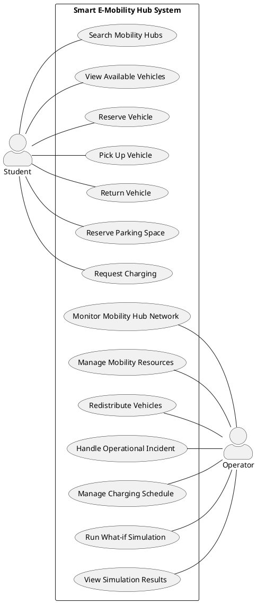

### Mã Mermaid
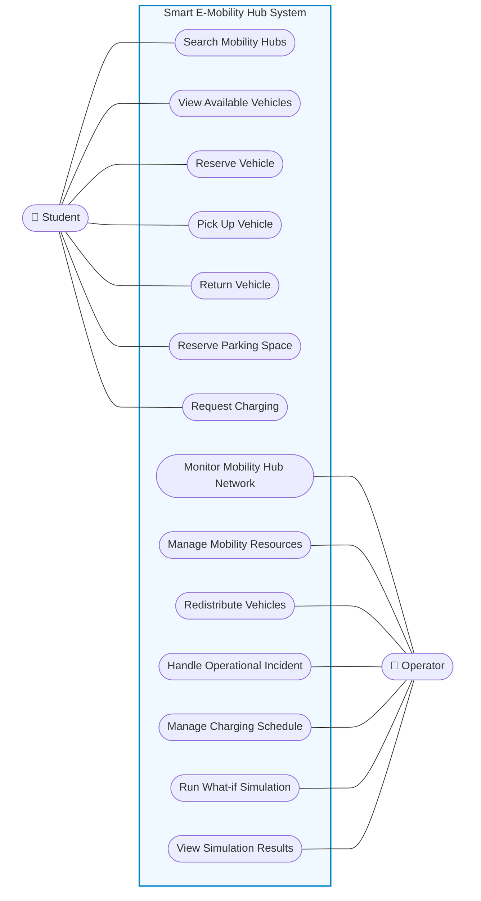

---

## 2. Nhóm chức năng Sinh viên (Student Use Cases)

### UC01: Search Mobility Hub
- **File Draw.io:** `01_Diagram/01_Usecase_Diagram/STUDENTS/UC01-Search_Mobility_Hub.drawio.svg`

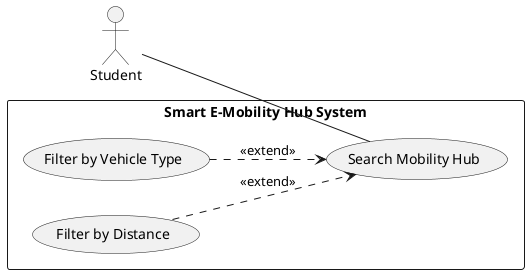

### UC02: View Available Vehicles
- **File Draw.io:** `01_Diagram/01_Usecase_Diagram/STUDENTS/UC02-View_Available_Vehicles.drawio.svg`

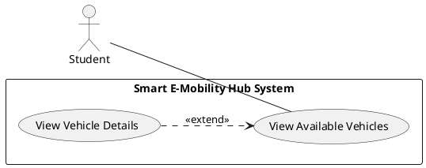

### UC03: Reserve Vehicle
- **File Draw.io:** `01_Diagram/01_Usecase_Diagram/STUDENTS/UC03-Reserve_Vehicle.drawio.svg`

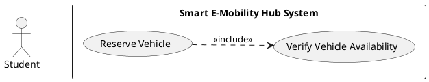

### UC04: Pick Up Vehicle
- **File Draw.io:** `01_Diagram/01_Usecase_Diagram/STUDENTS/UC04-Pick_Up_Vehicle.drawio.svg`

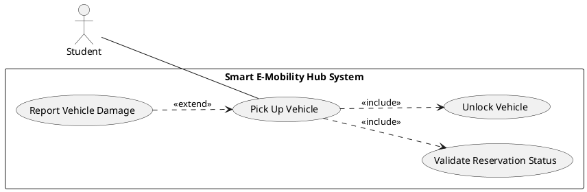

### UC05: Return Vehicle
- **File Draw.io:** `01_Diagram/01_Usecase_Diagram/STUDENTS/UC05-Return_Vehicle.drawio.svg`

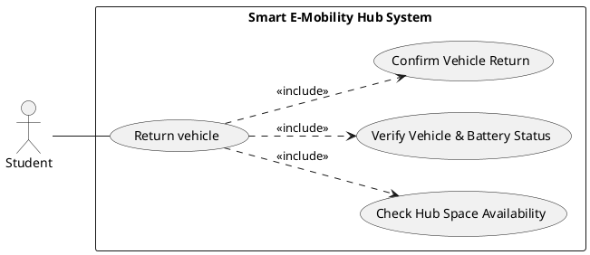

### UC06: Reserve Parking Space
- **File Draw.io:** `01_Diagram/01_Usecase_Diagram/STUDENTS/UC06-Reserve_Parking_Space.drawio.svg`

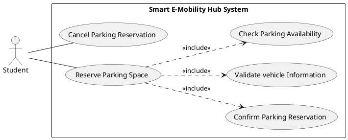

### UC07: Request Charging
- **File Draw.io:** `01_Diagram/01_Usecase_Diagram/STUDENTS/UC07-Request_Charging.drawio.svg`

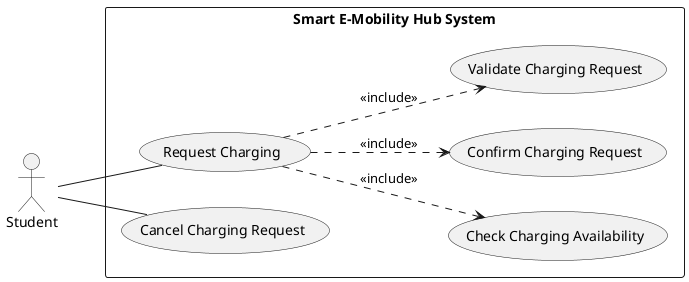

---

## 3. Nhóm chức năng Quản trị / Điều hành (Operator Use Cases)

### UC08: Monitor Mobility Hub Network
- **File Draw.io:** `01_Diagram/01_Usecase_Diagram/OPERATOR/UC8-Monitor_Mobility_Hub_Network.drawio.svg`

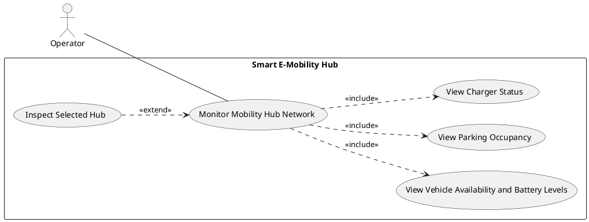

### UC09: Manage Mobility Resources
- **File Draw.io:** `01_Diagram/01_Usecase_Diagram/OPERATOR/UC9-Manage_Mobility_Resources.drawio.svg`

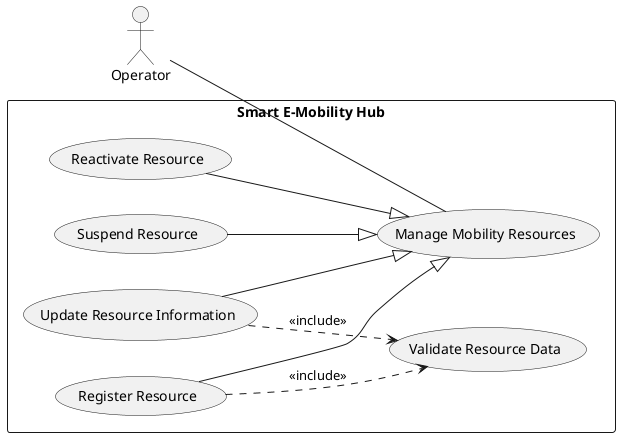

### UC10: Redistribute Vehicles
- **File Draw.io:** `01_Diagram/01_Usecase_Diagram/OPERATOR/UC10-Redistribute_Vehicles.drawio.svg`

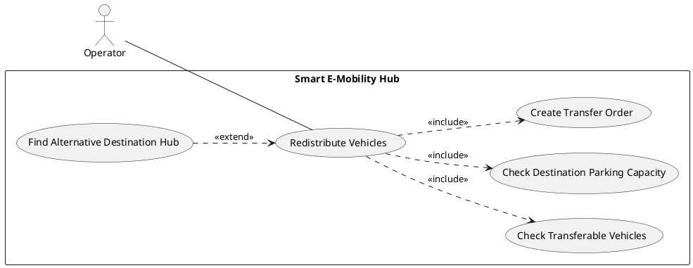

### UC11: Handle Operational Incident
- **File Draw.io:** `01_Diagram/01_Usecase_Diagram/OPERATOR/UC11-Handle_Operational_Incident.drawio.svg`

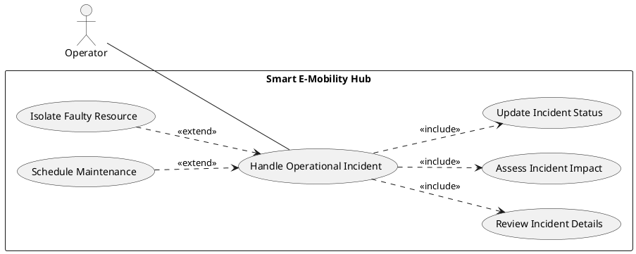

### UC12: Manage Charging Schedule
- **File Draw.io:** `01_Diagram/01_Usecase_Diagram/OPERATOR/UC12-Manage_Charging_Schedule.drawio.svg`

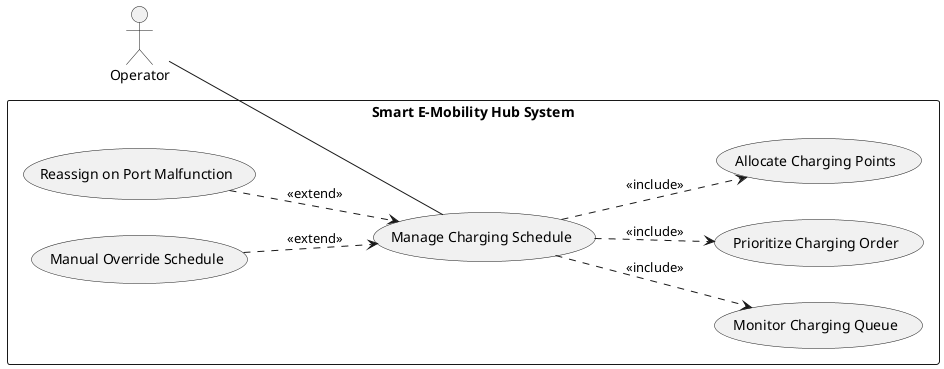

### UC13: Run What-if Simulation
- **File Draw.io:** `01_Diagram/01_Usecase_Diagram/OPERATOR/UC13-Run_What-if_Simulation.drawio.svg`

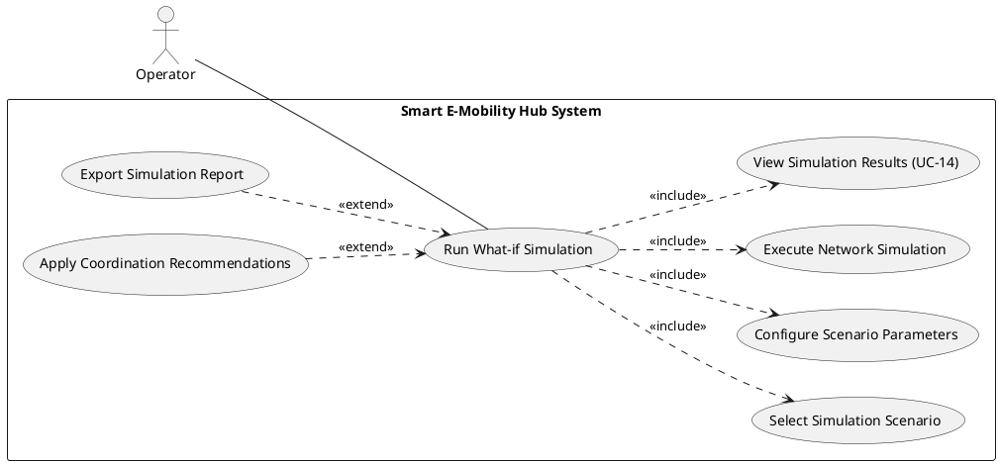

### UC14: View Simulation Results
- **File Draw.io:** `01_Diagram/01_Usecase_Diagram/OPERATOR/UC14-View_Simulation_Results.drawio.svg`

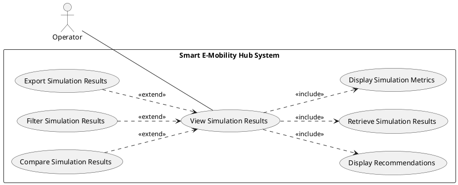
