# TỔNG HỢP MÃ NGUỒN PLANTUML & MERMAID SƠ ĐỒ TUẦN TỰ (SEQUENCE DIAGRAM)
> **Chuẩn mực bài giảng (Supreme Law):** Môn **Software Engineering (CO3001) - ĐHQG-HCM** & **Ian Sommerville (10th Ed) Ch6 p.21-26 (Hình mẫu Slide 22/23 "SEQUENCE DIAGRAMS - EXAMPLE")**.  
> **Đặc trưng quy chuẩn:**
> - Actor stick figure đại diện người dùng khởi xướng.
> - Hộp đối tượng / thành phần ở đỉnh Lifeline tô màu pastel phân biệt (UI, Controller, Service/IoT, Database).
> - Khung kích hoạt (*Activation Bar*) liên tục biểu thị chính xác thời gian xử lý của đối tượng.
> - Thông điệp yêu cầu (*Request Message*): Nét liền đầu mũi tên đặc (`──►`), đặt tên theo hành động nghiệp vụ rõ ràng (VD: `select vehicle`, `insert card`, `verify card`).
> - Thông điệp phản hồi (*Return Message*): Nét đứt đầu mũi tên mở (`< - - -`), nhãn in nghiêng (VD: `reservation approved`, `reject card`, `display active ticket`).
> - Ràng buộc thời gian & thời lượng (*Time & Duration Constraints*): Mốc `{a}`, `{b}` và mũi tên hai đầu `{b - a < X sec}` (Slide Ch6 p.22/23).

---

## MỤC LỤC
1. [SQ01: Đặt giữ phương tiện (Reserve Vehicle - UC03)](#sq01-reserve-vehicle)
2. [SQ02: Nhận phương tiện tại trạm (Pick Up Vehicle - UC04)](#sq02-pick-up-vehicle)
3. [SQ03: Trả phương tiện tại trạm (Return Vehicle - UC05)](#sq03-return-vehicle)
4. [SQ04: Đăng ký & Kích hoạt sạc xe (Request Charging - UC07)](#sq04-request-charging)
5. [SQ05: Điều phối xe giữa các trạm (Redistribute Vehicles - UC10)](#sq05-redistribute-vehicles)
6. [SQ06: Xử lý sự cố vận hành trạm (Handle Operational Incident - UC11)](#sq06-handle-operational-incident)
7. [SQ07: Chạy mô phỏng kịch bản giả định What-if (Run What-if Simulation - UC13 & UC14)](#sq07-run-what-if-simulation)

---

## SQ01: Reserve Vehicle
- **Tương ứng Use Case:** `UC03 - Reserve Vehicle`
- **File Draw.io SVG:** [`SQ01-Reserve_Vehicle.drawio.svg`](./SQ01-Reserve_Vehicle.drawio.svg)
- **File Ảnh PNG:** [`SQ01-Reserve_Vehicle.png`](./SQ01-Reserve_Vehicle.png)
- **Ràng buộc thời gian:** `{a}` tại lúc chọn xe, `{b}` tại lúc nhận vé giữ xe; `{b - a < 5 sec}`.

### Mã PlantUML
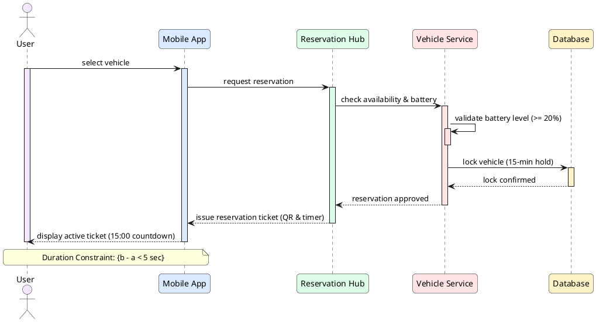

### Mã Mermaid Preview
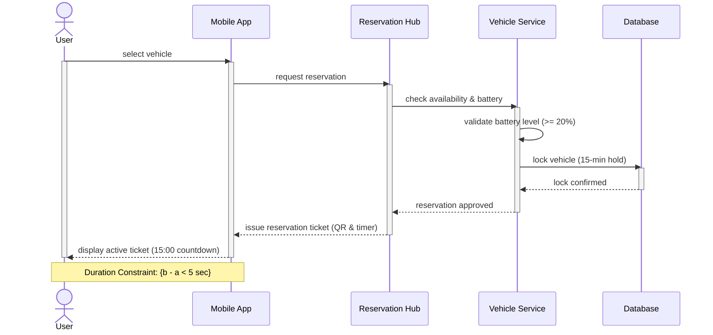

---

## SQ02: Pick Up Vehicle
- **Tương ứng Use Case:** `UC04 - Pick Up Vehicle`
- **File Draw.io SVG:** [`SQ02-Pick_Up_Vehicle.drawio.svg`](./SQ02-Pick_Up_Vehicle.drawio.svg)
- **File Ảnh PNG:** [`SQ02-Pick_Up_Vehicle.png`](./SQ02-Pick_Up_Vehicle.png)
- **Ràng buộc thời gian:** `{a}` tại lúc quét mã QR, `{b}` tại lúc bắt đầu chuyến đi; `{b - a < 8 sec}`.

### Mã PlantUML
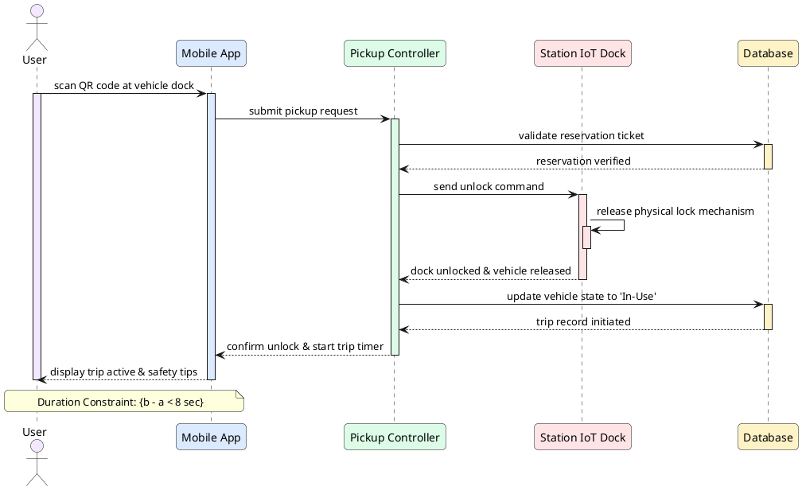

### Mã Mermaid Preview
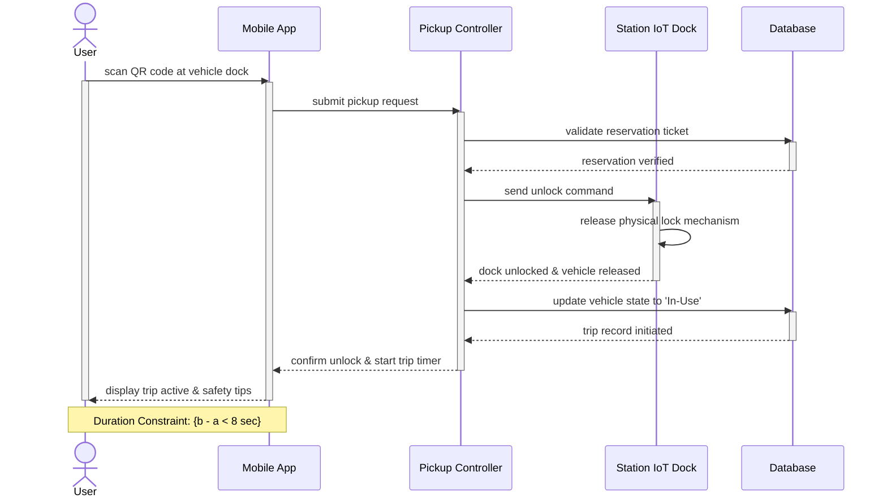

---

## SQ03: Return Vehicle
- **Tương ứng Use Case:** `UC05 - Return Vehicle`
- **File Draw.io SVG:** [`SQ03-Return_Vehicle.drawio.svg`](./SQ03-Return_Vehicle.drawio.svg)
- **File Ảnh PNG:** [`SQ03-Return_Vehicle.png`](./SQ03-Return_Vehicle.png)
- **Ràng buộc thời gian:** `{a}` tại lúc cắm xe vào dock, `{b}` tại lúc nhận hóa đơn thanh toán; `{b - a < 6 sec}`.

### Mã PlantUML
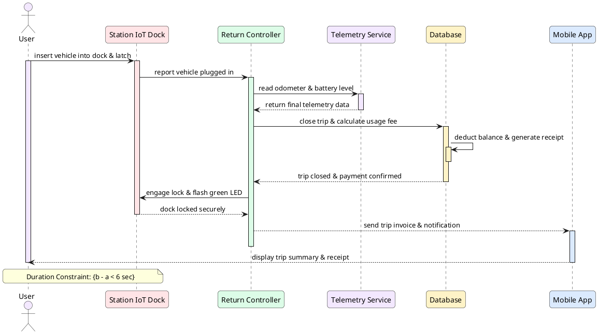

### Mã Mermaid Preview
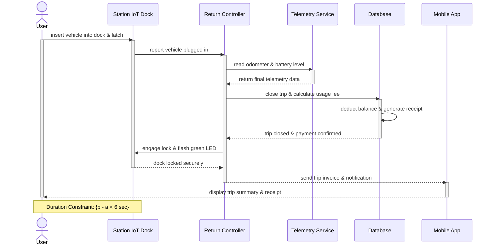

---

## SQ04: Request Charging
- **Tương ứng Use Case:** `UC07 - Request Charging`
- **File Draw.io SVG:** [`SQ04-Request_Charging.drawio.svg`](./SQ04-Request_Charging.drawio.svg)
- **File Ảnh PNG:** [`SQ04-Request_Charging.png`](./SQ04-Request_Charging.png)
- **Ràng buộc thời gian:** `{a}` tại lúc chọn gói sạc, `{b}` tại lúc dòng sạc bắt đầu cấp năng lượng; `{b - a < 7 sec}`.

### Mã PlantUML
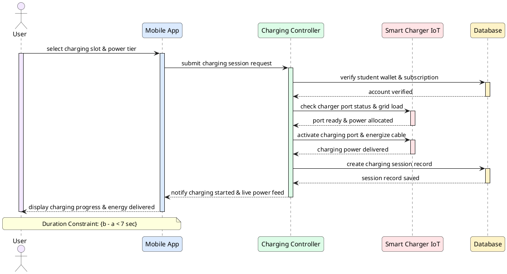

### Mã Mermaid Preview
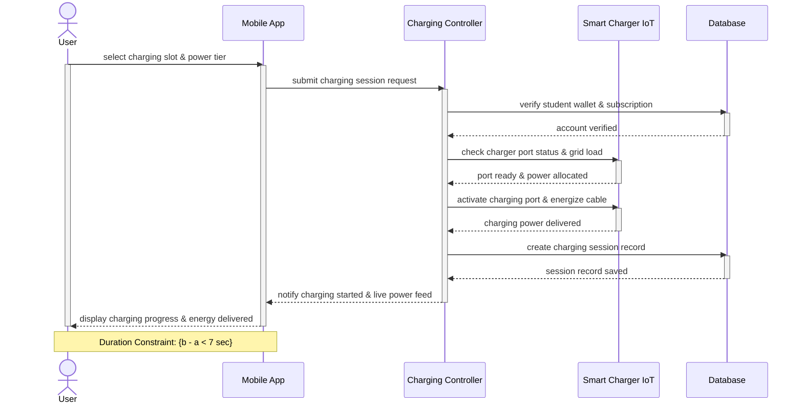

---

## SQ05: Redistribute Vehicles
- **Tương ứng Use Case:** `UC10 - Redistribute Vehicles`
- **File Draw.io SVG:** [`SQ05-Redistribute_Vehicles.drawio.svg`](./SQ05-Redistribute_Vehicles.drawio.svg)
- **File Ảnh PNG:** [`SQ05-Redistribute_Vehicles.png`](./SQ05-Redistribute_Vehicles.png)
- **Ràng buộc thời gian:** `{a}` tại lúc kích hoạt phân tích, `{b}` tại lúc nhiệm vụ hiển thị trên bản đồ; `{b - a < 10 sec}`.

### Mã PlantUML
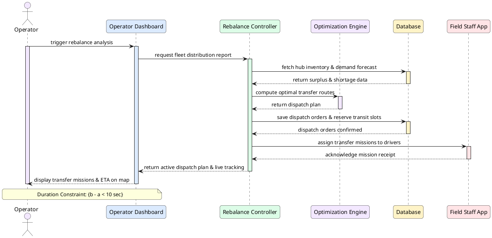

### Mã Mermaid Preview
```mermaid
sequenceDiagram
    actor Op as Operator
    participant Dash as Operator Dashboard
    participant Ctrl as Rebalance Controller
    participant Opt as Optimization Engine
    participant DB as Database
    participant Staff as Field Staff App

    Op->>Dash: trigger rebalance analysis
    activate Op
    activate Dash
    Dash->>Ctrl: request fleet distribution report
    activate Ctrl
    Ctrl->>DB: fetch hub inventory & demand forecast
    activate DB
    DB-->>Ctrl: return surplus & shortage data
    deactivate DB
    Ctrl->>Opt: compute optimal transfer routes
    activate Opt
    Opt-->>Ctrl: return dispatch plan
    deactivate Opt
    Ctrl->>DB: save dispatch orders & reserve transit slots
    activate DB
    DB-->>Ctrl: dispatch orders confirmed
    deactivate DB
    Ctrl->>Staff: assign transfer missions to drivers
    activate Staff
    Staff-->>Ctrl: acknowledge mission receipt
    deactivate Staff
    Ctrl-->>Dash: return active dispatch plan & live tracking
    deactivate Ctrl
    Dash-->>Op: display transfer missions & ETA on map
    deactivate Dash
    deactivate Op
    Note over Op,Dash: Duration Constraint: {b - a < 10 sec}
```

---

## SQ06: Handle Operational Incident
- **Tương ứng Use Case:** `UC11 - Handle Operational Incident`
- **File Draw.io SVG:** [`SQ06-Handle_Operational_Incident.drawio.svg`](./SQ06-Handle_Operational_Incident.drawio.svg)
- **File Ảnh PNG:** [`SQ06-Handle_Operational_Incident.png`](./SQ06-Handle_Operational_Incident.png)
- **Ràng buộc thời gian:** `{a}` tại lúc báo cáo sự cố, `{b}` tại lúc nhận mã ticket bảo trì; `{b - a < 5 sec}`.

### Mã PlantUML
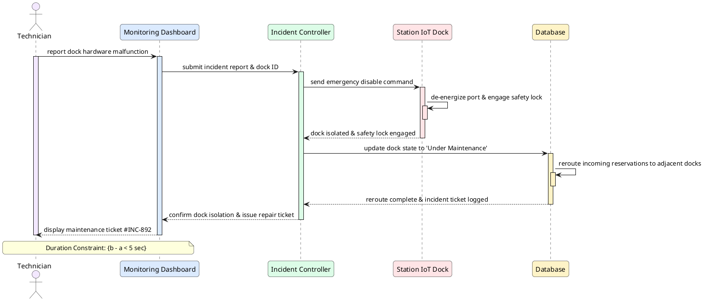

### Mã Mermaid Preview
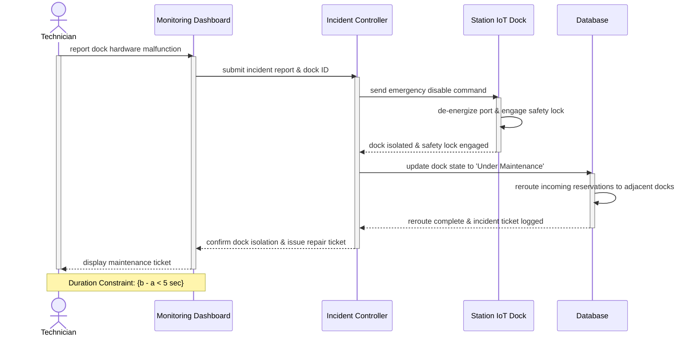

---

## SQ07: Run What-if Simulation
- **Tương ứng Use Case:** `UC13 - Run What-if Simulation & UC14 - View Results`
- **File Draw.io SVG:** [`SQ07-Run_What_if_Simulation.drawio.svg`](./SQ07-Run_What_if_Simulation.drawio.svg)
- **File Ảnh PNG:** [`SQ07-Run_What_if_Simulation.png`](./SQ07-Run_What_if_Simulation.png)
- **Ràng buộc thời gian:** `{a}` tại lúc nhấn chạy mô phỏng, `{b}` tại lúc bản đồ nhiệt và khuyến nghị xuất hiện; `{b - a < 15 sec}`.

### Mã PlantUML
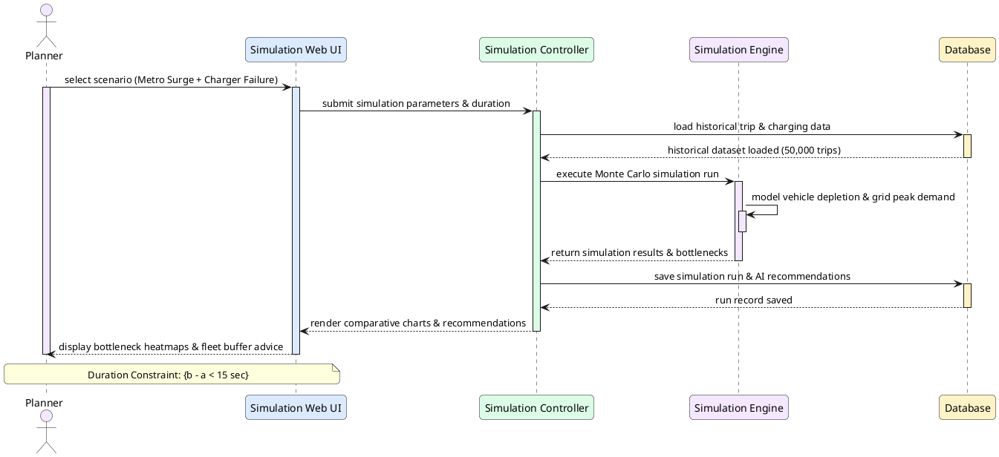

### Mã Mermaid Preview
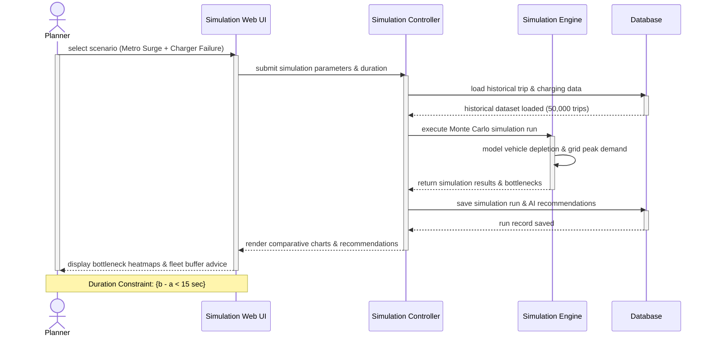
