# TỔNG HỢP MÃ NGUỒN PLANTUML & MERMAID SƠ ĐỒ TUẦN TỰ (SEQUENCE DIAGRAM)
> **Chuẩn mực bài giảng (Supreme Law):** Môn **Software Engineering (CO3001) - ĐHQG-HCM** & **Ian Sommerville (10th Ed) Ch6 p.21-26, 40, 50**.
> Định dạng chuẩn: Actor stickman, Lifelines (`:ClassName`, `name:ClassName`, `<<datastore>>`), đánh số thứ tự phân cấp (`1:`, `1.1:`, `1.2:`), Guard condition `[guard]`, Request (`->`), Response (`-->`), Self-call (`Validate()`) và khung `alt`.

---

## MỤC LỤC
1. [SQ01: Đặt giữ phương tiện (Reserve Vehicle - UC03)](#sq01-reserve-vehicle)
2. [SQ02: Nhận phương tiện tại trạm (Pick Up Vehicle - UC04)](#sq02-pick-up-vehicle)
3. [SQ03: Trả phương tiện tại trạm (Return Vehicle - UC05)](#sq03-return-vehicle)
4. [SQ04: Đăng ký & Kích hoạt sạc xe (Request Charging - UC07)](#sq04-request-charging)
5. [SQ05: Điều phối xe giữa các trạm (Redistribute Vehicles - UC10)](#sq05-redistribute-vehicles)
6. [SQ06: Xử lý sự cố vận hành trạm (Handle Operational Incident - UC11)](#sq06-handle-operational-incident)
7. [SQ07: Chạy mô phỏng kịch bản giả định What-if (Run What-if Simulation - UC13 & UC14)](#sq07-run-what-if-simulation)

---

## SQ01: Reserve Vehicle
- **Tương ứng Use Case:** `UC03 - Reserve Vehicle`
- **File Draw.io:** `01_Diagram/02_Sequence_Diagram/SQ01-Reserve_Vehicle.drawio.svg`

### Mã PlantUML
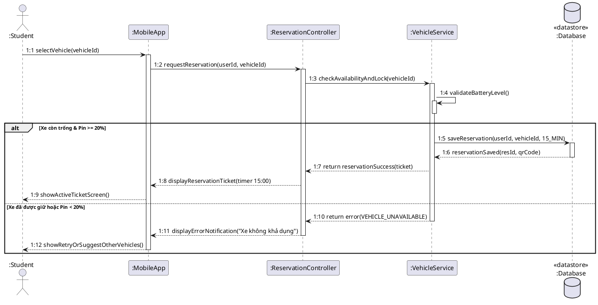

### Mã Mermaid Preview
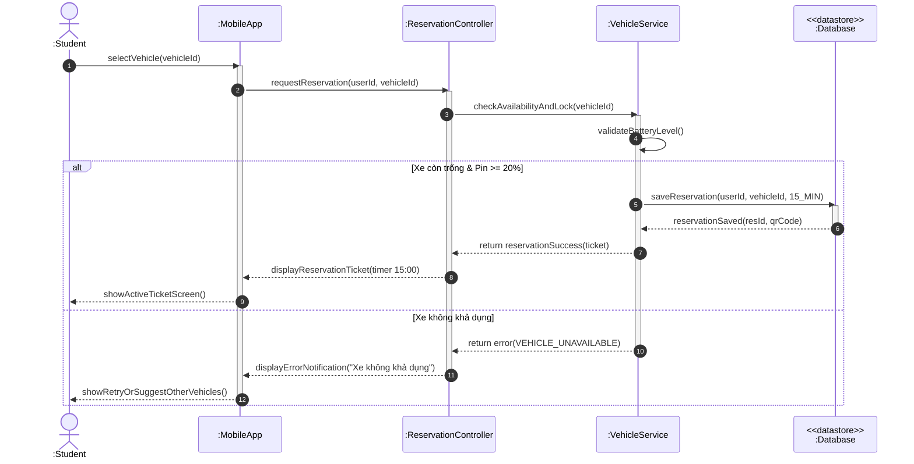

---

## SQ02: Pick Up Vehicle
- **Tương ứng Use Case:** `UC04 - Pick Up Vehicle`
- **File Draw.io:** `01_Diagram/02_Sequence_Diagram/SQ02-Pick_Up_Vehicle.drawio.svg`

### Mã PlantUML
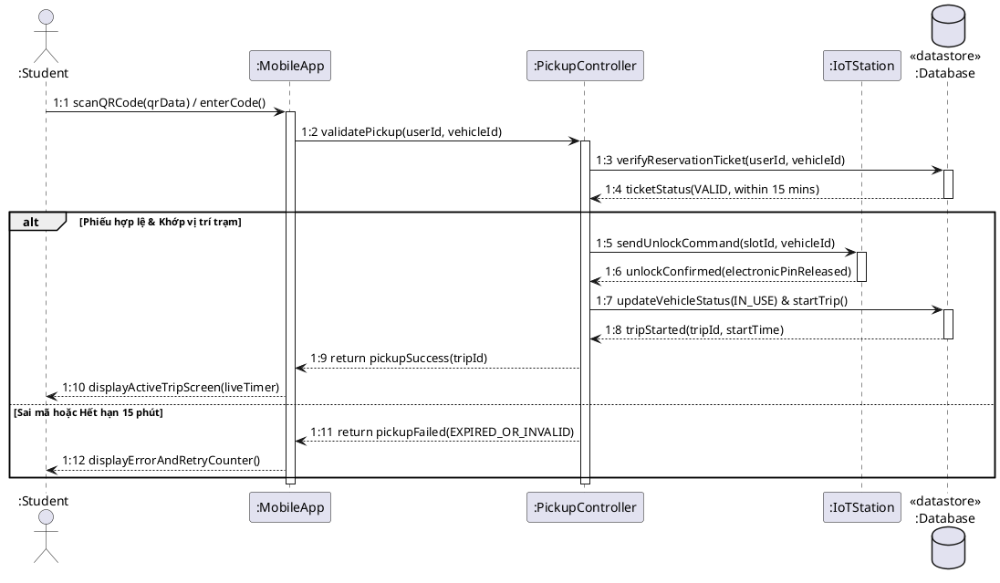

### Mã Mermaid Preview
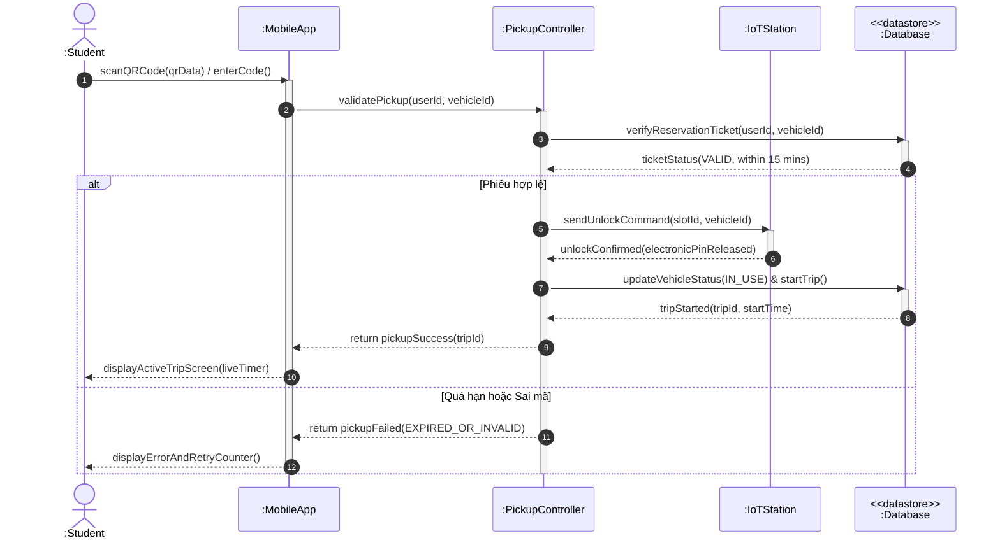

---

## SQ03: Return Vehicle
- **Tương ứng Use Case:** `UC05 - Return Vehicle`
- **File Draw.io:** `01_Diagram/02_Sequence_Diagram/SQ03-Return_Vehicle.drawio.svg`

### Mã PlantUML
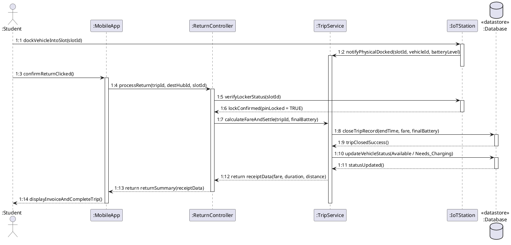

### Mã Mermaid Preview
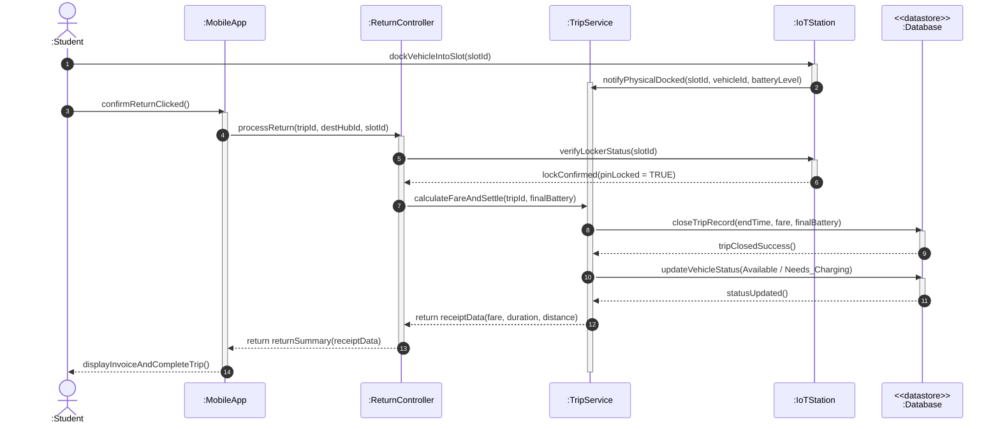

---

## SQ04: Request Charging
- **Tương ứng Use Case:** `UC07 - Request Charging`
- **File Draw.io:** `01_Diagram/02_Sequence_Diagram/SQ04-Request_Charging.drawio.svg`

### Mã PlantUML
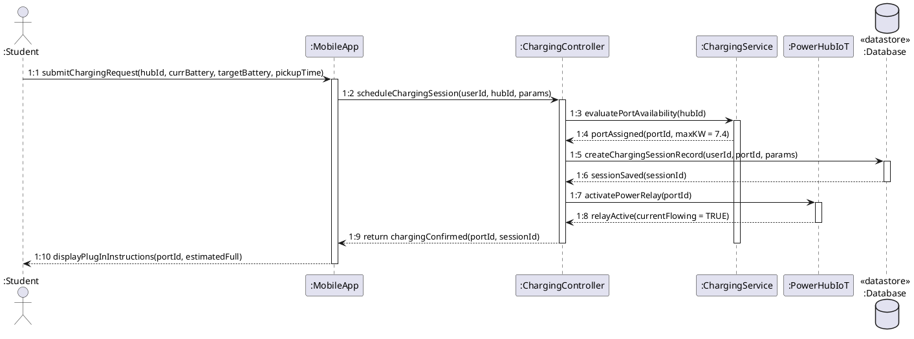

### Mã Mermaid Preview
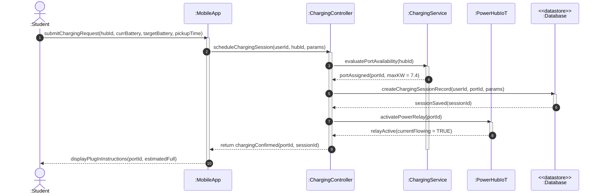

---

## SQ05: Redistribute Vehicles
- **Tương ứng Use Case:** `UC10 - Redistribute Vehicles`
- **File Draw.io:** `01_Diagram/02_Sequence_Diagram/SQ05-Redistribute_Vehicles.drawio.svg`

### Mã PlantUML
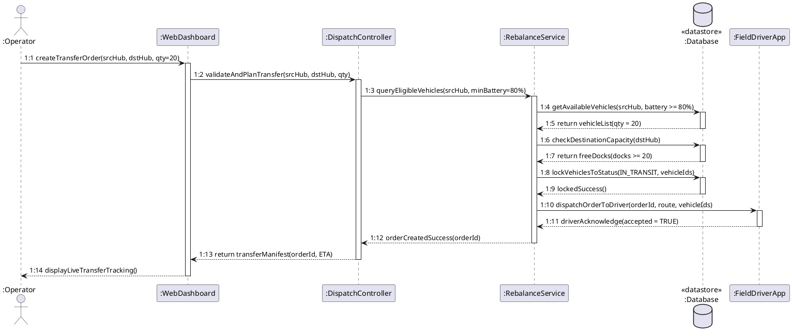

### Mã Mermaid Preview
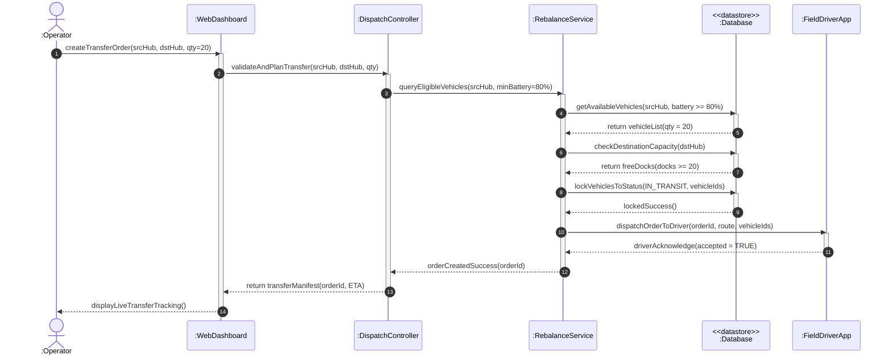

---

## SQ06: Handle Operational Incident
- **Tương ứng Use Case:** `UC11 - Handle Operational Incident`
- **File Draw.io:** `01_Diagram/02_Sequence_Diagram/SQ06-Handle_Operational_Incident.drawio.svg`

### Mã PlantUML
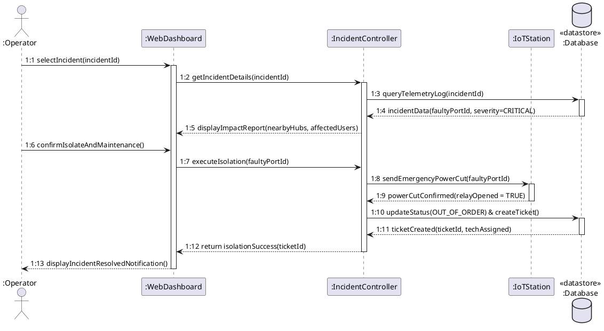

### Mã Mermaid Preview
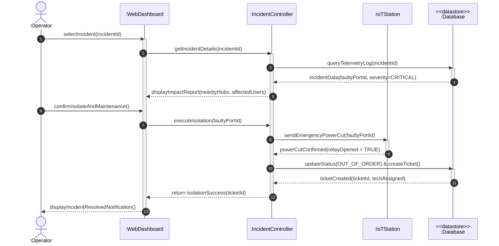

---

## SQ07: Run What-if Simulation
- **Tương ứng Use Case:** `UC13 - Run What-if Simulation` & `UC14 - View Simulation Results`
- **File Draw.io:** `01_Diagram/02_Sequence_Diagram/SQ07-Run_What_if_Simulation.drawio.svg`

### Mã PlantUML
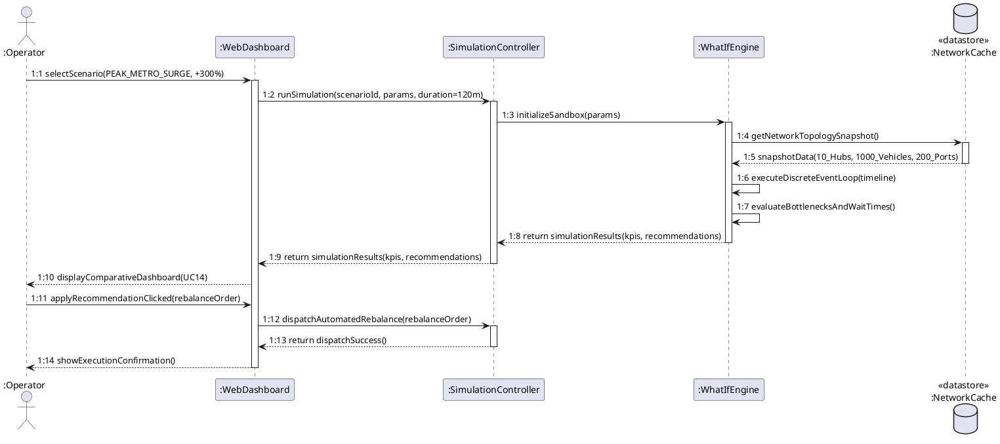

### Mã Mermaid Preview
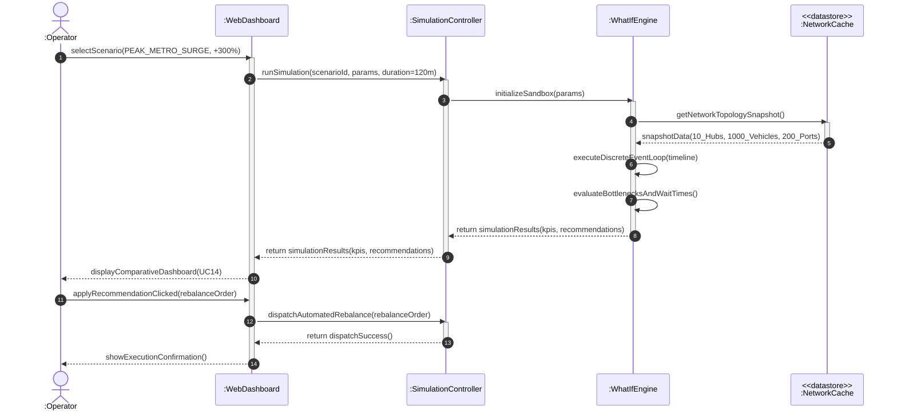
