# TỔNG HỢP MÃ NGUỒN PLANTUML & MERMAID SƠ ĐỒ HOẠT ĐỘNG (ACTIVITY DIAGRAM)
> **Chuẩn mực bài giảng (Supreme Law):** Môn **Software Engineering (CO3001) - ĐHQG-HCM** & **Ian Sommerville (10th Ed) Ch6 p.12-13, 39, 51, 52**.
> Định dạng chuẩn: Phân làn trách nhiệm (**Swimming lane / Swimlanes** - Slide 52), Luồng đối tượng (**Object Flow** `:Object [state]` nét đứt - Slide 51), Nút Decision (`◇`) có Guard Condition trong ngoặc vuông `[...]` loại trừ lẫn nhau, và Thanh đồng bộ song song (**Fork & Join**).

---

## MỤC LỤC
1. [AD01: Quy trình đặt giữ xe (Reserve Vehicle Workflow)](#ad01-reserve-vehicle-workflow)
2. [AD02: Quy trình nhận xe tại bãi (Pick Up Vehicle Workflow)](#ad02-pick-up-vehicle-workflow)
3. [AD03: Quy trình trả xe vào chốt khóa (Return Vehicle Workflow)](#ad03-return-vehicle-workflow)
4. [AD04: Quy trình đặt chỗ đỗ & Sạc pin (Reserve Parking & Charging Workflow)](#ad04-reserve-parking-and-charging-workflow)
5. [AD05: Quy trình điều phối phương tiện liên trạm (Vehicle Redistribution Workflow)](#ad05-vehicle-redistribution-workflow)
6. [AD06: Quy trình xử lý & Cô lập sự cố vận hành (Handle Operational Incident Workflow)](#ad06-handle-operational-incident-workflow)
7. [AD07: Quy trình mô phỏng kịch bản giả định (What-if Simulation Workflow)](#ad07-what-if-simulation-workflow)

---

## AD01: Reserve Vehicle Workflow
- **Tương ứng Use Case:** `UC03 - Reserve Vehicle`
- **File Draw.io:** `01_Diagram/03_Activity_Diagram/AD01-Reserve_Vehicle.drawio.svg`

### Mã PlantUML (Có Phân làn Swimlanes & Object Flow)
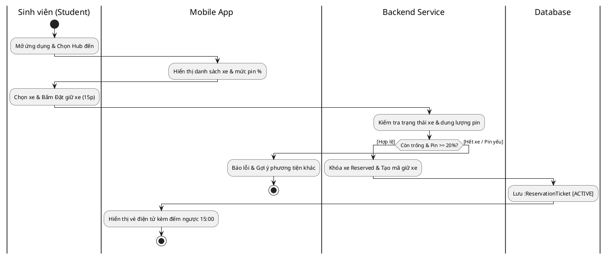

### Mã Mermaid Preview
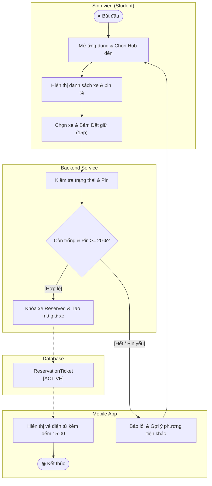

---

## AD02: Pick Up Vehicle Workflow
- **Tương ứng Use Case:** `UC04 - Pick Up Vehicle`
- **File Draw.io:** `01_Diagram/03_Activity_Diagram/AD02-Pick_Up_Vehicle.drawio.svg`

### Mã PlantUML (Có Fork/Join Song song & Swimlanes)
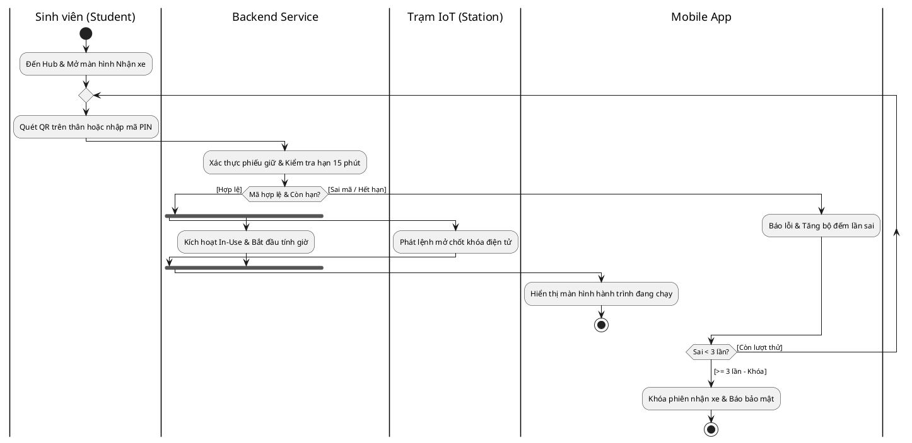

### Mã Mermaid Preview
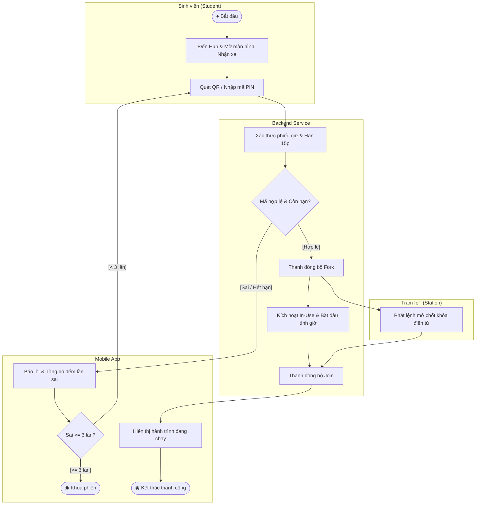

---

## AD03: Return Vehicle Workflow
- **Tương ứng Use Case:** `UC05 - Return Vehicle`
- **File Draw.io:** `01_Diagram/03_Activity_Diagram/AD03-Return_Vehicle.drawio.svg`

### Mã PlantUML (Object Flow :TripInvoice & Swimlanes)
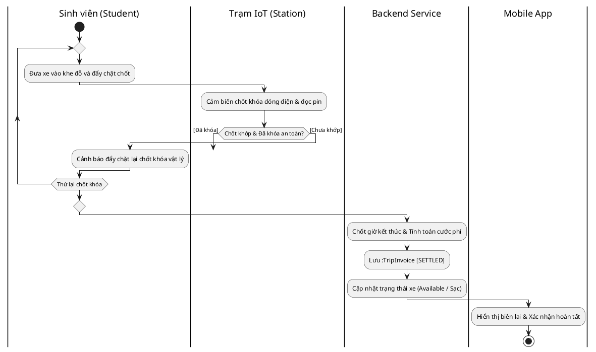

### Mã Mermaid Preview
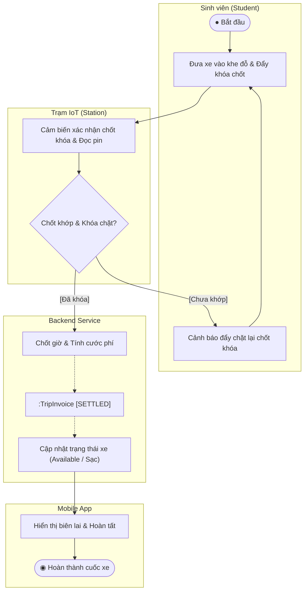

---

## AD04: Reserve Parking and Charging Workflow
- **Tương ứng Use Case:** `UC06 - Reserve Parking Space` & `UC07 - Request Charging`
- **File Draw.io:** `01_Diagram/03_Activity_Diagram/AD04-Reserve_Parking_and_Charging.drawio.svg`

### Mã PlantUML
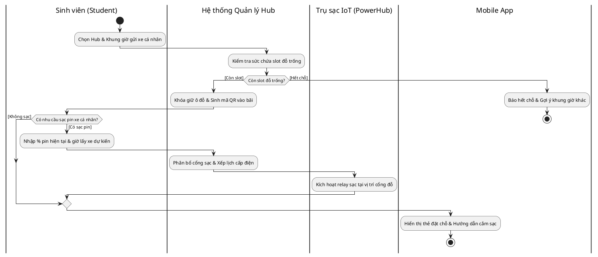

### Mã Mermaid Preview
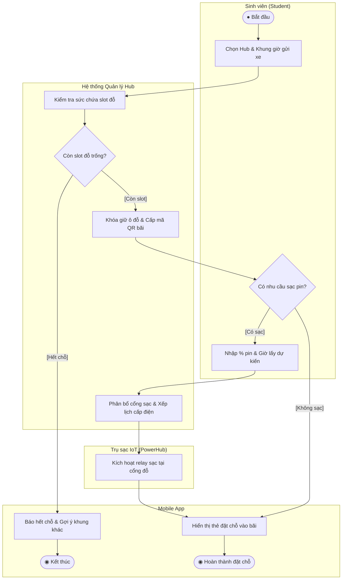

---

## AD05: Vehicle Redistribution Workflow
- **Tương ứng Use Case:** `UC10 - Redistribute Vehicles`
- **File Draw.io:** `01_Diagram/03_Activity_Diagram/AD05-Redistribute_Vehicles.drawio.svg`

### Mã PlantUML
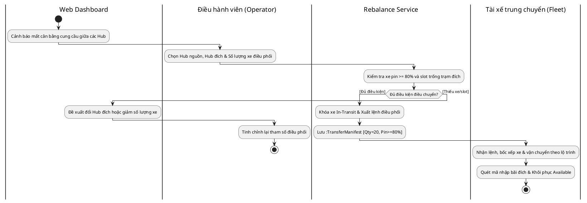

### Mã Mermaid Preview
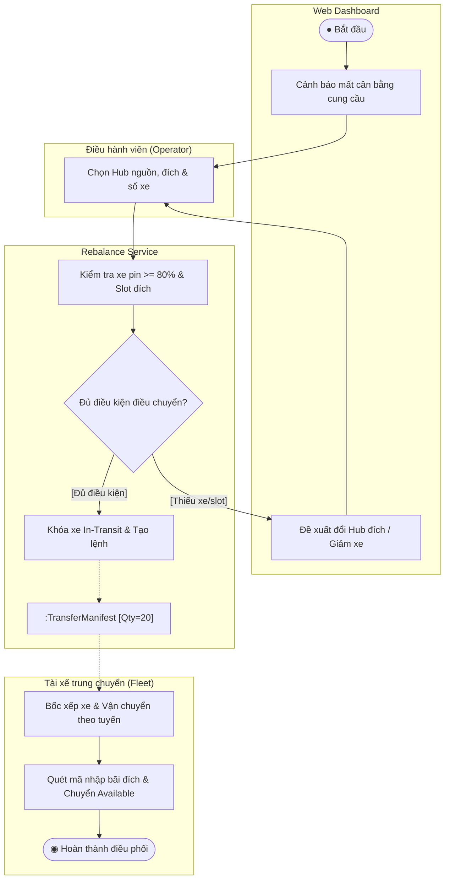

---

## AD06: Handle Operational Incident Workflow
- **Tương ứng Use Case:** `UC11 - Handle Operational Incident`
- **File Draw.io:** `01_Diagram/03_Activity_Diagram/AD06-Handle_Operational_Incident.drawio.svg`

### Mã PlantUML
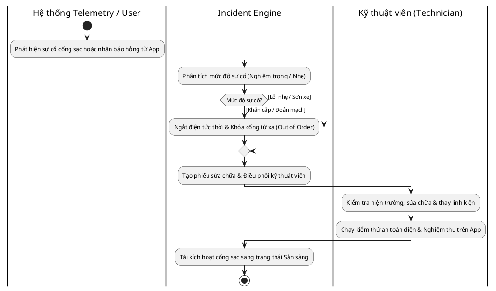

### Mã Mermaid Preview
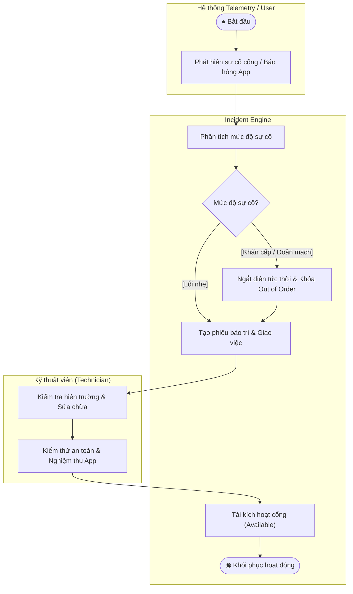

---

## AD07: What-if Simulation Workflow
- **Tương ứng Use Case:** `UC13 - Run What-if Simulation` & `UC14 - View Simulation Results`
- **File Draw.io:** `01_Diagram/03_Activity_Diagram/AD07-Run_What_if_Simulation.drawio.svg`

### Mã PlantUML
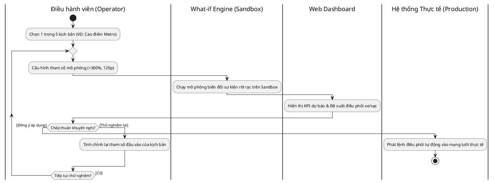

### Mã Mermaid Preview
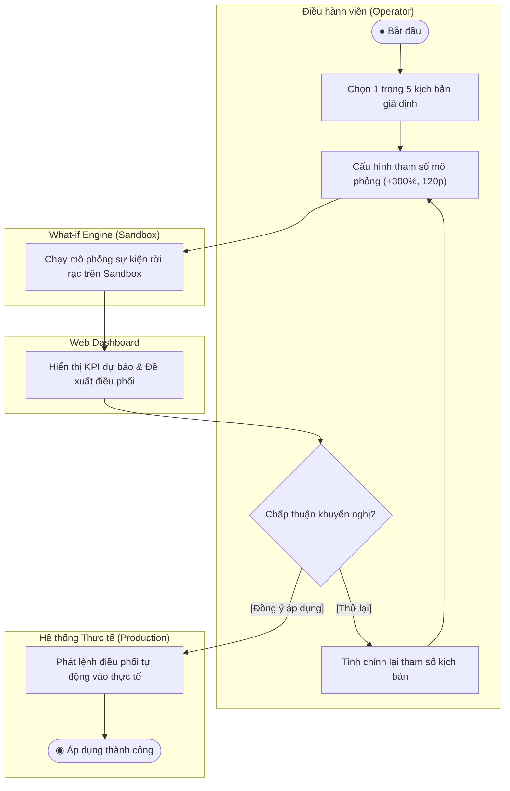
