# Activity — PlantUML & Mermaid

Nguồn: `PROJECT_SPECIFICATION.md` §3, `LIFECYCLE_SCENARIOS.md`; slide CO3001 Ch6.
Dữ liệu gốc: `.agent/scripts/generate_process_diagrams.py`. SVG và PNG được render bằng Draw.io thật.

PlantUML/Mermaid là bản xem mã; Draw.io là bản ký hiệu chi tiết. PlantUML dùng stereotype `<<object>>` cho nút dữ liệu; Mermaid mô phỏng thanh fork/join bằng ô đen. Không dùng hai bản preview để kiểm tra hình học UML.

## AD01 — Reserve Vehicle

[Draw.io](AD01-Reserve_Vehicle.drawio) · [SVG editable](AD01-Reserve_Vehicle.drawio.svg) · [PNG](AD01-Reserve_Vehicle.png)

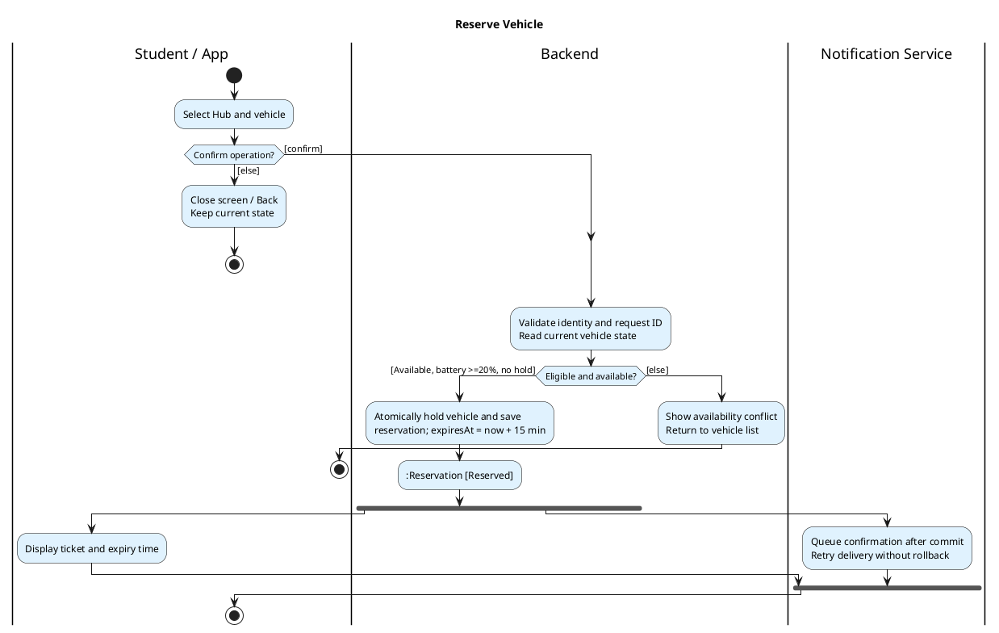

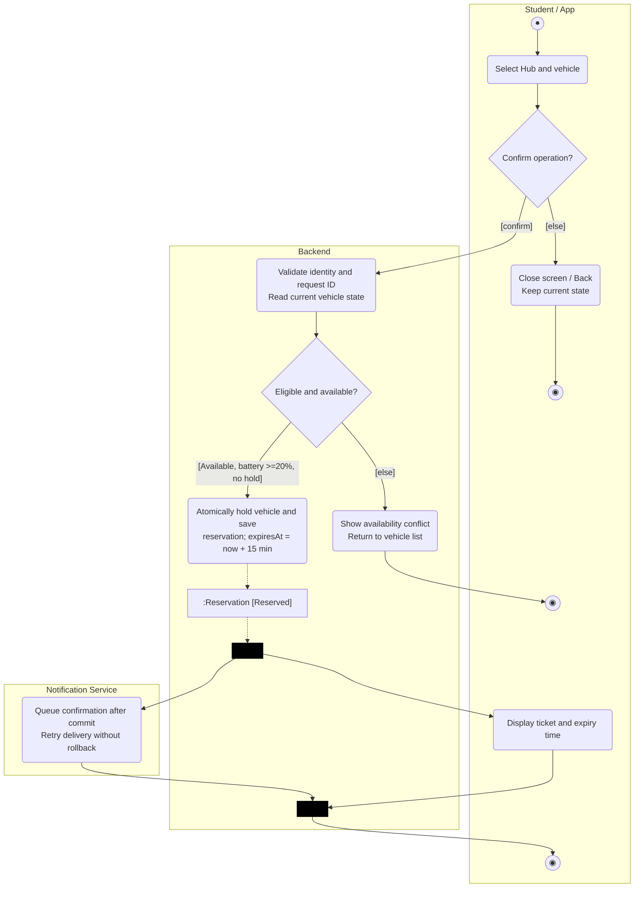

## AD02 — Pick Up Vehicle

[Draw.io](AD02-Pick_Up_Vehicle.drawio) · [SVG editable](AD02-Pick_Up_Vehicle.drawio.svg) · [PNG](AD02-Pick_Up_Vehicle.png)

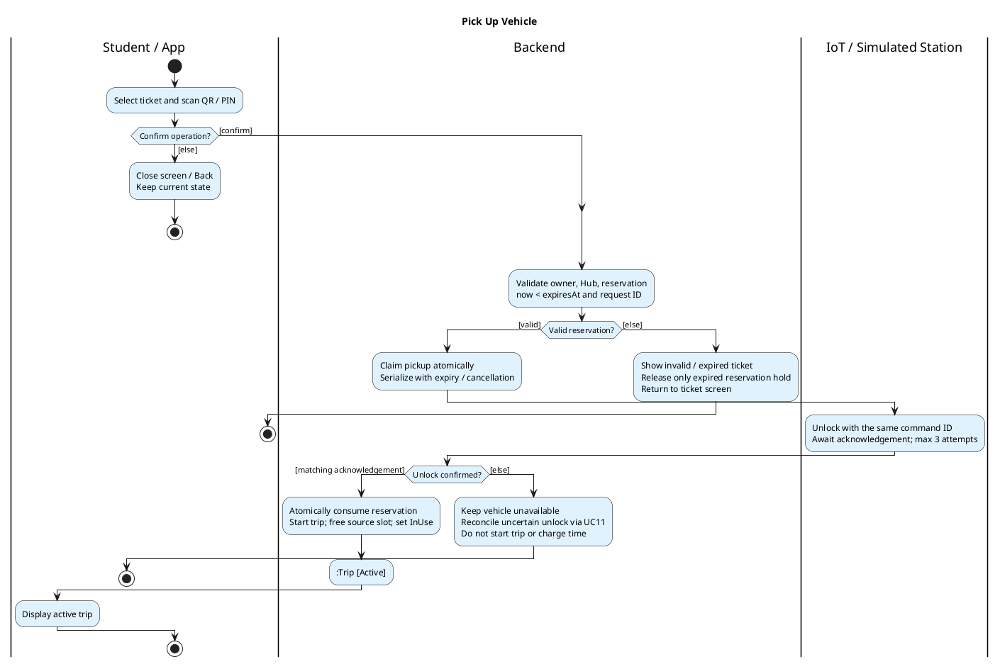

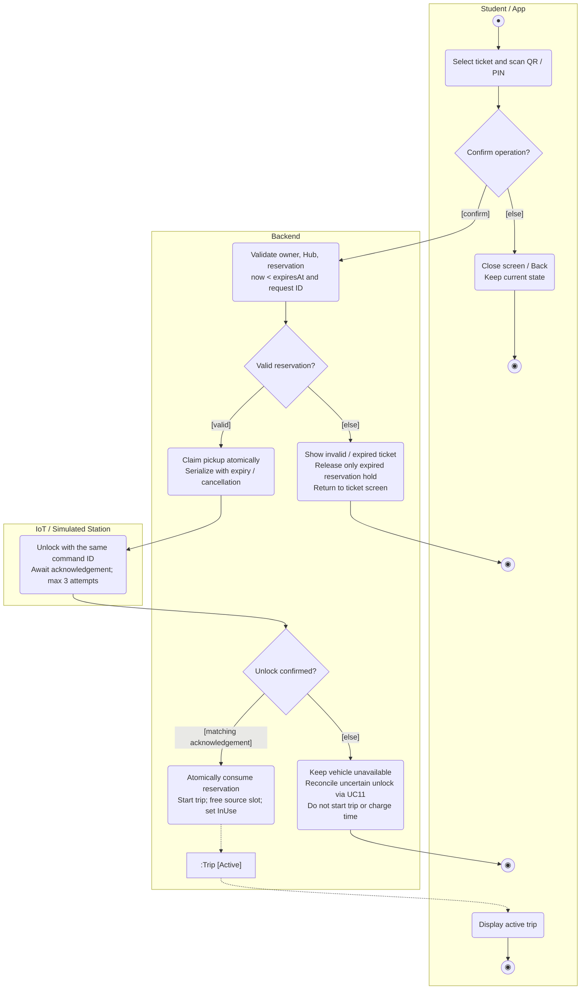

## AD03 — Return Vehicle

[Draw.io](AD03-Return_Vehicle.drawio) · [SVG editable](AD03-Return_Vehicle.drawio.svg) · [PNG](AD03-Return_Vehicle.png)

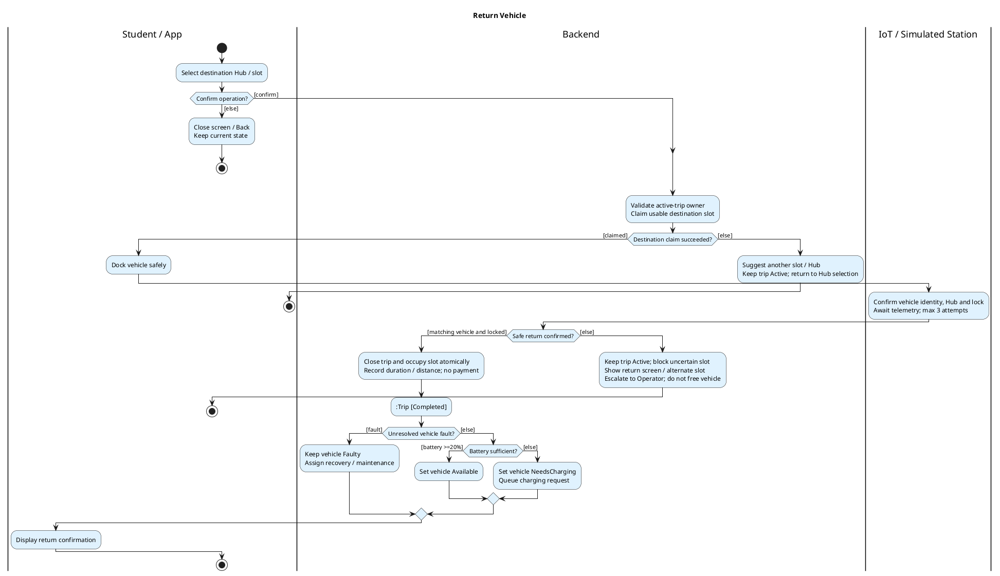

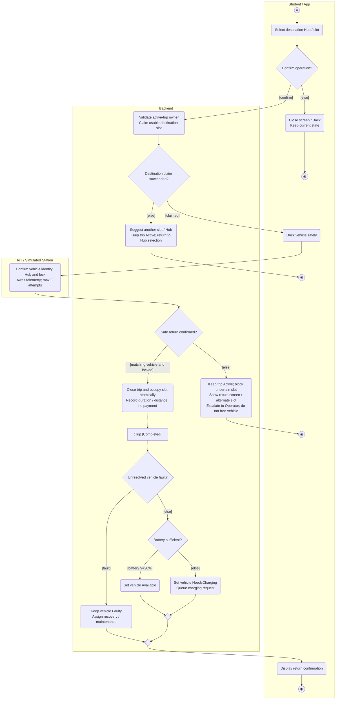

## AD04 — Private Parking and Charging

[Draw.io](AD04-Reserve_Parking_and_Charging.drawio) · [SVG editable](AD04-Reserve_Parking_and_Charging.drawio.svg) · [PNG](AD04-Reserve_Parking_and_Charging.png)

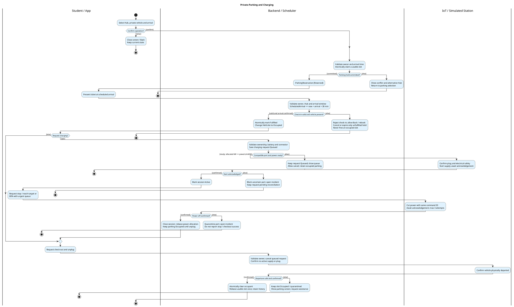

```mermaid
flowchart TD
  subgraph lane0["Student / App"]
    n0(("●"))
    n1("Select Hub, private vehicle and arrival")
    n2{"Confirm operation?"}
    n3("Close screen / Back<br/>Keep current state")
    n4(("◉"))
    n8("Present ticket at scheduled arrival")
    n12{"Request charging?"}
    n18("Request stop / reach target or<br/>80% with urgent queue")
    n23(("◉"))
    n25(("◉"))
    n27(("◉"))
    n28{" "}
    n29("Request check-out and unplug")
    n35(("◉"))
    n37(("◉"))
    n39(("◉"))
    n40(("◉"))
  end
  subgraph lane1["Backend / Scheduler"]
    n5("Validate owner and arrival time<br/>Atomically claim a usable slot")
    n6{"Parking hold committed?"}
    n7[":ParkingReservation [Reserved]"]
    n9("Validate owner, Hub and arrival window<br/>ScheduledArrival <= now < arrival + 30 min")
    n10{"Check-in valid and vehicle present?"}
    n11("Atomically mark Fulfilled<br/>Change Held slot to Occupied")
    n13("Validate ownership, battery and connector<br/>Save charging request Queued")
    n14{"Compatible port and power ready?"}
    n16{"Start acknowledged?"}
    n17("Mark session Active")
    n20{"Power off confirmed?"}
    n21("Close session; release power allocation<br/>Keep parking Occupied until unplug")
    n22("Quarantine port; open incident<br/>Do not report stop / checkout success")
    n24("Block uncertain port; open incident<br/>Keep request pending reconciliation")
    n26("Keep request Queued; show queue<br/>Allow cancel; retain occupied parking")
    n30("Validate owner; cancel queued request<br/>Confirm no active supply or plug")
    n32{"Departure safe and confirmed?"}
    n33("Atomically clear occupant<br/>Release usable slot once; retain history")
    n34("Keep slot Occupied / quarantined<br/>Show parking screen; request assistance")
    n36("Reject check-in; allow Back / rebook<br/>Cancel or expire only unfulfilled hold<br/>Never free an occupied slot")
    n38("Show conflict and alternative Hub<br/>Return to parking selection")
  end
  subgraph lane2["IoT / Simulated Station"]
    n15("Confirm plug and electrical safety<br/>Start supply; await acknowledgement")
    n19("Cut power with same command ID<br/>Await acknowledgement; max 3 attempts")
    n31("Confirm vehicle physically departed")
  end
  n0 --> n1
  n1 --> n2
  n2 --> |"[else]"| n3
  n3 --> n4
  n2 --> |"[confirm]"| n5
  n5 --> n6
  n6 -.-> |"[committed]"| n7
  n7 -.-> n8
  n8 --> n9
  n9 --> n10
  n10 --> |"[valid and arrival confirmed]"| n11
  n11 --> n12
  n12 --> |"[yes]"| n13
  n13 --> n14
  n14 --> |"[ready; allocated kW <= powerLimitKW]"| n15
  n15 --> n16
  n16 --> |"[confirmed]"| n17
  n17 --> n18
  n18 --> n19
  n19 --> n20
  n20 --> |"[confirmed]"| n21
  n20 --> |"[else]"| n22
  n22 --> n23
  n16 --> |"[else]"| n24
  n24 --> n25
  n14 --> |"[else]"| n26
  n26 --> n27
  n21 --> n28
  n12 --> |"[else]"| n28
  n28 --> n29
  n29 --> n30
  n30 --> n31
  n31 --> n32
  n32 --> |"[confirmed]"| n33
  n32 --> |"[else]"| n34
  n34 --> n35
  n10 --> |"[else]"| n36
  n36 --> n37
  n6 --> |"[else]"| n38
  n38 --> n39
  n33 --> n40
```

## AD05 — Redistribute Vehicles

[Draw.io](AD05-Redistribute_Vehicles.drawio) · [SVG editable](AD05-Redistribute_Vehicles.drawio.svg) · [PNG](AD05-Redistribute_Vehicles.png)

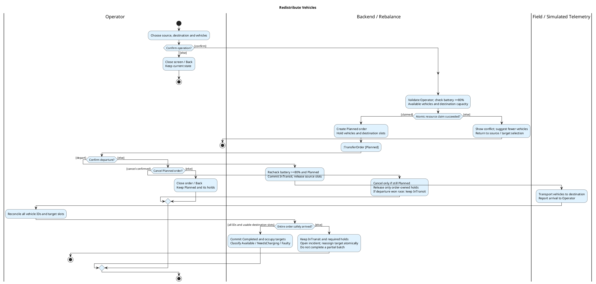

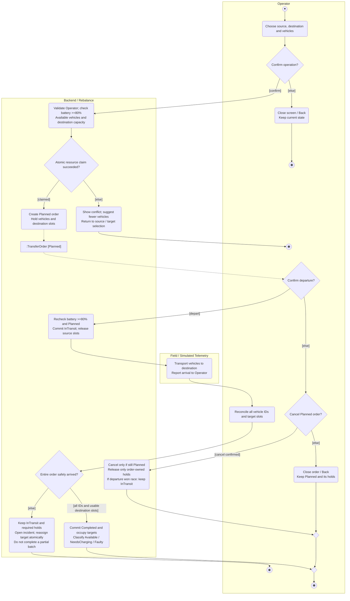

## AD06 — Handle Operational Incident

[Draw.io](AD06-Handle_Operational_Incident.drawio) · [SVG editable](AD06-Handle_Operational_Incident.drawio.svg) · [PNG](AD06-Handle_Operational_Incident.png)

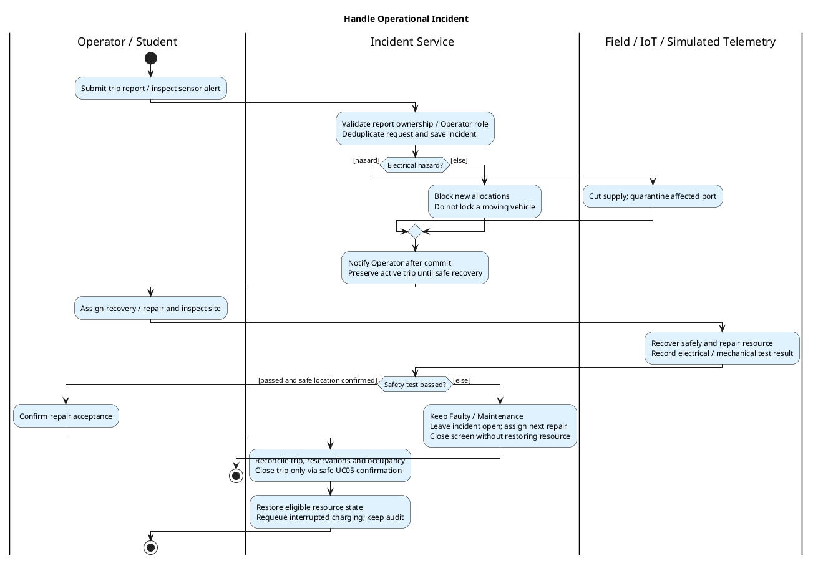

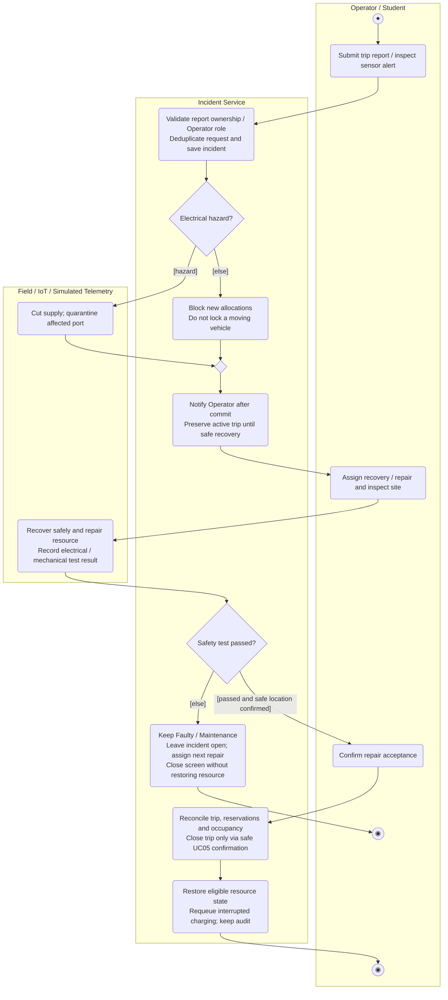

## AD07 — Run What-if Simulation

[Draw.io](AD07-Run_What_if_Simulation.drawio) · [SVG editable](AD07-Run_What_if_Simulation.drawio.svg) · [PNG](AD07-Run_What_if_Simulation.png)

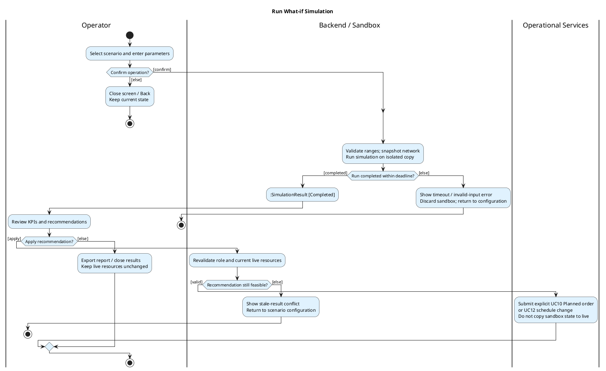

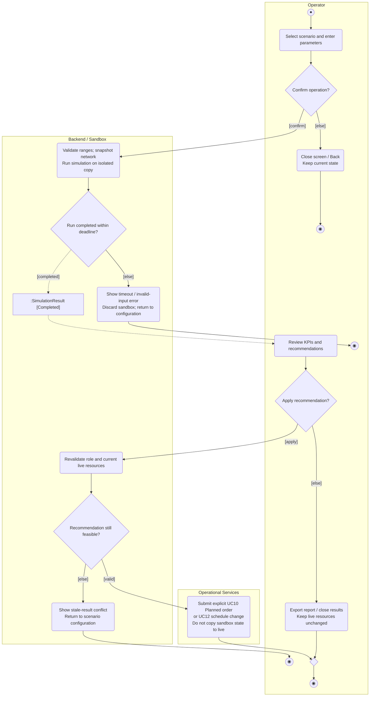
