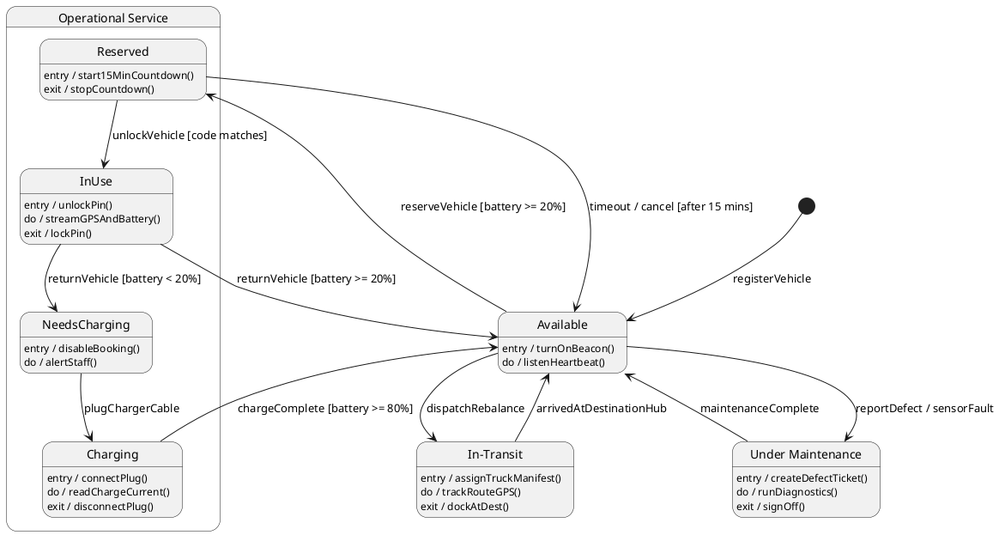
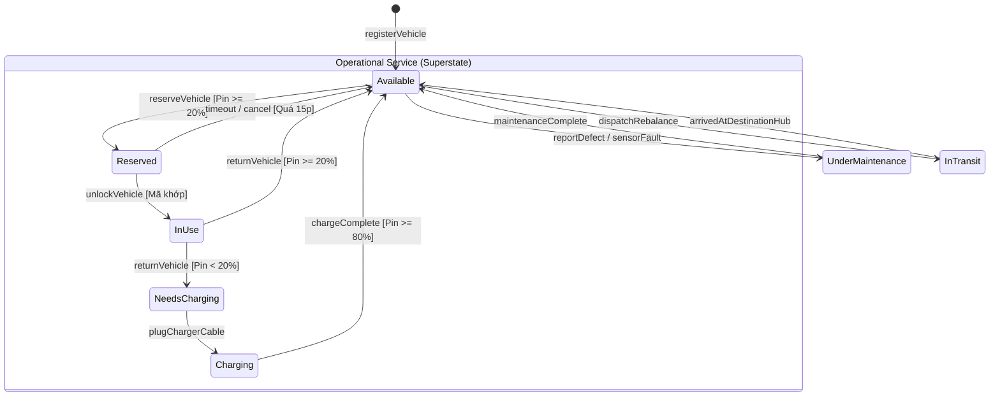
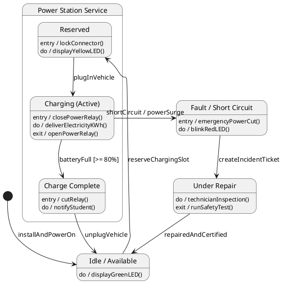
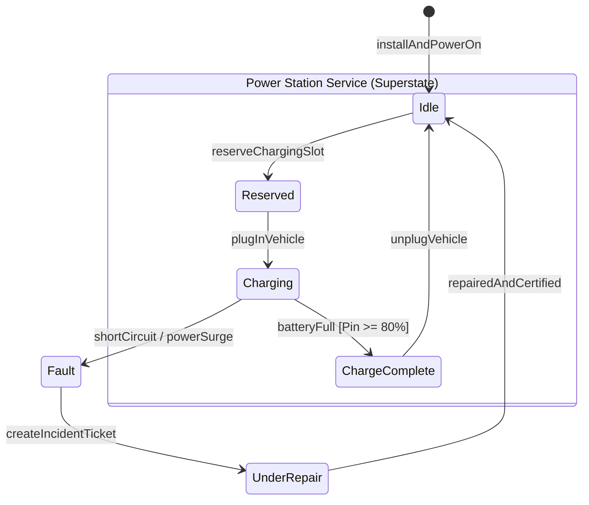
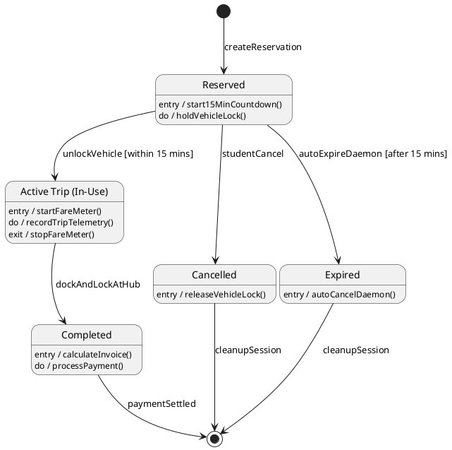
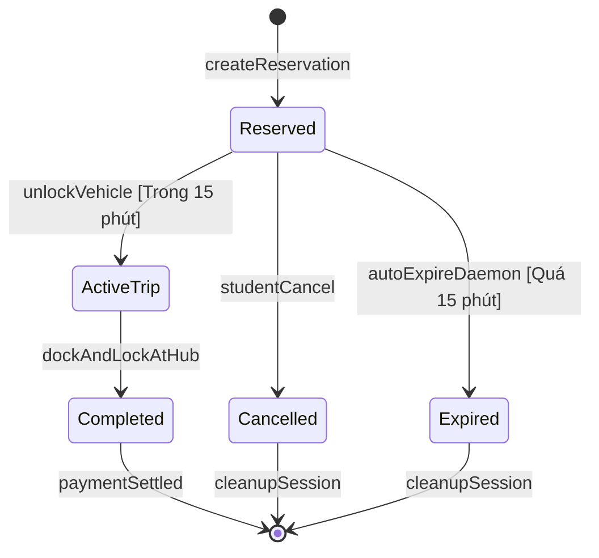

# TỔNG HỢP MÃ NGUỒN PLANTUML & MERMAID SƠ ĐỒ TRẠNG THÁI (STATE-CHART DIAGRAM)
> **Chuẩn mực bài giảng (Supreme Law):** Môn **Software Engineering (CO3001) - ĐHQG-HCM** & **Ian Sommerville (10th Ed) Ch6 p.41-45 (Microwave Oven State Machine)**.
> Định dạng chuẩn: Khối trạng thái 2 ngăn (Tên trạng thái; Hành động nội bộ `entry /`, `do:`, `exit /`), Khung trạng thái phức hợp (**Superstate / Composite State** - Slide 43), Nhãn chuyển trạng thái chuẩn UML `event [guard] / action`.

---

## MỤC LỤC
1. [SC01: Vòng đời Phương tiện (Vehicle State Machine)](#sc01-vehicle-state-machine)
2. [SC02: Vòng đời Trụ sạc pin (Charging Point State Machine)](#sc02-charging-point-state-machine)
3. [SC03: Vòng đời Đặt giữ chỗ & Cuốc xe (Reservation & Trip State Machine)](#sc03-reservation--trip-state-machine)

---

## SC01: Vehicle State Machine
- **Ý nghĩa nghiệp vụ:** Quản lý toàn diện các trạng thái hoạt động của xe (E-Scooter / E-Bike) trong mạng lưới trạm Hub.
- **Cấu trúc Slide Ch6 p.43:** Áp dụng **Superstate `Operational Service`** bao bọc các trạng thái vận hành con (`Available`, `Reserved`, `In-Use`, `Needs Charging`, `Charging`).
- **File Draw.io:** `01_Diagram/04_Statechart_Diagram/SC01-Vehicle_State_Machine.drawio.svg`

### Mã PlantUML (Có Superstate & 2 Ngăn Hành động Nội bộ)

### Mã Mermaid Preview

---

## SC02: Charging Point State Machine
- **Ý nghĩa nghiệp vụ:** Quản lý vòng đời hoạt động, an toàn điện và tiếp nhận sạc của từng cổng sạc thông minh tại Hub.
- **Cấu trúc Slide Ch6 p.43:** Áp dụng **Superstate `Power Station Service`** bao bọc các trạng thái cấp điện (`Idle`, `Reserved`, `Charging`, `Charge Complete`).
- **File Draw.io:** `01_Diagram/04_Statechart_Diagram/SC02-Charging_Point_State_Machine.drawio.svg`

### Mã PlantUML

### Mã Mermaid Preview

---

## SC03: Reservation & Trip State Machine
- **Ý nghĩa nghiệp vụ:** Quản lý vòng đời logic của một phiên giao dịch từ khi tạo đặt giữ cho đến khi trả xe và thanh toán hoàn tất.
- **File Draw.io:** `01_Diagram/04_Statechart_Diagram/SC03-Reservation_and_Trip_State_Machine.drawio.svg`

### Mã PlantUML

### Mã Mermaid Preview

