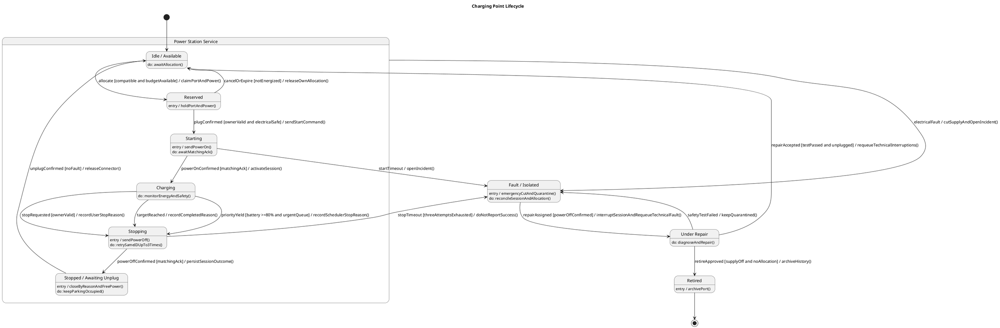
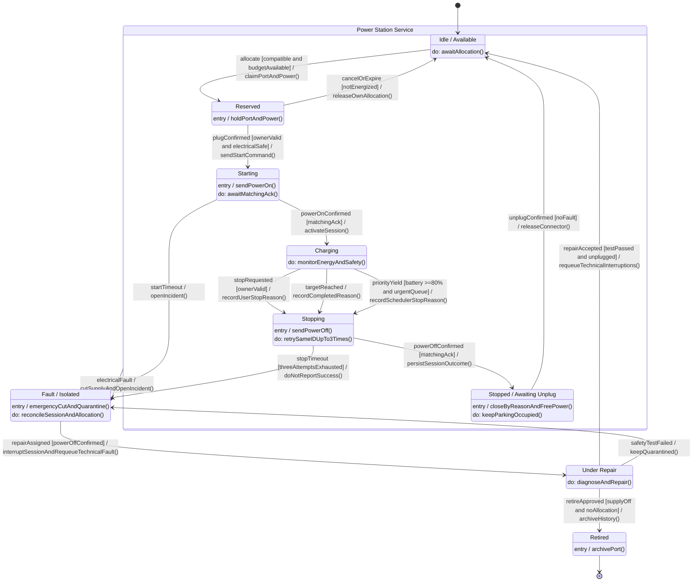
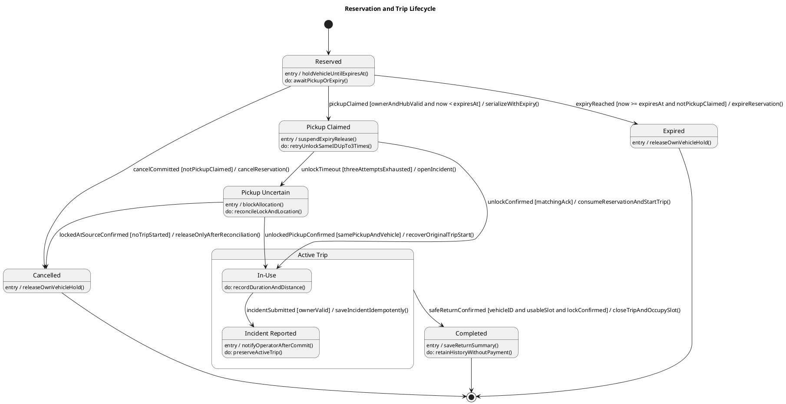
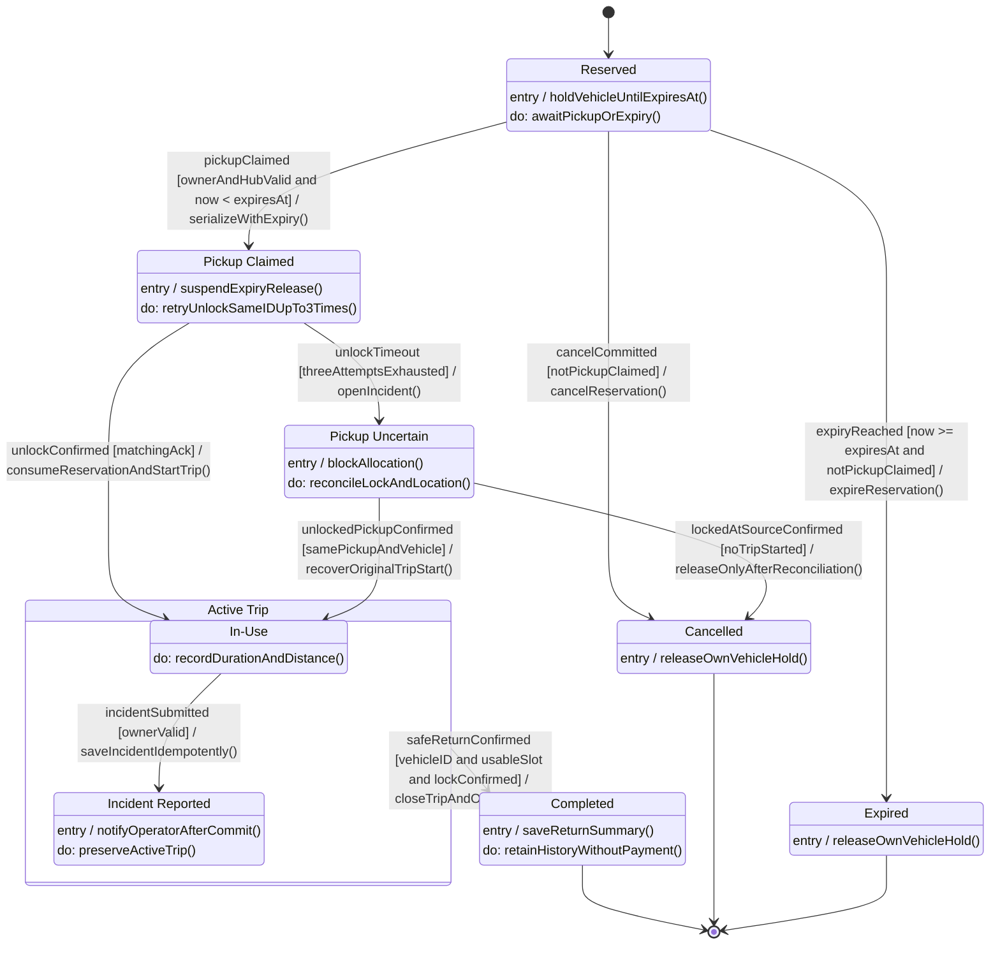

# Statechart — PlantUML & Mermaid

Nguồn: `PROJECT_SPECIFICATION.md` §3, `LIFECYCLE_SCENARIOS.md`; slide CO3001 Ch6.
Dữ liệu gốc: `.agent/scripts/generate_process_diagrams.py`. SVG và PNG được render bằng Draw.io thật.

PlantUML/Mermaid là bản xem mã; Draw.io là bản ký hiệu chi tiết. PlantUML dùng stereotype `<<object>>` cho nút dữ liệu; Mermaid mô phỏng thanh fork/join bằng ô đen. Không dùng hai bản preview để kiểm tra hình học UML.

## SC01 — Vehicle Lifecycle

[Draw.io](SC01-Vehicle_State_Machine.drawio) · [SVG editable](SC01-Vehicle_State_Machine.drawio.svg) · [PNG](SC01-Vehicle_State_Machine.png)

```plantuml
@startuml
title Vehicle Lifecycle
state "Operational Service" as Operational {
  state "Available" as Available
  state "Reserved" as Reserved
  state "In-Use" as InUse
  state "Needs Charging" as NeedsCharging
  state "Charging" as Charging
}
Available : entry / enableBookingIfUnheld()
Available : do: receiveTelemetry()
Reserved : entry / holdFor15Minutes()
Reserved : exit / stopExpiryTimer()
InUse : do: streamTripTelemetry()
NeedsCharging : entry / disableBooking()
NeedsCharging : do: waitForScheduler()
Charging : do: monitorSupplyAndBattery()
state "Held for Transfer" as TransferHeld
TransferHeld : entry / excludeFromBooking()
state "In-Transit" as InTransit
InTransit : do: trackTransferManifest()
state "Faulty" as Faulty
Faulty : entry / blockNewAllocations()
Faulty : do: preserveTripAndLocation()
state "Under Maintenance" as Maintenance
Maintenance : do: diagnoseAndRepair()
state "Retired" as Retired
Retired : entry / archiveVehicle()
[*] --> Available
Available --> Reserved : reserveCommitted [battery >=20% and no other hold] / linkReservation()
Reserved --> Available : cancelCommitted [pickupNotClaimed] / releaseOwnHold()
Reserved --> Available : expiryReached [now >= expiresAt and pickupNotClaimed] / releaseOwnHold()
Reserved --> InUse : unlockConfirmed [pickupClaimed and matchingAck] / consumeReservationAndStartTrip()
Reserved --> Faulty : unlockUncertain [threeAttemptsExhausted] / openIncidentAndReconcile()
InUse --> Available : safeReturnConfirmed [noFault and battery >=20%] / closeTripAndOccupySlot()
InUse --> NeedsCharging : safeReturnConfirmed [noFault and battery <20%] / closeTripAndQueueCharge()
NeedsCharging --> Charging : powerOnConfirmed [plugSafe and portAllocated] / startSession()
Charging --> Available : powerOffConfirmed [noFault and battery >=20%] / closeSession()
Charging --> NeedsCharging : powerOffConfirmed [noFault and battery <20%] / closeSessionAndRequeue()
Operational --> Faulty : faultDetected / blockAllocations; cutSupplyIfCharging; neverLockMovingVehicle
Available --> TransferHeld : planCommitted [battery >=80% and capacityHeld] / linkPlannedOrder()
TransferHeld --> Available : cancelCommitted [orderStillPlanned and noFault] / releaseOwnHolds()
TransferHeld --> InTransit : departureConfirmed [battery >=80% and orderStillPlanned] / freeSourceSlot()
TransferHeld --> Faulty : faultDetected / invalidateDeparture()
InTransit --> Available : arrivalCommitted [wholeOrderArrived and noFault and battery >=20%] / occupyTarget()
InTransit --> NeedsCharging : arrivalCommitted [wholeOrderArrived and noFault and battery <20%] / occupyTargetAndQueue()
InTransit --> Faulty : arrivalCommitted [wholeOrderArrived and fault] / occupyTargetAndOpenIncident()
Faulty --> Maintenance : recoveryConfirmed [safeStationaryLocation] / assignRepair()
Maintenance --> Available : repairAccepted [testPassed and noActiveTrip and battery >=20%] / reconcileHolds()
Maintenance --> NeedsCharging : repairAccepted [testPassed and noActiveTrip and battery <20%] / queueCharge()
Maintenance --> Retired : retireApproved [noTripOrTransferOrReservation and supplyOff] / archiveHistory()
Retired --> [*]
@enduml
```

```mermaid
stateDiagram-v2
  state "Operational Service" as Operational {
    state "Available" as Available
    state "Reserved" as Reserved
    state "In-Use" as InUse
    state "Needs Charging" as NeedsCharging
    state "Charging" as Charging
  }
  Available : entry / enableBookingIfUnheld()
  Available : do: receiveTelemetry()
  Reserved : entry / holdFor15Minutes()
  Reserved : exit / stopExpiryTimer()
  InUse : do: streamTripTelemetry()
  NeedsCharging : entry / disableBooking()
  NeedsCharging : do: waitForScheduler()
  Charging : do: monitorSupplyAndBattery()
  state "Held for Transfer" as TransferHeld
  TransferHeld : entry / excludeFromBooking()
  state "In-Transit" as InTransit
  InTransit : do: trackTransferManifest()
  state "Faulty" as Faulty
  Faulty : entry / blockNewAllocations()
  Faulty : do: preserveTripAndLocation()
  state "Under Maintenance" as Maintenance
  Maintenance : do: diagnoseAndRepair()
  state "Retired" as Retired
  Retired : entry / archiveVehicle()
  [*] --> Available
  Available --> Reserved : reserveCommitted [battery >=20% and no other hold] / linkReservation()
  Reserved --> Available : cancelCommitted [pickupNotClaimed] / releaseOwnHold()
  Reserved --> Available : expiryReached [now >= expiresAt and pickupNotClaimed] / releaseOwnHold()
  Reserved --> InUse : unlockConfirmed [pickupClaimed and matchingAck] / consumeReservationAndStartTrip()
  Reserved --> Faulty : unlockUncertain [threeAttemptsExhausted] / openIncidentAndReconcile()
  InUse --> Available : safeReturnConfirmed [noFault and battery >=20%] / closeTripAndOccupySlot()
  InUse --> NeedsCharging : safeReturnConfirmed [noFault and battery <20%] / closeTripAndQueueCharge()
  NeedsCharging --> Charging : powerOnConfirmed [plugSafe and portAllocated] / startSession()
  Charging --> Available : powerOffConfirmed [noFault and battery >=20%] / closeSession()
  Charging --> NeedsCharging : powerOffConfirmed [noFault and battery <20%] / closeSessionAndRequeue()
  Operational --> Faulty : faultDetected / blockAllocations; cutSupplyIfCharging; neverLockMovingVehicle
  Available --> TransferHeld : planCommitted [battery >=80% and capacityHeld] / linkPlannedOrder()
  TransferHeld --> Available : cancelCommitted [orderStillPlanned and noFault] / releaseOwnHolds()
  TransferHeld --> InTransit : departureConfirmed [battery >=80% and orderStillPlanned] / freeSourceSlot()
  TransferHeld --> Faulty : faultDetected / invalidateDeparture()
  InTransit --> Available : arrivalCommitted [wholeOrderArrived and noFault and battery >=20%] / occupyTarget()
  InTransit --> NeedsCharging : arrivalCommitted [wholeOrderArrived and noFault and battery <20%] / occupyTargetAndQueue()
  InTransit --> Faulty : arrivalCommitted [wholeOrderArrived and fault] / occupyTargetAndOpenIncident()
  Faulty --> Maintenance : recoveryConfirmed [safeStationaryLocation] / assignRepair()
  Maintenance --> Available : repairAccepted [testPassed and noActiveTrip and battery >=20%] / reconcileHolds()
  Maintenance --> NeedsCharging : repairAccepted [testPassed and noActiveTrip and battery <20%] / queueCharge()
  Maintenance --> Retired : retireApproved [noTripOrTransferOrReservation and supplyOff] / archiveHistory()
  Retired --> [*]
```

### Bảng đối chiếu nhãn trên hình

Nhãn ngắn chỉ là cách trình bày; dùng điều kiện đầy đủ bên phải khi triển khai hoặc kiểm tra nghiệp vụ. SoC là mức pin; healthy là không có fault; safe trong nhánh repair là testPassed. Mỗi dòng giữ nguyên ID transition trong Draw.io.

| ID | Nhãn trên hình | Hợp đồng đầy đủ |
|---|---|---|
| e0 | completion | `completion` |
| e1 | reserve [eligible] / hold vehicle | `reserveCommitted [battery >=20% and no other hold] / linkReservation()` |
| e2 | cancel [not claimed] / release hold | `cancelCommitted [pickupNotClaimed] / releaseOwnHold()` |
| e3 | expire [deadline reached] / release hold | `expiryReached [now >= expiresAt and pickupNotClaimed] / releaseOwnHold()` |
| e4 | unlock ACK [claimed] / start trip | `unlockConfirmed [pickupClaimed and matchingAck] / consumeReservationAndStartTrip()` |
| e5 | unlock uncertain [3 tries] / open incident | `unlockUncertain [threeAttemptsExhausted] / openIncidentAndReconcile()` |
| e6 | safe return [healthy, SoC >=20%] / close trip | `safeReturnConfirmed [noFault and battery >=20%] / closeTripAndOccupySlot()` |
| e7 | safe return [healthy, SoC <20%] / queue charge | `safeReturnConfirmed [noFault and battery <20%] / closeTripAndQueueCharge()` |
| e8 | power ON ACK [plug safe, allocated] / start session | `powerOnConfirmed [plugSafe and portAllocated] / startSession()` |
| e9 | power OFF ACK [healthy, SoC >=20%] / close session | `powerOffConfirmed [noFault and battery >=20%] / closeSession()` |
| e10 | power OFF ACK [healthy, SoC <20%] / requeue | `powerOffConfirmed [noFault and battery <20%] / closeSessionAndRequeue()` |
| e11 | fault detected / isolate safely | `faultDetected / blockAllocations; cutSupplyIfCharging; neverLockMovingVehicle` |
| e12 | plan [SoC >=80%, capacity held] / hold for transfer | `planCommitted [battery >=80% and capacityHeld] / linkPlannedOrder()` |
| e13 | cancel [still Planned, healthy] / release order holds | `cancelCommitted [orderStillPlanned and noFault] / releaseOwnHolds()` |
| e14 | depart [SoC >=80%, Planned] / free source slot | `departureConfirmed [battery >=80% and orderStillPlanned] / freeSourceSlot()` |
| e15 | fault detected / block departure | `faultDetected / invalidateDeparture()` |
| e16 | arrive [all arrived, healthy, SoC >=20%] / occupy target | `arrivalCommitted [wholeOrderArrived and noFault and battery >=20%] / occupyTarget()` |
| e17 | arrive [all arrived, healthy, SoC <20%] / queue charge | `arrivalCommitted [wholeOrderArrived and noFault and battery <20%] / occupyTargetAndQueue()` |
| e18 | arrive [all arrived, fault] / occupy target; report | `arrivalCommitted [wholeOrderArrived and fault] / occupyTargetAndOpenIncident()` |
| e19 | recover [safe location] / assign repair | `recoveryConfirmed [safeStationaryLocation] / assignRepair()` |
| e20 | repair accepted [safe, no trip, SoC >=20%] / reconcile holds | `repairAccepted [testPassed and noActiveTrip and battery >=20%] / reconcileHolds()` |
| e21 | repair accepted [safe, no trip, SoC <20%] / queue charge | `repairAccepted [testPassed and noActiveTrip and battery <20%] / queueCharge()` |
| e22 | retire [no active obligations, power off] / archive | `retireApproved [noTripOrTransferOrReservation and supplyOff] / archiveHistory()` |
| e23 | completion | `completion` |

## SC02 — Charging Point Lifecycle

[Draw.io](SC02-Charging_Point_State_Machine.drawio) · [SVG editable](SC02-Charging_Point_State_Machine.drawio.svg) · [PNG](SC02-Charging_Point_State_Machine.png)

### Bảng đối chiếu nhãn trên hình

Nhãn ngắn chỉ là cách trình bày; dùng điều kiện đầy đủ bên phải khi triển khai hoặc kiểm tra nghiệp vụ. SoC là mức pin; healthy là không có fault; safe trong nhánh repair là testPassed. Mỗi dòng giữ nguyên ID transition trong Draw.io.

| ID | Nhãn trên hình | Hợp đồng đầy đủ |
|---|---|---|
| e0 | completion | `completion` |
| e1 | allocate [compatible, budget] / reserve port and power | `allocate [compatible and budgetAvailable] / claimPortAndPower()` |
| e2 | cancel or expire [power off] / release allocation | `cancelOrExpire [notEnergized] / releaseOwnAllocation()` |
| e3 | plug confirmed [authorized, safe] / send power ON | `plugConfirmed [ownerValid and electricalSafe] / sendStartCommand()` |
| e4 | power ON ACK / activate session | `powerOnConfirmed [matchingAck] / activateSession()` |
| e5 | start timeout / open incident | `startTimeout / openIncident()` |
| e6 | stop [authorized] / record user reason | `stopRequested [ownerValid] / recordUserStopReason()` |
| e7 | target reached / record completion | `targetReached / recordCompletedReason()` |
| e8 | yield [SoC >=80%, urgent queue] / record scheduler reason | `priorityYield [battery >=80% and urgentQueue] / recordSchedulerStopReason()` |
| e9 | power OFF ACK / persist stop outcome | `powerOffConfirmed [matchingAck] / persistSessionOutcome()` |
| e10 | stop timeout [3 tries] / quarantine; no success | `stopTimeout [threeAttemptsExhausted] / doNotReportSuccess()` |
| e11 | unplug [no fault] / release connector | `unplugConfirmed [noFault] / releaseConnector()` |
| e12 | electrical fault / cut supply; isolate | `electricalFault / cutSupplyAndOpenIncident()` |
| e13 | assign repair [power off ACK] / interrupt and requeue | `repairAssigned [powerOffConfirmed] / interruptSessionAndRequeueTechnicalFault()` |
| e14 | repair accepted [test passed, unplugged] / requeue interrupted requests | `repairAccepted [testPassed and unplugged] / requeueTechnicalInterruptions()` |
| e15 | safety test failed / keep isolated | `safetyTestFailed / keepQuarantined()` |
| e16 | retire [power off, no allocation] / archive | `retireApproved [supplyOff and noAllocation] / archiveHistory()` |
| e17 | completion | `completion` |

## SC03 — Reservation and Trip Lifecycle

[Draw.io](SC03-Reservation_and_Trip_State_Machine.drawio) · [SVG editable](SC03-Reservation_and_Trip_State_Machine.drawio.svg) · [PNG](SC03-Reservation_and_Trip_State_Machine.png)

### Bảng đối chiếu nhãn trên hình

Nhãn ngắn chỉ là cách trình bày; dùng điều kiện đầy đủ bên phải khi triển khai hoặc kiểm tra nghiệp vụ. SoC là mức pin; healthy là không có fault; safe trong nhánh repair là testPassed. Mỗi dòng giữ nguyên ID transition trong Draw.io.

| ID | Nhãn trên hình | Hợp đồng đầy đủ |
|---|---|---|
| e0 | completion | `completion` |
| e1 | claim pickup [owner, Hub, in time] / serialize with expiry | `pickupClaimed [ownerAndHubValid and now < expiresAt] / serializeWithExpiry()` |
| e2 | cancel [not claimed] / cancel reservation | `cancelCommitted [notPickupClaimed] / cancelReservation()` |
| e3 | expire [deadline reached, not claimed] / expire reservation | `expiryReached [now >= expiresAt and notPickupClaimed] / expireReservation()` |
| e4 | unlock ACK / consume ticket; start trip | `unlockConfirmed [matchingAck] / consumeReservationAndStartTrip()` |
| e5 | unlock timeout [3 tries] / open incident | `unlockTimeout [threeAttemptsExhausted] / openIncident()` |
| e6 | locked at source [no trip] / release hold | `lockedAtSourceConfirmed [noTripStarted] / releaseOnlyAfterReconciliation()` |
| e7 | pickup confirmed [same pickup and vehicle] / recover original start | `unlockedPickupConfirmed [samePickupAndVehicle] / recoverOriginalTripStart()` |
| e8 | report incident [authorized] / save once; notify | `incidentSubmitted [ownerValid] / saveIncidentIdempotently()` |
| e9 | safe return [vehicle, slot, lock verified] / close trip; occupy slot | `safeReturnConfirmed [vehicleID and usableSlot and lockConfirmed] / closeTripAndOccupySlot()` |
| e10 | completion | `completion` |
| e11 | completion | `completion` |
| e12 | completion | `completion` |
