# Class diagram sources

Both blocks describe the complete selected domain model in [CLASS_CATALOG.md](CLASS_CATALOG.md). Every declared operation has a contract in [METHOD_DESCRIPTIONS.md](METHOD_DESCRIPTIONS.md). Supporting value types/enums are defined in the catalog and intentionally not expanded as extra domain nodes. The editable SVG is the layout reference. Mermaid may not reproduce abstract-class italics, empty compartments, endpoint role placement or shared inheritance branches; these preview limits do not change semantics.

```plantuml
@startuml
skinparam classAttributeIconSize 0
skinparam shadowing false
skinparam defaultFontName Arial
skinparam classBackgroundColor #e0f2fe
skinparam linetype ortho
skinparam groupInheritance 2
hide circle
class UserAccount {
  -accountId : String
  -roles : UserRoleSet
  --
  +hasRole(role : UserRole) : Boolean
}
abstract class ElectricVehicle {
  -vehicleId : String
  -batteryPercent : Integer
  -status : VehicleStatus
  -ownership : VehicleOwnership
  -connector : ConnectorType
  --
  +updateBattery(percent : Integer) : void
  +isRentable() : Boolean
}
class ElectricBicycle {
  --
}
class ElectricMotorcycle {
  --
}
class MobilityHub {
  -hubId : String
  -name : String
  -location : GeoLocation
  -powerLimitKW : Real
  --
  +availableParkingCount() : Integer
}
class ParkingSlot {
  -slotId : String
  -status : ParkingStatus
  --
  +canAccept(vehicle : ElectricVehicle) : Boolean
}
class ChargingPoint {
  -pointId : String
  -status : ChargingPointStatus
  -connector : ConnectorType
  -ratedPowerKW : Real
  --
  +canServe(vehicle : ElectricVehicle) : Boolean
}
abstract class Reservation {
  -reservationId : String
  -status : ReservationStatus
  -expiresAt : DateTime
  --
  +cancel() : void
  +expire(now : DateTime) : Boolean
  {abstract} +calculateExpiry() : DateTime
}
class VehicleReservation {
  -reservedAt : DateTime
  --
  +calculateExpiry() : DateTime
}
class ParkingReservation {
  -scheduledArrivalAt : DateTime
  --
  +calculateExpiry() : DateTime
}
class Trip {
  -tripId : String
  -status : TripStatus
  -pickedUpAt : DateTime
  -returnedAt : OptionalDateTime
  --
  +complete(at : DateTime) : void
}
class ChargingRequest {
  -requestId : String
  -batteryAtRequest : Integer
  -neededBy : DateTime
  -status : ChargingRequestStatus
  --
  +isUrgent() : Boolean
}
class ChargingSession {
  -sessionId : String
  -startedAt : DateTime
  -stoppedAt : OptionalDateTime
  -status : ChargingSessionStatus
  -allocatedPowerKW : Real
  --
  +stop(at : DateTime) : void
}
class TransferOrder {
  -orderId : String
  -status : TransferStatus
  -dispatchedAt : OptionalDateTime
  -completedAt : OptionalDateTime
  --
  +complete(at : DateTime) : void
}
class OperationalIncident {
  -incidentId : String
  -status : IncidentStatus
  -reportedAt : DateTime
  -resolvedAt : OptionalDateTime
  --
  +resolve(at : DateTime) : void
}
class SimulationScenario {
  -scenarioId : String
  -type : ScenarioType
  -parameters : ScenarioParameters
  --
  +validate() : Boolean
}
class SimulationRun {
  -runId : String
  -status : SimulationRunStatus
  -snapshot : NetworkSnapshot
  --
  +complete(result : SimulationResult) : void
}
class SimulationResult {
  -resultId : String
  -serviceSuccessRate : Real
  -averageWaitMinutes : Real
  -rejectedTripCount : Integer
  --
}
class CoordinationRecommendation {
  -recommendationId : String
  -type : RecommendationType
  -details : String
  -status : RecommendationStatus
  --
}
ElectricVehicle <|-- ElectricBicycle
ElectricVehicle <|-- ElectricMotorcycle
Reservation <|-- VehicleReservation
Reservation <|-- ParkingReservation
MobilityHub "hub 1" -- "slots 0..*" ParkingSlot
MobilityHub "hub 1" -- "points 0..*" ChargingPoint
MobilityHub "currentHub 0..1" -- "currentVehicles 0..*" ElectricVehicle
ParkingSlot "currentSlot 0..1" -- "occupant 0..1" ElectricVehicle
UserAccount "owner 0..1" -- "privateVehicles 0..*" ElectricVehicle
UserAccount "booker 1" -- "reservations 0..*" Reservation
ElectricVehicle "reservedVehicle 1" -- "vehicleReservations 0..*" VehicleReservation
ParkingSlot "reservedSlot 1" -- "parkingReservations 0..*" ParkingReservation
UserAccount "rider 1" -- "trips 0..*" Trip
ElectricVehicle "vehicle 1" -- "trips 0..*" Trip
VehicleReservation "booking 0..1" -- "resultingTrip 0..1" Trip
MobilityHub "pickupHub 1" -- "departures 0..*" Trip
MobilityHub "returnHub 0..1" -- "returns 0..*" Trip
UserAccount "requester 1" -- "chargingRequests 0..*" ChargingRequest
ElectricVehicle "vehicle 1" -- "chargingRequests 0..*" ChargingRequest
ChargingRequest "request 1" -- "sessions 0..*" ChargingSession
ChargingPoint "point 1" -- "sessions 0..*" ChargingSession
MobilityHub "sourceHub 1" -- "outgoingOrders 0..*" TransferOrder
MobilityHub "destinationHub 1" -- "incomingOrders 0..*" TransferOrder
ElectricVehicle "vehicles 1..*" -- "transfers 0..*" TransferOrder
ElectricVehicle "affectedVehicle 0..1" -- "vehicleIncidents 0..*" OperationalIncident
ChargingPoint "affectedPoint 0..1" -- "pointIncidents 0..*" OperationalIncident
UserAccount "assignedOperator 0..1" -- "assignedIncidents 0..*" OperationalIncident
SimulationScenario "scenario 1" -- "runs 0..*" SimulationRun
SimulationRun "run 1" -- "result 0..1" SimulationResult
SimulationResult "result 1" *-- "recommendations 0..*" CoordinationRecommendation
@enduml
```

```mermaid
classDiagram
direction TB
class UserAccount {
  -accountId : String
  -roles : UserRoleSet
  +hasRole(role : UserRole) Boolean
}
class ElectricVehicle {
  <<abstract>>
  -vehicleId : String
  -batteryPercent : Integer
  -status : VehicleStatus
  -ownership : VehicleOwnership
  -connector : ConnectorType
  +updateBattery(percent : Integer) void
  +isRentable() Boolean
}
class ElectricBicycle {
}
class ElectricMotorcycle {
}
class MobilityHub {
  -hubId : String
  -name : String
  -location : GeoLocation
  -powerLimitKW : Real
  +availableParkingCount() Integer
}
class ParkingSlot {
  -slotId : String
  -status : ParkingStatus
  +canAccept(vehicle : ElectricVehicle) Boolean
}
class ChargingPoint {
  -pointId : String
  -status : ChargingPointStatus
  -connector : ConnectorType
  -ratedPowerKW : Real
  +canServe(vehicle : ElectricVehicle) Boolean
}
class Reservation {
  <<abstract>>
  -reservationId : String
  -status : ReservationStatus
  -expiresAt : DateTime
  +cancel() void
  +expire(now : DateTime) Boolean
  +calculateExpiry() DateTime*
}
class VehicleReservation {
  -reservedAt : DateTime
  +calculateExpiry() DateTime
}
class ParkingReservation {
  -scheduledArrivalAt : DateTime
  +calculateExpiry() DateTime
}
class Trip {
  -tripId : String
  -status : TripStatus
  -pickedUpAt : DateTime
  -returnedAt : OptionalDateTime
  +complete(at : DateTime) void
}
class ChargingRequest {
  -requestId : String
  -batteryAtRequest : Integer
  -neededBy : DateTime
  -status : ChargingRequestStatus
  +isUrgent() Boolean
}
class ChargingSession {
  -sessionId : String
  -startedAt : DateTime
  -stoppedAt : OptionalDateTime
  -status : ChargingSessionStatus
  -allocatedPowerKW : Real
  +stop(at : DateTime) void
}
class TransferOrder {
  -orderId : String
  -status : TransferStatus
  -dispatchedAt : OptionalDateTime
  -completedAt : OptionalDateTime
  +complete(at : DateTime) void
}
class OperationalIncident {
  -incidentId : String
  -status : IncidentStatus
  -reportedAt : DateTime
  -resolvedAt : OptionalDateTime
  +resolve(at : DateTime) void
}
class SimulationScenario {
  -scenarioId : String
  -type : ScenarioType
  -parameters : ScenarioParameters
  +validate() Boolean
}
class SimulationRun {
  -runId : String
  -status : SimulationRunStatus
  -snapshot : NetworkSnapshot
  +complete(result : SimulationResult) void
}
class SimulationResult {
  -resultId : String
  -serviceSuccessRate : Real
  -averageWaitMinutes : Real
  -rejectedTripCount : Integer
}
class CoordinationRecommendation {
  -recommendationId : String
  -type : RecommendationType
  -details : String
  -status : RecommendationStatus
}
ElectricVehicle <|-- ElectricBicycle
ElectricVehicle <|-- ElectricMotorcycle
Reservation <|-- VehicleReservation
Reservation <|-- ParkingReservation
MobilityHub "1" -- "0..*" ParkingSlot : hub / slots
MobilityHub "1" -- "0..*" ChargingPoint : hub / points
MobilityHub "0..1" -- "0..*" ElectricVehicle : currentHub / currentVehicles
ParkingSlot "0..1" -- "0..1" ElectricVehicle : currentSlot / occupant
UserAccount "0..1" -- "0..*" ElectricVehicle : owner / privateVehicles
UserAccount "1" -- "0..*" Reservation : booker / reservations
ElectricVehicle "1" -- "0..*" VehicleReservation : reservedVehicle / vehicleReservations
ParkingSlot "1" -- "0..*" ParkingReservation : reservedSlot / parkingReservations
UserAccount "1" -- "0..*" Trip : rider / trips
ElectricVehicle "1" -- "0..*" Trip : vehicle / trips
VehicleReservation "0..1" -- "0..1" Trip : booking / resultingTrip
MobilityHub "1" -- "0..*" Trip : pickupHub / departures
MobilityHub "0..1" -- "0..*" Trip : returnHub / returns
UserAccount "1" -- "0..*" ChargingRequest : requester / chargingRequests
ElectricVehicle "1" -- "0..*" ChargingRequest : vehicle / chargingRequests
ChargingRequest "1" -- "0..*" ChargingSession : request / sessions
ChargingPoint "1" -- "0..*" ChargingSession : point / sessions
MobilityHub "1" -- "0..*" TransferOrder : sourceHub / outgoingOrders
MobilityHub "1" -- "0..*" TransferOrder : destinationHub / incomingOrders
ElectricVehicle "1..*" -- "0..*" TransferOrder : vehicles / transfers
ElectricVehicle "0..1" -- "0..*" OperationalIncident : affectedVehicle / vehicleIncidents
ChargingPoint "0..1" -- "0..*" OperationalIncident : affectedPoint / pointIncidents
UserAccount "0..1" -- "0..*" OperationalIncident : assignedOperator / assignedIncidents
SimulationScenario "1" -- "0..*" SimulationRun : scenario / runs
SimulationRun "1" -- "0..1" SimulationResult : run / result
SimulationResult "1" *-- "0..*" CoordinationRecommendation : result / recommendations
```

