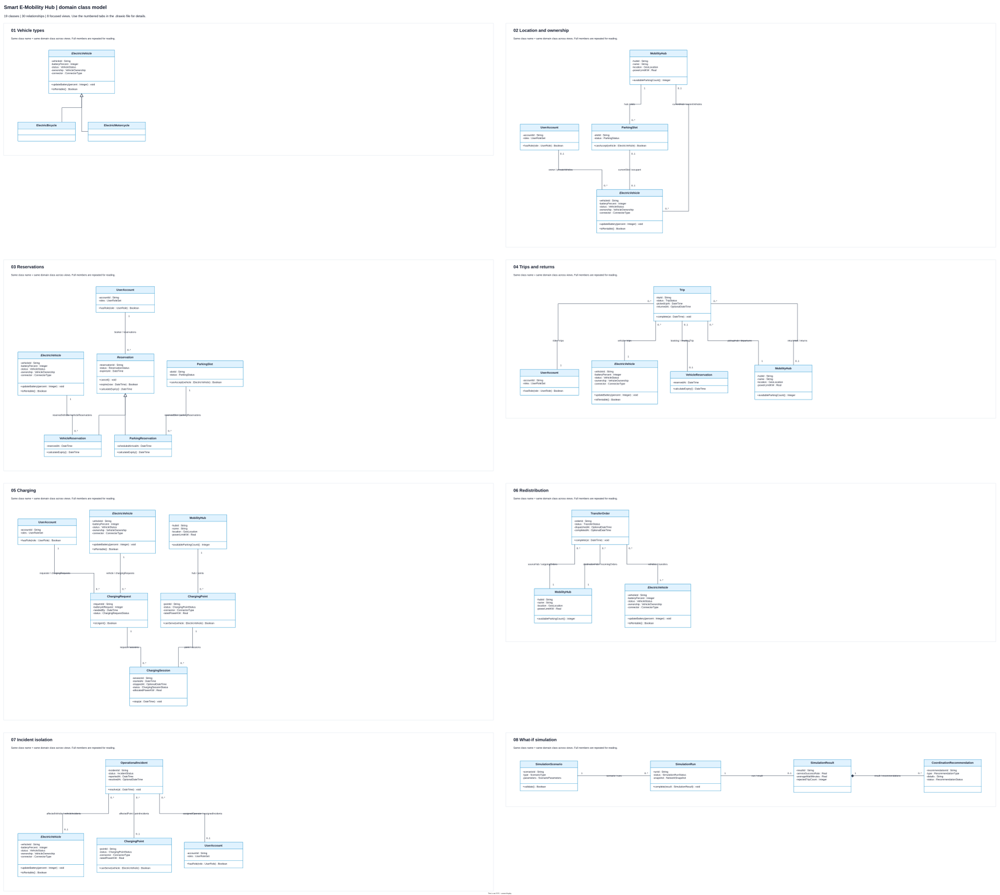

# Smart E-Mobility Hub — domain class model

Proposed Logical View for Submission #3: **19 classes (2 abstract, 17 concrete), 18 declared operations, 4 generalizations and 26 associations**. It covers UC01–UC14 and all five required simulation types. The UI prototype remains a mockup; these documents do not implement a backend.

## Artifacts

| File | Purpose |
| --- | --- |
| [CLASS_CATALOG.md](CLASS_CATALOG.md) | Class purposes, typed members, supporting types, inheritance justification, associations, allocation invariants, 23 sequence lifeline mappings and UC traceability |
| [METHOD_DESCRIPTIONS.md](METHOD_DESCRIPTIONS.md) | Contracts/algorithms for every displayed method, including the abstract method, overrides and inherited links |
| [PLANTUML_CLASS.md](PLANTUML_CLASS.md) | Complete matching PlantUML and Mermaid blocks |
| [smart_emobility_class_diagram.drawio](smart_emobility_class_diagram.drawio) | Native editable file: overview tab and eight numbered detail tabs |
| [smart_emobility_class_diagram.drawio.svg](smart_emobility_class_diagram.drawio.svg) | All eight views on one vector canvas; the same nine-tab editable file is embedded |
| [smart_emobility_class_diagram.png](smart_emobility_class_diagram.png) | Overview PNG without embedded XML |
| [build_class_diagram.py](build_class_diagram.py) | Use drawio-skill auto-layout to project the catalog into focused views; assert model/source/export parity |
| [render_class_diagram.cjs](render_class_diagram.cjs) | Native draw.io export and checks for clipping, stacked segments, crossings and label collisions |



Open the **numbered tabs** in the native `.drawio` file to read each view at full size. The overview keeps all views together for orientation. Class names repeated between views denote the **same class**, with identical full members, not extra types or instances. The 35 displayed occurrences cover the same 19 domain classes; all 30 relationships appear exactly once across the eight views. No business relationships were removed.

| Tab / readable PNG | Scope |
| --- | --- |
| [01 Vehicle types](previews/types.png) | ElectricVehicle inheritance |
| [02 Location and ownership](previews/location.png) | Hubs, parking, vehicle location and private owner |
| [03 Reservations](previews/reservations.png) | Reservation inheritance, booking account and held resources |
| [04 Trips and returns](previews/trips.png) | Rider, vehicle, optional booking and pickup/return hubs |
| [05 Charging](previews/charging.png) | Hub points, request account/vehicle and session history |
| [06 Redistribution](previews/transfers.png) | Shared vehicles and distinct source/destination hub roles |
| [07 Incident isolation](previews/incidents.png) | Incident target alternatives and assigned operator |
| [08 What-if simulation](previews/simulation.png) | Scenario, run, optional result and owned recommendations |

Every connector follows an orthogonal route with a separate terminal port. Shared stems are intentional only for the two inheritance trees. Paired role labels `role at A / role at B` follow the catalog's endpoint order; multiplicities remain at both physical endpoints. Supporting value types/enums are defined in the catalog rather than expanded into extra domain classes. PlantUML/Mermaid retain the complete single-model semantic source; these focused Draw.io views are its readable projections.

## Source authority and scope

1. [CO3001 Ch6 System Modeling](../../00_Slides/06_Ch6%20System%20Modeling_2025.pdf), pp. 28–35. Pages **30–34 were rendered and inspected visually**: p.30 relationship/shared-tree example, p.31 compartments/visibility, pp.32–33 multiplicities, p.34 abstract class/method italics and common inheritance stem. The lecture's abbreviated examples remain valid UML; full typed compartments here are the workspace's detailed-design convention.
2. [Assignment](../../04_BTL_SoftwareEngineering_HK261.pdf), PDF pp.1–4 for the domain/five scenarios; pp.5–6 for class/method deliverables. [Master specification](../../PROJECT_SPECIFICATION.md), §§2–5, supplies UC01–UC14 and FR-NI01–04. The 20% rental candidate threshold is from [SQ01](../02_Sequence_Diagram/PLANTUML_SEQUENCE.md), while UC10's 80% transfer threshold is separate.
3. [Class convention](../../02_Rules/03_Class_diagram.md) and [change design](../../openspec/changes/define-domain-class-model/design.md). Existing sequence/prototype files and the separate notation change are preserved.

The redraw uses the installed `drawio-skill/scripts/autolayout.py` for each view. Reserved label spaces distinguish parallel associations and keep text away from unrelated routes. `edgeports.py --dry-run` reports no unpinned dense terminals. The class exporter uses the installed draw.io viewer/Playwright approach without modifying the shared sequence generator; the installed `C:/Program Files/draw.io/draw.io.exe` also successfully exported a draft PNG. No new dependency was installed.

## Completed quality checklist

| Check | Result / evidence |
| --- | --- |
| Abstract/concrete classification and is-a justification | Pass: two abstract roots, four concrete subclasses, all 19 purposes/source mappings in catalog |
| Detailed compartments; private attributes, public typed operations | Pass: all classes have three editable compartments, including intentional empty compartments; no filler methods |
| Abstract class/method italics (Ch6 p.34) | Pass: visually inspected ElectricVehicle and Reservation; Reservation.calculateExpiry is italic; both concrete overrides are regular |
| Hollow generalization arrow points child -> parent; common branches (pp.30,34) | Pass: four native semantic edges with hollow triangles at the two parents; paired child paths share each parent stem |
| Roles and multiplicities (pp.30,32–33) | Pass: 26 relations, both-end cardinalities, paired role labels; no cardinalities on generalization |
| Association versus composition | Pass: ordinary hub/resource associations; one justified composition from result to its exclusively owned recommendation records |
| No clipped text, overlapping classes/labels or connectors through classes | Pass: overview and readable detail PNGs inspected; native DOM checks report zero clipping, class intersections, unrelated label collisions, stacked connector segments or connector crossings. Shared inheritance stems are intentional |
| SVG and embedded graph parse; members/labels editable | Pass: nine native pages decode/render; 35 class occurrences preserve full compartments; overview retains 78 editable edge-label cells |
| Catalog / PlantUML / Mermaid / SVG parity | Pass: all repeated class members match; 19 unique classes, all 30 relationship endpoint/kind/label comparisons and 18 method contracts preserved; overview relationship union equals the eight numbered tabs |
| drawio-skill validation | Each of the eight numbered pages has **0 errors and 0 warnings**. The overview has 0 structural errors; the current linter emits geometry warnings there because `edge_route()` reads frame-relative waypoints as page coordinates. The native rendered DOM verifies those translated routes directly and reports zero intersections/crossings |
| Edge-label preservation | Pass: each role label and each multiplicity is a separate editable edgeLabel child; SVG exported from that same native graph |
| UC01–UC14 and five scenarios | Pass: explicit UC table; MetroSurge, FullParking, ChargingDemandSurge, PartialChargerFailure, VehicleClustering |
| Allocation edge cases | Pass: private motorcycles excluded from rental/transfer, absent hub while traveling, distinct expiry formulas, historical/active allocation distinction, interrupted charging history, incident XOR/isolation and pending/failed runs without results are documented |
| Use-case system boundary/padding and actor hand/ellipse attachment | Not applicable: no actors or use-case ellipses exist in this class model. No artificial system boundary is added. Light ocean blue headers retain export styling |
| PlantUML syntax | Pass: local installed PlantUML JAR `-checkonly` accepted the complete block |
| Mermaid preview fidelity | Semantics checked structurally; engine rendering not tested. Mermaid may omit abstract-class italics, merge empty compartments or route inheritance independently. Abstract operations use `*`; stereotypes identify abstract classes |
| OpenSpec validation | Pass: `openspec validate define-domain-class-model --strict`; documentation-only `skip_specs: true` accepted |
| Imports and manual editing | All native tabs rendered, plus desktop CLI PNG export tested; interactive editing, Draw.io PlantUML import and VP Online import **not tested** |

## Reproduce verification

From the repository root, with Python, Node, Graphviz `dot`, `drawio-skill` under `~/.agents/skills/`, the VS Code draw.io extension, bundled Playwright and Edge available:

```powershell
python 01_Diagram/05_Class_Diagram/build_class_diagram.py
node 01_Diagram/05_Class_Diagram/render_class_diagram.cjs
python 01_Diagram/05_Class_Diagram/build_class_diagram.py --check
openspec validate define-domain-class-model --strict
```

Generation writes the source document, native `.drawio`, editable SVG, overview PNG and eight detail PNGs; temporary verification assets stay under `.agent/scratch/class_model/`. Edit the catalog then regenerate to preserve cross-format parity. Manual canvas edits remain possible; reflect semantic edits in the catalog/source blocks before regeneration. The scripts use this workspace's installed skill/viewer/runtime paths and are not standalone distribution tools.

## Editing / import instructions

1. **VS Code offline:** Nhấp đúp [file `.drawio`](smart_emobility_class_diagram.drawio) hoặc [`.drawio.svg`](smart_emobility_class_diagram.drawio.svg), rồi chọn tab nghiệp vụ ở cuối canvas (cần extension Draw.io).
2. **Draw.io PlantUML:** Mở `+` -> `Advanced` -> `PlantUML`, dán toàn bộ block PlantUML trong [nguồn sơ đồ](PLANTUML_CLASS.md).
3. **VP Online:** Mở `File` -> `Import` -> `PlantUML...`, dán toàn bộ block PlantUML.

This set is ready for design review. Archiving the OpenSpec change is a separate action after review.
