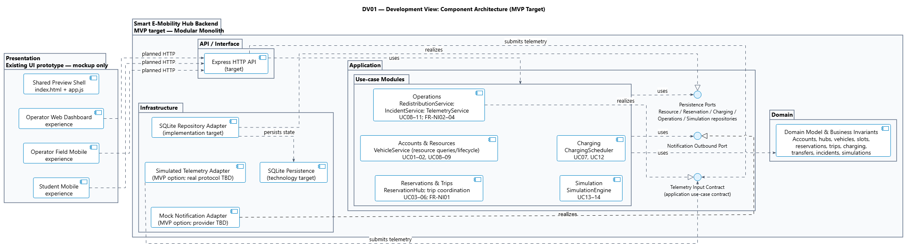
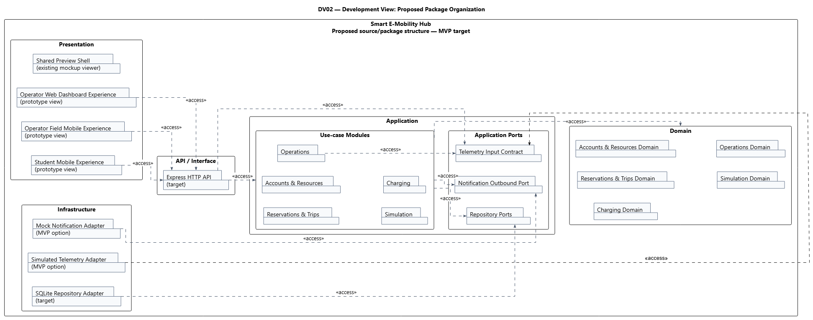

# BÁO CÁO SUBMISSION #3
## GÓC NHÌN PHÁT TRIỂN / HIỆN THỰC
### HỆ THỐNG SMART E-MOBILITY HUB

**Học phần:** Công nghệ Phần mềm (Software Engineering) – HK261  
**Cơ sở đào tạo:** Đại học Quốc gia TP. Hồ Chí Minh (VNU-HCM)  
**Phạm vi:** Development / Implementation View – nội dung nhóm của Submission #3  
**Trạng thái tài liệu:** Bản dự thảo để nhóm rà soát  
**Ngày:** 04/11/2026

---

## Tóm tắt

Báo cáo trình bày góc nhìn Development / Implementation View cho Smart E-Mobility Hub. Kiến trúc mục tiêu sử dụng một backend **modular monolith**, được tổ chức theo năm tầng logic **Presentation → API / Interface → Application → Domain → Infrastructure**. Hai sơ đồ UML đi kèm mô tả các component và cấu trúc package nguồn dự kiến; chúng thể hiện ranh giới trách nhiệm, dependency và các interface/adapter quan trọng, không phải bằng chứng rằng backend hoặc các package đã được lập trình hay triển khai.

Frontend hiện có là prototype HTML5, CSS3 và Modern JavaScript. Node.js + Express và SQLite là lựa chọn mục tiêu cho MVP. Repository abstraction cùng transaction boundary bảo vệ các thao tác phân bổ tài nguyên và chuyển trạng thái cần tính nguyên tử. Các chi tiết chưa được quyết định — như API contract, schema, driver, giao thức telemetry và nhà cung cấp notification — được giữ mở thay vì tự giả định trong báo cáo.

## 1. Mục đích, phạm vi và căn cứ

Theo mô hình 4+1, Development View mô tả cách phân rã phần mềm thành tầng, module/package và các quan hệ phụ thuộc để hỗ trợ tổ chức, hiện thực và bảo trì mã nguồn. Phạm vi báo cáo này là phần Development / Implementation View thuộc nội dung nhóm của Submission #3: kiến trúc phân tầng, component, package/module và công nghệ mục tiêu.

Báo cáo không thay thế:

- **Deployment View**, vốn mô tả node, phần cứng, mạng và môi trường triển khai;
- **Class Diagram** và **Method Descriptions** thuộc phần thiết kế chi tiết cá nhân;
- đặc tả yêu cầu, kịch bản Use Case hoặc hồ sơ UI/UX ở các submission khác.

Các nguồn chính được sử dụng gồm [quyết định kiến trúc đã xác nhận](development_implement_view/DECISION.md), [quy tắc Development View](02_Rules/06_Development_Implementation_view.md), [quy tắc 4+1 View](02_Rules/05_Architecture_4plus1_views.md), [đặc tả dự án](PROJECT_SPECIFICATION.md), [catalog lớp miền](01_Diagram/05_Class_Diagram/CLASS_CATALOG.md), [tài liệu prototype UI/UX](03_App/01_UI_UX/README.md) và các sơ đồ, mô tả trong thư mục Development View. Các service và package được nêu là thiết kế/ý tưởng tổ chức, trừ khi có nguồn xác nhận cụ thể rằng chúng đã được triển khai.

## 2. Quyết định kiến trúc

Các quyết định nền tảng đã được chủ dự án xác nhận và được giữ nguyên trong báo cáo:

1. **Modular monolith:** Backend MVP là một ứng dụng duy nhất, chia thành các module nghiệp vụ gắn kết; không xem mỗi module là một microservice hoặc đơn vị triển khai độc lập.
2. **Năm tầng logic:** Presentation, API / Interface, Application, Domain và Infrastructure.
3. **Công nghệ mục tiêu:** Node.js + Express cho backend API; SQLite cho lưu trữ bền vững.
4. **Prototype giao diện:** HTML5, CSS3 và Modern JavaScript không dùng thư viện ngoài theo tài liệu dự án. Prototype chưa được xác nhận là đã tích hợp với backend.
5. **Persistence boundary:** Application/Domain sử dụng Repository abstraction, không phụ thuộc trực tiếp vào API SQLite. Các thao tác phân bổ và chuyển trạng thái cần thiết phải được bảo vệ bởi transaction để giữ tính nguyên tử.
6. **Bộ sơ đồ:** Component Diagram và Package Diagram cùng các bản PlantUML, Mermaid, Draw.io có thể chỉnh sửa và SVG tương ứng.

Các quyết định này mô tả kiến trúc mục tiêu cho MVP. Chúng không khẳng định rằng ứng dụng backend, cơ sở dữ liệu hoặc cấu trúc package đã tồn tại trong mã nguồn.

## 3. Kiến trúc phân tầng

| Tầng | Trách nhiệm trong kiến trúc mục tiêu | Ranh giới cần giữ |
| --- | --- | --- |
| **Presentation** | Giao diện người dùng Student, Operator hiện trường trên mobile và Operator trên web; prototype dùng chung preview shell để trình bày các màn hình. | Prototype chưa gọi backend mục tiêu; không truy cập SQLite hoặc tự thực hiện quy tắc phân bổ tài nguyên. |
| **API / Interface** | Express HTTP API và adapter đầu vào chuyển request/event bên ngoài thành lời gọi application operation. | Không chứa toàn bộ quy tắc miền hoặc truy cập trực tiếp SQLite. API contract và endpoint cụ thể còn mở. |
| **Application** | Điều phối use case, service/module nghiệp vụ, transaction boundary và các port phục vụ persistence, notification, telemetry. | Không phụ thuộc vào Express, SQLite driver hay giao thức thiết bị cụ thể. |
| **Domain** | Mô hình hóa tài khoản, hub, phương tiện, chỗ đỗ, đặt chỗ, chuyến đi, sạc, điều chuyển, sự cố và mô phỏng; sở hữu quy tắc, bất biến và chuyển trạng thái nghiệp vụ. | Không phụ thuộc UI, Express hoặc chi tiết SQLite. |
| **Infrastructure** | Adapter triển khai Repository với SQLite và adapter tích hợp ngoài, ví dụ simulated telemetry hoặc mock notification cho MVP. | Công nghệ cụ thể nằm sau abstraction; giao thức phần cứng và nhà cung cấp thật chưa được chọn. |

Dependency hướng từ client qua API/Application tới các quy tắc Domain. Infrastructure hiện thực các port mà ứng dụng sử dụng; không đảo chiều để Domain/Application phụ thuộc trực tiếp vào adapter cụ thể. Các tầng và adapter trong sơ đồ là thành phần logic, không phải server, container, process hoặc node triển khai.

## 4. Component Architecture — DV01

Sơ đồ DV01 thể hiện các component logic theo trách nhiệm và ranh giới. Bản PlantUML là nguồn UML chi tiết; Mermaid là preview gần đúng, không biểu diễn đầy đủ các glyph interface/realization như ký pháp UML chuyên biệt.

Nguồn chỉnh sửa và mã UML: [Draw.io](01_Diagram/06_Component_Diagram/DV01-Component_Diagram_New.drawio) · [PlantUML](01_Diagram/06_Development_View/DV01-Component_Diagram.puml) · [Mermaid preview](01_Diagram/06_Development_View/DV01-Component_Diagram.mmd).

Các quan hệ chính:

- Ba trải nghiệm Student mobile, Operator field mobile và Operator web có dependency HTTP **dự kiến** tới Express API. Đây là quan hệ của kiến trúc mục tiêu; prototype hiện tại chưa được tích hợp với API.
- API sử dụng nhóm application use-case modules. Nhóm module phối hợp với Domain và các abstraction như Repository Ports, Notification Outbound Port.
- Application sở hữu **Telemetry Input Contract**. Operations hiện thực contract này; API và simulated telemetry adapter phụ thuộc vào contract để đưa dữ liệu vào luồng ứng dụng. Operations không phụ thuộc ngược ra một abstraction thuộc API layer.
- SQLite Repository Adapter hiện thực Repository Ports và làm việc với công nghệ lưu trữ SQLite. Business logic không được nối trực tiếp với SQLite.
- Mock Notification Adapter hiện thực Notification Outbound Port. Nhà cung cấp notification sản xuất chưa được quyết định.
- Các dependency tới Domain/Repository/Notification được gom ở biên `Use-case Modules` để sơ đồ dễ đọc; bảng module bên dưới giữ phần truy vết trách nhiệm chi tiết.

Các component `VehicleService`, `ReservationHub`, `ChargingScheduler`, `RedistributionService`, `IncidentService`, `TelemetryService` và `SimulationEngine` là service concepts được mô tả trong thiết kế. Không xem các tên này là bằng chứng về class, endpoint hay mã nguồn đã được triển khai.

## 5. Proposed Package Organization — DV02

DV02 mô tả **cấu trúc package nguồn dự kiến**, không phải cây thư mục hiện có. Các package được nhóm theo năm tầng; Application chứa các module nghiệp vụ cùng Application Ports; Domain được phân chia theo nhóm nghiệp vụ; Infrastructure chứa adapter. SQLite là công nghệ persistence, không phải package nguồn hay node triển khai.

Nguồn chỉnh sửa và mã UML: [Draw.io](01_Diagram/07_Package_Diagram/DV02-Package_Diagram_New.drawio) · [PlantUML](01_Diagram/06_Development_View/DV02-Package_Diagram.puml) · [Mermaid preview](01_Diagram/06_Development_View/DV02-Package_Diagram.mmd).

Các đường dependency package dùng nét đứt và hướng từ package client/nguồn tới package được sử dụng; stereotype `<<access>>` chỉ biểu thị quan hệ package tương ứng, không phải lời gọi runtime hoặc interface realization. Để tránh quá tải đường nối, một số quan hệ được gom ở biên Use-case Modules và Domain Packages. Mermaid chỉ là preview dạng flowchart, không thay thế chính xác ký pháp folder/package của UML.

## 6. Module nghiệp vụ và truy vết

| Module Application | Trách nhiệm / service concepts | Truy vết yêu cầu |
| --- | --- | --- |
| **Accounts & Resources** | Truy vấn tài nguyên, điều kiện đủ điều kiện, vòng đời phương tiện và quản trị tài nguyên; `VehicleService`. | UC01–02, UC08–09 |
| **Reservations & Trips** | Giữ xe/chỗ, nhận và trả xe, điều phối chuyến đi; `ReservationHub`. | UC03–06; FR-NI01 |
| **Charging** | Kiểm tra yêu cầu và phân bổ/lập lịch sạc; `ChargingScheduler`. | UC07, UC12 |
| **Operations** | Điều phối lại phương tiện, xử lý sự cố và tiếp nhận telemetry; `RedistributionService`, `IncidentService`, `TelemetryService`. | UC08–11; FR-NI02–04 |
| **Simulation** | Chạy kịch bản what-if, tạo kết quả và khuyến nghị; `SimulationEngine`. | UC13–14 |

Một Use Case có thể đi qua nhiều module; bảng là hướng dẫn trách nhiệm và truy vết, không hàm ý quan hệ một-Use-Case-một-module hoặc mã nguồn đã tồn tại. UC/FR identifiers ở đây giúp liên kết góc nhìn Development với đặc tả nghiệp vụ.

## 7. Công nghệ và trạng thái hiện thực

| Thành phần / ranh giới | Công nghệ hoặc lựa chọn | Trạng thái | Vai trò / giới hạn |
| --- | --- | --- | --- |
| Frontend prototype | HTML5, CSS3, Modern JavaScript không thư viện ngoài | Đã có dưới dạng prototype/mockup | Trình bày Student và Operator; chưa tích hợp API, backend, lưu trữ, xác thực hay IoT. |
| Backend runtime/API | Node.js + Express | Đã xác nhận cho MVP; chưa có bằng chứng backend đã được hiện thực | HTTP API thuộc tầng API / Interface. |
| Persistence | SQLite | Đã xác nhận cho MVP | Công nghệ lưu trữ phía sau Repository Adapter; không quyết định schema, driver hoặc migration tool. |
| Repository và transaction | Repository abstraction; transaction cho thao tác cần tính nguyên tử | Quyết định kiến trúc đã xác nhận | Cô lập business logic khỏi SQLite và bảo vệ allocation/state transition phù hợp. |
| Telemetry | Simulated adapter | Được phép như lựa chọn MVP; không phải giao thức đã chọn | Giao thức phần cứng thật còn mở. |
| Notification | Mock adapter | Được phép như lựa chọn MVP; chưa chọn provider sản xuất | Giữ outbound request sau abstraction. |
| API contract, authentication, DB schema/driver, ORM/query library, validation/logging/testing, hosting và CI/CD | Chưa chọn | Còn mở | Cần quyết định trước khi hiện thực tương ứng; báo cáo không tự đề xuất thư viện cụ thể. |

## 8. Kiểm tra, giới hạn và trạng thái bàn giao

Các kiểm tra cấu trúc được ghi nhận cho bộ deliverable gồm sự tồn tại của PlantUML, Mermaid, Draw.io, SVG và PNG; parse XML của các file Draw.io/SVG; kiểm tra graph references, parity giữa graph native và SVG, page bounds và liên kết tài liệu. Các Draw.io mới được đưa vào báo cáo tại [thư mục Component](01_Diagram/06_Component_Diagram/) và [thư mục Package](01_Diagram/07_Package_Diagram/); PlantUML nhúng trong từng file được đối chiếu với PlantUML chuẩn, và các PNG tương ứng đang được liên kết làm hình minh họa. `git diff --check` cũng được chạy.

Đây không phải kết quả render bằng PlantUML, Mermaid CLI hay Draw.io: các renderer/CLI độc lập không khả dụng trong môi trường kiểm tra. Các kiểm tra XML/model không thay thế fit-to-page review trực quan trong Draw.io. Chủ dự án đã xem các sơ đồ trước đó và cho biết vẫn còn một số connector cần chỉnh; việc xác định chính xác connector chưa được ghi lại. Vì vậy, báo cáo **không tuyên bố nghiệm thu trực quan cuối cùng**. Tình trạng và yêu cầu handoff được theo dõi trong [kế hoạch chỉnh sửa sơ đồ](development_implement_view/plan.md) và [README của bộ sơ đồ](01_Diagram/06_Development_View/README.md).

Các quy tắc nội dung đã được đối chiếu gồm: năm tầng và modular monolith; dependency direction; phân biệt component, interface/contract và package; Repository/SQLite boundary; telemetry ingress; mock/simulated adapter; status prototype so với target; và việc không trộn Development View với Logical, Process hoặc Deployment View.

## 9. Quyết định còn mở và rủi ro

Trước khi hiện thực backend, nhóm cần quyết định API contract/endpoints, authentication/authorization, SQLite schema và migration strategy, driver/query library, validation/logging/testing tools, hosting/CI/CD, cùng telemetry protocol và notification provider nếu cần tích hợp thật. Những lựa chọn này không được suy ra từ sơ đồ.

Rủi ro lớn nhất khi sử dụng tài liệu là nhầm lẫn giữa **target architecture** với **implementation hiện hữu**. Cần duy trì nhãn “target”, “proposed”, “MVP option” hoặc “TBD” trong tài liệu và sơ đồ cho tới khi có code hoặc quyết định mới làm thay đổi trạng thái. Hạng mục connector routing vẫn cần chủ dự án điều chỉnh trong Draw.io và xác nhận hoàn tất hoặc miễn trừ trước khi ghi nhận nghiệm thu trực quan.

## 10. Kết luận

Development / Implementation View xác lập hướng tổ chức backend MVP thành một modular monolith có ranh giới năm tầng, các module theo nghiệp vụ và dependency hướng vào abstraction. Hai sơ đồ DV01/DV02 cùng bảng công nghệ và module mapping cung cấp căn cứ để triển khai tiếp mà không khẳng định hệ thống backend đã tồn tại hoặc tự quyết định các công nghệ còn mở. Báo cáo này là bản Markdown độc lập có thể ghép vào Submission #3; việc xuất bản DOCX/PDF và nghiệm thu connector cuối cùng cần được nhóm/chủ dự án xác nhận.

## Tài liệu tham khảo

1. [Đặc tả dự án](PROJECT_SPECIFICATION.md), đặc biệt §§2, 3, 5, 6.
2. [Quyết định kiến trúc Development View](development_implement_view/DECISION.md).
3. [Quy tắc Development / Implementation View](02_Rules/06_Development_Implementation_view.md) và [quy tắc kiến trúc 4+1](02_Rules/05_Architecture_4plus1_views.md).
4. [Component Diagram DV01 — PNG](01_Diagram/06_Component_Diagram/DV01-Component_Diagram_New.png) và [Package Diagram DV02 — PNG](01_Diagram/07_Package_Diagram/DV02-Package_Diagram_New.png), cùng các file nguồn được liên kết tại §§4–5.
5. [Catalog lớp miền](01_Diagram/05_Class_Diagram/CLASS_CATALOG.md) và [README bộ UI/UX prototype](03_App/01_UI_UX/README.md).
6. [Kế hoạch chỉnh sửa và handoff sơ đồ](development_implement_view/plan.md).
