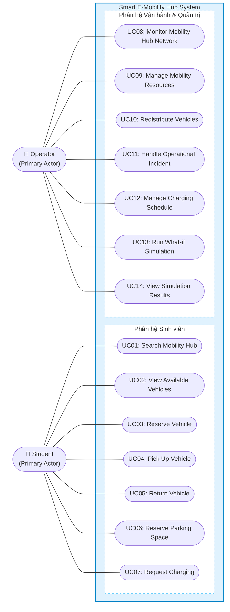
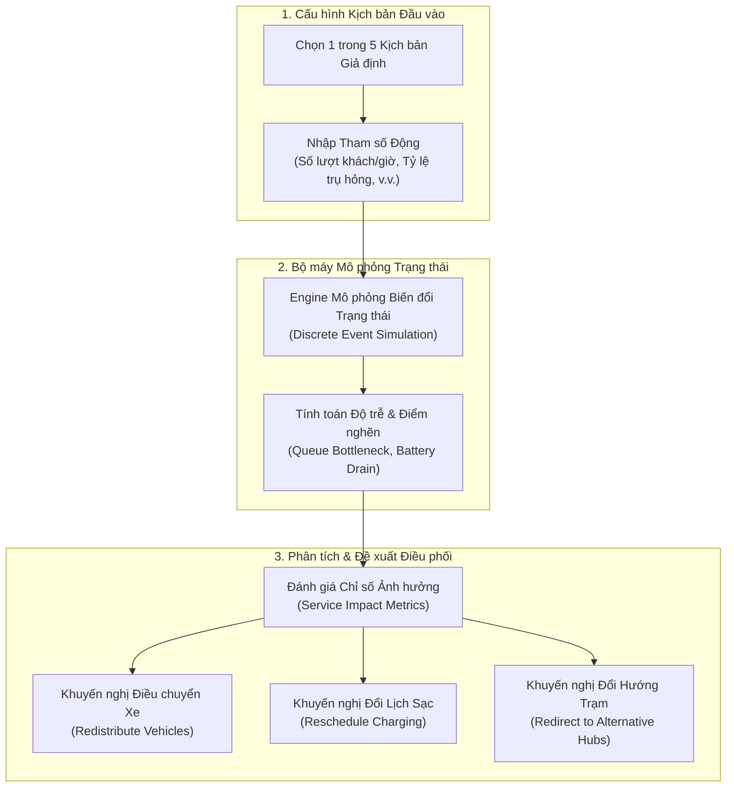

# Smart E-Mobility Hub – Hệ thống Điều phối Phương tiện Điện Khu đô thị ĐHQG-HCM

> **Bài tập lớn môn:** Công nghệ Phần mềm (Software Engineering) – Học kỳ 261  
> **Cơ sở đào tạo:** Đại học Quốc gia TP. Hồ Chí Minh (VNU-HCM)  
> **Định dạng tài liệu:** Báo cáo kỹ thuật đặc tả yêu cầu, thiết kế kiến trúc và hướng dẫn phát triển hệ thống  

---

## 📌 MỤC LỤC
1. [Giới thiệu & Bối cảnh Đề tài](#1-giới-thiệu--bối-cảnh-đề-tài)
2. [Mục tiêu & Trọng tâm Kỹ thuật](#2-mục-tiêu--trọng-tâm-kỹ-thuật)
3. [Phân tích Tác nhân & Đặc tả Yêu cầu Chức năng (FRs)](#3-phân-tích-tác-nhân--đặc-tả-yêu-cầu-chức-năng-frs)
   - [3.1. Phân tích Tác nhân Hệ thống (System Actors & Stakeholders)](#31-phân-tích-tác-nhân-hệ-thống-system-actors--stakeholders)
   - [3.2. Sơ đồ Use Case Tổng quan & Bảng Ánh xạ 14 Use Cases](#32-sơ-đồ-use-case-tổng-quan--bảng-ánh-xạ-14-use-cases)
   - [3.3. Phân hệ Sinh viên (Student Perspective - UC01 đến UC07)](#33-phân-hệ-sinh-viên-student-perspective---uc01-đến-uc07)
   - [3.4. Phân hệ Quản trị & Vận hành (Operator Perspective - UC08 đến UC14)](#34-phân-hệ-quản-trị--vận-hành-operator-perspective---uc08-đến-uc14)
   - [3.5. Bộ máy Mô phỏng & Phân tích Kịch bản (What-if Simulation Engine)](#35-bộ-máy-mô-phỏng--phân-tích-kịch-bản-what-if-simulation-engine)
   - [3.6. Yêu cầu Chức năng Phi tương tác (Non-interactive FRs - Điểm cộng)](#36-yêu-cầu-chức-năng-phi-tương-tác-non-interactive-frs---điểm-cộng)
4. [Đặc tả Yêu cầu Phi chức năng (NFRs)](#4-đặc-tả-yêu-cầu-phi-chức-năng-nfrs)
5. [Cấu trúc Lộ trình Nộp bài & Tiêu chí Đánh giá](#5-cấu-trúc-lộ-trình-nộp-bài--tiêu-chí-đánh-giá)
   - [Giai đoạn 1: Submission #1 (Đặc tả Yêu cầu & Use Case)](#giai-đoạn-1-submission-1-đặc-tả-yêu-cầu--use-case)
   - [Giai đoạn 2: Submission #2 (Mô hình Động & Giao diện UI)](#giai-đoạn-2-submission-2-mô-hình-động--giao-diện-ui)
   - [Giai đoạn 3: Submission #3 (Kiến trúc Hệ thống & Thiết kế Chi tiết)](#giai-đoạn-3-submission-3-kiến-trúc-hệ-thống--thiết-kế-chi-tiết)
   - [Giai đoạn 4: Submission #Final & Trình diễn MVP](#giai-đoạn-4-submission-final--trình-diễn-mvp)
6. [Thiết kế Giao diện UI/UX & Bản mẫu Tương tác (03_App)](#6-thiết-kế-giao-diện-uiux--bản-mẫu-tương-tác-03_app)
   - [6.1. Triết lý Thiết kế: 2 Luồng Nghiệp vụ & 3 Giao diện Độc lập](#61-triết-lý-thiết-kế-2-luồng-nghiệp-vụ--3-giao-diện-độc-lập)
   - [6.2. Hệ thống Nhận diện Giao diện (Design System & Color Palette)](#62-hệ-thống-nhận-diện-giao-diện-design-system--color-palette)
   - [6.3. Bảng Ánh xạ 14 Use Cases sang 26 Màn hình Giao diện](#63-bảng-ánh-xạ-14-use-cases-sang-26-màn-hình-giao-diện)
   - [6.4. Các Kịch bản Trình diễn Mẫu (Suggested Demo Flows)](#64-các-kịch-bản-trình-diễn-mẫu-suggested-demo-flows)
   - [6.5. Kiểm định Tự động (Automated Verification) & Bộ Tài liệu Xuất khẩu](#65-kiểm-định-tự-động-automated-verification--bộ-tài-liệu-xuất-khẩu)
   - [6.6. Hướng dẫn Mở & Thao tác Trực tiếp trên Trình duyệt](#66-hướng-dẫn-mở--thao-tác-trực-tiếp-trên-trình-duyệt)
7. [Quy chuẩn Làm việc Nhóm & Họp định kỳ](#7-quy-chuẩn-làm-việc-nhóm--họp-định-kỳ)
8. [Chính sách Khai báo & Sử dụng Generative AI](#8-chính-sách-khai-báo--sử-dụng-generative-ai)
9. [Cấu trúc Thư mục Workspace & Danh mục Tài nguyên](#9-cấu-trúc-thư-mục-workspace--danh-mục-tài-nguyên)
10. [Hướng dẫn Xem & Chỉnh sửa Sơ đồ Offline](#10-hướng-dẫn-xem--chỉnh-sửa-sơ-đồ-offline)

---

## 1. GIỚI THIỆU & BỐI CẢNH ĐỀ TÀI

Khu đô thị Đại học Quốc gia TP. Hồ Chí Minh (VNU-HCM Urban Area) là một tổ hợp rộng lớn bao gồm nhiều trường đại học thành viên, ký túc xá (Khu A, Khu B), nhà văn hóa sinh viên, thư viện trung tâm, các khu dịch vụ tiện ích và đầu mối giao thông công cộng.

Trong xu thế phát triển giao thông xanh và thông minh, việc đưa **Tuyến Metro số 1 (Bến Thành – Suối Tiên)** vào vận hành với **Ga Đại học Quốc gia** đóng vai trò là cửa ngõ giao thông huyết mạch. Sinh viên và cán bộ giảng viên sau khi đến ga Metro cần các phương tiện giao thông kết nối chặng cuối (last-mile connectivity) như:
- Xe đạp điện dùng chung (Shared E-Bicycles).
- Xe máy điện dùng chung (Shared E-Motorcycles).
- Phương tiện điện cá nhân của sinh viên (Private Electric Vehicles).

Vấn đề đặt ra không dừng lại ở bài toán quản lý xe thông thường, mà là bài toán **điều phối đa tài nguyên phân tán** (Distributed Multi-Resource Coordination):
- **Cân bằng chỗ đỗ xe:** Tránh tình trạng quá tải (Hub đầy chỗ không thể trả xe) hoặc cạn kiệt xe tại các Hub giờ cao điểm.
- **Tối ưu hạ tầng sạc:** Số lượng trụ/cổng sạc có giới hạn, cần thuật toán lập lịch thông minh ưu tiên cho xe pin yếu hoặc xe sắp có lượt sử dụng.
- **Phục vụ đa đối tượng:** Đáp ứng đồng thời nhu cầu thuê xe dùng chung và nhu cầu gửi/sạc của xe điện cá nhân.

---

## 2. MỤC TIÊU & TRỌNG TÂM KỸ THUẬT

### 2.1. Mục tiêu cốt lõi
Xây dựng hệ thống phần mềm **Smart E-Mobility Hub** mô phỏng mạng lưới các trạm trung chuyển (Mobility Hubs) đặt tại các vị trí chiến lược:
1. **Ga Metro ĐHQG (Hub chính đón luồng khách).**
2. **Ký túc xá Khu A & Ký túc xá Khu B.**
3. **Các khuôn viên trường đại học:** Bách Khoa, Khoa học Tự nhiên, KHXH&NV, Công nghệ Thông tin, Quốc Tế, Kinh tế - Luật,...
4. **Khu dịch vụ & Thư viện trung tâm.**

Mỗi Hub được trang bị:
- Danh sách vị trí đỗ (Parking Slots).
- Hệ thống cổng sạc thông minh (Charging Points).
- Đội xe điện dùng chung (Shared EVs).

Dữ liệu trạng thái của xe (mức pin, vị trí, trạng thái hoạt động), tình trạng cổng sạc và chỗ đỗ được cập nhật **gần thời gian thực (near real-time)** thông qua cảm biến IoT hoặc dữ liệu giả lập (simulated stream).

### 2.2. Định hướng Kỹ thuật Công nghệ Phần mềm
> [!IMPORTANT]
> **Trọng tâm đề tài không nằm ở việc chế tạo phần cứng IoT hay dựng đồ họa bản đồ 3D phức tạp.**
> 
> Thay vào đó, đề tài tập trung vào việc áp dụng chuẩn mực các nguyên lý và kỹ thuật Công nghệ Phần mềm (Software Engineering) để giải quyết:
> 1. **Quản lý trạng thái phức tạp (State Management):** Vòng đời xe (Available, Reserved, In-Use, Charging, Faulty, Maintenance), trạng thái cổng sạc và slot đỗ.
> 2. **Phân bổ tài nguyên đồng thời (Resource Allocation & Concurrency):** Tránh hiện tượng tranh chấp (race conditions), double-booking chỗ đỗ hoặc xe.
> 3. **Lập lịch sạc thông minh (Smart Charging Scheduling):** Sắp xếp hàng đợi sạc tối ưu theo thứ tự ưu tiên pin và lịch trình.
> 4. **Điều phối luồng nghiệp vụ phân tán (Vehicle Dispatching & Rebalancing):** Tự động phát hiện và đề xuất luồng vận chuyển xe giữa các Hub.
> 5. **Mô phỏng kịch bản giả định (What-if Scenario Simulation):** Dự báo biến động hệ thống để hỗ trợ ra quyết định vận hành.

---

## 3. PHÂN TÍCH TÁC NHÂN & ĐẶC TẢ YÊU CẦU CHỨC NĂNG (FRS)

### 3.1. Phân tích Tác nhân Hệ thống (System Actors & Stakeholders)
Theo quy chuẩn UML và kỹ nghệ phần mềm phân tán, hệ thống phân định rõ ràng giữa các tác nhân bên ngoài tương tác qua ranh giới hệ thống:

1. **Primary Actors (Tác nhân chính - Khởi xướng hành vi):**
   - **Student (Sinh viên - Đặt bên TRÁI):** Người dùng cuối trong khuôn viên ĐHQG. Thực hiện các nhu cầu di chuyển: tìm kiếm Hub, kiểm tra phương tiện khả dụng, đặt trước xe/chỗ đỗ, nhận và trả xe, gửi yêu cầu sạc cho xe dùng chung hoặc phương tiện cá nhân.
   - **Operator (Đơn vị Vận hành - Đặt bên TRÁI):** Tác nhân chính khởi xướng vận hành toàn mạng lưới. Theo dõi dashboard thời gian thực, quản lý tài nguyên xe và hạ tầng, điều chuyển tái cân bằng xe giữa các Hub, xử lý sự cố thiết bị, tối ưu hóa lịch sạc và **chạy các kịch bản mô phỏng What-if**.

2. **Secondary / External Actors (Tác nhân hỗ trợ / Hệ thống ngoài - Đặt bên PHẢI):**
   - **IoT Sensor Stream / Simulated Telemetry:** Hệ thống cảm biến telemetry (hoặc luồng dữ liệu giả lập) cung cấp dữ liệu định kỳ gần thời gian thực về mức pin, tọa độ xe, tình trạng chiếm dụng slot đỗ và trạng thái hoạt động của cổng sạc.
   - **Notification Service:** Dịch vụ gửi thông báo cảnh báo (SMS/Email/Push Notification) về trạng thái đặt xe, hủy đặt do quá hạn, hoặc cảnh báo bất thường.

> [!NOTE]
> **Lưu ý Chuẩn UML:** Bộ máy mô phỏng (*What-if Simulation Engine*) là một **thành phần nghiệp vụ nội tại (Internal Subsystem)** nằm hoàn toàn bên trong ranh giới hệ thống (System Boundary), được điều khiển bởi tác nhân **Operator** (thông qua UC13 & UC14), tuyệt đối không mô hình hóa bộ máy này như một Actor độc lập.

---

### 3.2. Sơ đồ Use Case Tổng quan & Bảng Ánh xạ 14 Use Cases

Toàn bộ hệ thống được chuẩn hóa thành **14 Use Cases cốt lõi** (7 ca sử dụng cho Sinh viên và 7 ca sử dụng cho Đơn vị Vận hành), bao bọc 100% trong khung ranh giới hệ thống:



#### Bảng Ánh xạ 14 Use Cases với Tài nguyên Thiết kế trong Workspace:

| STT | Mã UC | Tên Use Case | Tác nhân chính | File Sơ đồ Draw.io Vector | File Ảnh |
| :---: | :---: | :--- | :---: | :--- | :--- |
| **00** | **SYS** | **Sơ đồ Tổng quan Toàn Hệ thống** | All Actors | [`general_usecase_diagram.drawio.svg`](./01_Diagram/01_Usecase_Diagram/GENERAL/general_usecase_diagram.drawio.svg) | [Ảnh PNG](./01_Diagram/01_Usecase_Diagram/GENERAL/general_usecase_diagram.png) |
| **01** | **UC01** | Tìm kiếm Hub di chuyển (`Search Mobility Hub`) | Student | [`UC01-Search_Mobility_Hub.drawio.svg`](./01_Diagram/01_Usecase_Diagram/STUDENTS/UC01-Search_Mobility_Hub.drawio.svg) | [Ảnh PNG](./01_Diagram/01_Usecase_Diagram/STUDENTS/UC01-Search_Mobility_Hub.png) |
| **02** | **UC02** | Xem danh sách xe khả dụng (`View Available Vehicles`) | Student | [`UC02-View_Available_Vehicles.drawio.svg`](./01_Diagram/01_Usecase_Diagram/STUDENTS/UC02-View_Available_Vehicles.drawio.svg) | [Ảnh PNG](./01_Diagram/01_Usecase_Diagram/STUDENTS/UC02-View_Available_Vehicles.png) |
| **03** | **UC03** | Đặt trước phương tiện (`Reserve Vehicle`) | Student | [`UC03-Reserve_Vehicle.drawio.svg`](./01_Diagram/01_Usecase_Diagram/STUDENTS/UC03-Reserve_Vehicle.drawio.svg) | [Ảnh PNG](./01_Diagram/01_Usecase_Diagram/STUDENTS/UC03-Reserve_Vehicle.png) |
| **04** | **UC04** | Nhận phương tiện tại Hub (`Pick Up Vehicle`) | Student | [`UC04-Pick_Up_Vehicle.drawio.svg`](./01_Diagram/01_Usecase_Diagram/STUDENTS/UC04-Pick_Up_Vehicle.drawio.svg) | [Ảnh PNG](./01_Diagram/01_Usecase_Diagram/STUDENTS/UC04-Pick_Up_Vehicle.png) |
| **05** | **UC05** | Trả phương tiện tại Hub (`Return Vehicle`) | Student | [`UC05-Return_Vehicle.drawio.svg`](./01_Diagram/01_Usecase_Diagram/STUDENTS/UC05-Return_Vehicle.drawio.svg) | [Ảnh PNG](./01_Diagram/01_Usecase_Diagram/STUDENTS/UC05-Return_Vehicle.png) |
| **06** | **UC06** | Đặt trước chỗ đỗ xe (`Reserve Parking Space`) | Student | [`UC06-Reserve_Parking_Space.drawio.svg`](./01_Diagram/01_Usecase_Diagram/STUDENTS/UC06-Reserve_Parking_Space.drawio.svg) | [Ảnh PNG](./01_Diagram/01_Usecase_Diagram/STUDENTS/UC06-Reserve_Parking_Space.png) |
| **07** | **UC07** | Yêu cầu sạc điện (`Request Charging`) | Student | [`UC07-Request_Charging.drawio.svg`](./01_Diagram/01_Usecase_Diagram/STUDENTS/UC07-Request_Charging.drawio.svg) | [Ảnh PNG](./01_Diagram/01_Usecase_Diagram/STUDENTS/UC07-Request_Charging.png) |
| **08** | **UC08** | Giám sát mạng lưới Hub (`Monitor Mobility Hub Network`) | Operator | [`UC8-Monitor_Mobility_Hub_Network.drawio.svg`](./01_Diagram/01_Usecase_Diagram/OPERATOR/UC8-Monitor_Mobility_Hub_Network.drawio.svg) | [Ảnh PNG](./01_Diagram/01_Usecase_Diagram/OPERATOR/UC8-Monitor_Mobility_Hub_Network.png) |
| **09** | **UC09** | Quản lý tài nguyên vận hành (`Manage Mobility Resources`) | Operator | [`UC9-Manage_Mobility_Resources.drawio.svg`](./01_Diagram/01_Usecase_Diagram/OPERATOR/UC9-Manage_Mobility_Resources.drawio.svg) | [Ảnh PNG](./01_Diagram/01_Usecase_Diagram/OPERATOR/UC9-Manage_Mobility_Resources.png) |
| **10** | **UC10** | Điều phối & Cân bằng xe (`Redistribute Vehicles`) | Operator | [`UC10-Redistribute_Vehicles.drawio.svg`](./01_Diagram/01_Usecase_Diagram/OPERATOR/UC10-Redistribute_Vehicles.drawio.svg) | [Ảnh PNG](./01_Diagram/01_Usecase_Diagram/OPERATOR/UC10-Redistribute_Vehicles.png) |
| **11** | **UC11** | Xử lý sự cố vận hành (`Handle Operational Incident`) | Operator | [`UC11-Handle_Operational_Incident.drawio.svg`](./01_Diagram/01_Usecase_Diagram/OPERATOR/UC11-Handle_Operational_Incident.drawio.svg) | [Ảnh PNG](./01_Diagram/01_Usecase_Diagram/OPERATOR/UC11-Handle_Operational_Incident.png) |
| **12** | **UC12** | Quản lý & Lập lịch sạc (`Manage Charging Schedule`) | Operator | [`UC12-Manage_Charging_Schedule.drawio.svg`](./01_Diagram/01_Usecase_Diagram/OPERATOR/UC12-Manage_Charging_Schedule.drawio.svg) | [Ảnh PNG](./01_Diagram/01_Usecase_Diagram/OPERATOR/UC12-Manage_Charging_Schedule.png) |
| **13** | **UC13** | Chạy mô phỏng kịch bản What-if (`Run What-if Simulation`) | Operator | [`UC13-Run_What-if_Simulation.drawio.svg`](./01_Diagram/01_Usecase_Diagram/OPERATOR/UC13-Run_What-if_Simulation.drawio.svg) | [Ảnh PNG](./01_Diagram/01_Usecase_Diagram/OPERATOR/UC13-Run_What-if_Simulation.png) |
| **14** | **UC14** | Xem kết quả mô phỏng & Đề xuất (`View Simulation Results`) | Operator | [`UC14-View_Simulation_Results.drawio.svg`](./01_Diagram/01_Usecase_Diagram/OPERATOR/UC14-View_Simulation_Results.drawio.svg) | [Ảnh PNG](./01_Diagram/01_Usecase_Diagram/OPERATOR/UC14-View_Simulation_Results.png) |

---

### 3.3. Phân hệ Sinh viên (Student Perspective - UC01 đến UC07)

#### UC01: Tìm kiếm Hub di chuyển (`Search Mobility Hub`)
- **Tác nhân:** `Student`
- **Mục tiêu:** Giúp sinh viên tra cứu và lựa chọn Hub phù hợp nhất cho lộ trình di chuyển (từ Ga Metro về trường hoặc giữa các cơ sở).
- **Quan hệ kỹ thuật:**
  - `Filter by Vehicle Type` $\xrightarrow{\ll extend \gg}$ `Search Mobility Hub`: Lọc danh sách Hub có sẵn loại xe mong muốn (xe đạp điện hoặc xe máy điện).
  - `Filter by Distance` $\xrightarrow{\ll extend \gg}$ `Search Mobility Hub`: Lọc theo bán kính khoảng cách địa lý gần nhất.
- **Sơ đồ chi tiết:** Xem file [`UC01-Search_Mobility_Hub.drawio.svg`](./01_Diagram/01_Usecase_Diagram/STUDENTS/UC01-Search_Mobility_Hub.drawio.svg).

#### UC02: Xem danh sách xe khả dụng (`View Available Vehicles`)
- **Tác nhân:** `Student`
- **Mục tiêu:** Cung cấp thông tin chi tiết về từng phương tiện tại Hub được chọn để sinh viên quyết định trước khi đặt xe.
- **Quan hệ kỹ thuật:**
  - `View Vehicle Details` $\xrightarrow{\ll extend \gg}$ `View Available Vehicles`: Xem thông số xe, mức % pin còn lại, tình trạng kỹ thuật và ước lượng cự ly di chuyển khả dụng (Estimated Range).
- **Sơ đồ chi tiết:** Xem file [`UC02-View_Available_Vehicles.drawio.svg`](./01_Diagram/01_Usecase_Diagram/STUDENTS/UC02-View_Available_Vehicles.drawio.svg).

#### UC03: Đặt trước phương tiện (`Reserve Vehicle`)
- **Tác nhân:** `Student`
- **Mục tiêu:** Cho phép sinh viên giữ chỗ xe trước tối đa 15 phút, đảm bảo có xe khi đến Hub.
- **Quan hệ kỹ thuật:**
  - `Reserve Vehicle` $\xrightarrow{\ll include \gg}$ `Verify Vehicle Availability`: Bắt buộc kiểm tra tính khả dụng của xe và khóa trạng thái sang `Reserved` nhằm ngăn chặn xung đột double-booking.
- **Sơ đồ chi tiết:** Xem file [`UC03-Reserve_Vehicle.drawio.svg`](./01_Diagram/01_Usecase_Diagram/STUDENTS/UC03-Reserve_Vehicle.drawio.svg).

#### UC04: Nhận phương tiện tại Hub (`Pick Up Vehicle`)
- **Tác nhân:** `Student`
- **Mục tiêu:** Xác thực lượt đặt xe và mở khóa vật lý để sinh viên bắt đầu hành trình.
- **Quan hệ kỹ thuật:**
  - `Pick Up Vehicle` $\xrightarrow{\ll include \gg}$ `Validate Reservation Status`: Kiểm tra mã đặt chỗ / QR code hợp lệ và còn trong thời hạn 15 phút.
  - `Pick Up Vehicle` $\xrightarrow{\ll include \gg}$ `Unlock Vehicle`: Kích hoạt tín hiệu mở khóa chốt điện tử của phương tiện.
  - `Report Vehicle Damage` $\xrightarrow{\ll extend \gg}$ `Pick Up Vehicle`: Cho phép sinh viên chụp ảnh báo cáo hư hại (xẹp lốp, trầy xước, phanh yếu) trước khi lấy xe ra khỏi trạm.
- **Sơ đồ chi tiết:** Xem file [`UC04-Pick_Up_Vehicle.drawio.svg`](./01_Diagram/01_Usecase_Diagram/STUDENTS/UC04-Pick_Up_Vehicle.drawio.svg).

#### UC05: Trả phương tiện tại Hub (`Return Vehicle`)
- **Tác nhân:** `Student`
- **Mục tiêu:** Kết thúc chuyến đi, khóa xe an toàn tại Hub đích và cập nhật sức chứa của trạm.
- **Quan hệ kỹ thuật:**
  - `Return Vehicle` $\xrightarrow{\ll include \gg}$ `Check Hub Space Availability`: Xác nhận Hub đích còn vị trí đỗ trống hợp lệ.
  - `Return Vehicle` $\xrightarrow{\ll include \gg}$ `Verify Vehicle & Battery Status`: Ghi nhận % pin thực tế khi trả xe và trạng thái khóa chốt vật lý.
  - `Return Vehicle` $\xrightarrow{\ll include \gg}$ `Confirm Vehicle Return`: Đóng hành trình, tính phí dịch vụ (nếu có) và cập nhật xe về trạng thái `Available` hoặc `Needs Charging`.
- **Sơ đồ chi tiết:** Xem file [`UC05-Return_Vehicle.drawio.svg`](./01_Diagram/01_Usecase_Diagram/STUDENTS/UC05-Return_Vehicle.drawio.svg).

#### UC06: Đặt trước chỗ đỗ xe (`Reserve Parking Space`)
- **Tác nhân:** `Student` (Đặc biệt dành cho sinh viên mang phương tiện điện cá nhân hoặc cần giữ chỗ đỗ trả xe).
- **Mục tiêu:** Đảm bảo chắc chắn có vị trí đỗ tại Hub điểm đến trong giờ cao điểm.
- **Quan hệ kỹ thuật:**
  - `Reserve Parking Space` $\xrightarrow{\ll include \gg}$ `Check Parking Availability`: Kiểm tra số lượng slot đỗ còn trống tại Hub đích.
  - `Reserve Parking Space` $\xrightarrow{\ll include \gg}$ `Validate Vehicle Information`: Kiểm tra thông tin biển số và loại phương tiện cá nhân.
  - `Reserve Parking Space` $\xrightarrow{\ll include \gg}$ `Confirm Parking Reservation`: Khóa giữ chỗ đỗ và cấp mã QR check-in.
  - Ca sử dụng kết hợp: `Cancel Parking Reservation` (sinh viên có thể chủ động hủy đặt chỗ nếu thay đổi lịch trình).
- **Sơ đồ chi tiết:** Xem file [`UC06-Reserve_Parking_Space.drawio.svg`](./01_Diagram/01_Usecase_Diagram/STUDENTS/UC06-Reserve_Parking_Space.drawio.svg).

#### UC07: Yêu cầu sạc điện (`Request Charging`)
- **Tác nhân:** `Student` (Cho xe dùng chung cần bổ sung pin hoặc xe điện cá nhân).
- **Mục tiêu:** Đăng ký sử dụng trụ/cổng sạc thông minh tại Hub theo khung giờ xác định.
- **Quan hệ kỹ thuật:**
  - `Request Charging` $\xrightarrow{\ll include \gg}$ `Check Charging Availability`: Kiểm tra cổng sạc tương thích và công suất điện tức thời của Hub.
  - `Request Charging` $\xrightarrow{\ll include \gg}$ `Validate Charging Request`: Xác thực loại chuẩn sạc, dung lượng pin và thời gian sạc mong muốn.
  - `Request Charging` $\xrightarrow{\ll include \gg}$ `Confirm Charging Request`: Xếp xe vào hàng đợi sạc hoặc kích hoạt cấp nguồn.
  - Ca sử dụng kết hợp: `Cancel Charging Request` (cho phép hủy yêu cầu sạc khi chưa thực hiện cắm sạc).
- **Sơ đồ chi tiết:** Xem file [`UC07-Request_Charging.drawio.svg`](./01_Diagram/01_Usecase_Diagram/STUDENTS/UC07-Request_Charging.drawio.svg).

---

### 3.4. Phân hệ Quản trị & Vận hành (Operator Perspective - UC08 đến UC14)

#### UC08: Giám sát mạng lưới Hub (`Monitor Mobility Hub Network`)
- **Tác nhân:** `Operator`
- **Mục tiêu:** Cung cấp bức tranh toàn cảnh (Real-time Dashboard) về hiện trạng của toàn bộ mạng lưới Hub tại ĐHQG.
- **Quan hệ kỹ thuật:**
  - `Monitor Mobility Hub Network` $\xrightarrow{\ll include \gg}$ `View Vehicle Availability and Battery Levels`: Theo dõi số lượng xe và phổ phân bố pin.
  - `Monitor Mobility Hub Network` $\xrightarrow{\ll include \gg}$ `View Parking Occupancy`: Theo dõi tỷ lệ lấp đầy chỗ đỗ tại từng Hub.
  - `Monitor Mobility Hub Network` $\xrightarrow{\ll include \gg}$ `View Charger Status`: Theo dõi tình trạng các trụ sạc (Sẵn sàng, Đang sạc, Lỗi nguồn).
  - `Inspect Selected Hub` $\xrightarrow{\ll extend \gg}$ `Monitor Mobility Hub Network`: Mở rộng xem chi tiết nội bộ một Hub cụ thể khi có dấu hiệu quá tải hoặc sự cố.
- **Sơ đồ chi tiết:** Xem file [`UC8-Monitor_Mobility_Hub_Network.drawio.svg`](./01_Diagram/01_Usecase_Diagram/OPERATOR/UC8-Monitor_Mobility_Hub_Network.drawio.svg).

#### UC09: Quản lý tài nguyên vận hành (`Manage Mobility Resources`)
- **Tác nhân:** `Operator`
- **Mục tiêu:** Quản trị vòng đời của phương tiện, cổng sạc và vị trí đỗ trong toàn hệ thống.
- **Quan hệ kỹ thuật (Áp dụng Generalization & Include):**
  - Kế thừa chuyên biệt hóa: `Register Resource`, `Update Resource Information`, `Suspend Resource`, `Reactivate Resource` đều kế thừa từ Use Case cha `Manage Mobility Resources`.
  - `Register Resource` & `Update Resource Information` $\xrightarrow{\ll include \gg}$ `Validate Resource Data`: Kiểm tra định danh thiết bị (VIN, MAC address, số hiệu cổng sạc).
- **Sơ đồ chi tiết:** Xem file [`UC9-Manage_Mobility_Resources.drawio.svg`](./01_Diagram/01_Usecase_Diagram/OPERATOR/UC9-Manage_Mobility_Resources.drawio.svg).

#### UC10: Điều phối & Cân bằng xe (`Redistribute Vehicles`)
- **Tác nhân:** `Operator`
- **Mục tiêu:** Tái phân bổ phương tiện giữa các Hub để tránh tình trạng nơi thừa xe nơi cạn kiệt (Rebalancing).
- **Quan hệ kỹ thuật:**
  - `Redistribute Vehicles` $\xrightarrow{\ll include \gg}$ `Check Transferable Vehicles`: Lọc danh sách xe có pin $\ge 80\%$ và không có lịch đặt trước tại Hub nguồn.
  - `Redistribute Vehicles` $\xrightarrow{\ll include \gg}$ `Check Destination Parking Capacity`: Đảm bảo Hub tiếp nhận có đủ slot đỗ trống.
  - `Redistribute Vehicles` $\xrightarrow{\ll include \gg}$ `Create Transfer Order`: Phát hành lệnh vận chuyển xe kèm lộ trình điều động.
  - `Find Alternative Destination Hub` $\xrightarrow{\ll extend \gg}$ `Redistribute Vehicles`: Đề xuất Hub đích dự phòng nếu Hub tiếp nhận mục tiêu bất ngờ bị lấp đầy.
- **Sơ đồ chi tiết:** Xem file [`UC10-Redistribute_Vehicles.drawio.svg`](./01_Diagram/01_Usecase_Diagram/OPERATOR/UC10-Redistribute_Vehicles.drawio.svg).

#### UC11: Xử lý sự cố vận hành (`Handle Operational Incident`)
- **Tác nhân:** `Operator`
- **Mục tiêu:** Tiếp nhận, cách ly và điều phối khắc phục các trục trặc kỹ thuật hoặc sự cố bất thường.
- **Quan hệ kỹ thuật:**
  - `Handle Operational Incident` $\xrightarrow{\ll include \gg}$ `Review Incident Details`: Xem chi tiết báo cáo sự cố (ảnh hỏng hóc, nhật ký lỗi từ cảm biến).
  - `Handle Operational Incident` $\xrightarrow{\ll include \gg}$ `Assess Incident Impact`: Đánh giá mức độ ảnh hưởng đến an toàn và năng lực phục vụ của Hub.
  - `Handle Operational Incident` $\xrightarrow{\ll include \gg}$ `Update Incident Status`: Cập nhật trạng thái xử lý sự cố (`Open` $\rightarrow$ `Investigating` $\rightarrow$ `Resolved`).
  - `Handle Operational Incident` $\xrightarrow{\ll include \gg}$ `Isolate Faulty Resource`: Bắt buộc cách ly và khóa thiết bị hỏng để người dùng không chọn nhầm, phù hợp luồng chính và hậu điều kiện UC11.
  - `Handle Operational Incident` $\xrightarrow{\ll include \gg}$ `Schedule Maintenance`: Bắt buộc phân công kỹ thuật viên bảo trì, phù hợp luồng chính và hậu điều kiện UC11.
- **Sơ đồ chi tiết:** Xem file [`UC11-Handle_Operational_Incident.drawio.svg`](./01_Diagram/01_Usecase_Diagram/OPERATOR/UC11-Handle_Operational_Incident.drawio.svg).

#### UC12: Quản lý & Lập lịch sạc (`Manage Charging Schedule`)
- **Tác nhân:** `Operator`
- **Mục tiêu:** Lập lịch sạc thông minh cho các phương tiện, tối ưu hóa công suất trạm biến áp và giảm thiểu thời gian chờ đợi.
- **Quan hệ kỹ thuật:**
  - `Manage Charging Schedule` $\xrightarrow{\ll include \gg}$ `Monitor Charging Queue`: Giám sát danh sách xe đang xếp hàng đợi sạc tại Hub.
  - `Manage Charging Schedule` $\xrightarrow{\ll include \gg}$ `Prioritize Charging Order`: Thuật toán ưu tiên tự động (xe có pin khẩn cấp $<20\%$ hoặc xe có lịch đặt cho chuyến đi sắp diễn ra).
  - `Manage Charging Schedule` $\xrightarrow{\ll include \gg}$ `Allocate Charging Points`: Phân bổ xe vào cổng sạc phù hợp.
  - `Reassign on Port Malfunction` $\xrightarrow{\ll extend \gg}$ `Manage Charging Schedule`: Tự động tái phân bổ xe sang cổng sạc khác nếu cổng đang sạc gặp lỗi ngắt nguồn.
  - `Override Charging Schedule` $\xrightarrow{\ll extend \gg}$ `Manage Charging Schedule`: Cho phép Operator can thiệp bằng tay thay đổi thứ tự ưu tiên trong trường hợp khẩn cấp.
- **Sơ đồ chi tiết:** Xem file [`UC12-Manage_Charging_Schedule.drawio.svg`](./01_Diagram/01_Usecase_Diagram/OPERATOR/UC12-Manage_Charging_Schedule.drawio.svg).

#### UC13: Chạy mô phỏng kịch bản What-if (`Run What-if Simulation`)
- **Tác nhân:** `Operator`
- **Mục tiêu:** Thử nghiệm các tình huống vận hành giả định trước khi quyết định can thiệp thực tế.
- **Quan hệ kỹ thuật:**
  - `Run What-if Simulation` $\xrightarrow{\ll include \gg}$ `Select Simulation Scenario`: Chọn kịch bản kiểm thử (Tải đỉnh Metro, Đầy bãi đỗ, Đột biến sạc, Hỏng trụ sạc, Tồn ứ xe).
  - `Run What-if Simulation` $\xrightarrow{\ll include \gg}$ `Configure Scenario Parameters`: Tùy chỉnh các thông số giả định (tỷ lệ sinh viên đến, số cổng sạc hỏng, thời lượng mô phỏng).
  - `Run What-if Simulation` $\xrightarrow{\ll include \gg}$ `Execute Network Simulation`: Chạy thuật toán mô phỏng diễn biến mạng lưới Hub theo thời gian.
  - `Run What-if Simulation` $\xrightarrow{\ll include \gg}$ `View Simulation Results (UC-14)`: Tự động chuyển hướng hiển thị kết quả phân tích tại UC14.
  - `Apply Coordination Recommendations` $\xrightarrow{\ll extend \gg}$ `Run What-if Simulation`: Cho phép Operator chấp thuận và áp dụng trực tiếp các giải pháp điều phối được máy tính đề xuất.
  - `Export Simulation Report` $\xrightarrow{\ll extend \gg}$ `Run What-if Simulation`: Xuất báo cáo kết quả mô phỏng phục vụ báo cáo quản trị.
- **Sơ đồ chi tiết:** Xem file [`UC13-Run_What-if_Simulation.drawio.svg`](./01_Diagram/01_Usecase_Diagram/OPERATOR/UC13-Run_What-if_Simulation.drawio.svg).

#### UC14: Xem kết quả mô phỏng & Đề xuất (`View Simulation Results`)
- **Tác nhân:** `Operator`
- **Mục tiêu:** Trực quan hóa các chỉ số đo lường hiệu năng và danh sách khuyến nghị điều phối sau khi mô phỏng.
- **Quan hệ kỹ thuật:**
  - `View Simulation Results` $\xrightarrow{\ll include \gg}$ `Display Simulation Metrics`: Hiển thị các chỉ số đo lường cốt lõi (Tỷ lệ phục vụ thành công, thời gian chờ trung bình, số chuyến đi bị từ chối).
  - `View Simulation Results` $\xrightarrow{\ll include \gg}$ `Retrieve Simulation Results`: Truy xuất tập dữ liệu kết quả từ bộ nhớ mô phỏng.
  - `View Simulation Results` $\xrightarrow{\ll include \gg}$ `Display Recommendations`: Trình bày phương án giải quyết (Số lượng xe cần điều chuyển, điều chỉnh khung giờ sạc, hướng dẫn đổi trạm).
  - `Filter Simulation Results` $\xrightarrow{\ll extend \gg}$ `View Simulation Results`: Lọc kết quả theo từng Hub hoặc mốc thời gian cao điểm.
  - `Compare Simulation Results` $\xrightarrow{\ll extend \gg}$ `View Simulation Results`: Đối chiếu so sánh hiệu quả giữa các cấu hình tham số khác nhau.
  - `Export Simulation Results` $\xrightarrow{\ll extend \gg}$ `View Simulation Results`: Xuất dữ liệu biểu đồ và số liệu phân tích dạng CSV/PDF.
- **Sơ đồ chi tiết:** Xem file [`UC14-View_Simulation_Results.drawio.svg`](./01_Diagram/01_Usecase_Diagram/OPERATOR/UC14-View_Simulation_Results.drawio.svg).

---

### 3.5. Bộ máy Mô phỏng & Phân tích Kịch bản (What-if Simulation Engine)

Bộ máy mô phỏng kịch bản là một phân hệ kỹ thuật trọng tâm của đề tài, mô phỏng diễn biến động của toàn bộ mạng lưới phương tiện và trạm sạc:



#### Chi tiết 5 Kịch bản Mô phỏng Bắt buộc theo Đề bài:
1. **Kịch bản 1: Sinh viên tăng đột biến tại Ga Metro vào giờ cao điểm (Metro Station Surge):**
   - *Tình huống giả định:* Chuyến tàu Metro số 1 cập bến Ga ĐHQG mang theo hơn 300 sinh viên cùng lúc vào khung 06:45 – 07:15 sáng, nhu cầu thuê xe tăng vọt gấp 4 lần bình thường.
   - *Mô phỏng tác động:* Hub Metro nhanh chóng cạn kiệt xe khả dụng trong 10 phút, hàng đợi kéo dài, thời gian chờ lấy xe vượt quá 20 phút.
   - *Đề xuất điều phối:* Tự động kích hoạt lệnh điều chuyển 60 xe từ các Hub KTX và bãi dự phòng tập kết sẵn về Hub Metro trước 06:30.
2. **Kịch bản 2: Hub chạm ngưỡng 100% sức chứa chỗ đỗ (Hub Full Parking Capacity):**
   - *Tình huống giả định:* Khung giờ vào lớp tại Hub trường ĐH Bách Khoa và ĐH CNTT đạt 100% tỷ lệ lấp đầy slot đỗ xe.
   - *Mô phỏng tác động:* Sinh viên đi xe thuê và xe cá nhân đến trạm không thể trả xe hoặc gửi xe, gây ách tắc lối vào trạm.
   - *Đề xuất điều phối:* Gửi thông báo chuyển hướng (Reroute) ngay trên ứng dụng di động cho sinh viên đang di chuyển, hướng dẫn trả xe tại Hub Nhà Văn Hóa Sinh Viên (cách 250m) kèm ưu đãi giảm 20% cước phí chuyến đi.
3. **Kịch bản 3: Nhu cầu sạc điện tăng đột biến (Surge in Charging Demand):**
   - *Tình huống giả định:* Thời tiết mưa kéo dài hoặc thời điểm ban đêm (21:00 – 23:00) tại Ký túc xá Khu B, hàng loạt sinh viên cắm sạc xe điện cá nhân và xe dùng chung.
   - *Mô phỏng tác động:* Tổng công suất sạc vượt quá ngưỡng an toàn của trạm biến áp Hub, hàng đợi sạc kéo dài qua đêm.
   - *Đề xuất điều phối:* Áp dụng thuật toán chia ca sạc so le thông minh (Time-of-Use staggered charging), tự động ngắt sạc khi xe đạt 80% pin để nhường cổng sạc cho xe có mức pin dưới 20%.
4. **Kịch bản 4: Trục trặc hỏng hóc một phần cổng sạc (Partial Charging Point Failure):**
   - *Tình huống giả định:* Sự cố ngắn mạch làm 4/8 cổng sạc nhanh tại Hub Trung tâm Thể dục Thể thao bị ngắt điện hoàn toàn.
   - *Mô phỏng tác động:* Giảm 50% năng lực sạc tại trạm, dẫn đến thiếu hụt xe pin đầy sẵn sàng cho khung giờ tiếp theo.
   - *Đề xuất điều phối:* Hệ thống tự động chuyển đổi trạng thái 4 cổng sạc sang `Out of Order`, phân bổ lại các xe đang chờ sang trạm sạc lân cận tại Hub Thư viện Trung tâm và gửi cảnh báo điều động kỹ thuật viên đến sửa chữa.
5. **Kịch bản 5: Xe phân bổ dồn ứ mất cân bằng nghiêm trọng (Excessive Vehicle Clustering):**
   - *Tình huống giả định:* Sau 18:00 mỗi ngày, phần lớn sinh viên di chuyển từ các trường đại học về tụ tập tại khu dịch vụ ăn uống và Ký túc xá, làm các Hub giảng đường hoàn toàn không còn xe.
   - *Mô phỏng tác động:* Sáng hôm sau các Hub khu giảng đường thiếu phương tiện cho sinh viên nội khu di chuyển giữa các phòng thí nghiệm.
   - *Đề xuất điều phối:* Xây dựng lộ trình thu gom và phân phối ban đêm (Night Redistribution Route) cho xe tải chuyên dụng, điều chuyển ngược lại 80 phương tiện về các trường đại học trước 06:00 sáng.

---

### 3.6. Yêu cầu Chức năng Phi tương tác (Non-interactive FRs - Tiêu chí Điểm cộng)

Để đạt điểm cộng (Bonus) trong Submission #1, hệ thống thiết kế các dịch vụ nền (Background Daemons / Automated Jobs) tự động vận hành không phụ thuộc vào thao tác trực tiếp của người dùng:

1. **FR-NI01: Cơ chế Tự động Hủy Đặt chỗ Quá hạn (Auto-cancel Overdue Reservation Daemon):**
   - Định kỳ mỗi 30 giây, tiến trình nền quét toàn bộ các bản ghi `VehicleReservation` và `ParkingReservation`.
   - Mỗi phiếu có `ExpiresAt`: đặt xe là `Reservation_Time + 15 phút`; đặt chỗ đỗ là `ScheduledArrivalTime + 30 phút` theo BR08 trong báo cáo Submission #1. Khi `Current_Time >= ExpiresAt` và phiếu vẫn ở trạng thái `Pending/Reserved` (chưa nhận xe/check-in), hệ thống tự động:
     + Chuyển trạng thái đặt chỗ sang `Expired`.
     + Trả trạng thái xe/chỗ đỗ về `Available`.
     + Gửi thông báo nhắc nhở đến tài khoản sinh viên.
2. **FR-NI02: Dịch vụ Giả lập Tiêu hao Pin & Đồng bộ Telemetry (Simulated Battery Degradation Stream):**
   - Luồng tác vụ chạy ngầm định kỳ mô phỏng sự suy giảm % pin của các phương tiện đang ở trạng thái `In-Use` dựa trên quãng đường và vận tốc di chuyển.
   - Cảnh báo khẩn cấp gửi về hệ thống khi pin xe đang chạy chạm ngưỡng nguy cấp ($<15\%$).
3. **FR-NI03: Bộ kích hoạt Cảnh báo Vượt ngưỡng Sức chứa Hub (Hub Capacity Threshold Watcher):**
   - Lắng nghe sự kiện nhận/trả xe và cập nhật tỷ lệ lấp đầy.
   - Tự động phát sinh cảnh báo mức độ vàng khi Hub đạt $\ge 85\%$ chỗ đỗ hoặc $\le 10\%$ xe khả dụng; phát sinh cảnh báo mức độ đỏ khi đạt $\ge 95\%$ hoặc cạn kiệt xe.
4. **FR-NI04: Tự động Tái Lập Lịch Sạc khi có Biến động Nguồn (Dynamic Charge Queue Rebalancer):**
   - Khi có bất kỳ cổng sạc nào chuyển sang trạng thái `Fault` hoặc có xe mới đăng ký sạc khẩn cấp ($<10\%$ pin), tiến trình nền tự động tính toán lại ma trận độ ưu tiên và cập nhật lại hàng đợi sạc ngay lập tức mà không cần Operator thao tác thủ công.

---

## 4. ĐẶC TẢ YÊU CẦU PHI CHỨC NĂNG (NFRS)

1. **Hiệu năng & Đồng bộ thời gian thực (Performance & Near Real-time):**
   - Độ trễ phản hồi trạng thái xe, slot đỗ và cổng sạc $\le 2$ giây.
   - Thuật toán mô phỏng What-if cho 1.000 phương tiện trên 10 Hub hoàn thành kết quả trong vòng $\le 5$ giây.
2. **Xử lý Xung đột & Tranh chấp Tài nguyên (Concurrency Control):**
   - Đảm bảo tính toàn vẹn (ACID): Tuyệt đối không để xảy ra hiện tượng **Double-Booking** (hai người cùng đặt thành công 1 xe hoặc 1 chỗ đỗ cùng một thời điểm).
3. **Tính Tin cậy & Phục hồi Sự cố (Reliability & Fault Tolerance):**
   - Dữ liệu lượt đặt và lịch trình sạc không bị mất khi ứng dụng khởi động lại.
   - Trạng thái xe gặp sự cố phải được cách ly tức thì khỏi danh sách xe cho thuê.
4. **Khả năng Mở rộng (Scalability):**
   - Kiến trúc module hóa, sẵn sàng mở rộng từ 5 Hub ban đầu lên hàng chục Hub và hàng ngàn phương tiện trong toàn thành phố.
5. **Tính Dễ dùng & Trải nghiệm (Usability & Responsiveness):**
   - Giao diện thân thiện trên thiết bị di động (Mobile Web / App) cho sinh viên thao tác 1 chạm (quét QR, đặt chỗ).
   - Bảng điều khiển trực quan (Dashboard) cho Operator với biểu đồ màu phân biệt trạng thái rõ ràng (Xanh: Khả dụng, Đỏ: Hỏng/Quá tải, Vàng: Đang sạc/Đặt trước).

---

## 5. CẤU TRÚC LỘ TRÌNH NỘP BÀI & TIÊU CHÍ ĐÁNH GIÁ

Theo yêu cầu môn học, bài tập lớn được chia làm 4 cột mốc nộp tài liệu (`.doc`, `.docx` hoặc `.pdf`):

```
┌────────────────────┐     ┌────────────────────┐     ┌────────────────────┐     ┌────────────────────┐
│   SUBMISSION #1    │ ──> │   SUBMISSION #2    │ ──> │   SUBMISSION #3    │ ──> │  SUBMISSION #FINAL │
│  Requirements & UC │     │   Dynamic & UI     │     │ Architecture & Cls │     │ Report & MVP Demo  │
└────────────────────┘     └────────────────────┘     └────────────────────┘     └────────────────────┘
```

### Giai đoạn 1: Submission #1 (Đặc tả Yêu cầu & Use Case)
- **Nội dung Nhóm (Group Work):**
  - Mô tả chi tiết bối cảnh đề tài, phạm vi và mục tiêu hệ thống.
  - Phân tích các bên liên quan (Stakeholders), vai trò và kỳ vọng.
  - **Sơ đồ Use Case toàn hệ thống (System-wide Use Case Diagram).**
  - Danh mục Yêu cầu Phi chức năng (General NFRs).
- **Nội dung Cá nhân (Individual Work):**
  - Viết kịch bản chi tiết (Use Case Description / Scenario) cho Use Case mà từng thành viên phụ trách (luồng chính, luồng thay thế, ngoại lệ, tiền điều kiện, hậu điều kiện).
- **Điểm cộng (Bonus):**
  - Đặc tả các Yêu cầu Chức năng phi tương tác (Non-interactive Functional Requirements).

---

### Giai đoạn 2: Submission #2 (Mô hình Động & Giao diện UI)
- **Nội dung Nhóm (Group Work):**
  - **Thiết kế Giao diện người dùng (UI Mockups / Wireframes cho toàn bộ các màn hình chính):**
    > [!TIP]
    > **Đã hoàn thiện sẵn sàng:** Toàn bộ bộ UI Mockup đã được xây dựng và kiểm định trong thư mục [`03_App/01_UI_UX/`](file:///c:/Users/Triet/Documents/03_Year3/02_SE/03_App/01_UI_UX/). Nhóm có thể sử dụng trực tiếp tài liệu xuất xưởng chuẩn A4 Landscape [`UI-UX.pdf`](file:///c:/Users/Triet/Documents/03_Year3/02_SE/03_App/01_UI_UX/UI-UX.pdf) (14 trang), thư mục 26 ảnh chụp màn hình độ phân giải cao [`screens/`](file:///c:/Users/Triet/Documents/03_Year3/02_SE/03_App/01_UI_UX/screens/), và bản tổng hợp [`design-board.png`](file:///c:/Users/Triet/Documents/03_Year3/02_SE/03_App/01_UI_UX/design-board.png), [`operator-app-board.png`](file:///c:/Users/Triet/Documents/03_Year3/02_SE/03_App/01_UI_UX/operator-app-board.png) để đính kèm vào báo cáo.
- **Nội dung Cá nhân (Individual Work):**
  - **Biểu đồ Tuần tự (Sequence Diagrams):** Cho các luồng nghiệp vụ tương ứng với Use Case phụ trách. Thể hiện rõ các tầng kỹ thuật (UI $\rightarrow$ Controller $\rightarrow$ Service $\rightarrow$ Model/DB).
  - **Biểu đồ Hoạt động (Activity Diagrams):** Thể hiện chi tiết logic rẽ nhánh, luồng song song (Fork/Join) và xử lý lỗi.
- **Điểm cộng (Bonus):**
  - **Biểu đồ Trạng thái (State-chart Diagrams):** Mô hình hóa vòng đời trạng thái của Phương tiện (`Vehicle State Machine`), Cổng sạc (`Charging Point State Machine`) hoặc Lượt đặt chỗ (`Booking State Machine`).

---

### Giai đoạn 3: Submission #3 (Kiến trúc Hệ thống & Thiết kế Chi tiết)
- **Nội dung Nhóm (Group Work):**
  - Góc nhìn Triển khai (Deployment View): Sơ đồ phần cứng, môi trường server, kết nối mạng IoT/Client.
  - Góc nhìn Phát triển (Development / Implementation View): Cấu trúc phân tầng (Layered Architecture), module và thư viện.
- **Nội dung Cá nhân (Individual Work):**
  - **Biểu đồ Lớp (Class Diagram):** Chi tiết thuộc tính, phương thức, quan hệ kết tập/cấu thành/kế thừa.
  - **Đặc tả Phương thức (Method Descriptions):** Mô tả chi tiết mục đích, tham số đầu vào, kiểu dữ liệu trả về và giải thuật cho **100% các phương thức** trong Class Diagram.
- **Điểm cộng (Bonus):**
  - Bộ kịch bản kiểm thử (Test Cases / Unit Tests specification).

---

### Giai đoạn 4: Submission #Final & Trình diễn MVP
- **Báo cáo tổng kết:** Hợp nhất toàn bộ nội dung #1, #2, #3 thành 01 file PDF duy nhất.
- **Phát triển sản phẩm mẫu (MVP Demonstration):**
  - Tự do lựa chọn ngôn ngữ lập trình (HTML/JS, Python, C#, Flutter,...).
  - **Không bắt buộc dựng cơ sở dữ liệu backend phức tạp** (cho phép lưu trữ In-memory hoặc Mock data trong code file để tập trung vào logic nghiệp vụ).
  - **Kế thừa & Trình diễn:** Tận dụng trực tiếp bản mẫu tương tác đa nền tảng trong thư mục [`03_App/01_UI_UX/`](file:///c:/Users/Triet/Documents/03_Year3/02_SE/03_App/01_UI_UX/) (`index.html`, `user-app.html`, `operator-app.html`, `operator-web.html`) để trình diễn chuỗi màn hình thao tác hoàn chỉnh (Sequence of screens) từ lúc sinh viên đặt xe $\rightarrow$ lấy xe $\rightarrow$ trả xe $\rightarrow$ hệ thống điều phối $\rightarrow$ kịch bản What-if.
- **Báo cáo thuyết trình:** Chuẩn bị Slide ngắn gọn, đúng trọng tâm, nêu rõ bài học kinh nghiệm (Lessons learned).
- **Bản Khai báo Sử dụng AI:** Bắt buộc kê khai minh bạch theo quy định môn học (tham khảo mẫu tại Mục 8).

---

## 6. THIẾT KẾ GIAO DIỆN UI/UX & BẢN MẪU TƯƠNG TÁC (`03_App`)

Hệ thống được trang bị bộ khung ứng dụng và bản mẫu tương tác hoàn chỉnh tại thư mục [`03_App/`](file:///c:/Users/Triet/Documents/03_Year3/02_SE/03_App/), xây dựng bằng công nghệ Web thuần (HTML5, CSS3, Modern JavaScript) không phụ thuộc vào thư viện ngoài, tối ưu hóa cho cả việc thuyết minh báo cáo và trình diễn trực tiếp.

### 6.1. Triết lý Thiết kế: 2 Luồng Nghiệp vụ & 3 Giao diện Độc lập
Hệ thống xác định phạm vi sản phẩm (Product Scope) theo các nguyên tắc kỹ thuật chặt chẽ:

1. **Phân hệ Sinh viên / Người dùng phổ thông (Chỉ Mobile App - `user-app.html`):**
   - **Quyết định phạm vi:** **Không cung cấp phiên bản Web máy tính cho Sinh viên.** Người dùng di chuyển trong đô thị ĐHQG chỉ tương tác thông qua ứng dụng di động để tra cứu vị trí gần nhất, mở khóa xe bằng mã/QR và xác nhận trả xe tại bãi.
   - **Tính năng bao phủ:** UC01 $\rightarrow$ UC07 (Tìm Hub, xem xe, giữ chỗ, nhận/trả xe, đặt chỗ đỗ cá nhân, yêu cầu sạc, thông báo và tài khoản).
2. **Phân hệ Đơn vị Vận hành - Hiện trường (Operator Mobile App - `operator-app.html`):**
   - Dành cho kỹ thuật viên và nhân viên tuần tra tại các Hub.
   - Giao diện dạng thẻ (Card-based), thanh điều hướng dưới (Bottom Navigation), danh mục chức năng `#op-menu`, hỗ trợ thao tác một tay để kiểm tra xe hỏng, nhận bàn giao xe điều chuyển hoặc xử lý cổng sạc mất nguồn tại chỗ.
3. **Phân hệ Đơn vị Vận hành - Trung tâm Điều hành (Operator Web Dashboard - `operator-web.html`):**
   - Dành cho người quản trị mạng lưới làm việc trên màn hình máy tính lớn (PC/Laptop).
   - Thanh điều hướng bên trái (Sidebar), bảng số liệu KPI thời gian thực, bản đồ tổng quan các Hub, biểu đồ sức chứa và bảng dữ liệu đa cột phục vụ phân tích chuyên sâu các kịch bản What-if.
4. **Trình duyệt Thiết kế Toàn cảnh (`index.html`):**
   - Shell điều hướng dành riêng cho nhóm phát triển và giảng viên kiểm tra mockup. Cho phép chuyển đổi linh hoạt giữa 3 giao diện và 26 màn hình mà không cần cài đặt web server hay môi trường phức tạp.

---

### 6.2. Hệ thống Nhận diện Giao diện (Design System & Color Palette)
Thiết kế kế thừa phong cách từ các ảnh tham khảo thực tế tại [`03_App/00_Ref/`](file:///c:/Users/Triet/Documents/03_Year3/02_SE/03_App/00_Ref/) (`login.PNG`, `main_menu.PNG`, `map_view.PNG`, `noti1.PNG`, `noti2.PNG`):

- **Màu chủ đạo (Primary Navy):** `#152584` – Thể hiện sự chuyên nghiệp, chuẩn mực của Đại học Quốc gia.
- **Màu điểm nhấn (Accent Cyan):** `#00B8D6` – Biểu trưng cho năng lượng điện xanh, công nghệ thông minh và các nút kêu gọi hành động (Call to Action).
- **Màu nền (Cloud Background):** `#F2F5F9` – Dịu mắt, làm nổi bật các thẻ nội dung màu trắng bo tròn góc (`#FFFFFF`).
- **Trực quan hóa Trạng thái:** Trạng thái xe và cổng sạc luôn được thể hiện đồng thời bằng **văn bản rõ ràng kết hợp màu sắc** (Xanh lá: Sẵn sàng; Vàng: Đang sạc/Đặt trước; Đỏ: Hỏng/Cần bảo trì), tuân thủ tiêu chuẩn Accessibility.
- **Ngôn ngữ:** 100% Tiếng Việt chuẩn hóa ngữ cảnh giáo dục và giao thông ĐHQG-HCM.

---

### 6.3. Bảng Ánh xạ 14 Use Cases sang 26 Màn hình Giao diện

Toàn bộ 14 Use Cases trong hệ thống được hiện thực hóa tương ứng trên các màn hình cụ thể trong prototype:

| Mã UC | Nhóm Nghiệp vụ | Màn hình / Route | Nền tảng hỗ trợ | Tên File Ảnh Màn hình (`screens/`) |
| :---: | :--- | :--- | :---: | :--- |
| — | Tổng quan / Lối tắt | `#home` | Mobile Student | [`home.png`](file:///c:/Users/Triet/Documents/03_Year3/02_SE/03_App/01_UI_UX/screens/home.png) |
| **UC01** | Tìm kiếm Hub di chuyển | `#map` | Mobile Student | [`map.png`](file:///c:/Users/Triet/Documents/03_Year3/02_SE/03_App/01_UI_UX/screens/map.png) |
| **UC02** | Xem danh sách xe khả dụng | `#vehicles` | Mobile Student | [`vehicles.png`](file:///c:/Users/Triet/Documents/03_Year3/02_SE/03_App/01_UI_UX/screens/vehicles.png) |
| **UC03** | Đặt trước phương tiện | `#reserve`, `#ticket` | Mobile Student | [`reserve.png`](file:///c:/Users/Triet/Documents/03_Year3/02_SE/03_App/01_UI_UX/screens/reserve.png), [`ticket.png`](file:///c:/Users/Triet/Documents/03_Year3/02_SE/03_App/01_UI_UX/screens/ticket.png) |
| **UC04** | Nhận phương tiện tại Hub | `#pickup` | Mobile Student | [`pickup.png`](file:///c:/Users/Triet/Documents/03_Year3/02_SE/03_App/01_UI_UX/screens/pickup.png) |
| **UC05** | Trả phương tiện tại Hub | `#trip` | Mobile Student | [`trip.png`](file:///c:/Users/Triet/Documents/03_Year3/02_SE/03_App/01_UI_UX/screens/trip.png) |
| **UC06** | Đặt trước chỗ đỗ xe | `#parking` | Mobile Student | [`parking.png`](file:///c:/Users/Triet/Documents/03_Year3/02_SE/03_App/01_UI_UX/screens/parking.png) |
| **UC07** | Yêu cầu sạc điện cá nhân | `#charging` | Mobile Student | [`charging.png`](file:///c:/Users/Triet/Documents/03_Year3/02_SE/03_App/01_UI_UX/screens/charging.png) |
| — | Thông báo & Tài khoản | `#notifications`, `#account` | Mobile Student | [`notifications.png`](file:///c:/Users/Triet/Documents/03_Year3/02_SE/03_App/01_UI_UX/screens/notifications.png), [`account.png`](file:///c:/Users/Triet/Documents/03_Year3/02_SE/03_App/01_UI_UX/screens/account.png) |
| **UC08** | Giám sát mạng lưới Hub | `#overview` | Mobile & Web Op | [`overview.png`](file:///c:/Users/Triet/Documents/03_Year3/02_SE/03_App/01_UI_UX/screens/overview.png), [`op-mobile-overview.png`](file:///c:/Users/Triet/Documents/03_Year3/02_SE/03_App/01_UI_UX/screens/op-mobile-overview.png) |
| **UC09** | Quản lý tài nguyên vận hành | `#resources` | Mobile & Web Op | [`resources.png`](file:///c:/Users/Triet/Documents/03_Year3/02_SE/03_App/01_UI_UX/screens/resources.png), [`op-mobile-resources.png`](file:///c:/Users/Triet/Documents/03_Year3/02_SE/03_App/01_UI_UX/screens/op-mobile-resources.png) |
| **UC10** | Điều phối & Cân bằng xe | `#redistribute` | Mobile & Web Op | [`redistribute.png`](file:///c:/Users/Triet/Documents/03_Year3/02_SE/03_App/01_UI_UX/screens/redistribute.png), [`op-mobile-redistribute.png`](file:///c:/Users/Triet/Documents/03_Year3/02_SE/03_App/01_UI_UX/screens/op-mobile-redistribute.png) |
| **UC11** | Xử lý sự cố vận hành | `#incidents` | Mobile & Web Op | [`incidents.png`](file:///c:/Users/Triet/Documents/03_Year3/02_SE/03_App/01_UI_UX/screens/incidents.png), [`op-mobile-incidents.png`](file:///c:/Users/Triet/Documents/03_Year3/02_SE/03_App/01_UI_UX/screens/op-mobile-incidents.png) |
| **UC12** | Quản lý & Lập lịch sạc | `#schedule` | Mobile & Web Op | [`schedule.png`](file:///c:/Users/Triet/Documents/03_Year3/02_SE/03_App/01_UI_UX/screens/schedule.png), [`op-mobile-schedule.png`](file:///c:/Users/Triet/Documents/03_Year3/02_SE/03_App/01_UI_UX/screens/op-mobile-schedule.png) |
| **UC13** | Chạy mô phỏng What-if | `#simulation` | Mobile & Web Op | [`simulation.png`](file:///c:/Users/Triet/Documents/03_Year3/02_SE/03_App/01_UI_UX/screens/simulation.png), [`op-mobile-simulation.png`](file:///c:/Users/Triet/Documents/03_Year3/02_SE/03_App/01_UI_UX/screens/op-mobile-simulation.png) |
| **UC14** | Xem kết quả mô phỏng | `#results` | Mobile & Web Op | [`results.png`](file:///c:/Users/Triet/Documents/03_Year3/02_SE/03_App/01_UI_UX/screens/results.png), [`op-mobile-results.png`](file:///c:/Users/Triet/Documents/03_Year3/02_SE/03_App/01_UI_UX/screens/op-mobile-results.png) |
| — | Menu chức năng Operator | `#op-menu` | Mobile Op | [`op-mobile-op-menu.png`](file:///c:/Users/Triet/Documents/03_Year3/02_SE/03_App/01_UI_UX/screens/op-mobile-op-menu.png) |

---

### 6.4. Các Kịch bản Trình diễn Mẫu (Suggested Demo Flows)

Khi thuyết trình và demo MVP, nhóm có thể đi theo 4 kịch bản luồng thao tác liền mạch đã được lập trình sẵn:

1. **Luồng Thuê xe Sinh viên (Happy Path & Exception):**
   `Trang chủ (#home)` $\rightarrow$ Chọn đặt xe $\rightarrow$ Xem xe `EB-024` (pin 92%) $\rightarrow$ Bấm `Xác nhận giữ xe` $\rightarrow$ Nhận `Phiếu giữ xe (#ticket)` $\rightarrow$ Đến trạm bấm `Nhận xe (#pickup)` $\rightarrow$ Nhập sai mã (hệ thống báo lỗi) $\rightarrow$ Nhập đúng mã `EB-024` $\rightarrow$ Chuyển sang màn hình `Hành trình (#trip)` $\rightarrow$ Chọn Hub trả $\rightarrow$ Tích chọn *"Đã đưa vào slot và khóa chốt"* $\rightarrow$ Bấm `Xác nhận trả xe`.
2. **Luồng Phương tiện Cá nhân (Chỗ đỗ & Yêu cầu sạc):**
   `Trang chủ (#home)` $\rightarrow$ Chọn `Chỗ đỗ (#parking)` $\rightarrow$ Chọn Hub đến & khung giờ $\rightarrow$ Chọn ô đỗ trống $\rightarrow$ Xác nhận. Sau đó chuyển sang `Sạc xe (#charging)` $\rightarrow$ Nhập mức pin hiện tại, mức pin cần sạc $\rightarrow$ Gửi yêu cầu sạc thành công.
3. **Luồng Điều hành & Xử lý Hiện trường (Operator Workflow):**
   Đăng nhập tài khoản vận hành $\rightarrow$ Bảng điều khiển `Tổng quan (#overview)` quan sát tỷ lệ lấp đầy các Hub $\rightarrow$ Mở `Điều phối xe (#redistribute)` $\rightarrow$ Kiểm tra sức chứa Hub nguồn và Hub đích $\rightarrow$ Tạo lệnh vận chuyển. Tiếp tục mở `Sự cố (#incidents)` $\rightarrow$ Cách ly cổng sạc bị chập $\rightarrow$ Phân công kỹ thuật viên.
4. **Luồng Mô phỏng What-if & Đề xuất Điều phối:**
   Mở `Mô phỏng (#simulation)` $\rightarrow$ Chọn kịch bản *"Tăng đột biến sinh viên tại Ga Metro giờ cao điểm"* $\rightarrow$ Kéo thanh tham số sinh viên đến ($+300\%$) $\rightarrow$ Bấm `Chạy mô phỏng` $\rightarrow$ Màn hình `Kết quả (#results)` hiển thị so sánh trước và sau (thời gian chờ tăng từ 3 phút lên 22 phút) $\rightarrow$ Xem khuyến nghị *"Điều chuyển 50 xe từ KTX Khu B về Ga Metro"* $\rightarrow$ Bấm `Áp dụng phương án điều phối` hoặc `Xuất dữ liệu JSON`.

---

### 6.5. Kiểm định Tự động (Automated Verification) & Bộ Tài liệu Xuất khẩu

Thư mục `03_App/01_UI_UX/` tích hợp sẵn bộ kiểm thử hồi quy tự động sử dụng **Playwright** (`verify.cjs`), kiểm tra toàn diện 9 tiêu chí chất lượng nghiêm ngặt:
- ✅ Xác thực chuỗi thao tác: Đặt trước $\rightarrow$ Nhập sai mã bị chặn $\rightarrow$ Nhập đúng nhận xe $\rightarrow$ Trả xe thành công.
- ✅ Từ chối yêu cầu sạc khi Hub hết cổng sạc trống.
- ✅ Kiểm định dung lượng và logic tạo lệnh điều chuyển xe (Hub nguồn và đích phải khác nhau, không vượt quá số xe khả dụng).
- ✅ Bộ máy mô phỏng What-if phản hồi chính xác theo tham số đầu vào.
- ✅ 100% 26 màn hình render mượt mà, không phát sinh lỗi JavaScript (`console error`).
- ✅ Kiểm tra responsive: Không bị tràn layout ngang (Horizontal Overflow) trên cả kích thước Mobile (390px) và Desktop (1280px).
- ✅ Phân tách chặt chẽ route giữa quyền Sinh viên và quyền Operator.
- ✅ Kết quả kiểm định tự động được lưu trữ tại file [`verification.json`](file:///c:/Users/Triet/Documents/03_Year3/02_SE/03_App/01_UI_UX/verification.json) (`passed: true`).

**Tài liệu xuất bản đính kèm:**
- [`UI-UX.pdf`](file:///c:/Users/Triet/Documents/03_Year3/02_SE/03_App/01_UI_UX/UI-UX.pdf): Bộ hồ sơ thiết kế giao diện hoàn chỉnh gồm 14 trang A4 Landscape chất lượng cao, sẵn sàng phục vụ **Submission #2** và in ấn báo cáo.
- [`gallery.html`](file:///c:/Users/Triet/Documents/03_Year3/02_SE/03_App/01_UI_UX/gallery.html): Bố cục gallery A4 trình chiếu các trang giao diện.
- [`export.cjs`](file:///c:/Users/Triet/Documents/03_Year3/02_SE/03_App/01_UI_UX/export.cjs): Script tự động chụp màn hình và đóng gói PDF.

---

### 6.6. Hướng dẫn Mở & Thao tác Trực tiếp trên Trình duyệt

Bạn có thể chạy thử nghiệm và tương tác với toàn bộ hệ thống giao diện cực kỳ đơn giản:

1. **Khởi chạy tức thì:** Mở trực tiếp file [`03_App/01_UI_UX/index.html`](file:///c:/Users/Triet/Documents/03_Year3/02_SE/03_App/01_UI_UX/index.html) bằng trình duyệt Microsoft Edge hoặc Google Chrome (nhấp đúp chuột vào file, **không cần cài Node.js hay bật web server**).
2. **Xem app sinh viên:** Nhấp vào nút `App người dùng` trên thanh công cụ trên cùng để tương tác khung điện thoại Mobile.
3. **Xem app vận hành hiện trường:** Nhấp vào nút `App operator` để xem giao diện mobile nội bộ của kỹ thuật viên.
4. **Xem dashboard quản trị PC:** Nhấp vào nút `Web operator` để xem toàn màn hình bảng điều khiển trung tâm máy tính.
5. **Chọn màn hình nhanh:** Dùng menu thả xuống `Màn hình` ở thanh trên cùng để nhảy ngay tới màn hình của Use Case cần kiểm tra.

---

## 7. QUY CHUẨN LÀM VIỆC NHÓM & HỌP ĐỊNH KỲ

1. **Phân công trách nhiệm:** Nhóm được phân ngẫu nhiên bởi giảng viên. Mỗi thành viên **bắt buộc phải tham gia đầy đủ tất cả các giai đoạn** (từ đặc tả yêu cầu, thiết kế kiến trúc đến thiết kế chi tiết), không được chia rẽ theo kiểu người chỉ làm tài liệu, người chỉ làm code.
2. **Họp nhóm hàng tuần (Weekly Team Meetings):**
   - Tối thiểu 1 buổi/tuần.
   - Buổi họp đầu tiên tập trung vào: Quy chế giao tiếp, cam kết tiến độ, rủi ro dự án và cơ chế giải quyết xung đột.
3. **Biên bản họp (Meeting Minutes):**
   - Bắt buộc ghi chép và lưu trữ biên bản cho mọi buổi họp để theo dõi tiến độ công việc và làm căn cứ đánh giá.
4. **Đánh giá chéo cuối kỳ (Peer Evaluation):**
   - Cuối học kỳ, các thành viên cho điểm đánh giá chéo và nhận xét khách quan về đóng góp của từng cá nhân.

---

## 8. CHÍNH SÁCH KHAI BÁO & SỬ DỤNG GENERATIVE AI

> [!CAUTION]
> **Quy định nghiêm ngặt về Liêm chính Học thuật (Academic Integrity):**
> 
> - AI **không bị cấm**, nhưng phải được sử dụng như một **công cụ trợ lực (Supporting Tool)** để gợi mở ý tưởng, tham khảo cấu trúc.
> - Sinh viên phải tự phân tích, chỉnh sửa, phản biện và thể hiện rõ năng lực cá nhân.
> - Điểm số sẽ **rất thấp hoặc bị đánh rớt** nếu lạm dụng AI, sao chép nguyên văn mà không hiểu bản chất nội dung đã nộp.
> - **Khai báo minh bạch là bắt buộc.** Mọi hành vi gian dối, che giấu sẽ bị xử lý nghiêm khắc theo quy chế thi cử.

### Mẫu Khai báo Minh bạch (Generative AI Declaration Form)
Trong báo cáo cuối kỳ, nhóm bắt buộc đính kèm bảng sau:

| Công cụ AI sử dụng | Phạm vi áp dụng | Nội dung AI gợi ý | Nội dung nhóm tự phát triển & điều chỉnh | Mức độ đóng góp của AI (%) |
| :--- | :--- | :--- | :--- | :--- |
| *Ví dụ: OpenAI Codex / Claude* | *Ví dụ: Bố cục Mockup UI/UX & CSS (`03_App`)* | *Gợi ý khung giao diện Web/Mobile và script kiểm thử* | *Chuẩn hóa lại theo nhận diện ĐHQG-HCM, thiết kế chi tiết 26 màn hình khớp 14 Use Case* | *Khoảng 20%* |
| *Ví dụ: Antigravity UML Designer* | *Ví dụ: Khởi tạo khung PlantUML & Draw.io* | *Cú pháp sơ đồ tuần tự và khung ranh giới* | *Tự thiết kế chi tiết logic kiểm tra pin và thuật toán sạc* | *Khoảng 20%* |

---

## 9. CẤU TRÚC THƯ MỤC WORKSPACE & DANH MỤC TÀI NGUYÊN

Dự án được cấu trúc chuyên nghiệp, tích hợp sẵn bộ quy chuẩn UML, prototype UI/UX và extension Draw.io chỉnh sửa offline:

```text
02_SE/
├── 00_Slides/                          # Bài giảng lý thuyết Công nghệ Phần mềm (Ch1 - Ch10)
├── 01_Diagram/01_Usecase_Diagram/                 # Bộ sơ đồ Use Case hoàn chỉnh (Vector .drawio.svg & .png)
│   ├── GENERAL/                        # Sơ đồ tổng quan toàn hệ thống (General Use Case)
│   ├── STUDENTS/                       # 7 Sơ đồ phân hệ Sinh viên (UC01 -> UC07)
│   ├── OPERATOR/                       # 7 Sơ đồ phân hệ Vận hành (UC08 -> UC14)
│   └── PLANTUML_ALL.md                 # Toàn bộ mã nguồn PlantUML & Mermaid cho 15 sơ đồ
├── 02_Rules/                           # Cẩm nang quy chuẩn thiết kế UML (Tiếng Việt)
│   ├── 00_Usecase_diagram.md           # Quy tắc Use Case (Boundary, Actor, include/extend)
│   ├── 01_Activity_diagram.md          # Quy tắc Activity (Decision guards, fork/join, loop escape)
│   ├── 02_Sequence_diagram.md          # Quy tắc Sequence (Lifeline, Activation, alt blocks)
│   ├── 03_Class_diagram.md             # Quy tắc Class (3 ngăn, visibility, multiplicity, quan hệ)
│   ├── 04_Summary.md                   # Tổng hợp chống lỗi sai phổ biến
│   └── 05_PlantUML_Guide.md            # Hướng dẫn chi tiết cú pháp PlantUML
├── 03_App/                             # Bộ khung ứng dụng và Prototype UI/UX hoàn chỉnh
│   ├── 00_Ref/                         # Ảnh chụp tham khảo giao diện thực tế (Login, Main menu, Map, Noti)
│   └── 01_UI_UX/                       # Bản mẫu tương tác HTML/CSS/JS & Bộ kiểm định chất lượng
│       ├── screens/                    # 26 ảnh chụp màn hình độ phân giải cao phục vụ báo cáo
│       ├── index.html                  # Trình duyệt mockup cho nhóm thiết kế (chuyển đổi 3 giao diện)
│       ├── user-app.html               # Bản mẫu Mobile App dành riêng cho Sinh viên
│       ├── operator-app.html           # Bản mẫu Mobile App hiện trường cho Operator
│       ├── operator-web.html           # Bản mẫu Web Dashboard phân tích PC cho Operator
│       ├── gallery.html                # Trang thư viện xuất PDF A4 Landscape 14 trang
│       ├── UI-UX.pdf                   # Hồ sơ thiết kế UI/UX hoàn chỉnh cho Submission #2
│       ├── app.js & styles.css         # Mã nguồn logic tương tác và stylesheet giao diện
│       ├── verify.cjs & export.cjs     # Script kiểm định Playwright và xuất bản tự động
│       ├── verification.json           # Báo cáo kết quả kiểm định 9 tiêu chí giao diện (Passed)
│       └── README.md                   # Hướng dẫn chi tiết về bộ giao diện UI/UX
├── .agent/                             # Quy tắc kích hoạt & script hỗ trợ
│   ├── rules/                          # Bộ quy tắc tự động kích hoạt
│   └── scripts/                        # Python Script vẽ tự động Draw.io SVG chuẩn xác
├── .agents/
│   └── skills/uml-designer/            # Skill UML; quy chuẩn dùng chung tại 02_Rules/
├── .vscode/
│   └── extensions.json                 # Cấu hình gợi ý cài đặt extension Draw.io cho VS Code
├── 04_BTL_SoftwareEngineering_HK261.pdf # Đề bài chính thức từ Giảng viên
├── AGENTS.md                           # Bộ quy tắc dành cho Agent phát triển hệ thống
├── GEMINI.md                           # Tham chiếu AGENTS.md và skill UML
└── README.md                           # Tài liệu master đặc tả dự án (File này)
```

---

## 10. HƯỚNG DẪN XEM & CHỈNH SỬA SƠ ĐỒ OFFLINE
1. **Xem trực tiếp sơ đồ:** Nhấp vào bất kỳ file `.drawio.svg` trong thư mục [01_Diagram/01_Usecase_Diagram/](./01_Diagram/01_Usecase_Diagram/) để xem ảnh vector sắc nét.
2. **Chỉnh sửa giao diện kéo thả:** Mở file `.drawio.svg` trong VS Code (đã kích hoạt extension `hediet.vscode-drawio`).
3. **Chèn mã PlantUML:** Trên thanh công cụ Draw.io, chọn `+` $\rightarrow$ `Advanced` $\rightarrow$ `PlantUML`, dán mã từ file [PLANTUML_ALL.md](./01_Diagram/01_Usecase_Diagram/PLANTUML_ALL.md).
4. **Import vào Visual Paradigm Online:** Chọn `File` $\rightarrow$ `Import` $\rightarrow$ `PlantUML...`.
5. **Trải nghiệm giao diện UI/UX:** Mở trực tiếp file [`03_App/01_UI_UX/index.html`](file:///c:/Users/Triet/Documents/03_Year3/02_SE/03_App/01_UI_UX/index.html) bằng Chrome hoặc Edge.

---
*Tài liệu được thiết lập và quản lý theo tiêu chuẩn Kỹ nghệ Phần mềm ĐHQG-HCM.*
