# Smart E-Mobility Hub — Version 2.0

**Smart E-Mobility Hub** is a unified urban micro-mobility, private EV parking, and smart-charging management platform combining:

- **Backend & Web Consoles (`app/`)**: Node.js / Express modular monolith (`operations`, `parking-charging`, `mobility-simulation`) backed by SQLite (WAL mode, schema `v12`), serving the Operator & Admin web experience (`app/prototype/live.html` via `/operator-web.html` and `/operator-app.html`).
- **Mobile Rider Clients (`android/`, `app/flutter_mobile/`)**: Native Kotlin Jetpack Compose + OpenFreeMap app (`android/`) and Flutter mobile client (`app/flutter_mobile/`) for riders and private EV owners (discover hubs, book/unlock rentals via QR/ticket, reserve private parking, submit smart-charging requests, and report trip incidents).
- **Synchronized Architecture & UML Specification (`docs/`)**: Complete 4+1 views, UC01–UC14 domain contracts, sequence/activity/state-chart/class models, and API contracts reconciled with the live codebase.

> Course duties and milestone checklists from v1.0 have been archived to [docs/reports/SUBMISSION_PROGRESS_ARCHIVE.md](docs/reports/SUBMISSION_PROGRESS_ARCHIVE.md).

---

## Demo Video (Mobile App + Admin Dashboard)

Watch the end-to-end Version 2.0 walkthrough recorded directly from a physical Android device and live browser session:

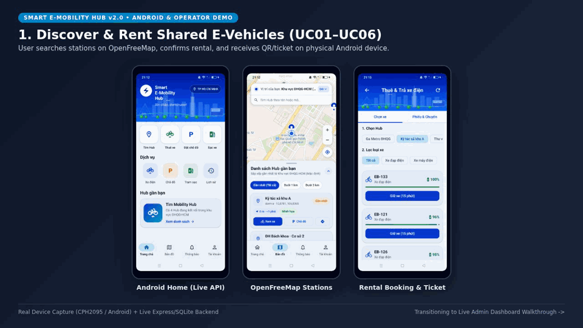

- **Full-resolution video (1280×720 VP8 WebM, 2.3 MB)**: [Open / Download Raw WebM](docs/assets/demo/smart-emobility-v2-demo.webm?raw=1) *(uses `?raw=1` so the browser plays or downloads directly instead of opening GitHub's blob text preview)*

---

## Visual Walkthrough

### 1. Android Rider & Private EV App (`android/`)

| 1. Live Hub Home | 2. OpenFreeMap Discovery | 3. Rental Booking (`UC05`) | 4. QR Unlock & Ticket (`UC06`) |
| :---: | :---: | :---: | :---: |
| 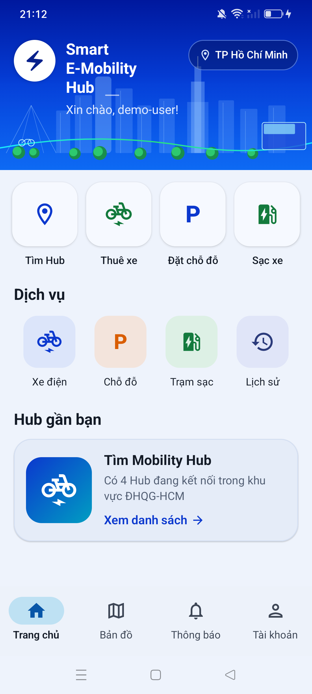 | 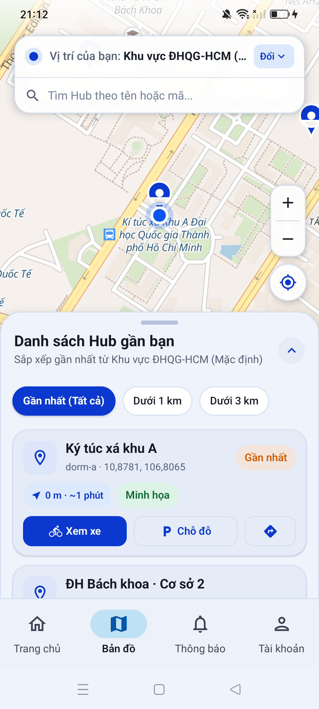 | 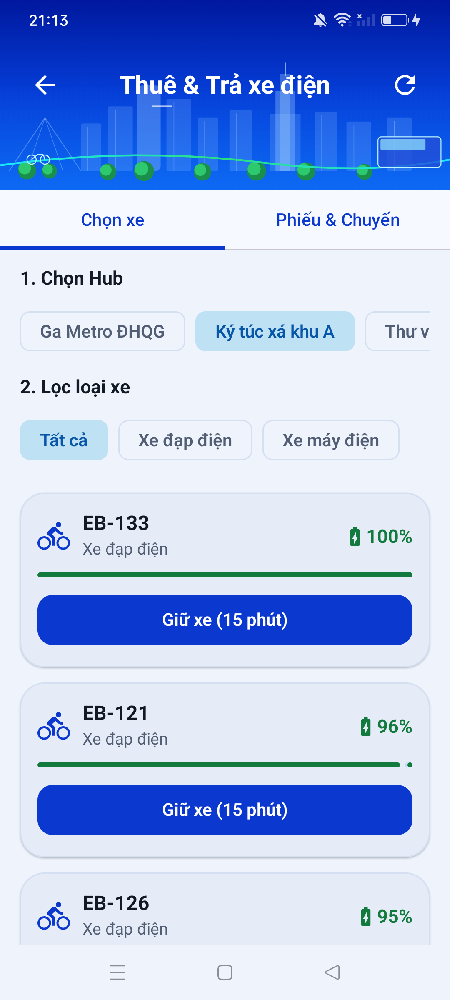 | 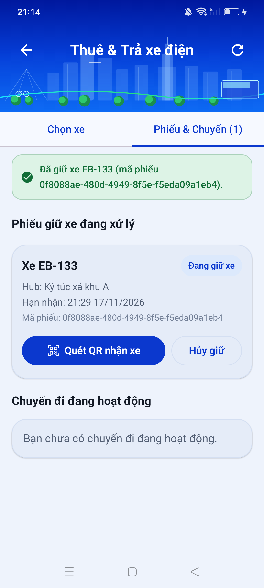 |
| Connects to live `/api/stations` & user trips | Interactive station pins & availability | Select hub/vehicle type & issue booking | Scan/enter vehicle code to start trip |

| 5. Active Trip & Incident Report (`UC06`, `UC11A`) | 6. Private Parking Check-In (`UC08`) | 7. Smart Charging Request (`UC07`, `UC09`) |
| :---: | :---: | :---: |
| 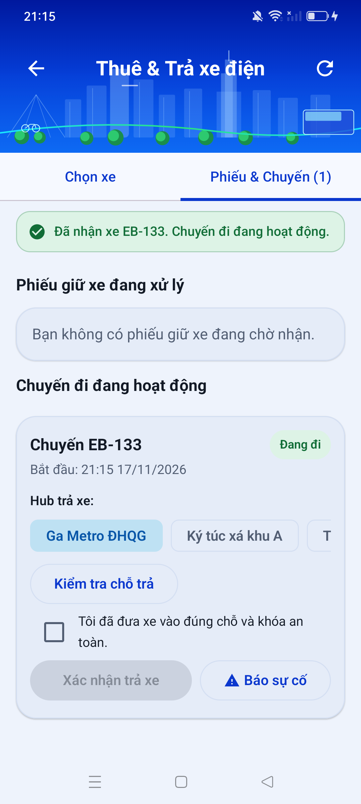 | 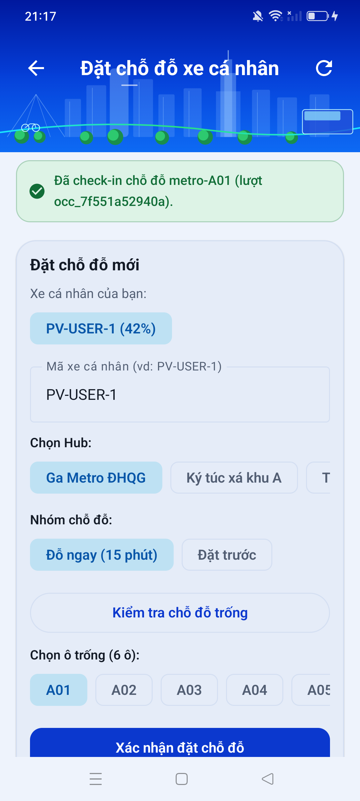 | 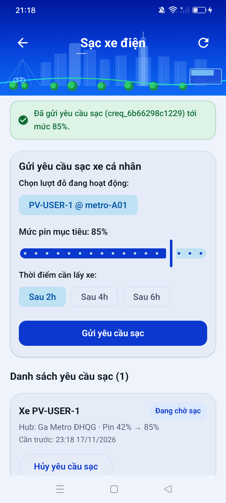 |
| Live trip telemetry & incident submission | Reserve & check in private EV slot | Submit target SoC & desired finish time |

### 2. Operator & Admin Web Dashboards (`app/prototype/live.html`)

| Network Overview & Dispatch (`UC10`, `UC14`) | Fleet & Charging Resources (`UC10`, `UC13`) |
| :---: | :---: |
| 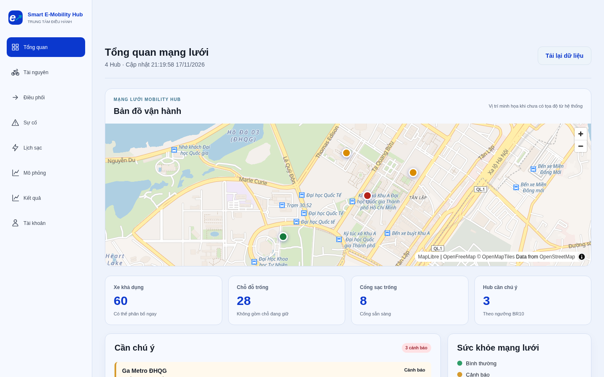 | 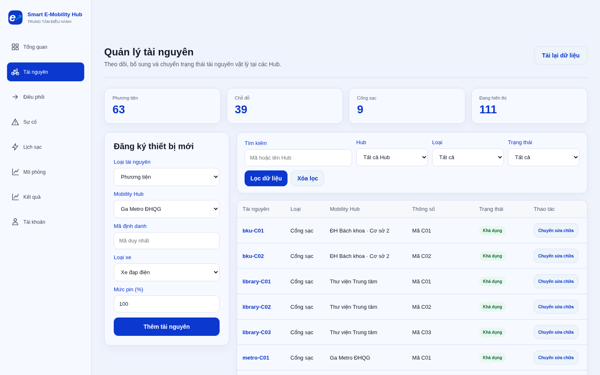 |

| Incident Intake & Resolution (`UC11`) | Smart Charging Allocation (`UC12`) |
| :---: | :---: |
| 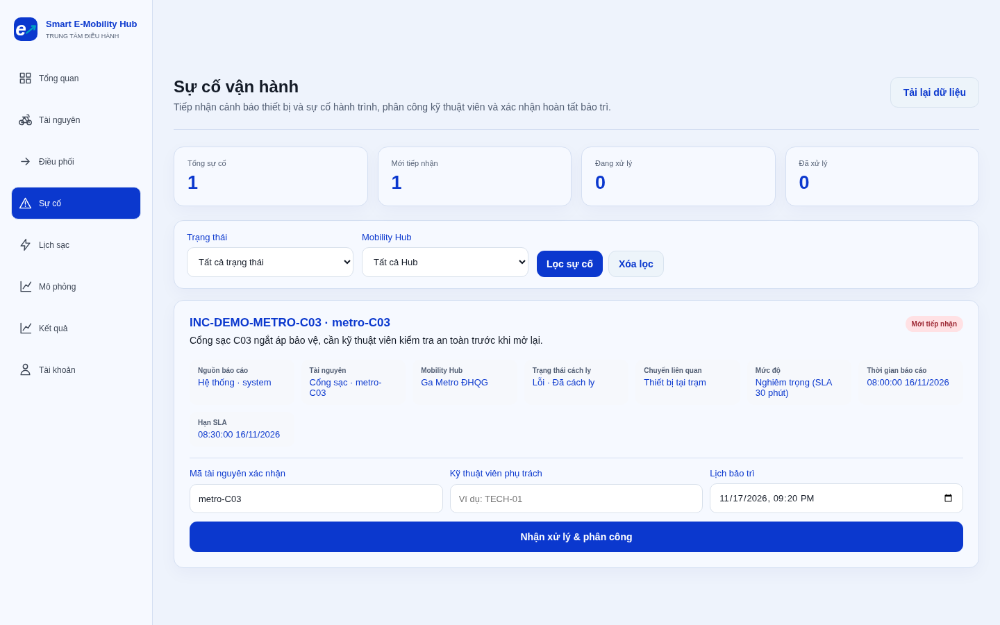 | 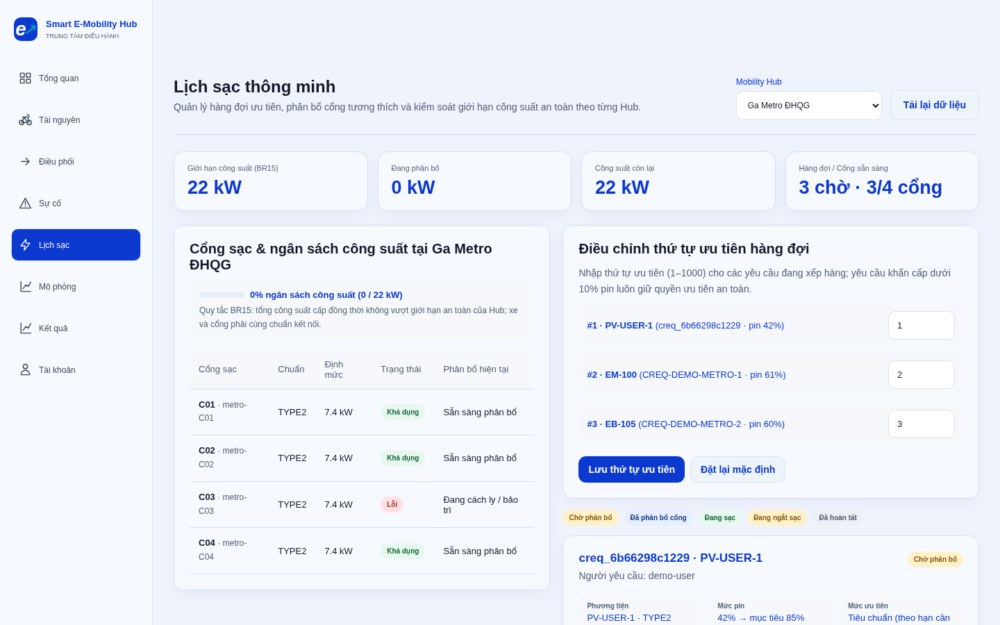 |

| What-If Demand Simulation (`UC13`, `UC14`) | Field Operator Mobile Console (`UC10`, `UC11`) |
| :---: | :---: |
| 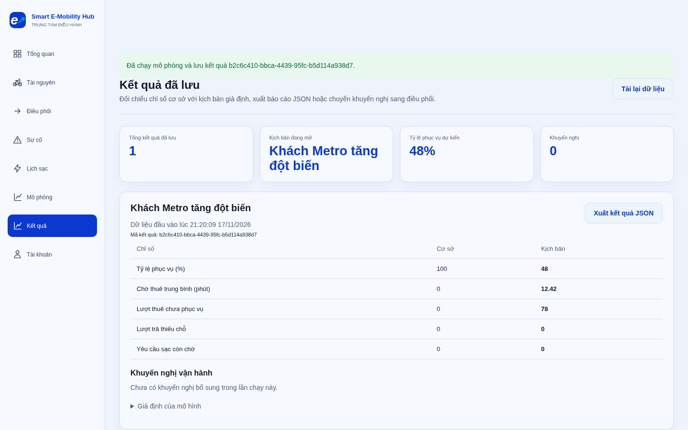 | 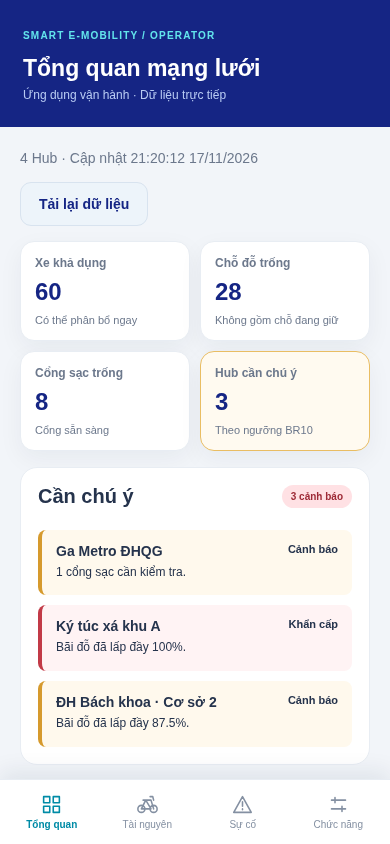 |

---

## Architecture at a Glance

```text
android/ (Kotlin + Compose)   ──┐
app/flutter_mobile/ (Flutter) ──┼──► Express REST API + Cookie Auth (app/src/)
app/prototype/live.html       ──┘      ├── modules/operations/           (UC05, UC06, UC10, UC11, UC13)
  (operator-web / operator-app)        ├── modules/parking-charging/     (UC07, UC08, UC09, UC12)
                                       └── modules/mobility-simulation/  (UC14 what-if & JSON export)
                                                │
                                                ▼
                                       SQLite WAL + Repository Adapter (app/db/)
```

Key boundaries in v2.0 are documented transparently in [docs/architecture/API_CONTRACTS.md](docs/architecture/API_CONTRACTS.md) and [docs/PRODUCTION_GUIDE.md](docs/PRODUCTION_GUIDE.md).

---

## Quick Start

### 1. Run the Backend & Operator Dashboards

```bash
cd app
npm install
npm start
```

By default the server listens on `http://localhost:3000`:

- **Admin Dashboard**: `http://localhost:3000/operator-web.html` (and `/` redirects here)
- **Operator Mobile Console**: `http://localhost:3000/operator-app.html`

See [app/README.md](app/README.md) for demo login credentials and environment variables (`PORT`, `SQLITE_DB_PATH`, `AUTH_COOKIE_SECRET`), and [docs/PRODUCTION_GUIDE.md](docs/PRODUCTION_GUIDE.md) for production hardening, WAL backups, and reverse-proxy TLS configuration.

### 2. Run the Native Android App

Open `android/` in Android Studio or build via Gradle:

```bash
cd android
./gradlew assembleDebug
```

Configure the backend URL inside the app settings (`10.0.2.2:3000` for Android Emulator, or `adb reverse tcp:3000 tcp:3000` with `http://127.0.0.1:3000` over USB). See [android/README.md](android/README.md) for details.

### 3. Deploy to Cloud (Render / Railway / Docker)

- **Render (1-click Blueprint)**: Open [Deploy to Render](https://render.com/deploy?repo=https://github.com/YdtTran/software-engineerning) (reads `render.yaml` + `Dockerfile`), enter `DEMO_OPERATOR_PASSWORD` and `DEMO_USER_PASSWORD`, and apply.
- **Railway**: Create a new project from this GitHub repository (`railway.json` builds `Dockerfile` with `/healthz` healthcheck) and set `DEMO_OPERATOR_PASSWORD`, `DEMO_USER_PASSWORD`, and `DEMO_SIMULATED_DEVICES=1`.
- **Docker Compose / VPS**: Copy `.env.example` to `.env`, set strong passwords, and run `docker compose up -d --build`.

See [docs/PRODUCTION_GUIDE.md](docs/PRODUCTION_GUIDE.md) for persistent `/data` volumes, TLS reverse proxy (`TRUST_PROXY=1`), and WAL backup instructions.

---

## Verification & Quality Checks

Run the backend test suite and UML/documentation consistency checks before committing:

```bash
npm --prefix app test
python3 .agent/scripts/check_usecases.py
python3 .agent/scripts/check_process_diagrams.py
python3 .agent/scripts/check_sequences.py
python3 .agent/class-diagram/check_compact_projection.py
git diff --check
```

---

## Documentation Index

| Document | Purpose |
| :--- | :--- |
| [CHANGELOG.md](CHANGELOG.md) | Version 2.0.0 release notes and reconciled scope |
| [docs/PRODUCTION_GUIDE.md](docs/PRODUCTION_GUIDE.md) | Production deployment, SQLite WAL ops, security & boundaries |
| [docs/architecture/API_CONTRACTS.md](docs/architecture/API_CONTRACTS.md) | HTTP endpoints, auth, idempotency & service-only methods |
| [docs/requirements/PROJECT_SPECIFICATION.md](docs/requirements/PROJECT_SPECIFICATION.md) | System requirements, constraints, and NFRs |
| [docs/requirements/VERSION_2_CONTRACT_REVIEW.md](docs/requirements/VERSION_2_CONTRACT_REVIEW.md) | Reconciliation status across UC contracts, UML diagrams & tests |
| [docs/requirements/VERSION_2_TRACEABILITY.md](docs/requirements/VERSION_2_TRACEABILITY.md) | End-to-end requirement -> code -> diagram traceability matrix |
| [index.md](index.md) | Full repository navigation map (4+1 Views & UML folders) |
| [docs/reports/SUBMISSION_PROGRESS_ARCHIVE.md](docs/reports/SUBMISSION_PROGRESS_ARCHIVE.md) | Archived v1.0 course submission checklist and role matrix |
