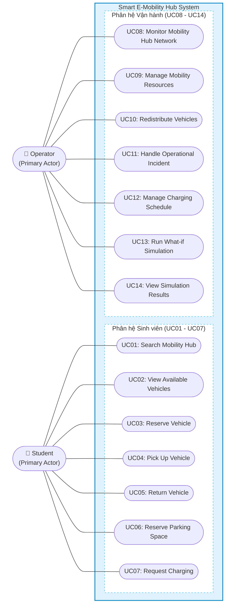

# BÁO CÁO BÀI TẬP LỚN: SUBMISSION #1
## ĐẶC TẢ YÊU CẦU HỆ THỐNG & MÔ HÌNH HÓA USE CASE
### HỌC PHẦN: CÔNG NGHỆ PHẦN MỀM (SOFTWARE ENGINEERING) – HK261
**Đại học Quốc gia TP. Hồ Chí Minh (VNU-HCM)**

---

**Đề tài:** Smart E-Mobility Hub – Hệ thống Điều phối Phương tiện Điện Khu đô thị ĐHQG-HCM  
**Loại tài liệu:** Hồ sơ Đặc tả Yêu cầu Kỹ thuật Phần mềm (Software Requirements Specification - SRS)  
**Cột mốc thực hiện:** Đợt nộp 1 (Submission #1 Detail)  
**Tài liệu tham chiếu:** Đề bài `04_BTL_SoftwareEngineering_HK261.pdf`, Bộ sơ đồ `01_Diagram/01_Usecase_Diagram/`, Bộ quy tắc `02_Rules/`

---

## MỤC LỤC BÁO CÁO

1. [Phần 1: Đặc tả Chi tiết Bối cảnh và Phạm vi Dự án (Project Details Specification)](#phần-1-đặc-tả-chi-tiết-bối-cảnh-và-phạm-vi-dự-án)
   - [1.1. Bối cảnh Dự án](#11-bối-cảnh-dự-án)
   - [1.2. Mục tiêu Kỹ thuật & Ranh giới Hệ thống](#12-mục-tiêu-kỹ-thuật--ranh-giới-hệ-thống)
   - [1.3. Phân tích Các bên Liên quan (Stakeholders)](#13-phân-tích-các-bên-liên-quan-stakeholders)
   - [1.4. Phân loại Tác nhân Tương tác (System Actors)](#14-phân-loại-tác-nhân-tương-tác-system-actors)
2. [Phần 2: Đặc tả Yêu cầu Phi chức năng (Non-Functional Requirements - NFRs)](#phần-2-đặc-tả-yêu-cầu-phi-chức-năng-nfrs)
   - [2.1. Nhóm Hiệu năng & Thời gian thực (Performance Efficiency)](#21-nhóm-hiệu-năng--thời-gian-thực)
   - [2.2. Nhóm Kiểm soát Đồng thời & Toàn vẹn Dữ liệu (Concurrency & Data Integrity)](#22-nhóm-kiểm-soát-đồng-thời--toàn-vẹn-dữ-liệu)
   - [2.3. Nhóm Độ tin cậy & Tính sẵn sàng (Reliability & Availability)](#23-nhóm-độ-tin-cậy--tính-sẵn-sàng)
   - [2.4. Nhóm Khả năng Sử dụng & Trải nghiệm (Usability & Accessibility)](#24-nhóm-khả-năng-sử-dụng--trải-nghiệm)
   - [2.5. Nhóm Khả năng Mở rộng & Bảo trì (Scalability & Maintainability)](#25-nhóm-khả-năng-mở-rộng--bảo-trì)
   - [2.6. Nhóm An toàn & Bảo mật (Security)](#26-nhóm-an-toàn--bảo-mật)
3. [Phần 3: Sơ đồ Use Case Toàn Hệ thống (System-Wide Use Case Diagram)](#phần-3-sơ-đồ-use-case-toàn-hệ-thống)
   - [3.1. Sơ đồ Ranh giới Hệ thống (System Boundary)](#31-sơ-đồ-ranh-giới-hệ-thống)
   - [3.2. Bảng Danh mục 14 Use Cases Cốt lõi](#32-bảng-danh-mục-14-use-cases-cốt-lõi)
4. [Phần 4: Kịch bản Chi tiết 14 Use Cases (Detailed Use Case Scenarios)](#phần-4-kịch-bản-chi-tiết-14-use-cases)
   - [4.1. Kịch bản Nhóm Sinh viên (UC01 đến UC07)](#41-kịch-bản-nhóm-sinh-viên-uc01-đến-uc07)
   - [4.2. Kịch bản Nhóm Vận hành (UC08 đến UC14)](#42-kịch-bản-nhóm-vận-hành-uc08-đến-uc14)
5. [Phần 5: Yêu cầu Chức năng Phi tương tác (Non-Interactive FRs - Điểm cộng)](#phần-5-yêu-cầu-chức-năng-phi-tương-tác-bonus)
   - [5.1. FR-NI01: Tiến trình Tự động Hủy Đặt chỗ Quá hạn (15 phút)](#51-fr-ni01-tiến-trình-tự-động-hủy-đặt-chỗ-quá-hạn)
   - [5.2. FR-NI02: Luồng Giả lập Suy giảm Pin & Đồng bộ Telemetry](#52-fr-ni02-luồng-giả-lập-suy-giảm-pin--đồng-bộ-telemetry)
   - [5.3. FR-NI03: Bộ Giám sát & Kích hoạt Cảnh báo Sức chứa Hub](#53-fr-ni03-bộ-giám-sát--kích-hoạt-cảnh-báo-sức-chứa-hub)
   - [5.4. FR-NI04: Cơ chế Tự động Tái Lập Lịch Hàng đợi Sạc](#54-fr-ni04-cơ-chế-tự-động-tái-lập-lịch-hàng-đợi-sạc)
6. [Phần 6: Kế hoạch Phân công Công việc & Checklist Nghiệm thu](#phần-6-kế-hoạch-phân-công-công-việc--checklist-nghiệm-thu)

---

## PHẦN 1: ĐẶC TẢ CHI TIẾT BỐI CẢNH VÀ PHẠM VI DỰ ÁN

### 1.1. Bối cảnh Dự án
Khu đô thị Đại học Quốc gia TP. Hồ Chí Minh (VNU-HCM) là trung tâm đào tạo và nghiên cứu đa ngành lớn nhất miền Nam, tập trung hơn 70.000 sinh viên, giảng viên và nhà khoa học sinh sống, học tập tại nhiều trường thành viên (ĐH Bách Khoa, ĐH Khoa học Tự nhiên, ĐH KHXH&NV, ĐH Quốc Tế, ĐH Công nghệ Thông tin, ĐH Kinh tế - Luật), hệ thống Ký túc xá Khu A và Khu B, Thư viện Trung tâm và các khu phức hợp thể thao, dịch vụ.

Khi **Tuyến Metro số 1 (Bến Thành – Suối Tiên)** chính thức vận hành với **Ga Đại học Quốc gia**, nhu cầu kết nối chặng cuối (last-mile transit) từ nhà ga đến các giảng đường và ký túc xá trở nên cấp bách. Hệ thống phương tiện giao thông điện dùng chung (Shared Electric Vehicles - xe đạp điện, xe máy điện) kết hợp trạm đỗ và hạ tầng sạc thông minh được xác định là giải pháp giao thông xanh chủ đạo.

Tuy nhiên, mô hình này đặt ra bài toán phức tạp về **điều phối đa tài nguyên phân tán** (Distributed Multi-Resource Coordination):
- Tình trạng lệch pha cung - cầu nghiêm trọng theo khung giờ (buổi sáng xe dồn ứ tại các trường học, thiếu xe ở Ga Metro; buổi chiều xe dồn về KTX).
- Quá tải cục bộ sức chứa bãi đỗ tại các điểm nóng, sinh viên không tìm được vị trí trả xe.
- Năng lực cung cấp điện và số cổng sạc có giới hạn, cần thuật toán phân bổ sạc tối ưu cho cả xe dùng chung và phương tiện cá nhân của sinh viên.

---

### 1.2. Mục tiêu Kỹ thuật & Ranh giới Hệ thống

#### A. Mục tiêu Kỹ thuật Cốt lõi
Phát triển hệ thống phần mềm **Smart E-Mobility Hub** làm hạt nhân điều phối mạng lưới trạm trung chuyển thông minh:
1. **Quản lý trạng thái đa thực thể:** Giám sát vòng đời phương tiện, cổng sạc, vị trí đỗ theo thời gian thực (gần thực).
2. **Phân bổ tài nguyên tự động & đồng thời:** Chống hiện tượng double-booking xe và slot đỗ khi nhiều người cùng đặt trong giờ cao điểm.
3. **Lập lịch sạc thông minh (Smart Charging Scheduling):** Tự động xếp độ ưu tiên sạc dựa trên dung lượng pin và lịch sử dụng tiếp theo.
4. **Tái cân bằng mạng lưới (Vehicle Rebalancing):** Đề xuất và phát lệnh điều chuyển xe từ Hub dư thừa về Hub thiếu hụt.
5. **Mô phỏng kịch bản What-if:** Thử nghiệm các tình huống vận hành giả định trước khi quyết định can thiệp thực tế.

#### B. Ranh giới Hệ thống (System Boundaries)
- **Trong phạm vi phần mềm (In-Scope):**
  - Quản lý logic trạng thái nghiệp vụ (State Management).
  - Thuật toán phân bổ tài nguyên, khóa giữ chỗ (Reservation & Locking).
  - Lập lịch hàng đợi sạc tối ưu.
  - Công cụ giám sát mạng lưới và tạo lệnh điều chuyển phương tiện.
  - Engine mô phỏng biến đổi trạng thái rời rạc (Discrete-Event Simulation) cho các kịch bản What-if.
  - Giao diện ứng dụng di động cho sinh viên và web/mobile app cho đơn vị vận hành.
- **Ngoài phạm vi phần mềm (Out-of-Scope):**
  - Không chế tạo phần cứng IoT vật lý (sử dụng luồng dữ liệu giả lập - simulated telemetry).
  - Không xây dựng đồ họa bản đồ 3D phức tạp (sử dụng bản đồ 2D dạng sơ đồ logic/tọa độ phẳng).

---

### 1.3. Phân tích Các bên Liên quan (Stakeholders)

| Bên liên quan | Vai trò trong hệ thống | Kỳ vọng & Mục tiêu chính |
| :--- | :--- | :--- |
| **Sinh viên & Học viên ĐHQG** | Người thụ hưởng dịch vụ di chuyển | Tìm xe nhanh, đặt giữ chỗ tin cậy (không bị cướp chỗ), xem rõ % pin, trả xe dễ dàng, đăng ký sạc xe cá nhân thuận tiện. |
| **Đơn vị Vận hành Mạng lưới (Operator)** | Người quản trị và điều phối hệ thống | Dashboard quan sát toàn cảnh, cảnh báo sớm nguy cơ cạn xe/đầy chỗ, hỗ trợ tạo lệnh điều phối nhanh, công cụ What-if phân tích rủi ro. |
| **Kỹ thuật viên Hiện trường** | Đội ngũ bảo trì và trung chuyển xe | Nhận thông báo sự cố tức thời, khóa cách ly cổng sạc/xe hỏng trên app di động, nhận danh sách xe cần vận chuyển tái cân bằng. |
| **Ban Quản lý Khu đô thị & KTX ĐHQG** | Đơn vị chủ quản hạ tầng giao thông | Giảm ùn tắc nội khu, an toàn cháy nổ tại các trạm sạc, dữ liệu báo cáo minh bạch về tỷ lệ khai thác phương tiện xanh. |
| **Đơn vị Vận hành Metro Tuyến số 1** | Đối tác hạ tầng giao thông công cộng | Đồng bộ thông tin luồng hành khách xuống ga với số lượng phương tiện sẵn sàng phục vụ tại Hub Ga Metro. |

---

### 1.4. Phân loại Tác nhân Tương tác (System Actors)

Tuân thủ nghiêm ngặt chuẩn UML:

```
                  ┌───────────────────────────────────────────────┐
                  │          Smart E-Mobility Hub System          │
                  │                                               │
   ┌───────────┐  │   ┌───────────────┐       ┌───────────────┐   │  ┌────────────┐
   │  Student  │──┼──>│  Phân hệ      │       │  Phân hệ      │<──┼──│  Operator  │
   │ (Primary) │  │   │  Sinh viên    │       │  Vận hành     │   │  │ (Primary)  │
   └───────────┘  │   │  (UC01-UC07)  │       │  (UC08-UC14)  │   │  └────────────┘
                  │   └───────────────┘       └───────────────┘   │         ▲
                  │                                   ▲           │         │
                  │                                   │           │  ┌────────────┐
                  │                                   └───────────┼──│ IoT Stream │
                  │                                               │  │(Secondary) │
                  └───────────────────────────────────────────────┘  └────────────┘
```

1. **Primary Actors (Khởi xướng hành động):**
   - **Student (Sinh viên - Đặt bên TRÁI):** Tác nhân sử dụng dịch vụ trên thiết bị di động.
   - **Operator (Đơn vị Vận hành - Đặt bên TRÁI):** Tác nhân chính khởi xướng quản trị điều phối mạng lưới và thực hiện mô phỏng kịch bản.
2. **Secondary / External Actors (Hỗ trợ / Nhận phản hồi - Đặt bên PHẢI):**
   - **IoT Sensor Stream / Simulated Telemetry:** Luồng cấp phát dữ liệu cảm biến định kỳ về mức pin, chốt khóa, trạng thái cổng sạc.
   - **Notification Service:** Cổng dịch vụ đẩy thông báo (Push/SMS) về trạng thái đặt xe hoặc cảnh báo sự cố.
3. **Quy chuẩn UML quan trọng:** Bộ máy mô phỏng (*What-if Simulation Engine*) là **hệ thống con nghiệp vụ nội tại**, do tác nhân Operator trực tiếp điều khiển qua ca sử dụng UC13 và UC14, tuyệt đối không vẽ What-if Engine thành Actor.

---

## PHẦN 2: ĐẶC TẢ YÊU CẦU PHI CHỨC NĂNG (NFRS)

Hệ thống tuân thủ tiêu chuẩn chất lượng công nghệ phần mềm quốc tế **ISO/IEC 25010**:

### 2.1. Nhóm Hiệu năng & Thời gian thực (Performance Efficiency)
- **NFR-PE01 (Thời gian phản hồi nghiệp vụ):** Thời gian xử lý các truy vấn tra cứu Hub, xem xe khả dụng, và tạo yêu cầu đặt giữ xe không vượt quá **1.5 giây** trong điều kiện 1.000 người dùng đồng thời.
- **NFR-PE02 (Tốc độ cập nhật trạng thái Telemetry):** Độ trễ từ khi cảm biến gửi tín hiệu thay đổi (pin xe, cắm sạc, chốt khóa) đến khi hiển thị trên màn hình không vượt quá **2.0 giây** (Near real-time).
- **NFR-PE03 (Hiệu năng Mô phỏng What-if):** Bộ máy mô phỏng phải hoàn tất tính toán kịch bản mạng lưới gồm 10 Hubs, 1.000 phương tiện trong khung thời gian 24 giờ trong vòng dưới **5.0 giây**.

### 2.2. Nhóm Kiểm soát Đồng thời & Toàn vẹn Dữ liệu (Concurrency & Data Integrity)
- **NFR-CD01 (Chống Double-Booking):** Hệ thống áp dụng cơ chế khóa phân tán (Distributed Locking / Transaction Isolation). Tuyệt đối không để xảy ra trường hợp hai sinh viên cùng đặt thành công 1 phương tiện hoặc 1 slot đỗ duy nhất tại cùng một thời điểm.
- **NFR-CD02 (Bảo toàn trạng thái khi mất kết nối):** Mọi giao dịch đặt xe, trả xe và phân bổ sạc phải thỏa mãn tính chất ACID. Nếu kết nối mạng giữa thiết bị sinh viên và hệ thống bị gián đoạn giữa chừng, trạng thái phải được rollback an toàn hoặc khôi phục tự động theo mã giao dịch duy nhất.

### 2.3. Nhóm Độ tin cậy & Tính sẵn sàng (Reliability & Availability)
- **NFR-RA01 (Tính sẵn sàng dịch vụ):** Hệ thống đảm bảo thời gian hoạt động tối thiểu **99.5%** trong suốt thời gian vận hành hàng ngày (05:00 – 23:30).
- **NFR-RA02 (Khả năng chịu lỗi thành phần):** Khi một cổng sạc hoặc một cảm biến trạm bị mất kết nối, hệ thống chỉ cách ly thành phần hỏng hóc sang trạng thái `Out of Order`, toàn bộ các dịch vụ khác của Hub vẫn hoạt động bình thường.

### 2.4. Nhóm Khả năng Sử dụng & Trải nghiệm (Usability & Accessibility)
- **NFR-UA01 (Tối ưu hóa Thao tác Di động):** Giao diện sinh viên được thiết kế dạng thẻ (Card-based), kích thước vùng bấm $\ge 44 \times 44\text{px}$, cho phép hoàn tất quy trình đặt xe hoặc quét mã nhận xe trong vòng không quá **3 lần chạm**.
- **NFR-UA02 (Hiển thị Trạng thái Đa kênh):** Mọi cảnh báo và trạng thái phương tiện/cổng sạc bắt buộc phải kết hợp đồng thời giữa **nhãn văn bản rõ ràng** và **màu sắc tương phản** (Xanh: Sẵn sàng; Vàng: Đang sạc/Giữ chỗ; Đỏ: Hỏng/Bảo trì) để hỗ trợ người dùng khiếm thị màu.

### 2.5. Nhóm Khả năng Mở rộng & Bảo trì (Scalability & Maintainability)
- **NFR-SM01 (Khả năng mở rộng Hub):** Kiến trúc hệ thống phân tầng (Layered/Clean Architecture), cho phép bổ sung thêm Hub mới, thêm tuyến xe điện mới bằng cấu hình dữ liệu mà không cần phải thay đổi mã nguồn cốt lõi.
- **NFR-SM02 (Độc lập nền tảng):** Hệ thống client chạy tương thích mượt mà trên mọi trình duyệt hiện đại (Chrome, Edge, Safari, Firefox).

### 2.6. Nhóm An toàn & Bảo mật (Security)
- **NFR-SE01 (Phân quyền Theo vai trò - RBAC):** Hệ thống kiểm tra quyền nghiêm ngặt trên từng yêu cầu. Tài khoản Sinh viên tuyệt đối không thể truy cập các API hoặc màn hình điều phối, lập lịch và mô phỏng của Operator.
- **NFR-SE02 (Bảo vệ thông tin cá nhân):** Mã số sinh viên, lộ trình di chuyển và số điện thoại phải được bảo mật và mã hóa trong quá trình truyền dữ liệu.

---

## PHẦN 3: SƠ ĐỒ USE CASE TOÀN HỆ THỐNG

### 3.1. Sơ đồ Ranh giới Hệ thống

Toàn bộ 14 Use Cases nằm trọn vẹn trong System Boundary, phân rã làm 2 phân hệ rõ rệt:



### 3.2. Bảng Danh mục 14 Use Cases Cốt lõi

| Mã UC | Tên Ca Sử dụng | Phân loại | Tác nhân chính | File Sơ đồ Vector Draw.io |
| :---: | :--- | :---: | :---: | :--- |
| **SYS** | **Sơ đồ Tổng quan Toàn hệ thống** | Hệ thống | All Actors | [`general_usecase_diagram.drawio.svg`](./01_Diagram/01_Usecase_Diagram/GENERAL/general_usecase_diagram.drawio.svg) |
| **UC01** | Tìm kiếm Hub di chuyển (`Search Mobility Hub`) | Cốt lõi | Student | [`UC01-Search_Mobility_Hub.drawio.svg`](./01_Diagram/01_Usecase_Diagram/STUDENTS/UC01-Search_Mobility_Hub.drawio.svg) |
| **UC02** | Xem danh sách xe khả dụng (`View Available Vehicles`) | Hỗ trợ | Student | [`UC02-View_Available_Vehicles.drawio.svg`](./01_Diagram/01_Usecase_Diagram/STUDENTS/UC02-View_Available_Vehicles.drawio.svg) |
| **UC03** | Đặt trước phương tiện (`Reserve Vehicle`) | Cốt lõi | Student | [`UC03-Reserve_Vehicle.drawio.svg`](./01_Diagram/01_Usecase_Diagram/STUDENTS/UC03-Reserve_Vehicle.drawio.svg) |
| **UC04** | Nhận phương tiện tại Hub (`Pick Up Vehicle`) | Cốt lõi | Student | [`UC04-Pick_Up_Vehicle.drawio.svg`](./01_Diagram/01_Usecase_Diagram/STUDENTS/UC04-Pick_Up_Vehicle.drawio.svg) |
| **UC05** | Trả phương tiện tại Hub (`Return Vehicle`) | Cốt lõi | Student | [`UC05-Return_Vehicle.drawio.svg`](./01_Diagram/01_Usecase_Diagram/STUDENTS/UC05-Return_Vehicle.drawio.svg) |
| **UC06** | Đặt trước chỗ đỗ xe (`Reserve Parking Space`) | Cốt lõi | Student | [`UC06-Reserve_Parking_Space.drawio.svg`](./01_Diagram/01_Usecase_Diagram/STUDENTS/UC06-Reserve_Parking_Space.drawio.svg) |
| **UC07** | Yêu cầu sạc điện (`Request Charging`) | Cốt lõi | Student | [`UC07-Request_Charging.drawio.svg`](./01_Diagram/01_Usecase_Diagram/STUDENTS/UC07-Request_Charging.drawio.svg) |
| **UC08** | Giám sát mạng lưới Hub (`Monitor Mobility Hub Network`) | Giám sát | Operator | [`UC8-Monitor_Mobility_Hub_Network.drawio.svg`](./01_Diagram/01_Usecase_Diagram/OPERATOR/UC8-Monitor_Mobility_Hub_Network.drawio.svg) |
| **UC09** | Quản lý tài nguyên vận hành (`Manage Mobility Resources`) | Quản trị | Operator | [`UC9-Manage_Mobility_Resources.drawio.svg`](./01_Diagram/01_Usecase_Diagram/OPERATOR/UC9-Manage_Mobility_Resources.drawio.svg) |
| **UC10** | Điều phối & Cân bằng xe (`Redistribute Vehicles`) | Điều hành | Operator | [`UC10-Redistribute_Vehicles.drawio.svg`](./01_Diagram/01_Usecase_Diagram/OPERATOR/UC10-Redistribute_Vehicles.drawio.svg) |
| **UC11** | Xử lý sự cố vận hành (`Handle Operational Incident`) | Xử lý lỗi | Operator | [`UC11-Handle_Operational_Incident.drawio.svg`](./01_Diagram/01_Usecase_Diagram/OPERATOR/UC11-Handle_Operational_Incident.drawio.svg) |
| **UC12** | Quản lý & Lập lịch sạc (`Manage Charging Schedule`) | Tối ưu hóa | Operator | [`UC12-Manage_Charging_Schedule.drawio.svg`](./01_Diagram/01_Usecase_Diagram/OPERATOR/UC12-Manage_Charging_Schedule.drawio.svg) |
| **UC13** | Chạy mô phỏng What-if (`Run What-if Simulation`) | Mô phỏng | Operator | [`UC13-Run_What-if_Simulation.drawio.svg`](./01_Diagram/01_Usecase_Diagram/OPERATOR/UC13-Run_What-if_Simulation.drawio.svg) |
| **UC14** | Xem kết quả mô phỏng (`View Simulation Results`) | Báo cáo | Operator | [`UC14-View_Simulation_Results.drawio.svg`](./01_Diagram/01_Usecase_Diagram/OPERATOR/UC14-View_Simulation_Results.drawio.svg) |

---

## PHẦN 4: KỊCH BẢN CHI TIẾT 14 USE CASES (INDIVIDUAL WORK)

Được biên soạn đầy đủ theo cấu trúc kịch bản chuẩn Use-case Scenario Tabular Template trong slide bài giảng môn Kỹ nghệ Phần mềm ĐHQG-HCM (Slide Ch3 p.56 & Ch6 p.19-20) gồm: Mã Use Case, Tên Use Case, Tác nhân, Mô tả tóm tắt, Tiền/Hậu điều kiện, Luồng chính, Luồng rẽ nhánh, Luồng ngoại lệ và Quy tắc nghiệp vụ bổ trợ.

---

### 4.1. Kịch bản Nhóm Sinh viên (UC01 đến UC07)

```
================================================================================
KỊCH BẢN CA SỬ DỤNG: UC01 - TÌM KIẾM HUB DI CHUYỂN (SEARCH MOBILITY HUB)
================================================================================
Mã Use Case: UC01
Tên Use Case: Tìm kiếm Hub di chuyển (Search Mobility Hub)
Tác nhân chính: Student
Tác nhân phụ: Hệ thống định vị GPS / Bản đồ nội khu ĐHQG
Mô tả tóm tắt: Sinh viên tìm kiếm danh sách các Hub lân cận, xem khoảng cách, số lượng phương tiện, chỗ đỗ và cổng sạc hiện có.
Tiền điều kiện: Sinh viên đã mở ứng dụng di động Smart E-Mobility Hub trên điện thoại.
Hậu điều kiện: Danh sách các Hub thỏa mãn tiêu chí tìm kiếm được hiển thị kèm trạng thái thời gian thực.

Luồng sự kiện chính (Main Flow):
1. Sinh viên chọn tính năng "Tìm Hub" hoặc mở màn hình bản đồ (#map).
2. Hệ thống xác định vị trí hiện tại của sinh viên qua GPS (hoặc điểm xuất phát mặc định: Ga Metro ĐHQG).
3. Hệ thống truy xuất cơ sở dữ liệu các Hub trong bán kính lân cận.
4. Hệ thống hiển thị danh sách các Hub kèm thông tin vắn tắt: Tên Hub, cự ly (mét), số xe khả dụng, số chỗ đỗ trống, số cổng sạc trống.
5. Sinh viên chọn một Hub mong muốn để xem chi tiết.
6. Hệ thống chuyển sang màn hình thông tin chi tiết của Hub đó. Use Case kết thúc thành công.

Luồng rẽ nhánh (Alternative Flows):
- 4a. Sinh viên sử dụng bộ lọc loại phương tiện (Filter by Vehicle Type - extend):
  1. Sinh viên bấm chọn lọc "Chỉ xe đạp điện" hoặc "Chỉ xe máy điện".
  2. Hệ thống lọc lại danh sách Hub có ít nhất 1 phương tiện thuộc loại đã chọn.
- 4b. Sinh viên sử dụng bộ lọc khoảng cách (Filter by Distance - extend):
  1. Sinh viên chọn bán kính tìm kiếm (ví dụ: < 500m, < 1km).
  2. Hệ thống cập nhật danh sách các Hub nằm trong cự ly đã chọn.

Luồng ngoại lệ (Exception Flows):
- 3a. Không tìm thấy Hub nào trong khu vực:
  1. Hệ thống hiển thị thông báo "Không tìm thấy Hub nào trong bán kính đã chọn".
  2. Gợi ý sinh viên mở rộng bán kính tìm kiếm hoặc chuyển vị trí bản đồ sang Ga Metro / KTX.
- 3b. Mất kết nối mạng Internet:
  1. Hệ thống hiển thị thông báo "Không thể kết nối đến máy chủ. Đang tải dữ liệu bộ nhớ đệm (Cache)".
  2. Hiển thị danh sách Hub theo dữ liệu lưu gần nhất kèm cảnh báo số liệu có thể chưa đồng bộ.

Quy tắc nghiệp vụ (Business Rules):
- BR01: Bán kính tìm kiếm mặc định ban đầu là 1.000 mét.
- BR02: Hub đang trong trạng thái "Bảo trì toàn phần" (Suspended) sẽ bị ẩn hoặc hiển thị biểu tượng xám không cho chọn.
================================================================================
```

```
================================================================================
KỊCH BẢN CA SỬ DỤNG: UC02 - XEM DANH SÁCH XE KHẢ DỤNG (VIEW AVAILABLE VEHICLES)
================================================================================
Mã Use Case: UC02
Tên Use Case: Xem danh sách xe khả dụng (View Available Vehicles)
Tác nhân chính: Student
Tác nhân phụ: IoT Sensor Stream
Mô tả tóm tắt: Sinh viên xem thông tin chi tiết từng phương tiện điện tại một Hub cụ thể, bao gồm mã định danh, loại xe, % pin và quãng đường di chuyển dự kiến.
Tiền điều kiện: Sinh viên đã chọn một Hub cụ thể từ màn hình tìm kiếm (UC01) hoặc màn hình chính.
Hậu điều kiện: Danh sách phương tiện điện khả dụng tại Hub được hiển thị đầy đủ.

Luồng sự kiện chính (Main Flow):
1. Sinh viên nhấp vào Hub đã chọn và chọn mục "Xem danh sách xe" (#vehicles).
2. Hệ thống gửi yêu cầu lấy danh sách các xe có trạng thái `Available` tại Hub.
3. Hệ thống trả về danh sách xe gồm: Mã xe (VD: EB-024, EM-102), hình ảnh loại xe, mức pin hiện tại (%), cự ly ước tính (km).
4. Sinh viên duyệt qua danh sách và bấm chọn một xe để xem chi tiết.
5. Hệ thống hiển thị bảng thông số: Model, dung lượng pin, thời gian cập nhật telemetry gần nhất.
6. Sinh viên có thể bấm "Đặt xe này" để chuyển sang UC03. Use Case kết thúc.

Luồng rẽ nhánh (Alternative Flows):
- 3a. Sinh viên bấm xem các xe đang cắm sạc (Viewing Charging Vehicles):
  1. Hệ thống hiển thị thêm tab các xe đang sạc kèm thời gian dự kiến sạc đầy và mức pin hiện tại.

Luồng ngoại lệ (Exception Flows):
- 2a. Hub hiện tại không còn phương tiện nào khả dụng (0 xe):
  1. Hệ thống hiển thị thông báo "Hub hiện đang hết xe khả dụng".
  2. Hệ thống tự động gợi ý Hub lân cận gần nhất có xe khả dụng kèm khoảng cách đi bộ.

Quy tắc nghiệp vụ (Business Rules):
- BR03: Xe có mức pin dưới 20% sẽ không hiển thị trong danh mục khả dụng cho thuê (tự động chuyển sang danh sách chờ sạc).
================================================================================
```

```
================================================================================
KỊCH BẢN CA SỬ DỤNG: UC03 - ĐẶT TRƯỚC PHƯƠNG TIỆN (RESERVE VEHICLE)
================================================================================
Mã Use Case: UC03
Tên Use Case: Đặt trước phương tiện (Reserve Vehicle)
Tác nhân chính: Student
Tác nhân phụ: Notification Service
Mô tả tóm tắt: Sinh viên thực hiện đặt giữ chỗ trước một phương tiện điện trong thời gian 15 phút để đảm bảo có xe khi đến Hub.
Tiền điều kiện: Sinh viên đã đăng nhập tài khoản hợp lệ, không có lệnh đặt xe nào đang hoạt động và không có nợ phí.
Hậu điều kiện: Xe được chuyển sang trạng thái `Reserved`, phiếu giữ xe (#ticket) được phát hành cho sinh viên.

Luồng sự kiện chính (Main Flow):
1. Tại màn hình xem xe (UC02), sinh viên bấm nút "Đặt giữ xe này".
2. Hệ thống kích hoạt Use Case bắt buộc: Verify Vehicle Availability (include).
   - Kiểm tra xe vẫn đang ở trạng thái `Available` và mức pin $\ge 20\%$.
3. Hệ thống thực hiện khóa bản ghi xe (Locking) và chuyển trạng thái xe sang `Reserved`.
4. Hệ thống tạo bản ghi đặt chỗ `Reservation` với thời hạn giữ chỗ là 15 phút.
5. Hệ thống hiển thị màn hình "Phiếu giữ xe" (#ticket) gồm: Mã xe, mã đặt chỗ (QR/Barcode), vị trí slot đỗ tại Hub, bộ đếm ngược thời gian (15:00).
6. Hệ thống gửi thông báo xác nhận thành công qua Notification Service. Use Case kết thúc.

Luồng rẽ nhánh (Alternative Flows):
- 5a. Sinh viên chủ động hủy đặt chỗ:
  1. Sinh viên bấm nút "Hủy giữ xe" trên phiếu.
  2. Hệ thống hiển thị hộp thoại xác nhận hủy.
  3. Sinh viên xác nhận hủy.
  4. Hệ thống mở khóa xe về trạng thái `Available`, hủy bản ghi đặt chỗ và gửi thông báo đã hủy.

Luồng ngoại lệ (Exception Flows):
- 2a. Xe đã bị người khác đặt trước trong tích tắc (Race condition / Concurrency conflict):
  1. Bước Verify Vehicle Availability thất bại.
  2. Hệ thống thông báo lỗi: "Rất tiếc! Phương tiện này vừa được người dùng khác đặt trước".
  3. Hệ thống tự động làm mới danh sách xe tại Hub và gợi ý phương tiện tương đương khác.
- 1a. Sinh viên đang có một lệnh đặt chỗ chưa hoàn thành:
  1. Hệ thống từ chối yêu cầu và thông báo: "Bạn đang có 1 phương tiện đang được giữ chỗ. Vui lòng hoàn thành hoặc hủy trước khi đặt xe mới".

Quy tắc nghiệp vụ (Business Rules):
- BR04: Mỗi sinh viên chỉ được phép đặt trước tối đa 01 phương tiện tại một thời điểm.
- BR05: Thời gian giữ xe tối đa là 15 phút. Sau 15 phút, tiến trình nền tự động hủy và trừ điểm uy tín nếu không đến nhận.
================================================================================
```

```
================================================================================
KỊCH BẢN CA SỬ DỤNG: UC04 - NHẬN PHƯƠNG TIỆN TẠI HUB (PICK UP VEHICLE)
================================================================================
Mã Use Case: UC04
Tên Use Case: Nhận phương tiện tại Hub (Pick Up Vehicle)
Tác nhân chính: Student
Tác nhân phụ: Trạm khóa chốt điện tử tại Hub (IoT Hardware / Simulated Unlock)
Mô tả tóm tắt: Sinh viên đến Hub, xác thực mã đặt xe hoặc quét mã QR trên xe để mở khóa phương tiện và bắt đầu hành trình.
Tiền điều kiện: Sinh viên đã có lệnh đặt xe hợp lệ còn hiệu lực (UC03) và đang có mặt tại vị trí Hub.
Hậu điều kiện: Xe chuyển sang trạng thái `In-Use`, chốt khóa vật lý mở ra, chuyến đi bắt đầu được tính giờ.

Luồng sự kiện chính (Main Flow):
1. Sinh viên đến vị trí phương tiện tại Hub, mở ứng dụng tại màn hình "Nhận xe" (#pickup).
2. Sinh viên quét mã QR dán trên thân xe hoặc nhập mã xe (VD: `EB-024`).
3. Hệ thống kích hoạt Use Case bắt buộc: Validate Reservation Status (include).
   - Kiểm tra mã xe khớp với phiếu đặt chỗ của sinh viên và thời hạn 15 phút chưa hết.
4. Hệ thống kích hoạt Use Case bắt buộc: Unlock Vehicle (include).
   - Gửi lệnh mở khóa chốt điện tử của vị trí đỗ.
5. Chốt khóa nhả xe, đèn tín hiệu trên trụ chuyển sang màu xanh.
6. Hệ thống cập nhật trạng thái xe sang `In-Use`, chuyển trạng thái slot đỗ sang `Available` (trống).
7. Màn hình ứng dụng chuyển sang giao diện "Hành trình đang diễn ra" (#trip). Use Case kết thúc thành công.

Luồng rẽ nhánh (Alternative Flows):
- 2a. Sinh viên phát hiện xe bị hư hỏng trước khi lấy (Report Vehicle Damage - extend):
  1. Sinh viên bấm nút "Báo cáo sự cố xe".
  2. Sinh viên chọn loại lỗi (xẹp lốp, hỏng phanh, vỡ đèn) và chụp ảnh đính kèm.
  3. Hệ thống ghi nhận sự cố (kích hoạt UC11), chuyển xe sang `Faulty/Under Maintenance`.
  4. Hệ thống tự động cấp đổi sang một phương tiện khả dụng khác tại Hub mà không tính phí.

Luồng ngoại lệ (Exception Flows):
- 3a. Sinh viên nhập sai mã xe hoặc quét nhầm xe khác:
  1. Hệ thống báo lỗi: "Mã phương tiện không khớp với phiếu giữ chỗ của bạn".
  2. Yêu cầu sinh viên kiểm tra lại vị trí đỗ ghi trên phiếu.
- 3b. Phiếu giữ xe đã hết hạn (> 15 phút):
  1. Hệ thống từ chối mở khóa: "Lượt giữ chỗ đã hết hạn. Phương tiện đã được giải phóng".
  2. Mời sinh viên thực hiện lại quy trình đặt xe nếu xe vẫn còn tại trạm.

Quy tắc nghiệp vụ (Business Rules):
- BR06: Tuyệt đối không kích hoạt mở chốt khóa khi mã xác thực không trùng khớp với tài khoản sinh viên đã đặt.
================================================================================
```

```
================================================================================
KỊCH BẢN CA SỬ DỤNG: UC05 - TRẢ PHƯƠNG TIỆN TẠI HUB (RETURN VEHICLE)
================================================================================
Mã Use Case: UC05
Tên Use Case: Trả phương tiện tại Hub (Return Vehicle)
Tác nhân chính: Student
Tác nhân phụ: Trạm khóa chốt điện tử tại Hub, Hệ thống thanh toán/ghi nhận lượt đi
Mô tả tóm tắt: Sinh viên kết thúc chuyến đi bằng cách đưa phương tiện vào slot đỗ hợp lệ tại Hub đích, khóa chốt và xác nhận trên app.
Tiền điều kiện: Sinh viên đang có chuyến đi ở trạng thái `In-Use` (UC04).
Hậu điều kiện: Xe được khóa chốt, cập nhật mức pin thực tế, chuyển trạng thái xe sang `Available` (hoặc `Needs Charging`), hành trình được đóng lại.

Luồng sự kiện chính (Main Flow):
1. Sinh viên điều khiển xe vào Hub đích, mở màn hình "Hành trình" (#trip).
2. Hệ thống kích hoạt Use Case bắt buộc: Check Hub Space Availability (include).
   - Kiểm tra Hub đích còn ít nhất 01 slot đỗ trống.
3. Sinh viên đưa xe vào khe cắm đỗ, đẩy sát chốt khóa cơ điện tử.
4. Hệ thống kích hoạt Use Case bắt buộc: Verify Vehicle & Battery Status (include).
   - Cảm biến chốt đỗ xác nhận xe đã khóa thành công.
   - Đọc dung lượng pin thực tế còn lại của xe qua telemetry.
5. Sinh viên tích chọn "Đã đưa xe vào vị trí và khóa chốt" trên màn hình và bấm "Xác nhận trả xe".
6. Hệ thống kích hoạt Use Case bắt buộc: Confirm Vehicle Return (include).
   - Đóng chuyến đi, tính tổng thời gian di chuyển, cự ly và chi phí (nếu có).
   - Cập nhật slot đỗ thành `Occupied`.
   - Nếu pin $\ge 20\%$: cập nhật xe thành `Available`. Nếu pin $< 20\%$: cập nhật thành `Needs Charging`.
7. Hệ thống hiển thị hóa đơn tóm tắt hành trình và gửi thông báo hoàn tất. Use Case kết thúc.

Luồng rẽ nhánh (Alternative Flows):
- 6a. Mức pin khi trả quá thấp ($< 20\%$):
  1. Hệ thống tự động đưa xe vào hàng đợi ưu tiên sạc (kích hoạt thuật toán của UC12).

Luồng ngoại lệ (Exception Flows):
- 2a. Hub đích đã đầy 100% chỗ đỗ:
  1. Hệ thống cảnh báo: "Hub này hiện đã hết chỗ đỗ khả dụng".
  2. Hệ thống hiển thị bản đồ điều hướng sinh viên sang Hub lân cận gần nhất (ví dụ: Hub Nhà văn hóa Sinh viên cách 250m) kèm khuyến mãi giảm giá lượt đi.
- 4a. Cảm biến báo chốt khóa chưa đóng chặt:
  1. Hệ thống báo lỗi: "Chưa nhận diện được chốt khóa xe. Vui lòng đẩy mạnh xe vào khe cắm đến khi nghe tiếng tách".
  2. Không cho phép sinh viên bấm xác nhận trả xe đến khi cảm biến báo khóa thành công.

Quy tắc nghiệp vụ (Business Rules):
- BR07: Chuyến đi tiếp tục tính thời gian cho đến khi chốt khóa vật lý được xác nhận đóng hoàn toàn.
================================================================================
```

```
================================================================================
KỊCH BẢN CA SỬ DỤNG: UC06 - ĐẶT TRƯỚC CHỖ ĐỖ XE (RESERVE PARKING SPACE)
================================================================================
Mã Use Case: UC06
Tên Use Case: Đặt trước chỗ đỗ xe (Reserve Parking Space)
Tác nhân chính: Student
Tác nhân phụ: Notification Service
Mô tả tóm tắt: Sinh viên sử dụng phương tiện điện cá nhân đặt trước vị trí đỗ tại Hub điểm đến để đảm bảo có chỗ gửi xe khi đến trường.
Tiền điều kiện: Sinh viên đã đăng nhập và đã đăng ký thông tin phương tiện cá nhân (biển số, loại xe).
Hậu điều kiện: Vị trí đỗ tại Hub được giữ trước, cấp mã QR check-in vào bãi đỗ.

Luồng sự kiện chính (Main Flow):
1. Sinh viên chọn mục "Đặt chỗ đỗ" (#parking) từ màn hình chính.
2. Sinh viên chọn Hub muốn đến, khung giờ dự kiến đến và thời lượng gửi xe.
3. Hệ thống kích hoạt: Check Parking Availability (include).
   - Kiểm tra số lượng slot đỗ trống trong khung giờ yêu cầu.
4. Hệ thống hiển thị sơ đồ trực quan các vị trí đỗ: Ô trống (xanh), Ô đã có xe (xám), Ô đã đặt trước (vàng).
5. Sinh viên chọn một vị trí đỗ mong muốn.
6. Hệ thống kích hoạt: Validate Vehicle Information (include).
   - Xác thực biển số xe và kích thước phù hợp với slot đỗ.
7. Sinh viên bấm "Xác nhận đặt chỗ".
8. Hệ thống kích hoạt: Confirm Parking Reservation (include).
   - Khóa slot đỗ sang trạng thái `Reserved`, phát hành mã QR check-in vào bãi.
9. Hệ thống gửi thông báo xác nhận thành công. Use Case kết thúc.

Luồng rẽ nhánh (Alternative Flows):
- 8a. Sinh viên chủ động hủy đặt chỗ đỗ (Cancel Parking Reservation):
  1. Sinh viên bấm "Hủy đặt chỗ" trước giờ hẹn tối thiểu 10 phút.
  2. Hệ thống giải phóng slot đỗ về `Available` và xác nhận hủy không tính phí.

Luồng ngoại lệ (Exception Flows):
- 3a. Hub đã kín chỗ trong khung giờ được chọn:
  1. Hệ thống thông báo: "Không còn chỗ đỗ trống trong khung giờ này".
  2. Đề xuất các khung giờ khác hoặc gợi ý Hub kế bên còn chỗ đỗ.

Quy tắc nghiệp vụ (Business Rules):
- BR08: Đặt chỗ đỗ hết hạn tại `ScheduledArrivalTime + 30 phút` nếu chưa check-in. Thời điểm hết hạn tính từ giờ đến đã đăng ký, không tính từ lúc tạo phiếu. Quy tắc giữ xe 15 phút của UC03 không áp dụng cho đặt chỗ đỗ.
================================================================================
```

```
================================================================================
KỊCH BẢN CA SỬ DỤNG: UC07 - YÊU CẦU SẠC ĐIỆN (REQUEST CHARGING)
================================================================================
Mã Use Case: UC07
Tên Use Case: Yêu cầu sạc điện (Request Charging)
Tác nhân chính: Student
Tác nhân phụ: Hệ thống quản lý trụ sạc thông minh tại Hub
Mô tả tóm tắt: Sinh viên đăng ký sạc pin cho xe điện cá nhân hoặc xe dùng chung tại Hub, thiết lập mức pin mong muốn và giờ cần lấy xe.
Tiền điều kiện: Sinh viên đang có mặt tại Hub hoặc đã đặt trước chỗ đỗ thành công tại Hub.
Hậu điều kiện: Xe được xếp vào hàng đợi sạc hoặc được cấp quyền cắm sạc vào trụ được chỉ định.

Luồng sự kiện chính (Main Flow):
1. Sinh viên chọn mục "Sạc xe" (#charging) trên ứng dụng.
2. Sinh viên nhập các thông số: Loại cổng sạc, mức pin hiện tại (%), mức pin mong muốn (mặc định 80% hoặc 100%), thời điểm cần lấy xe.
3. Hệ thống kích hoạt: Check Charging Availability (include).
   - Kiểm tra số cổng sạc khả dụng và công suất tải tức thời của Hub.
4. Hệ thống kích hoạt: Validate Charging Request (include).
   - Kiểm tra tính tương thích chuẩn sạc và thời gian sạc khả thi.
5. Hệ thống tính toán chi phí điện năng dự kiến và thời gian hoàn thành.
6. Sinh viên bấm "Xác nhận yêu cầu sạc".
7. Hệ thống kích hoạt: Confirm Charging Request (include).
   - Gán số hiệu cổng sạc (hoặc xếp vào hàng đợi sạc thông minh UC12).
   - Hiển thị hướng dẫn cắm đầu sạc vào phương tiện.
8. Sinh viên cắm sạc, đèn trụ sạc chuyển sang màu xanh dương (Đang sạc). Use Case kết thúc.

Luồng rẽ nhánh (Alternative Flows):
- 7a. Sinh viên hủy yêu cầu sạc (Cancel Charging Request):
  1. Khi chưa cắm đầu sạc hoặc đang trong hàng đợi, sinh viên có thể bấm "Hủy yêu cầu".
  2. Hệ thống xóa yêu cầu khỏi hàng đợi sạc.

Luồng ngoại lệ (Exception Flows):
- 3a. Toàn bộ cổng sạc tại Hub đang bận:
  1. Hệ thống thông báo: "Hiện không có cổng sạc trống ngay. Bạn có muốn xếp vào hàng đợi thông minh không?".
  2. Nếu sinh viên đồng ý, hệ thống xếp vào danh sách chờ và ước lượng giờ đến lượt.
- 4a. Cổng sạc được chỉ định gặp sự cố khi cắm:
  1. Trụ sạc báo lỗi đèn đỏ, hệ thống kích hoạt ca sử dụng UC11.
  2. Hệ thống tự động điều chuyển sinh viên sang cổng sạc dự phòng lân cận.

Quy tắc nghiệp vụ (Business Rules):
- BR09: Khi pin đạt mức 80%, hệ thống tự động chuyển sang chế độ sạc duy trì hoặc ngắt nguồn nếu có xe khác đang chờ gấp trong hàng đợi.
================================================================================
```

---

### 4.2. Kịch bản Nhóm Vận hành (UC08 đến UC14)

```
================================================================================
KỊCH BẢN CA SỬ DỤNG: UC08 - GIÁM SÁT MẠNG LƯỚI HUB (MONITOR MOBILITY HUB NETWORK)
================================================================================
Mã Use Case: UC08
Tên Use Case: Giám sát mạng lưới Hub (Monitor Mobility Hub Network)
Tác nhân chính: Operator
Tác nhân phụ: IoT Sensor Stream
Mô tả tóm tắt: Nhân viên vận hành theo dõi bảng điều khiển trực quan (Dashboard) cập nhật thời gian thực về tình trạng toàn bộ các Hub: tỷ lệ lấp đầy, số xe, pin, cổng sạc và các cảnh báo bất thường.
Tiền điều kiện: Operator đã đăng nhập tài khoản quyền quản trị trên Web Dashboard hoặc Operator Mobile App.
Hậu điều kiện: Toàn bộ chỉ số vận hành được hiển thị trực quan và tự động làm mới.

Luồng sự kiện chính (Main Flow):
1. Operator truy cập màn hình "Tổng quan mạng lưới" (#overview).
2. Hệ thống kích hoạt đồng thời 3 Use Case bắt buộc (include):
   - View Vehicle Availability and Battery Levels: Hiển thị tổng số xe, phân bố pin trên biểu đồ.
   - View Parking Occupancy: Hiển thị tỷ lệ lấp đầy bãi đỗ tại từng Hub.
   - View Charger Status: Hiển thị trạng thái các trụ sạc (Sẵn sàng, Đang sạc, Lỗi, Bảo trì).
3. Hệ thống tổng hợp các chỉ số KPI: Tỷ lệ phục vụ, số chuyến đi đang diễn ra, số cảnh báo quá tải/cạn xe.
4. Màn hình tự động cập nhật dữ liệu mới định kỳ mỗi 5 giây. Use Case duy trì hoạt động.

Luồng rẽ nhánh (Alternative Flows):
- 2a. Operator đi sâu vào chi tiết một Hub cụ thể (Inspect Selected Hub - extend):
  1. Operator nhấp chuột vào một Hub trên bản đồ mạng lưới.
  2. Hệ thống mở cửa sổ chi tiết hiển thị danh sách từng chiếc xe, mã pin, từng cổng sạc và lịch sử ra vào trong ngày của Hub đó.

Luồng ngoại lệ (Exception Flows):
- 2b. Mất kết nối luồng IoT Telemetry từ một Hub:
  1. Hub đó trên bản đồ nhấp nháy biểu tượng màu vàng kèm thông báo: "Mất kết nối cảm biến tại Hub KTX Khu A cách đây 2 phút".
  2. Hệ thống tự động kích hoạt tạo sự cố cảnh báo trong UC11.

Quy tắc nghiệp vụ (Business Rules):
- BR10: Khi tỷ lệ chỗ đỗ vượt quá 90% hoặc số xe khả dụng giảm dưới 5%, hệ thống phải phát tín hiệu cảnh báo màu đỏ trên Dashboard.
================================================================================
```

```
================================================================================
KỊCH BẢN CA SỬ DỤNG: UC09 - QUẢN LÝ TÀI NGUYÊN VẬN HÀNH (MANAGE MOBILITY RESOURCES)
================================================================================
Mã Use Case: UC09
Tên Use Case: Quản lý tài nguyên vận hành (Manage Mobility Resources)
Tác nhân chính: Operator
Tác nhân phụ: Cơ sở dữ liệu tài nguyên
Mô tả tóm tắt: Quản trị danh mục xe điện, cổng sạc và bãi đỗ (thêm mới, cập nhật thông số, tạm ngưng hoạt động hoặc tái kích hoạt).
Tiền điều kiện: Operator có thẩm quyền quản lý tài sản phần cứng của hệ thống.
Hậu điều kiện: Dữ liệu tài nguyên được cập nhật và đồng bộ trên toàn mạng lưới.

Luồng sự kiện chính (Main Flow - Dạng tổng quát kế thừa):
1. Operator mở phân hệ "Quản lý tài nguyên" (#resources).
2. Hệ thống hiển thị danh mục các loại tài nguyên: Phương tiện điện, Trụ sạc, Vị trí đỗ.
3. Operator chọn một trong các hành vi chuyên biệt hóa (Generalization):
   - TH1: Đăng ký tài nguyên mới (Register Resource).
   - TH2: Cập nhật thông số kỹ thuật/vị trí (Update Resource Information).
   - TH3: Tạm ngưng hoạt động tài nguyên (Suspend Resource).
   - TH4: Kích hoạt lại tài nguyên sau sửa chữa (Reactivate Resource).
4. Hệ thống kích hoạt: Validate Resource Data (include) cho các thao tác thêm mới hoặc sửa đổi.
5. Hệ thống lưu thay đổi vào cơ sở dữ liệu và ghi nhật ký kiểm toán (Audit Log).
6. Hệ thống hiển thị thông báo thành công và cập nhật lại danh sách. Use Case kết thúc.

Luồng rẽ nhánh (Alternative Flows):
- 3a. Operator thực hiện tạm ngưng (Suspend Resource) khi phát hiện xe hỏng:
  1. Chuyển trạng thái xe sang `Suspended/Maintenance`.
  2. Xe lập tức biến mất khỏi danh sách tìm kiếm của sinh viên trên ứng dụng di động.

Luồng ngoại lệ (Exception Flows):
- 4a. Dữ liệu nhập vào bị trùng lặp hoặc sai định dạng:
  1. Hệ thống báo lỗi: "Mã định danh (VIN/MAC Address) đã tồn tại trong hệ thống".
  2. Đánh dấu đỏ trường dữ liệu sai và yêu cầu nhập lại.

Quy tắc nghiệp vụ (Business Rules):
- BR11: Không thể xóa vĩnh viễn (Hard Delete) một phương tiện đang ở trạng thái `In-Use` hoặc `Reserved`. Chỉ được phép tạm ngưng khi xe đã được trả về trạm an toàn.
================================================================================
```

```
================================================================================
KỊCH BẢN CA SỬ DỤNG: UC10 - ĐIỀU PHỐI & CÂN BẰNG XE (REDISTRIBUTE VEHICLES)
================================================================================
Mã Use Case: UC10
Tên Use Case: Điều phối & Cân bằng xe (Redistribute Vehicles)
Tác nhân chính: Operator
Tác nhân phụ: Đội ngũ xe tải trung chuyển hiện trường (Field Logistics)
Mô tả tóm tắt: Operator lập lệnh điều chuyển một lô xe điện từ Hub dư thừa (Hub nguồn) đến Hub đang thiếu xe (Hub đích) để giải quyết mất cân đối cung cầu.
Tiền điều kiện: Có chênh lệch mật độ xe giữa các Hub hoặc có dự báo nhu cầu tăng cao (ví dụ: giờ cao điểm Metro).
Hậu điều kiện: Lệnh điều chuyển được tạo, các xe được chọn được khóa điều chuyển, Hub đích chuẩn bị tiếp nhận.

Luồng sự kiện chính (Main Flow):
1. Operator mở màn hình "Điều phối xe" (#redistribute).
2. Operator chọn Hub nguồn (nơi dư xe) và Hub đích (nơi thiếu xe), cùng số lượng xe cần chuyển.
3. Hệ thống kích hoạt Use Case bắt buộc: Check Transferable Vehicles (include).
   - Lọc danh sách các xe tại Hub nguồn thỏa mãn: Pin $\ge 80\%$, không có lịch đặt trước.
4. Hệ thống kích hoạt Use Case bắt buộc: Check Destination Parking Capacity (include).
   - Kiểm tra Hub đích có đủ số slot đỗ trống để tiếp nhận số lượng xe trên hay không.
5. Hệ thống kích hoạt Use Case bắt buộc: Create Transfer Order (include).
   - Tạo mã lệnh điều phối, chỉ định danh sách ID các xe, thời gian dự kiến hoàn thành.
6. Hệ thống khóa các xe được chọn sang trạng thái `In-Transit` và gửi lệnh đến app của đội xe tải trung chuyển.
7. Màn hình hiển thị thông báo "Tạo lệnh điều phối thành công". Use Case kết thúc.

Luồng rẽ nhánh (Alternative Flows):
- 4a. Hub đích không đủ chỗ đỗ tiếp nhận (Find Alternative Destination Hub - extend):
  1. Hệ thống cảnh báo: "Hub đích chỉ còn 10 chỗ trống, không thể chuyển 20 xe".
  2. Hệ thống tự động gợi ý Hub lân cận thay thế có đủ chỗ đỗ (ví dụ: chuyển bớt sang Hub Thư viện Trung tâm).
  3. Operator đồng ý với phương án chia tách lệnh điều phối.

Luồng ngoại lệ (Exception Flows):
- 3a. Hub nguồn không có đủ số xe pin đầy để chuyển:
  1. Hệ thống báo lỗi: "Hub nguồn chỉ có 8 xe đạt pin $\ge 80\%$. Không đủ 20 xe như yêu cầu".
  2. Yêu cầu Operator giảm số lượng hoặc kích hoạt chế độ sạc nhanh cho các xe còn lại.

Quy tắc nghiệp vụ (Business Rules):
- BR12: Hub nguồn và Hub đích bắt buộc phải khác nhau.
- BR13: Xe tham gia điều chuyển bắt buộc phải có mức pin tối thiểu 80% để đảm bảo sẵn sàng phục vụ ngay khi tới nơi.
================================================================================
```

```
================================================================================
KỊCH BẢN CA SỬ DỤNG: UC11 - XỬ LÝ SỰ CỐ VẬN HÀNH (HANDLE OPERATIONAL INCIDENT)
================================================================================
Mã Use Case: UC11
Tên Use Case: Xử lý sự cố vận hành (Handle Operational Incident)
Tác nhân chính: Operator
Tác nhân phụ: Kỹ thuật viên bảo trì hiện trường
Mô tả tóm tắt: Tiếp nhận, đánh giá mức độ ảnh hưởng, cách ly thiết bị hỏng và phân công bảo trì cho các sự cố xe hỏng, lỗi cổng sạc hoặc mất nguồn.
Tiền điều kiện: Có sự cố được báo cáo từ sinh viên (UC04) hoặc cảnh báo tự động từ cảm biến IoT (UC08).
Hậu điều kiện: Thiết bị hỏng được cách ly an toàn, phiếu bảo trì được tạo, trạng thái sự cố được cập nhật.

Luồng sự kiện chính (Main Flow):
1. Operator chọn mục "Sự cố vận hành" (#incidents).
2. Hệ thống kích hoạt: Review Incident Details (include).
   - Hiển thị danh sách sự cố đang mở kèm hình ảnh hỏng hóc, mã lỗi và thời gian phát sinh.
3. Operator chọn một sự cố để xử lý.
4. Hệ thống kích hoạt: Assess Incident Impact (include).
   - Đánh giá mức độ: Khẩn cấp (nguy cơ cháy nổ/chập điện), Nghiêm trọng (ảnh hưởng >30% năng lực Hub), hoặc Thông thường (xẹp lốp, trầy sơn).
5. Operator bấm nút xác nhận xử lý.
6. Hệ thống kích hoạt: Isolate Faulty Resource (include, bắt buộc).
   - Ngắt điện cổng sạc bị chập hoặc khóa xe hỏng sang trạng thái `Out of Order`.
7. Hệ thống kích hoạt: Schedule Maintenance (include, bắt buộc).
   - Phân công kỹ thuật viên đến hiện trường kèm thời hạn xử lý (SLA).
8. Hệ thống kích hoạt: Update Incident Status (include) sang `Investigating/In Progress`.
9. Hệ thống gửi thông báo nhiệm vụ đến kỹ thuật viên. Use Case kết thúc.

Luồng rẽ nhánh (Alternative Flows):
- 8a. Kỹ thuật viên hoàn tất sửa chữa:
  1. Kỹ thuật viên báo cáo nghiệm thu trên app.
  2. Operator kiểm tra và chuyển trạng thái sự cố sang `Resolved`.
  3. Kích hoạt lại tài nguyên về trạng thái `Available` (kế thừa UC09).

Luồng ngoại lệ (Exception Flows):
- 6a. Mất kết nối tới trụ sạc không thể gửi lệnh ngắt điện từ xa:
  1. Hệ thống báo động: "Không thể ngắt điện từ xa. Đang kích hoạt chuông cảnh báo tại chỗ".
  2. Tự động gửi SMS khẩn cấp cho nhân viên bảo vệ gần nhất đến ngắt cầu dao tay.

Quy tắc nghiệp vụ (Business Rules):
- BR14: Sự cố mức độ Khẩn cấp phải được xử lý cách ly trong vòng không quá 60 giây kể từ khi tiếp nhận.
================================================================================
```

```
================================================================================
KỊCH BẢN CA SỬ DỤNG: UC12 - QUẢN LÝ LẬP LỊCH SẠC (MANAGE CHARGING SCHEDULE)
================================================================================
Mã Use Case: UC12
Tên Use Case: Quản lý & Lập lịch sạc thông minh (Manage Charging Schedule)
Tác nhân chính: Operator
Tác nhân phụ: Hệ thống điều khiển trạm biến áp Hub
Mô tả tóm tắt: Thiết lập và áp dụng thuật toán lập lịch sạc thông minh cho các phương tiện, ưu tiên theo mức pin và lịch trình, chống quá tải lưới điện Hub.
Tiền điều kiện: Có các yêu cầu sạc từ sinh viên (UC07) hoặc xe dùng chung cần nạp pin sau khi trả (UC05).
Hậu điều kiện: Hàng đợi sạc được sắp xếp tối ưu, nguồn sạc được kích hoạt tương ứng cho các cổng.

Luồng sự kiện chính (Main Flow):
1. Operator mở phân hệ "Lịch sạc thông minh" (#schedule).
2. Hệ thống kích hoạt: Monitor Charging Queue (include).
   - Liệt kê danh sách các xe đang cắm sạc và các xe đang chờ sạc tại từng Hub.
3. Hệ thống kích hoạt: Prioritize Charging Order (include).
   - Chạy thuật toán xếp thứ tự ưu tiên:
     + Ưu tiên 1: Xe có mức pin khẩn cấp ($< 20\%$).
     + Ưu tiên 2: Xe dùng chung đã có lịch đặt trước cho chuyến đi tiếp theo.
     + Ưu tiên 3: Xe cá nhân có giờ hẹn lấy xe sớm hơn.
     + Ưu tiên 4: Xe sạc bình thường.
4. Hệ thống kích hoạt: Allocate Charging Points (include).
   - Tự động gán các xe ưu tiên cao vào các cổng sạc nhanh hoặc cổng sạc đang trống.
5. Operator xem phương án phân bổ và bấm "Xác nhận áp dụng lịch sạc".
6. Hệ thống gửi lệnh cấp nguồn đến các cổng sạc được chỉ định. Use Case kết thúc.

Luồng rẽ nhánh (Alternative Flows):
- 4a. Cổng sạc đang cấp điện bị ngắt nguồn đột ngột (Reassign on Port Malfunction - extend):
  1. Hệ thống phát hiện cổng số 3 mất điện.
  2. Tự động tìm cổng sạc trống khác và phân bổ lại xe mà không làm gián đoạn lịch trình tổng thể.
- 5a. Can thiệp thủ công (Override Charging Schedule - extend):
  1. Operator có quyền kéo thả đổi chỗ thứ tự ưu tiên của một phương tiện trong trường hợp đặc biệt.

Luồng ngoại lệ (Exception Flows):
- 4b. Tổng công suất sạc vượt quá ngưỡng chịu tải của trạm biến áp Hub:
  1. Hệ thống kích hoạt thuật toán điều tiết công suất (Smart Peak Shaving).
  2. Giảm dòng sạc của các xe đã đạt trên 70% pin để nhường công suất cho xe pin yếu.

Quy tắc nghiệp vụ (Business Rules):
- BR15: Tuyệt đối không để tổng công suất sạc vượt quá 85% công suất định mức của trạm biến áp Hub.
================================================================================
```

```
================================================================================
KỊCH BẢN CA SỬ DỤNG: UC13 - CHẠY MÔ PHỎNG KỊCH BẢN WHAT-IF (RUN WHAT-IF SIMULATION)
================================================================================
Mã Use Case: UC13
Tên Use Case: Chạy mô phỏng kịch bản What-if (Run What-if Simulation)
Tác nhân chính: Operator
Tác nhân phụ: Không có. What-if Simulation Engine là thành phần nội bộ, không phải tác nhân.
Mô tả tóm tắt: Operator thiết lập các thông số giả định (tăng đột biến sinh viên, hỏng trụ sạc, dồn ứ xe) để máy tính mô phỏng diễn biến động của mạng lưới Hub và xuất khuyến nghị điều phối.
Tiền điều kiện: Mạng lưới đang hoạt động hoặc đang có dữ liệu trạng thái hiện tại.
Hậu điều kiện: Kịch bản được thực thi hoàn tất, tự động chuyển sang UC14 để xem kết quả phân tích.

Luồng sự kiện chính (Main Flow):
1. Operator truy cập màn hình "Mô phỏng What-if" (#simulation).
2. Hệ thống kích hoạt: Select Simulation Scenario (include).
   - Operator chọn 1 trong 5 kịch bản giả định:
     + Kịch bản 1: Sinh viên tăng đột biến tại Ga Metro giờ cao điểm.
     + Kịch bản 2: Hub chạm ngưỡng 100% sức chứa bãi đỗ.
     + Kịch bản 3: Nhu cầu sạc pin tăng đột biến.
     + Kịch bản 4: Hỏng hóc một phần cổng sạc.
     + Kịch bản 5: Phân bổ xe dồn ứ mất cân bằng nghiêm trọng.
3. Hệ thống kích hoạt: Configure Scenario Parameters (include).
   - Operator điều chỉnh các tham số giả định: Tỷ lệ tăng khách (+100% đến +400%), số lượng cổng sạc hỏng, thời gian mô phỏng (ví dụ: 120 phút).
4. Operator bấm nút "Chạy mô phỏng".
5. Hệ thống kích hoạt: Execute Network Simulation (include).
   - Engine mô phỏng tính toán diễn biến thay đổi trạng thái của từng xe, từng cổng sạc và hàng đợi khách hàng theo thời gian rời rạc.
6. Hệ thống kích hoạt: View Simulation Results (include - gọi sang UC14).
   - Tự động chuyển hướng hiển thị kết quả đo lường và các khuyến nghị điều phối. Use Case kết thúc.

Luồng rẽ nhánh (Alternative Flows):
- 6a. Áp dụng khuyến nghị điều phối vào thực tế (Apply Coordination Recommendations - extend):
  1. Sau khi xem kết quả, Operator đồng ý với phương án điều phối tự động đề xuất.
  2. Hệ thống tự động tạo các lệnh điều phối xe (UC10) hoặc tái lập lịch sạc (UC12).
- 6b. Xuất báo cáo kết quả mô phỏng (Export Simulation Report - extend):
  1. Operator bấm "Xuất báo cáo". Hệ thống xuất file PDF/JSON tóm tắt kết quả phân tích.

Luồng ngoại lệ (Exception Flows):
- 5a. Tham số mô phỏng vượt giới hạn cho phép (ví dụ: số khách âm hoặc vượt 10.000 khách):
  1. Hệ thống báo lỗi và khôi phục về giá trị cận biên an toàn.

Quy tắc nghiệp vụ (Business Rules):
- BR16: Thuật toán mô phỏng không được làm ảnh hưởng đến dữ liệu thời gian thực đang chạy của hệ thống thật (chạy trên bộ nhớ Sandbox độc lập).
================================================================================
```

```
================================================================================
KỊCH BẢN CA SỬ DỤNG: UC14 - XEM KẾT QUẢ MÔ PHỎNG (VIEW SIMULATION RESULTS)
================================================================================
Mã Use Case: UC14
Tên Use Case: Xem kết quả mô phỏng (View Simulation Results)
Tác nhân chính: Operator
Tác nhân phụ: Không có. What-if Simulation Engine là thành phần nội bộ, không phải tác nhân.
Mô tả tóm tắt: Hiển thị bảng so sánh chỉ số đo lường hiệu năng (trước và sau mô phỏng) và danh sách các giải pháp khuyến nghị điều phối tối ưu.
Tiền điều kiện: Ca sử dụng UC13 đã được thực thi thành công và có dữ liệu kết quả trong bộ nhớ.
Hậu điều kiện: Operator nắm bắt đầy đủ rủi ro nghẽn mạng lưới và các giải pháp can thiệp.

Luồng sự kiện chính (Main Flow):
1. Hệ thống tiếp nhận dữ liệu từ UC13 và mở màn hình "Kết quả mô phỏng" (#results).
2. Hệ thống kích hoạt: Retrieve Simulation Results (include).
   - Truy xuất tập dữ liệu kết quả từ bộ nhớ mô phỏng.
3. Hệ thống kích hoạt: Display Simulation Metrics (include).
   - Hiển thị bảng đối chiếu chỉ số:
     + Thời gian chờ trung bình của sinh viên (Ví dụ: tăng từ 3 phút lên 22 phút).
     + Tỷ lệ lấp đầy bãi đỗ tại Hub tâm điểm (Ví dụ: 100% - Quá tải).
     + Số lượng yêu cầu mượn xe bị từ chối do hết xe (Ví dụ: 85 lượt).
4. Hệ thống kích hoạt: Display Recommendations (include).
   - Liệt kê các hành động điều phối khuyến nghị:
     + [Điều chuyển]: Chuyển 50 xe từ KTX Khu B về Ga Metro trước 06:45.
     + [Chuyển hướng]: Điều hướng sinh viên trả xe sang Hub Nhà văn hóa Sinh viên (cách 250m).
     + [Lịch sạc]: Giới hạn sạc tối đa 80% pin vào khung giờ cao điểm.
5. Operator xem xét phương án và có thể chọn "Áp dụng phương án" hoặc "Chạy lại với tham số khác". Use Case kết thúc.

Luồng rẽ nhánh (Alternative Flows):
- 3a. So sánh giữa các kịch bản khác nhau (Compare Simulation Results - extend):
  1. Operator chọn đối chiếu kết quả của lần chạy này với một lần chạy kịch bản trước đó.
  2. Hệ thống hiển thị biểu đồ so sánh song song (Side-by-side comparison).
- 4a. Lọc dữ liệu theo từng Hub cụ thể (Filter Simulation Results - extend):
  1. Operator lọc xem riêng tác động tại Hub Ga Metro hoặc Hub ĐH Bách Khoa.
- 5a. Xuất dữ liệu kết quả (Export Simulation Results - extend):
  1. Operator bấm "Xuất JSON / Excel" để tải về tập dữ liệu số liệu chi tiết.

Luồng ngoại lệ (Exception Flows):
- 2a. Kết quả mô phỏng không hội tụ hoặc bị lỗi bộ nhớ:
  1. Hệ thống thông báo: "Không thể tính toán kết quả mô phỏng do tham số xung đột".
  2. Gợi ý Operator đặt lại giá trị mặc định.

Quy tắc nghiệp vụ (Business Rules):
- BR17: Khuyến nghị điều phối phải luôn đi kèm mức độ cải thiện dự kiến (ví dụ: "Giảm thời gian chờ từ 22 phút xuống còn 4 phút").
================================================================================
```

---

## PHẦN 5: YÊU CẦU CHỨC NĂNG PHI TƯƠNG TÁC (BONUS)

Các dịch vụ chạy ngầm tự động (Background Daemons / Automated Jobs) vận hành liên tục 24/7 mà không cần thao tác bấm nút trực tiếp của con người:

### 5.1. FR-NI01: Tiến trình Tự động Hủy Đặt chỗ Quá hạn
- **Cơ chế hoạt động:** Một daemon tiến trình nền quét bảng dữ liệu `VehicleReservation` và `ParkingReservation` định kỳ mỗi **30 giây**.
- **Điều kiện kích hoạt:** Trạng thái vẫn là `Pending/Reserved` và `Current_Time >= ExpiresAt`. Với `VehicleReservation`, `ExpiresAt = Reservation_Time + 15 phút`; với `ParkingReservation`, `ExpiresAt = ScheduledArrivalTime + 30 phút` theo BR08. Phiếu đã nhận xe/check-in hoặc đã hủy không bị xử lý lại.
- **Hành động tự động:**
  1. Chuyển trạng thái bản ghi đặt chỗ sang `Expired`.
  2. Mở khóa phương tiện hoặc slot đỗ, trả về trạng thái `Available`.
  3. Gửi thông báo đến tài khoản sinh viên kèm thông tin trừ 5 điểm uy tín đặt chỗ.

### 5.2. FR-NI02: Luồng Giả lập Suy giảm Pin & Đồng bộ Telemetry
- **Cơ chế hoạt động:** Luồng dịch vụ thời gian thực mô phỏng sự tiêu hao năng lượng pin của tất cả các phương tiện đang có trạng thái `In-Use` trên đường.
- **Giải thuật:** Mức tiêu hao $\Delta \text{Battery} = \alpha \times \text{Vận tốc} \times \Delta t$.
- **Cảnh báo khẩn cấp:** Khi pin giảm xuống dưới **15%**, hệ thống tự động phát cảnh báo âm thanh trên ứng dụng sinh viên và đánh dấu xe trên Dashboard của Operator.

### 5.3. FR-NI03: Bộ Giám sát & Kích hoạt Cảnh báo Sức chứa Hub
- **Cơ chế hoạt động:** Trình theo dõi ngưỡng tải (Threshold Watcher) kích hoạt sau mỗi sự kiện nhận hoặc trả xe tại từng Hub.
- **Mức cảnh báo tự động:**
  - *Cảnh báo Vàng (Warning):* Khi tỷ lệ lấp đầy chỗ đỗ $\ge 85\%$ hoặc tỷ lệ xe khả dụng $\le 10\%$.
  - *Cảnh báo Đỏ (Critical Alert):* Khi tỷ lệ lấp đầy $\ge 95\%$ (nguy cơ không thể trả xe) hoặc xe khả dụng $= 0$.
  - Tự động hiển thị thẻ cảnh báo nổi bật trên Dashboard Operator để gợi ý tạo lệnh điều chuyển UC10.

### 5.4. FR-NI04: Cơ chế Tự động Tái Lập Lịch Hàng đợi Sạc
- **Cơ chế hoạt động:** Lắng nghe các biến động bất thường của hạ tầng sạc.
- **Kích hoạt tự động khi:**
  1. Một cổng sạc chuyển sang trạng thái `Fault` (mất nguồn).
  2. Một phương tiện được trả về trạm với mức pin khẩn cấp ($<10\%$).
- **Hành động tự động:** Tiến trình nền tự động tính toán lại ma trận trọng số ưu tiên của hàng đợi sạc ngay lập tức mà không cần Operator bấm nút can thiệp.

---

## PHẦN 6: KẾ HOẠCH PHÂN CÔNG CÔNG VIỆC & CHECKLIST NGHIỆM THU

### 6.1. Bảng Phân công Trách nhiệm Thành viên Nhóm

| Thành viên | Vai trò | Phụ trách Nội dung Nhóm | Use Case Phụ trách (Individual Work) |
| :---: | :---: | :--- | :--- |
| **Thành viên 1** | Trưởng nhóm | Tổng hợp tài liệu, Đặc tả Bối cảnh & Phạm vi, NFRs | **UC01** (Tìm Hub) & **UC02** (Xem xe khả dụng) |
| **Thành viên 2** | Thành viên | Sơ đồ Use Case toàn hệ thống, Mô hình dữ liệu | **UC03** (Đặt xe) & **UC04** (Nhận xe) |
| **Thành viên 3** | Thành viên | Phân tích luồng ngoại lệ, Rà soát chuẩn UML | **UC05** (Trả xe) & **UC06** (Đặt chỗ đỗ cá nhân) |
| **Thành viên 4** | Thành viên | Đặc tả Non-interactive FRs, Giám sát vận hành | **UC07** (Yêu cầu sạc) & **UC08** (Giám sát mạng lưới) |
| **Thành viên 5** | Thành viên | Phân tích bài toán điều phối & mô phỏng kịch bản | **UC09** (Tài nguyên), **UC10** (Điều phối) & **UC11** (Sự cố) |
| **Thành viên 6** | Thành viên | Phân tích thuật toán sạc thông minh & What-if | **UC12** (Lịch sạc), **UC13** (What-if) & **UC14** (Kết quả) |

*(Ghi chú: Nếu nhóm có 4 hoặc 5 thành viên, các Use Case được gộp theo cụm nghiệp vụ tương đương).*

---

### 6.2. Checklist Nghiệm thu Chất lượng Submission #1

- [x] Đã mô tả chi tiết bối cảnh dự án, các bên liên quan, vai trò và ranh giới hệ thống (Group work).
- [x] Đã thiết kế Sơ đồ Use Case toàn hệ thống chuẩn UML, Primary Actor bên trái, Secondary Actor bên phải, 100% Use Case nằm trong System Boundary.
- [x] Đã có đầy đủ 14 file sơ đồ Use Case vector `.drawio.svg` và ảnh `.png` trong thư mục `01_Diagram/01_Usecase_Diagram/`.
- [x] Đã biên soạn đầy đủ 14 kịch bản chi tiết (Use Case Scenarios) theo chuẩn mẫu bảng trong slide bài giảng ĐHQG-HCM (Slide Ch3 p.56 & Ch6 p.19-20) gồm: Tiền/Hậu điều kiện, Luồng chính, Luồng rẽ nhánh, Luồng ngoại lệ và Quy tắc nghiệp vụ (Individual work).
- [x] Đã đặc tả đầy đủ 6 nhóm Yêu cầu Phi chức năng (NFRs) chuẩn ISO/IEC 25010 (Group work).
- [x] Đã đặc tả 4 Yêu cầu Chức năng phi tương tác chạy ngầm (Non-interactive FRs - Hạng mục Điểm cộng Bonus).
- [x] Đường dẫn liên kết trong tài liệu hoàn toàn sạch sẽ, sử dụng định dạng tương đối gọn gàng.

---
*Báo cáo hoàn chỉnh Giai đoạn 1 (Submission #1) – Sẵn sàng kết xuất sang PDF/DOCX để nộp bài.*
