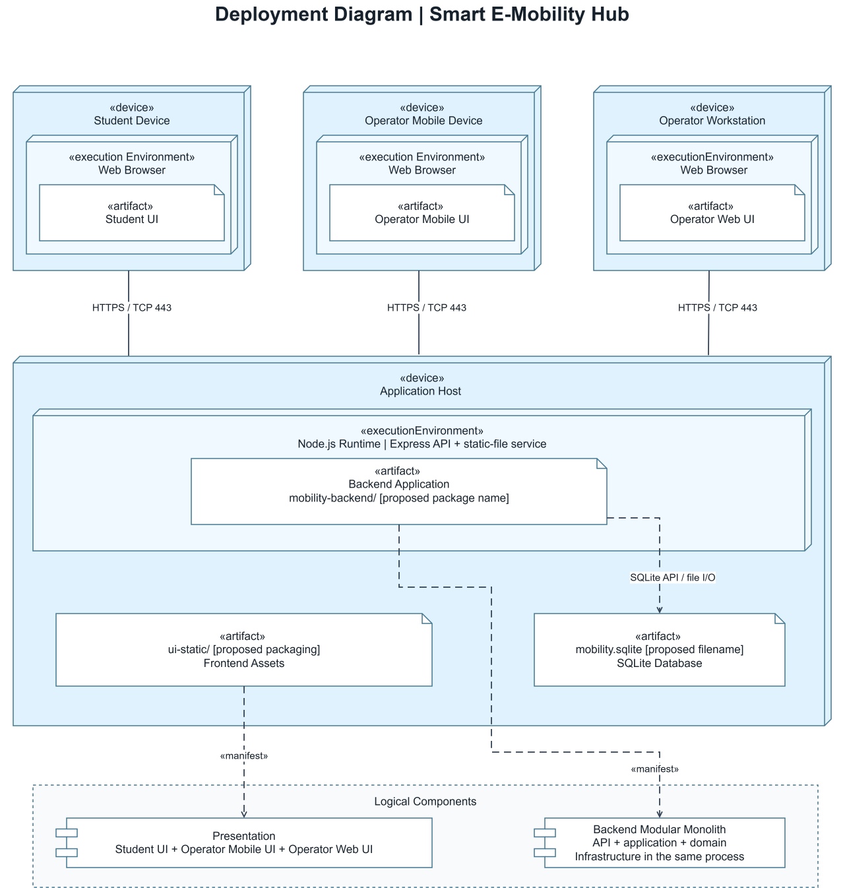

# Deployment View - Smart E-Mobility Hub

**Trạng thái:** Kiến trúc mục tiêu cho MVP, chưa khẳng định backend đã được hiện thực. Giữ ba client và một Application Host; bỏ mã đánh số, rút gọn nhãn artifact và dùng ký hiệu hình trụ cho SQLite Database.

## Kiến trúc

Student UI, Operator Mobile UI và Operator Web UI chạy trong trình duyệt, kết nối tới Application Host qua HTTPS. Node.js Runtime trên host chạy một Backend Application theo mô hình modular monolith. Express xử lý API và phục vụ Frontend Assets; What-if, telemetry giả lập và mock notification vẫn nằm trong backend.

**SQLite Database nằm trên cùng Application Host.** Hình trụ biểu diễn kho dữ liệu/file SQLite, không phải một device node, execution environment hay database server độc lập. Đường SQLite API / file I/O là truy cập cục bộ, không phải TCP/HTTP. Phương án này không thay đổi lựa chọn SQLite của nhóm.

## Node và môi trường chạy

| Thành phần | Loại | Nơi triển khai | Trách nhiệm |
| --- | --- | --- | --- |
| Student Device | Device | Thiết bị sinh viên | Host browser cho các thao tác tìm Hub, đặt/nhận/trả xe, đỗ và sạc. |
| Operator Mobile Device | Device | Thiết bị di động vận hành | Host browser phục vụ tác nghiệp tại hiện trường. |
| Operator Workstation | Device | Máy tính điều hành | Host browser cho giám sát mạng lưới, lịch sạc và What-if. |
| Application Host | Device | Máy chủ hoặc laptop demo | Host ứng dụng, tài nguyên frontend và dữ liệu SQLite. |
| Web Browser | Execution environment | Trong từng thiết bị client | Thực thi giao diện tương ứng, gửi yêu cầu và hiển thị phản hồi. |
| Node.js Runtime | Execution environment | Trong Application Host | Chạy Backend Application bằng một tiến trình. |

## Artifact và dữ liệu

| Thành phần | Vị trí | Trách nhiệm |
| --- | --- | --- |
| Student UI | Browser trên Student Device | Giao diện sinh viên; tương ứng entry page `user-app.html` cùng tài nguyên dùng chung. |
| Operator Mobile UI | Browser trên Operator Mobile Device | Giao diện tác nghiệp; tương ứng `operator-app.html`. |
| Operator Web UI | Browser trên Operator Workstation | Dashboard điều hành; tương ứng `operator-web.html`. |
| Backend Application | Node.js Runtime | Gói backend đề xuất: API, kiểm tra quyền và quy tắc nghiệp vụ, cập nhật trạng thái, sạc, điều phối và mô phỏng. |
| Frontend Assets | Application Host, được Express phục vụ | Bộ HTML/CSS/JS tạo ra các giao diện client; JavaScript frontend chạy ở browser, không chạy như backend. |
| SQLite Database | Application Host | Kho dữ liệu cục bộ; đề xuất file `data/mobility.sqlite`, tách khỏi thư mục public. |

Các tên artifact trên hình là tên gói ngắn gọn, không phải đường dẫn hoặc tên file phát hành đã được chốt. SQLite Database là phần dữ liệu được làm nổi bật bằng hình trụ, không bổ sung một ứng dụng CSDL chạy riêng.

## Kết nối

| Nguồn khởi tạo | Đích tiếp nhận | Giao thức / cơ chế | Dữ liệu |
| --- | --- | --- | --- |
| Student Device / Browser | Application Host / Express | HTTPS | HTML/CSS/JS; truy vấn Hub/xe; yêu cầu đặt, nhận, trả, đỗ/sạc và kết quả xử lý. |
| Operator Mobile / Browser | Application Host / Express | HTTPS | Tài nguyên UI, trạng thái tài nguyên, báo cáo sự cố và yêu cầu tác nghiệp. |
| Operator Workstation / Browser | Application Host / Express | HTTPS | Dashboard, lịch sạc, lệnh điều phối, tham số What-if và kết quả. |
| Backend Application | SQLite Database cùng host | SQLite API / local file I/O | Truy vấn, giao dịch và bản ghi nghiệp vụ; không dùng cổng TCP riêng. |

Ba kết nối HTTPS là communication paths giữa các device; response đi ngược lại trên cùng kết nối. Truy cập SQLite là usage dependency nội bộ. Payload API, tần suất cập nhật và cơ chế push/polling chưa được chốt.

## Deployment và manifestation

- **Deployment:** thể hiện bằng vị trí lồng nhau. UI nằm trong browser; Backend Application nằm trong Node.js Runtime; Frontend Assets và SQLite Database nằm trên Application Host. Không lặp lại mũi tên `«deploy»` để giữ sơ đồ gọn.
- **Manifestation:** `Frontend Assets → Presentation` và `Backend Application → Backend`, dùng nét đứt có mũi tên hở mang nhãn `«manifest»`.
- **Logical Components:** hai component ở cuối hình chỉ dùng để truy vết sang thiết kế logic, không phải hai máy chủ hay hai tiến trình bổ sung.

## Demo local và lưu trữ

Đây là cấu hình demo đề xuất **sau khi backend được hiện thực**:

1. Chạy một tiến trình Node.js + Express trên laptop, phục vụ API và frontend; có thể chọn `http://localhost:3000`.
2. Mở `/user-app.html`, `/operator-app.html` và `/operator-web.html` bằng các phiên browser riêng khi cần mô phỏng tài khoản độc lập. Nếu dùng điện thoại thật cùng LAN, truy cập IP LAN của laptop thay vì `localhost`.
3. Dùng dữ liệu Hub/xe giả lập, kiểm tra thay đổi từ một giao diện được backend lưu và các giao diện còn lại đọc lại đúng trạng thái.

SQLite được đề xuất lưu tại `data/mobility.sqlite` trên host, bằng đường dẫn cấu hình ổn định và không được phục vụ qua static-file route. Cần quyền truy cập phù hợp và backup/restore. HTTP/cổng 3000 chỉ là cấu hình demo; triển khai mục tiêu dùng HTTPS với chứng chỉ/cổng cụ thể được nhóm xác nhận.

Prototype UI hiện tại chưa chứng minh backend, API hoặc lưu trữ này đã chạy. Lệnh khởi động và schema cần được bổ sung khi lập trình.

## Giới hạn

- Một Application Host là **điểm lỗi đơn**: host hoặc backend dừng có thể làm gián đoạn toàn bộ nghiệp vụ; chưa có failover/cân bằng tải.
- SQLite cần backup và kiểm thử tranh chấp ghi; mất/hỏng file không có bản sao có thể làm mất dữ liệu.
- Demo local và telemetry giả lập không chứng minh đã đạt NFR về tải, bảo mật, tính sẵn sàng hoặc tích hợp IoT thật.

## Nguồn và kiểm tra

Baseline: [quyết định kiến trúc của nhóm](https://github.com/YdtTran/software-engineerning/blob/main/development_implement_view/DECISION.md). Node.js + Express, SQLite và modular monolith được giữ nguyên. Topology một host, HTTPS và vị trí file là đề xuất cần nhóm xác nhận.

