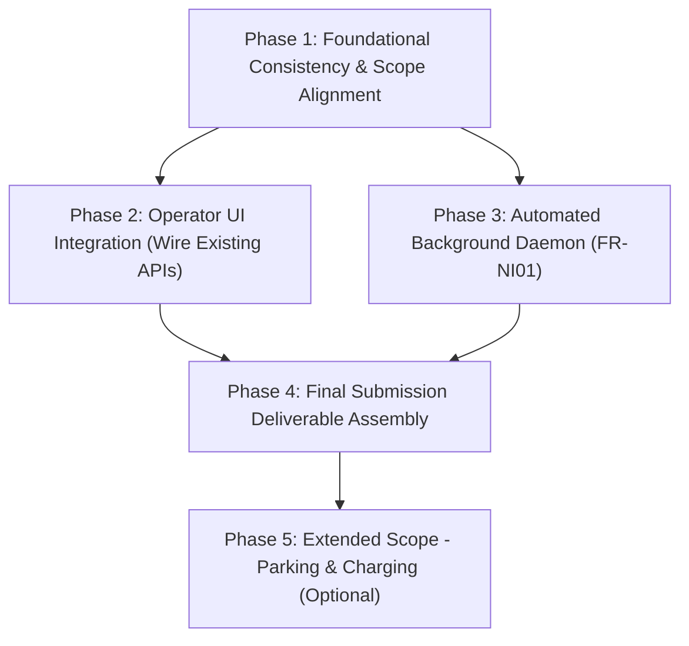

# Prioritized Remediation Roadmap

**Audit Baseline Commit:** [`ac21515`](https://github.com/YdtTran/software-engineerning/commit/ac21515ae299cbb61532faae6b8c2697d0d66e9d)  
**Strategy:** Dependency-ordered, incremental remediation designed to maximize demonstration fidelity and assignment compliance without unnecessary architectural overhaul.  

---

## 1. Roadmap Phasing Strategy

Remediation is ordered strictly by **dependency graph**, ensuring foundational contracts and data integrity are secured before UI views are mounted:



---

## 2. Remediation Sequence

### Phase 1 — Foundational Consistency & Documentation Demarcation
*Goal: Ensure documentation and UI entry points clearly distinguish working MVP code from static design mockups.*
*Target Timeline: Day 1*

1. **Task 1.1: Document Explicit MVP Scope Boundary in Readmes**
   - **Action:** Update [`app/README.md`](file:///home/ydt/Documents/Workspace/software-engineerning/app/README.md) and [`README.md`](file:///home/ydt/Documents/Workspace/software-engineerning/README.md) to explicitly state the dual nature of the prototype:
     - Live Functional Demo: Mobility (UC01–UC05), Incident Reporting (UC11A), What-if Simulation (UC13–UC14), and Operations Transfer creation (UC10 partial).
     - Design-Only Mockup Showcase: Parking (UC06) and Charging (UC07, UC12) available via `index.html`.
   - **Dependencies:** None.
   - **Risk:** Zero. Prevents confusion during demonstration grading.

2. **Task 1.2: Clarify UI Routing in Server**
   - **Action:** In [`app/src/app.js`](file:///home/ydt/Documents/Workspace/software-engineerning/app/src/app.js#L57-L60), add a top navigation banner or link on `live.html` allowing evaluators to switch between **"Chế độ Demo Trực tiếp (Live MVP)"** and **"Trình xem Thiết kế 26 Màn hình (Submission #2 Mockups)"** at `/index.html`.
   - **Dependencies:** None.

---

### Phase 2 — Operator UI Integration (Expose Existing Operations APIs)
*Goal: Wire existing, fully-tested backend Operations endpoints into the live web UI.*
*Target Timeline: Days 2–3*

1. **Task 2.1: Mount Operations Monitoring Dashboard (UC08) in `live.js`**
   - **Action:** Add a **"Tổng quan Hub"** view in `live.js` for the `operator` role.
   - **Integration:** Call existing endpoint `GET /api/v1/operations/hubs`.
   - **UI Rendering:** Display hub cards showing total capacity, available bikes, occupied slots, charging points, and alert badges (Yellow / Red according to FR-NI03 thresholds).
   - **Dependencies:** Backend API already tested and verified (`monitoring-regression.test.js`).

2. **Task 2.2: Add Incident Management View (UC11) in `live.js`**
   - **Action:** Add an **"Sự cố"** tab in `live.js` for `operator`.
   - **Integration:**
     - Call `GET /api/v1/incidents` to list reported trip and equipment incidents.
     - Add action buttons: *"Tiếp nhận & Giao kỹ thuật"* (`POST /api/v1/incidents/:id/handle`) and *"Hoàn tất xử lý"* (`POST /api/v1/incidents/:id/resolve`).
   - **Dependencies:** Backend API already tested and verified (`incident-regression.test.js`).

3. **Task 2.3: Complete Transfer Order Lifecycle UI (UC10, UC10A, UC10B)**
   - **Action:** In the Operator Transfer view, allow viewing existing transfers and triggering:
     - *"Xác nhận xuất phát"* (`POST /api/v1/transfers/:id/depart`).
     - *"Xác nhận đến"* (`POST /api/v1/transfers/:id/arrive`).
     - *"Hủy lệnh"* (`POST /api/v1/transfers/:id/cancel`).
   - **Dependencies:** Backend API already tested and verified (`transfer-regression.test.js`).

---

### Phase 3 — Background Daemon Implementation (FR-NI01)
*Goal: Satisfy the Submission #1 bonus requirement for autonomous background services.*
*Target Timeline: Day 4*

1. **Task 3.1: Add 30-Second Auto-Cancel Timer Daemon in Server**
   - **Action:** In [`app/src/demo-server.js`](file:///home/ydt/Documents/Workspace/software-engineerning/app/src/demo-server.js), instantiate a background timer:
     ```javascript
     setInterval(async () => {
       try {
         await app.locals.mobility.rentalService.expireOverdueReservations();
       } catch (err) {
         console.error('Background expiry error:', err);
       }
     }, 30000);
     ```
   - **Integration:** Wrap existing `RentalService.cancel()` / expiry logic into a repository method `expireOverdueReservations(now)`.
   - **Dependencies:** `sqlite-rental-repository.js`.
   - **Test:** Add an integration test in `src/tests/demo-server.test.js` verifying that a reservation older than 15 minutes transitions to `Expired` automatically.

---

### Phase 4 — Final Submission Assembly & Demonstration Preparation
*Goal: Fulfill all lecturer submission requirements for the final project package.*
*Target Timeline: Days 5–6*

1. **Task 4.1: Compile Final Consolidated PDF**
   - **Action:** Assemble all required sections into 1 PDF:
     - Section 1: Submission #1 (Context, Stakeholders, FRs, NFRs, System Use Case Diagram, Use Case Specs).
     - Section 2: Submission #2 (UI Mockups, 7 Sequence Diagrams, 7 Activity Diagrams, 3 Statechart Diagrams).
     - Section 3: Submission #3 (Deployment View, Development View, Class Diagram with Method Descriptions, Test Cases).
     - Section 4: MVP Working Demonstration sequence of screens.
   - **Dependencies:** Existing Markdown reports and diagrams.

2. **Task 4.2: Complete and Sign Generative AI Declaration**
   - **Action:** Fill out the declaration form in [`PROJECT_SPECIFICATION.md` §8](file:///home/ydt/Documents/Workspace/software-engineerning/docs/requirements/PROJECT_SPECIFICATION.md#8-ch%C3%ADnh-s%C3%A1ch-khai-b%C3%A1o--s%E1%BB%AD-d%E1%BB%A5ng-generative-ai):
     - Tools used: GitHub Copilot, Google Antigravity / Gemini CLI.
     - Scope: Scaffold test suites, generate SVG/Draw.io diagrams, code review and syntax checks.
     - Student contribution: Domain modeling, requirements engineering, concurrency review, manual testing, and presentation.
   - **Signatures:** All team members.

3. **Task 4.3: Dry-Run MVP Demonstration Presentation**
   - **Action:** Rehearse the live demo following [`docs/architecture/MINH_DEMO_GUIDE.md`](file:///home/ydt/Documents/Workspace/software-engineerning/docs/architecture/MINH_DEMO_GUIDE.md):
     - Step 1: Login Student `minh` → Reserve EB-001 at Metro Hub → Pickup → Active trip → Return at BKU Hub.
     - Step 2: Login Operator `operator` → Run What-if Simulation (Metro peak surge) → View projected metrics → Apply transfer recommendation → Verify transfer order created in SQLite.

---

### Phase 5 — Optional Enhancements (Post-Submission Scope)
*Target Timeline: Future work / Post-academic milestone*

1. **Task 5.1: Geolocation Coordinates & Interactive Leaflet Map**
   - Add `latitude`, `longitude` columns to `mobility_hubs` in migration 0012.
   - Integrate a lightweight Leaflet map in `live.html` showing real pins in VNU-HCM.
2. **Task 5.2: Backend Module for Parking (UC06) and Charging (UC07, UC12)**
   - Implement `parking-router.js` and `charging-router.js` backed by SQLite tables `parking_reservations` and `charging_sessions`.
   - Wire `chargingGuard` in `app.js` to allow active charging point state transitions.

---

## 3. Resource Allocation and Responsibility Matrix

| Task Category | Primary Responsibility | Reviewer | Estimated Effort |
|---|---|---|---|
| **Documentation & Scope Clarification (Phase 1)** | Lead Requirements Engineer | Whole Team | 0.5 Day |
| **Operator UI Integration (Phase 2)** | Frontend & Fullstack Author | Tech Lead | 1.5 Days |
| **Background Daemon (Phase 3)** | Backend Author | Verification / Test Lead | 0.5 Day |
| **PDF Compilation & GenAI Form (Phase 4)** | Team Coordinator | Whole Team | 1.0 Day |
| **Demo Rehearsal (Phase 4)** | Presenter & Demonstrator | Whole Team | 0.5 Day |
