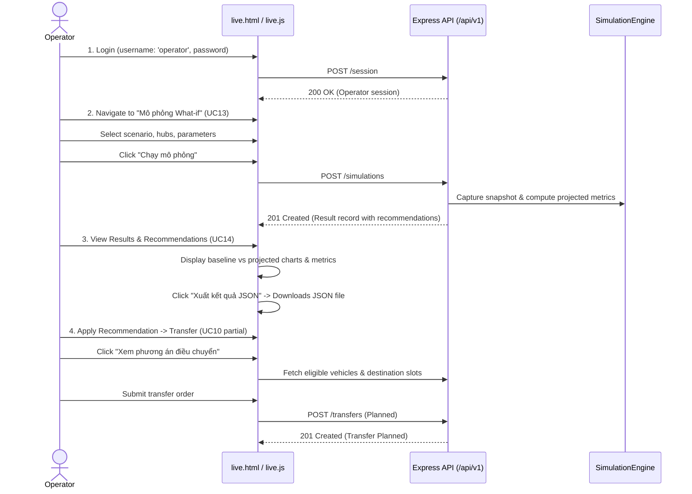

# UI/UX and MVP Demonstration Coverage Audit

**Commit:** [`ac21515`](https://github.com/YdtTran/software-engineerning/commit/ac21515ae299cbb61532faae6b8c2697d0d66e9d)  
**Primary UI Files Audited:**  
- Live Web Application: [`app/prototype/live.html`](file:///home/ydt/Documents/Workspace/software-engineerning/app/prototype/live.html), [`app/prototype/live.js`](file:///home/ydt/Documents/Workspace/software-engineerning/app/prototype/live.js), [`app/prototype/live.css`](file:///home/ydt/Documents/Workspace/software-engineerning/app/prototype/live.css)  
- Design Mockup Viewer: [`app/prototype/index.html`](file:///home/ydt/Documents/Workspace/software-engineerning/app/prototype/index.html), [`app/prototype/app.js`](file:///home/ydt/Documents/Workspace/software-engineerning/app/prototype/app.js), [`app/prototype/styles.css`](file:///home/ydt/Documents/Workspace/software-engineerning/app/prototype/styles.css)  
- Export Galleries & Verification: [`app/prototype/gallery.html`](file:///home/ydt/Documents/Workspace/software-engineerning/app/prototype/gallery.html), [`app/prototype/UI-UX.pdf`](file:///home/ydt/Documents/Workspace/software-engineerning/app/prototype/UI-UX.pdf)  

---

## 1. Dual-UI Architecture Analysis

The repository contains **two distinct UI presentations** that serve different submission purposes:

```mermaid
flowchart TD
    Client["Browser Client"]
    AppJS["app/src/app.js\nExpress Server"]

    subgraph LivePath ["Path 1: Live Interactive MVP Application"]
        LiveHTML["/live.html\n(Live Shell)"]
        LiveJS["live.js\n(Dynamic API Client)"]
        APIs["/api/v1/...\n(Express Routers + SQLite)"]
        LiveHTML --> LiveJS --> APIs
    end

    subgraph MockupPath ["Path 2: Submission #2 UI Mockup Showcase"]
        IndexHTML["/index.html\n(Mockup Studio)"]
        MockAppJS["app.js\n(26 Static Screens)"]
        MockData["In-Memory Mock Hubs/Vehicles\n(No Network Calls)"]
        IndexHTML --> MockAppJS --> MockData
    end

    Client -->|GET /user-app.html\nGET /operator-web.html\n(Redirects)| AppJS
    AppJS -->|302 Redirect| LiveHTML
    Client -->|Direct GET /index.html| IndexHTML
```

1. **Submission #2 UI Mockup Viewer (`index.html` + `app.js`):**
   - Designed for grading Submission #2 requirements.
   - Contains 26 high-fidelity screens covering all 14 use cases (UC01–UC14) across 3 experiences: User App (11 screens), Operator App (6 screens), and Operator Web (9 screens).
   - Operates entirely on client-side state with simulated mock data.
2. **Live Functional MVP (`live.html` + `live.js`):**
   - Created in PR #14 for end-to-end MVP demonstration.
   - Fully integrated with the Express backend, authentication session cookies, and SQLite persistence.
   - Connects live to Mobility Rental (UC01–UC05), Incident Reporting (UC11A), and What-if Simulation (UC13–UC14).

> [!WARNING]
> **Routing Interception:** In [`app/src/app.js`](file:///home/ydt/Documents/Workspace/software-engineerning/app/src/app.js#L57-L60), requesting `/user-app.html`, `/operator-app.html`, or `/operator-web.html` issues an HTTP 302 redirect to `/live.html?experience=...`. This bypasses `index.html`. Users evaluating the system through these URLs see the live application rather than the 26-screen mockup viewer.

---

## 2. End-to-End User Journey Audit (Student Experience)

We verified the live user journey through manual inspection and the automated Playwright test suite ([`app/src/tests/live-browser.test.js`](file:///home/ydt/Documents/Workspace/software-engineerning/app/src/tests/live-browser.test.js)):

```mermaid
sequenceDiagram
    actor Student
    participant UI as live.html / live.js
    participant Server as Express API (/api/v1)
    participant DB as SQLite (hub.sqlite)

    Student->>UI: 1. Login (username: 'minh', password)
    UI->>Server: POST /session
    Server-->>UI: 200 OK (Set demo_session cookie)
    
    Student->>UI: 2. Search Hubs (UC01) & View Vehicles (UC02)
    UI->>Server: GET /hubs?q= & GET /hubs/:id/vehicles
    Server-->>UI: 200 OK (List of available vehicles)

    Student->>UI: 3. Reserve Vehicle (UC03)
    UI->>Server: POST /vehicle-reservations (Idempotency-Key)
    Server->>DB: Atomically reserve vehicle (15 min hold)
    Server-->>UI: 201 Created (ticketCode: "EB-...", expiresAt)

    Student->>UI: 4. Pick Up Vehicle (UC04)
    UI->>Server: POST /vehicle-reservations/:id/pickup (vehicleCode)
    Server->>DB: Check ticketCode, verify vehicle, unlock dock
    Server-->>UI: 200 OK (Trip Active)

    opt Report Incident during Trip (UC11A)
        Student->>UI: Click "Báo sự cố" -> Enter description
        UI->>Server: POST /trips/:id/incidents
        Server->>DB: Create incident; keep trip Active
        Server-->>UI: 201 Created
    end

    Student->>UI: 5. Return Vehicle (UC05)
    UI->>Server: GET /hubs/:id/return-slots?tripId=
    Server-->>UI: 200 OK (Available slots)
    Student->>UI: Select slot, check confirmation, click "Xác nhận trả xe"
    UI->>Server: POST /trips/:id/return (confirmed: true)
    Server->>DB: Dock lock verified; close trip; occupy slot; classify battery
    Server-->>UI: 200 OK (Trip Completed)
```

### Detailed Evaluation of User Workflow Steps:

1. **Authentication & Session:**
   - Entry: Form on `live.html` asking for username and password.
   - Authentication sends credentials to `POST /api/v1/session`. Scrypt hash verified; `demo_session` cookie issued.
   - Role enforcement: Only users with `user` role can access rental endpoints.
2. **Hub Discovery & Vehicle Availability (UC01, UC02):**
   - User searches by keyword or selects from list.
   - `GET /api/v1/hubs` returns available Hubs.
   - Clicking a Hub triggers `GET /api/v1/hubs/:id/vehicles`, displaying available vehicles with battery percentages and vehicle types.
3. **Reservation & Ticket Creation (UC03):**
   - Selecting a vehicle and clicking "Xác nhận giữ xe" issues `POST /api/v1/vehicle-reservations` with client-generated idempotency key.
   - Receives ticket code and actual expiry timestamp (current time + 15 minutes).
   - Ability to cancel prior to pickup via `POST /vehicle-reservations/:id/cancel`.
4. **Pickup Verification & Unlock (UC04):**
   - User inputs vehicle code into ticket form.
   - Incorrect code returns error (`VEHICLE_CODE_MISMATCH`) without unlocking.
   - Correct code triggers `POST /vehicle-reservations/:id/pickup`. Simulated dock confirms unlock; reservation becomes `Fulfilled`; new `mobility_trips` record transitions to `Active`.
5. **Trip Return & Destination Capacity (UC05):**
   - User selects destination Hub and clicks "Kiểm tra chỗ trả".
   - `GET /api/v1/hubs/:hubId/return-slots?tripId=` dynamically filters out slots that are occupied, suspended, or held by transfers/commitments.
   - User selects slot and checks checkbox: *"Tôi đã đưa xe vào đúng chỗ và khóa an toàn."*
   - Returns successfully. Trip closes with end timestamp.
6. **Network Interruption & Lost-Response Recovery:**
   - In `live.js`, pending requests are stored in `localStorage`. If the network fails, button **"Thử lại yêu cầu trước"** replays the exact same idempotency key and payload, safely recovering the committed trip/reservation without duplicate writes.

---

## 3. End-to-End Operator Journey Audit



### Evaluation of Operator Workflow Steps:

1. **What-if Simulation Execution (UC13):**
   - Dropdown with 5 scenarios:
     1. *Metro surge* (`metro`): parameters `demandMultiplier`.
     2. *Full parking* (`parking`): parameters `occupiedPercent`.
     3. *Charging surge* (`charging-demand`): parameters `chargingMultiplier`, `chargingRequestsPerHour`, `powerBudgetKw`.
     4. *Charging port failure* (`charging`): parameters `failedPorts`, `powerBudgetKw`, `portPowerKw`.
     5. *Vehicle clustering* (`clustering`): parameters `targetHubId`, `returnBias`.
   - Form validates parameters before submission.
   - Submits `POST /api/v1/simulations`. Runs simulation on immutable snapshot in 15–50 ms.
2. **Results Review & Data Export (UC14):**
   - Renders baseline metrics vs projected metrics (fleet utilization, wait times, rejected trips, peak occupancy).
   - Lists actionable coordination recommendations.
   - **JSON Export Button:** Generates downloadable `simulation-<id>.json` client-side.
3. **Applying Transfer Recommendations (UC10 Partial):**
   - Clicking a redistribution recommendation loads live source vehicles and destination slots.
   - Submits `POST /api/v1/transfers`, creating a `Planned` transfer order in SQLite.

---

## 4. UI Coverage Matrix across Use Cases (UC01 – UC14)

| Use Case | Name | Mockup Screens (`index.html`) | Live Demo (`live.html`) | Demo Readiness Status | Gaps & Limitations |
|---|---|---|---|---|---|
| **UC01** | Search Mobility Hub | `#map` | `#home`, `#map` | **DEMONSTRABLE (LIVE)** | Static location coordinates |
| **UC02** | View Available Vehicles | `#vehicles` | `#vehicles` | **DEMONSTRABLE (LIVE)** | Filter by type supported |
| **UC03** | Reserve Vehicle | `#reserve`, `#ticket` | `#reserve`, `#ticket` | **DEMONSTRABLE (LIVE)** | 15-min countdown, cancellation |
| **UC04** | Pick Up Vehicle | `#pickup` | `#pickup` | **DEMONSTRABLE (LIVE)** | Simulated dock unlock |
| **UC05** | Return Vehicle | `#trip` | `#trip` | **DEMONSTRABLE (LIVE)** | Slot check, lock confirmation |
| **UC06** | Manage Parking Reservation | `#parking` | *(Not present)* | **MOCKUP ONLY** | No backend connection |
| **UC07** | Request Charging | `#charging` | *(Not present)* | **MOCKUP ONLY** | No backend connection |
| **UC08** | Monitor Mobility Hub Network | `#overview` | *(Not present)* | **MOCKUP ONLY** | API exists; not in `live.js` |
| **UC09** | Manage Mobility Resources | `#resources` | *(Not present)* | **MOCKUP ONLY** | API exists; not in `live.js` |
| **UC10** | Redistribute Vehicles | `#redistribute` | Partial (`#transfer`) | **PARTIALLY DEMONSTRABLE** | Can create; cannot depart/arrive |
| **UC11** | Handle Operational Incident | `#incidents` | Partial (`#journeys` dialog) | **PARTIALLY DEMONSTRABLE** | User can report; operator cannot resolve in UI |
| **UC12** | Manage Charging Schedule | `#schedule` | *(Not present)* | **MOCKUP ONLY** | No backend connection |
| **UC13** | Run What-if Simulation | `#simulation` | `#simulation` | **DEMONSTRABLE (LIVE)** | All 5 scenarios work |
| **UC14** | View Simulation Results | `#results` | `#results` | **DEMONSTRABLE (LIVE)** | Metrics, recommendations, JSON export |

---

## 5. UI/UX Accessibility, Error States, and Polish

1. **Error Messaging:**
   `live.js` maps backend error codes to human-readable Vietnamese explanations (e.g. `VEHICLE_CODE_MISMATCH` → *"Mã xe không khớp phiếu. Hãy kiểm tra mã trên xe."*, `RESERVATION_EXPIRED` → *"Phiếu đã hết hạn. Vui lòng chọn xe lại."*).
2. **Responsive Layouts:**
   Tested at 390×844 (mobile viewport) and 1440×1000 (desktop viewport). Responsive navigation, form grids, and result cards adapt gracefully without visual clipping or horizontal overflow.
3. **Accessibility Attributes:**
   Inputs include `aria-label`, forms use semantic tags (`<fieldset>`, `<legend>`), dynamic alerts use `role="status"` and `aria-live="polite"`.
