# Usecase Diagram

Editable diagrams are in `drawio/`.

The [11-field core scenarios](CORE_SCENARIOS.md) and [parking/lifecycle scenarios](LIFECYCLE_SCENARIOS.md) describe triggers, preconditions, outcomes and exceptions. The [version 2 review](../../requirements/VERSION_2_CONTRACT_REVIEW.md) distinguishes target behavior from the current demo.

Open a `.drawio` file in diagrams.net or the Draw.io extension for VS Code to edit it.

## System-wide overview

[Open the editable Draw.io overview](drawio/system_use_cases.drawio) for all 25 use cases, four actors, and their relationships on one canvas.

PlantUML source and Mermaid preview

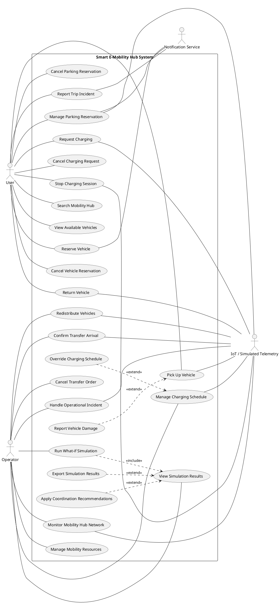

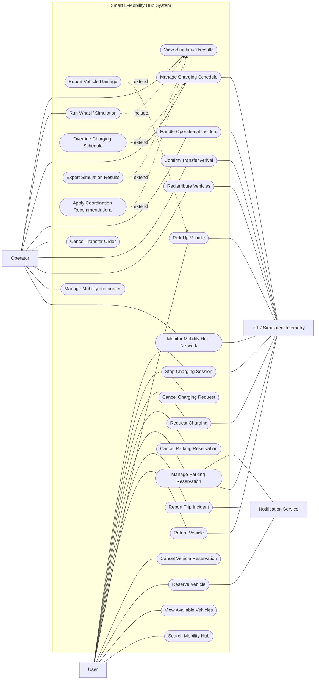

## Workflow diagrams

Together, these six diagrams cover 25 use cases, including UC01–UC14. Each use case appears in exactly one workflow. Actors appear wherever they participate.

| Workflow | Use cases | Draw.io |
| --- | ---: | --- |
| Vehicle Rental | 8 | [Edit](drawio/workflow_vehicle_rental.drawio) |
| Parking Reservation | 2 | [Edit](drawio/workflow_parking_reservation.drawio) |
| Charging | 5 | [Edit](drawio/workflow_charging.drawio) |
| Hub Operations | 3 | [Edit](drawio/workflow_hub_operations.drawio) |
| Vehicle Redistribution | 3 | [Edit](drawio/workflow_vehicle_redistribution.drawio) |
| What-if Simulation | 4 | [Edit](drawio/workflow_what_if_simulation.drawio) |

Open the files with the Draw.io extension in VS Code. To import the PlantUML, use **+ → Advanced → PlantUML** in Draw.io or **File → Import → PlantUML** in Visual Paradigm Online.

The [UC06 lifecycle scenarios](LIFECYCLE_SCENARIOS.md) document check-in and check-out in detail.

### Vehicle Rental

PlantUML source and Mermaid preview

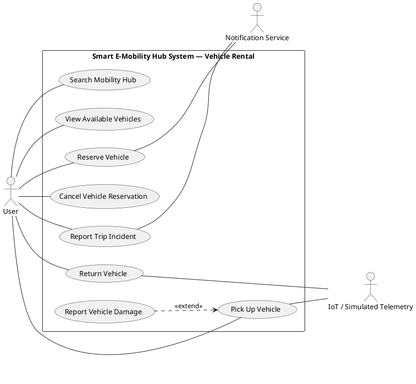

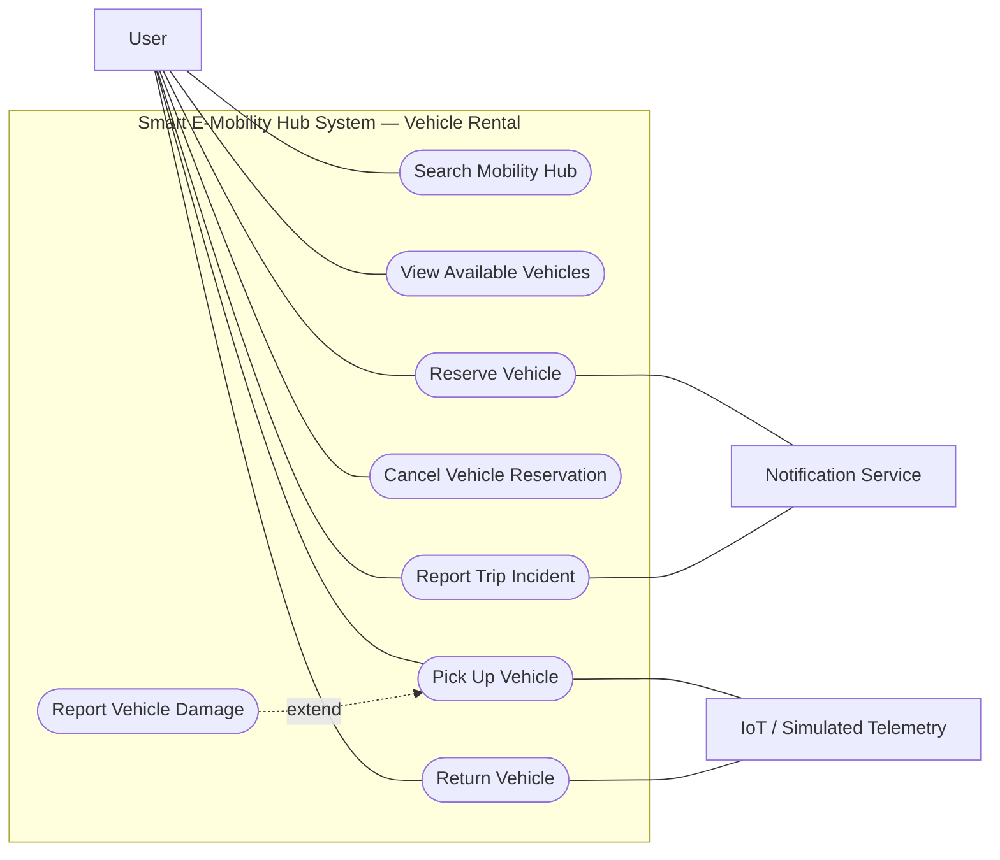

### Parking Reservation

PlantUML source and Mermaid preview

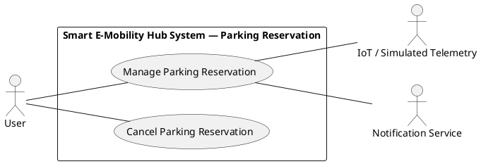

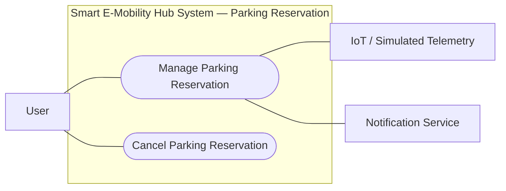

### Charging

PlantUML source and Mermaid preview

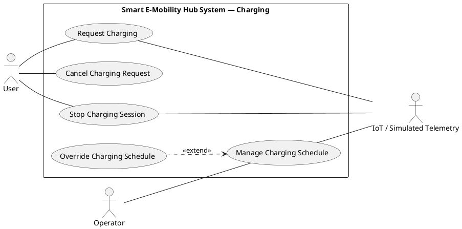

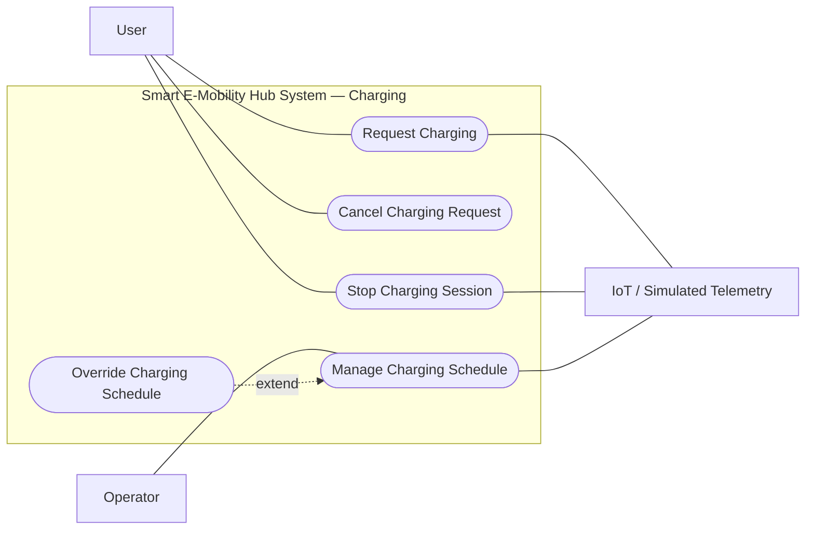

### Hub Operations

PlantUML source and Mermaid preview

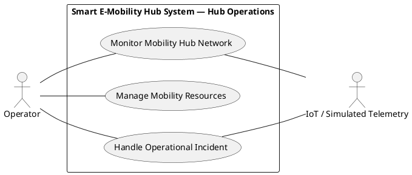

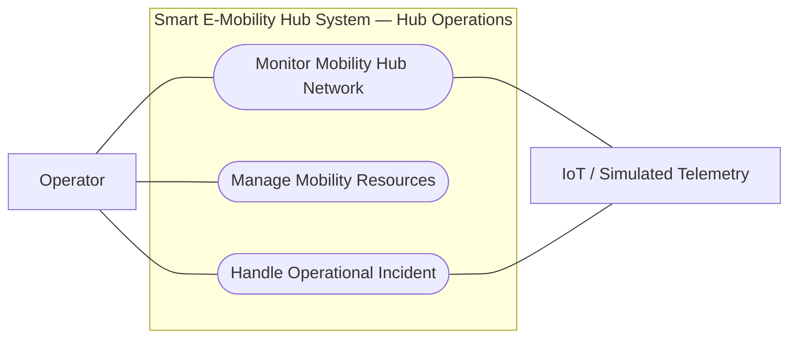

### Vehicle Redistribution

PlantUML source and Mermaid preview

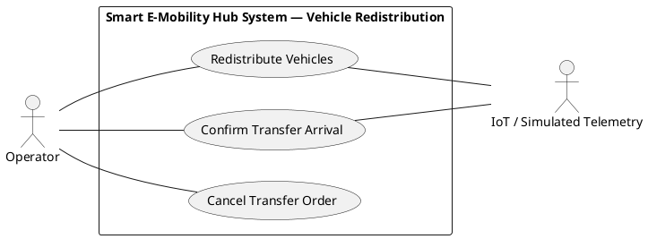

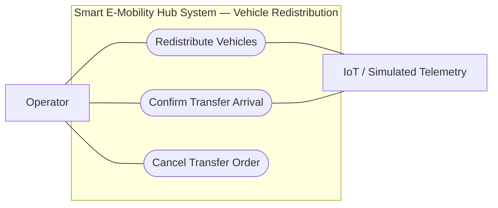

### What-if Simulation

PlantUML source and Mermaid preview

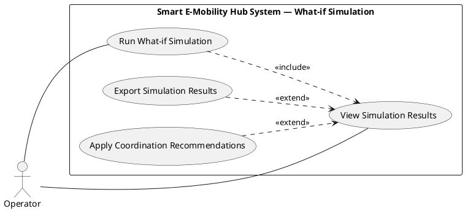

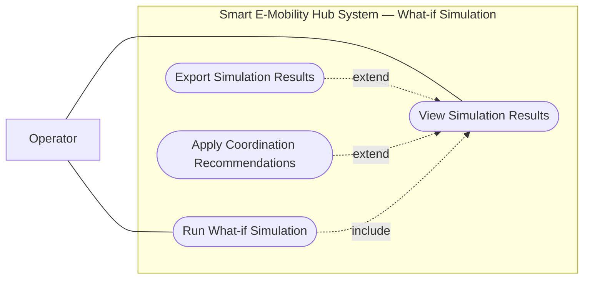

## UC13–UC14: current simulation interactions

The [core scenarios](CORE_SCENARIOS.md) describe scenario selection, execution and result display. After a successful run, UC13 includes UC14. An Operator may also open UC14 independently. From a result, the live demo exports JSON locally or opens a transfer recommendation for review; creating the transfer uses UC10 and checks live resources. Other recommendations remain informational. Filtering by Hub/time, comparing separate runs and CSV/PDF export are optional capabilities outside the current demo.
