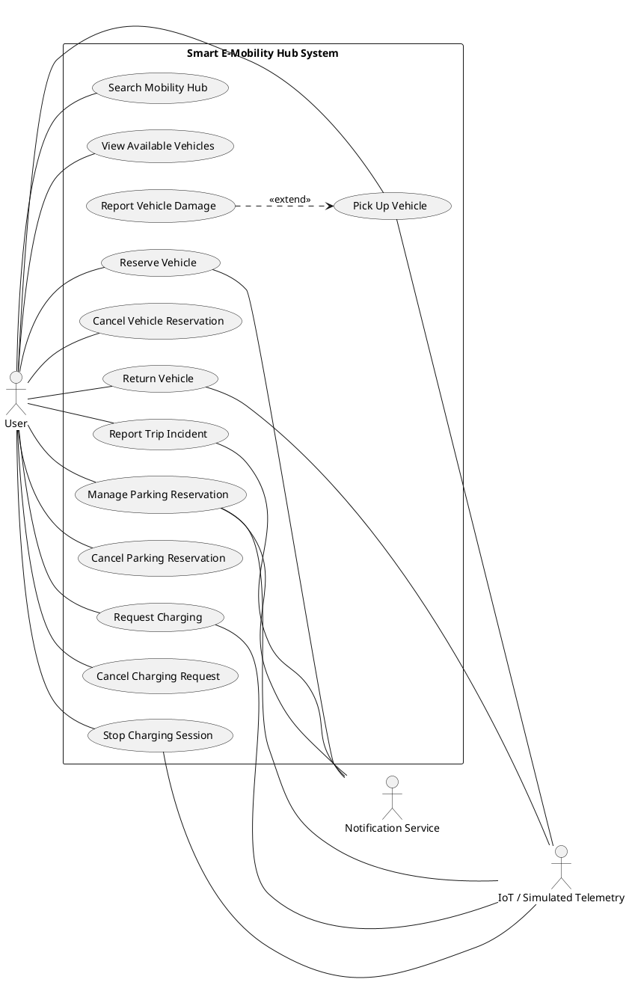
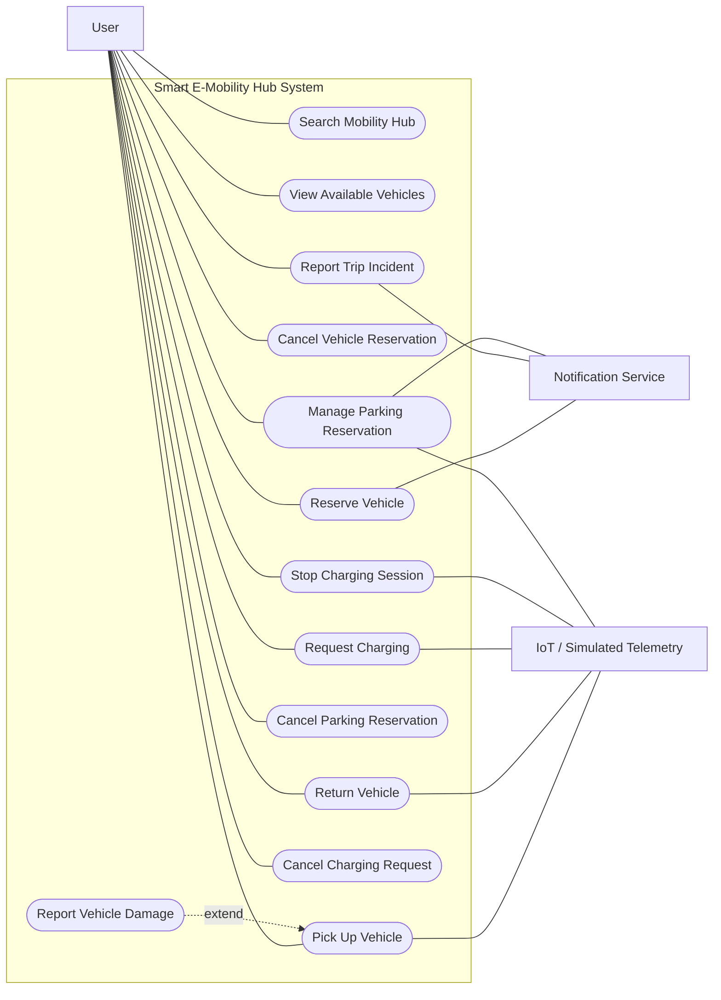
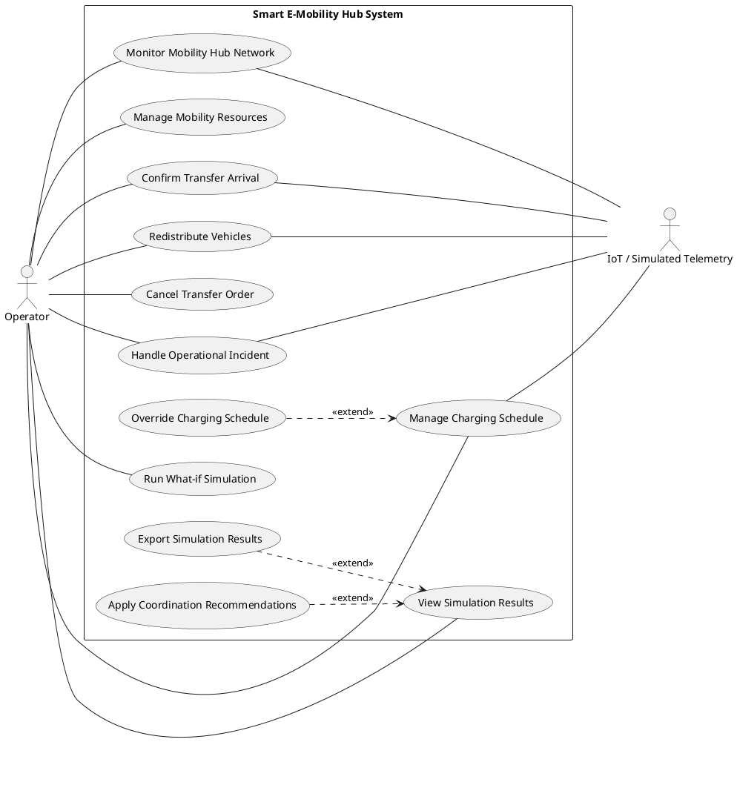
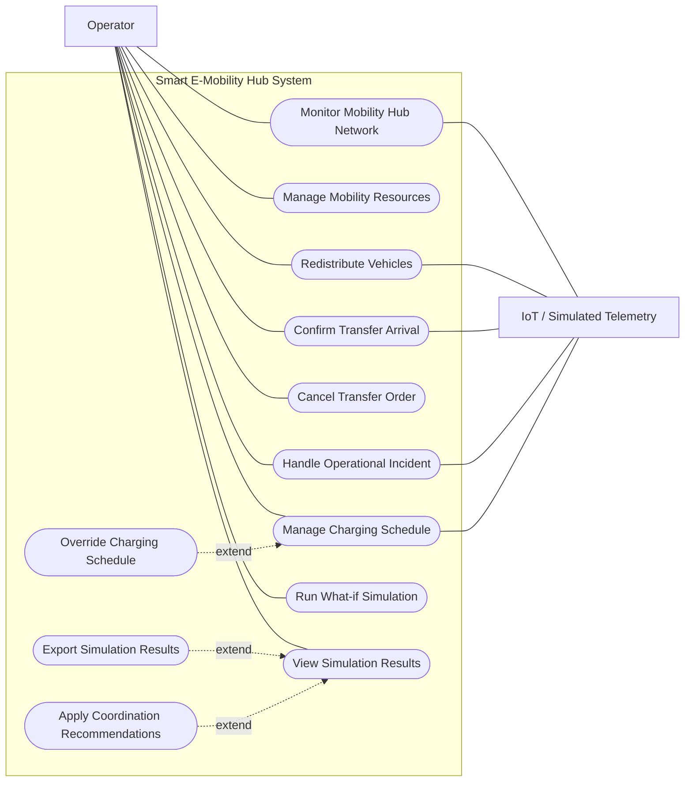
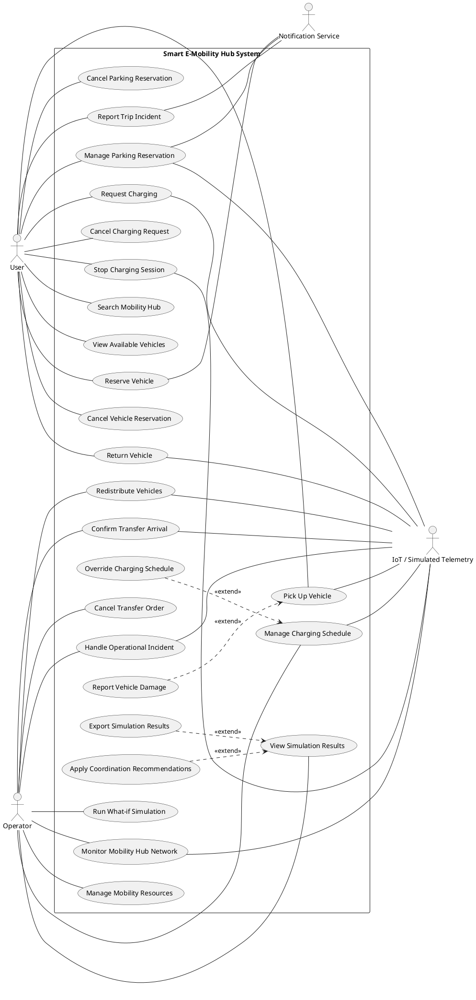
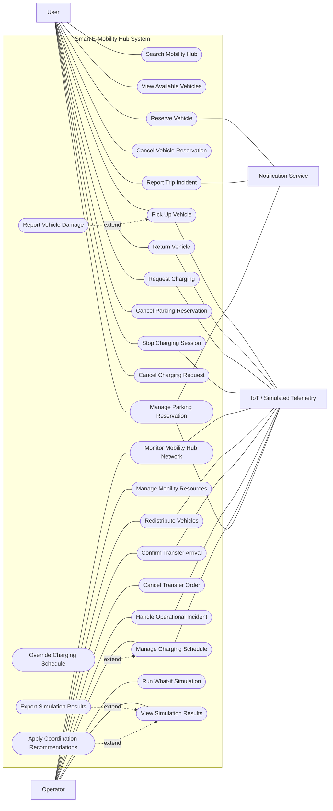

# Usecase Diagram

Editable diagrams are in `drawio/`.

Open a `.drawio` file in diagrams.net or the Draw.io extension for VS Code to edit it.

| Diagram | Draw.io |
| --- | --- |
| UC01-Search_Mobility_Hub | [Edit](drawio/UC01-Search_Mobility_Hub.drawio) |
| UC02-View_Available_Vehicles | [Edit](drawio/UC02-View_Available_Vehicles.drawio) |
| UC03-Reserve_Vehicle | [Edit](drawio/UC03-Reserve_Vehicle.drawio) |
| UC04-Pick_Up_Vehicle | [Edit](drawio/UC04-Pick_Up_Vehicle.drawio) |
| UC05-Return_Vehicle | [Edit](drawio/UC05-Return_Vehicle.drawio) |
| UC06-S1 — Create Parking Reservation | [Edit](drawio/UC06-S1-Create_Parking_Reservation.drawio) |
| UC06-S2 — Check In Private Vehicle (legacy UC06A) | [Edit](drawio/UC06-S2-Check_In_Private_Vehicle.drawio) |
| UC06-S3 — Check Out Private Vehicle (legacy UC06B) | [Edit](drawio/UC06-S3-Check_Out_Private_Vehicle.drawio) |
| UC07-Request_Charging | [Edit](drawio/UC07-Request_Charging.drawio) |
| UC07A-Stop_Charging_Session | [Edit](drawio/UC07A-Stop_Charging_Session.drawio) |
| UC10-Redistribute_Vehicles | [Edit](drawio/UC10-Redistribute_Vehicles.drawio) |
| UC10A-Confirm_Transfer_Arrival | [Edit](drawio/UC10A-Confirm_Transfer_Arrival.drawio) |
| UC10B-Cancel_Transfer_Order | [Edit](drawio/UC10B-Cancel_Transfer_Order.drawio) |
| UC11-Handle_Operational_Incident | [Edit](drawio/UC11-Handle_Operational_Incident.drawio) |
| UC11A-Report_Trip_Incident | [Edit](drawio/UC11A-Report_Trip_Incident.drawio) |
| UC12-Manage_Charging_Schedule | [Edit](drawio/UC12-Manage_Charging_Schedule.drawio) |
| UC13-Run_What-if_Simulation | [Edit](drawio/UC13-Run_What-if_Simulation.drawio) |
| UC14-View_Simulation_Results | [Edit](drawio/UC14-View_Simulation_Results.drawio) |
| UC8-Monitor_Mobility_Hub_Network | [Edit](drawio/UC8-Monitor_Mobility_Hub_Network.drawio) |
| UC9-Manage_Mobility_Resources | [Edit](drawio/UC9-Manage_Mobility_Resources.drawio) |
| general_usecase_diagram | [Edit](drawio/general_usecase_diagram.drawio) |
| operator_usecases | [Edit](drawio/operator_usecases.drawio) |
| user_usecases | [Edit](drawio/user_usecases.drawio) |

## Overview consistency

The overall view is the union of the User and Operator views: 27 goals. User is the end-user role. Telemetry and Notification Service are supporting external actors. Lifecycle goals are separate interactions; cancellation is not an extension of the original booking transaction. Simulation results are reviewed independently or after a successful run; applying recommendations still requires live resource validation.

### user_usecases

[Editable SVG](drawio/user_usecases.drawio)

### operator_usecases

[Editable SVG](drawio/operator_usecases.drawio)

### general_usecase_diagram

[Editable SVG](drawio/general_usecase_diagram.drawio)

| Quality check | Result |
|---|---|
| Overall goals equal union of role views | 27 goals |
| Primary actors left; supporting actors right | Applied |
| System boundary and separate relationship labels | Preserved |
| PlantUML, Mermaid, editable SVG and PNG | Generated |

- VS Code: double-click `.drawio` to edit.
- Draw.io: `+` → `Advanced` → `PlantUML`.
- VP Online: `File` → `Import` → `PlantUML...`.

[UC06 parent contract and lifecycle scenarios](LIFECYCLE_SCENARIOS.md). The overview shows the parent, and the detailed files use the current scenario IDs.
