# Sequence Diagram

Editable diagrams are in `drawio/`.

Open a `.drawio` file in diagrams.net or the Draw.io extension for VS Code to edit it.

| Diagram | Draw.io |
| --- | --- |
| SQ01-Reserve_Vehicle | [Edit](drawio/SQ01-Reserve_Vehicle.drawio) |
| SQ02-Pick_Up_Vehicle | [Edit](drawio/SQ02-Pick_Up_Vehicle.drawio) |
| SQ03-Return_Vehicle | [Edit](drawio/SQ03-Return_Vehicle.drawio) |
| SQ04-Request_Charging | [Edit](drawio/SQ04-Request_Charging.drawio) |
| SQ05-Redistribute_Vehicles | [Edit](drawio/SQ05-Redistribute_Vehicles.drawio) |
| SQ06-Handle_Operational_Incident | [Edit](drawio/SQ06-Handle_Operational_Incident.drawio) |
| SQ07-Run_What_if_Simulation | [Edit](drawio/SQ07-Run_What_if_Simulation.drawio) |

## Phạm vi và truy vết

Bảy sơ đồ minh họa các luồng thành công được chọn. Các ngoại lệ và tương tác vòng đời tiếp theo nằm trong [đặc tả use case](../../requirements/PROJECT_SPECIFICATION.md) và [hợp đồng vòng đời](../01_Usecase_Diagram/LIFECYCLE_SCENARIOS.md).

| Sơ đồ | Use case | Điểm kết thúc được minh họa | Luồng tra cứu thêm |
| --- | --- | --- | --- |
| SQ01 | UC03 | Giữ xe 15 phút, trả phiếu và hạn giữ. | UC03 và FR-NI01 cho xe không khả dụng, hủy và hết hạn. |
| SQ02 | UC04 | Mở khóa được xác nhận, bắt đầu chuyến và giải phóng ô đỗ. | UC04 cho mã xe hoặc phiếu không hợp lệ và mở khóa chưa xác nhận. Báo hư hại trước chuyến là yêu cầu mục tiêu chưa có luồng demo. |
| SQ03 | UC05 | Xác nhận xe đến và khóa, đóng chuyến và cập nhật ô đỗ. | UC05 cho Hub đầy, khóa chưa xác nhận, đối soát khi không thể xác nhận trả xe. |
| SQ04 | UC07 | Tiếp nhận yêu cầu hợp lệ, trả mã yêu cầu và trạng thái hàng đợi. | UC07 cho lịch hẹn, từ chối yêu cầu không hợp lệ và hủy trước kích hoạt. UC12 phân bổ cổng, khung giờ và công suất. UC07A dừng phiên đã kích hoạt. |
| SQ05 | UC10 | Lập lệnh Planned, giữ xe và sức chứa đích. | UC10 cho Hub đích thay thế và xác nhận xuất phát. UC10A xác nhận đến, UC10B hủy trước xuất phát. |
| SQ06 | UC11 | Operator chọn sự cố đã ghi và phân công bảo trì; trạng thái chuyển Investigating. | Việc ghi trạng thái Fault không chứng minh cách ly vật lý. UC11A ghi báo cáo của người đang đi và giữ chuyến mở. |
| SQ07 | UC13, UC14 | Chạy trên snapshot cô lập và hiển thị kết quả lần chạy đã hoàn tất. | UC14 có thể mở riêng. Áp dụng khuyến nghị đi qua UC10 hoặc UC12 với kiểm tra trạng thái thực. |

UC06-S1, UC06-S2 và UC06-S3 được mô tả trong [hợp đồng vòng đời](../01_Usecase_Diagram/LIFECYCLE_SCENARIOS.md) và [AD04](../03_Activity_Diagram/drawio/AD04-Reserve_Parking_and_Charging.drawio). Nếu mở rộng bộ sequence, ưu tiên UC06-S1, sau đó UC12 khi cần minh họa phân bổ.

## SQ04 · Tiếp nhận yêu cầu sạc

`validateAndQueueRequest()` là tên trách nhiệm minh họa: service kiểm tra lượt đỗ, quyền, xe, mục tiêu pin và thời gian trước khi ghi yêu cầu. Kiểm tra cổng tương thích và công suất diễn ra khi UC12 phân bổ; thiếu sức chứa hiện tại không ngăn tiếp nhận yêu cầu hợp lệ. Mã và trạng thái trả về thuộc yêu cầu sạc. UC12 xử lý phân bổ sau; phiên chỉ chuyển sang Active sau xác nhận cấp điện.

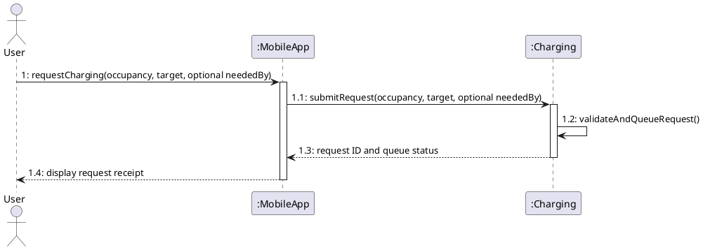

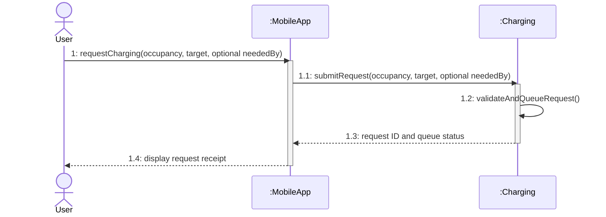

Kiểm tra SQ04 theo Ch6 gồm actor bên trái, lifeline nét đứt, activation theo thời gian, thông điệp yêu cầu nét liền và phản hồi nét đứt. Mở canvas bằng Draw.io Integration trong VS Code, hoặc nhập khối PlantUML bằng chức năng PlantUML trong Draw.io và Visual Paradigm Online.

## SQ03 · Confirm parking and return

The user confirms that the vehicle is parked before sending the return request. The system claims a destination slot and asks the simulated dock to confirm arrival, locking and battery data. Only confirmed dock evidence allows the trip to close and the slot to become occupied.

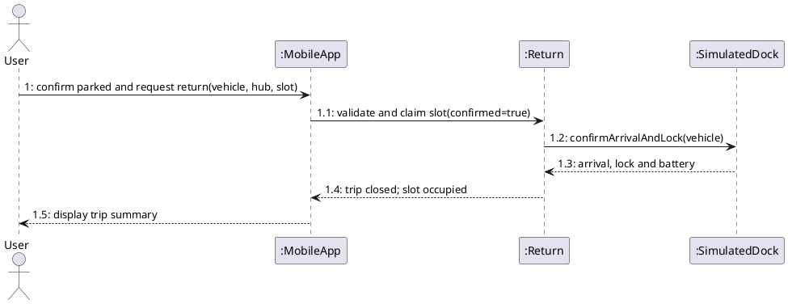

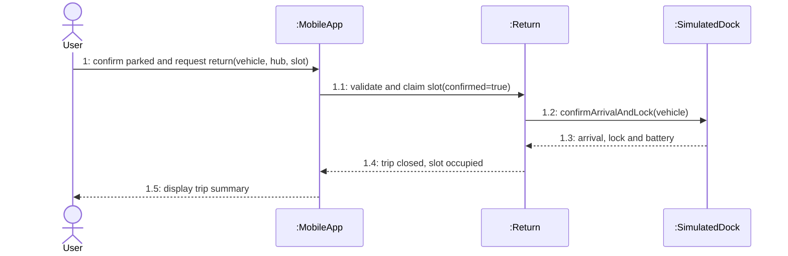

## SQ02 · Nhận xe đã đặt

User chọn phiếu và quét hoặc nhập **mã xe**. Service kiểm tra chủ phiếu, mã, Hub và hạn rồi claim trước khi yêu cầu dock mở khóa. Nếu không có xác nhận phù hợp, demo giữ claim và ghi sự kiện để đối soát; nó không tự tạo incident. Báo hư hại trước chuyến vẫn là yêu cầu mục tiêu chưa được nối trong luồng demo.

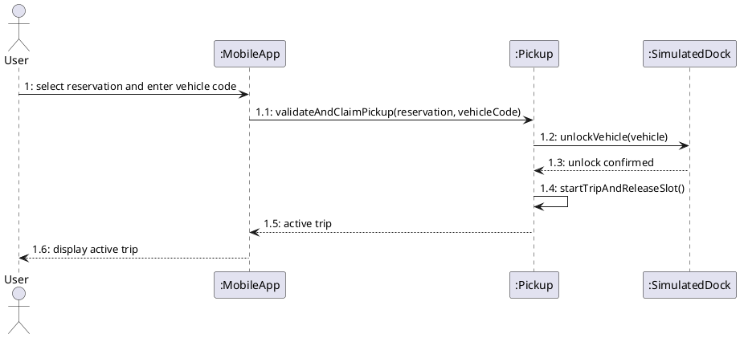

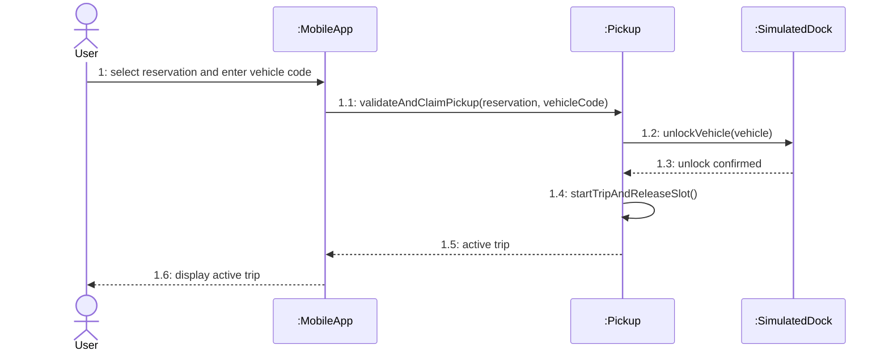

Checklist: User ở ngoài hệ thống; lời gọi và phản hồi theo thứ tự thời gian; chỉ xác nhận dock phù hợp mới bắt đầu chuyến. Mở canvas trong VS Code bằng Draw.io Integration hoặc nhập PlantUML tại **Advanced → PlantUML** trong Draw.io hay **File → Import → PlantUML** trong Visual Paradigm Online.

## SQ05 · Lập lệnh điều chuyển

Operator chọn Hub nguồn, Hub đích, xe và ô đích. Backend kiểm tra điều kiện rồi ghi lệnh `Planned` cùng các giữ chỗ trong một giao dịch. Xuất phát, đến nơi và hủy là các tương tác sau; xem UC10A/UC10B và AD05.

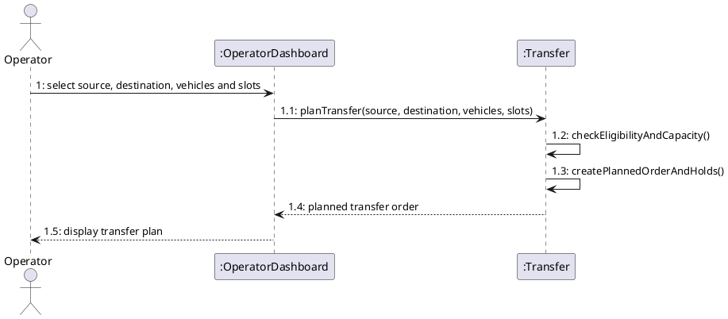

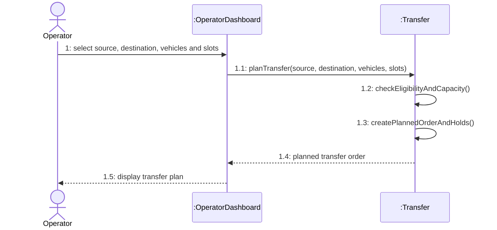

Checklist: Operator ở ngoài hệ thống; thứ tự thông điệp và phản hồi rõ; lệnh Planned không tự chuyển thành InTransit. Mở `.drawio` trong VS Code bằng Draw.io Integration, hoặc nhập PlantUML qua **Advanced → PlantUML** trong Draw.io hay **File → Import → PlantUML** trong Visual Paradigm Online.

## SQ01 · Đặt giữ xe dùng chung

User chọn xe khả dụng và xác nhận giữ xe. Service kiểm tra điều kiện xe (`Available`, pin ≥20%, không bị giữ hoặc có sự cố mở) và giữ xe 15 phút trong một giao dịch. Hủy trước khi nhận xe và hết hạn theo FR-NI01 xem tại UC03.

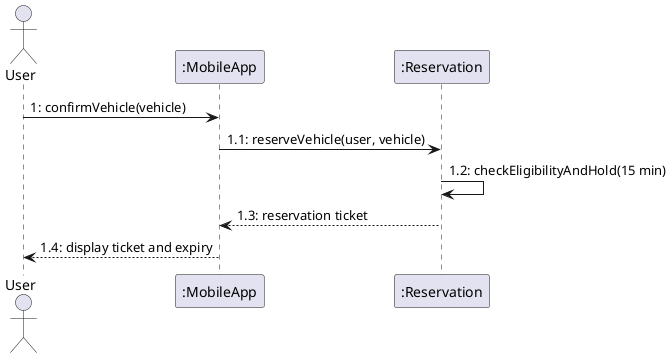

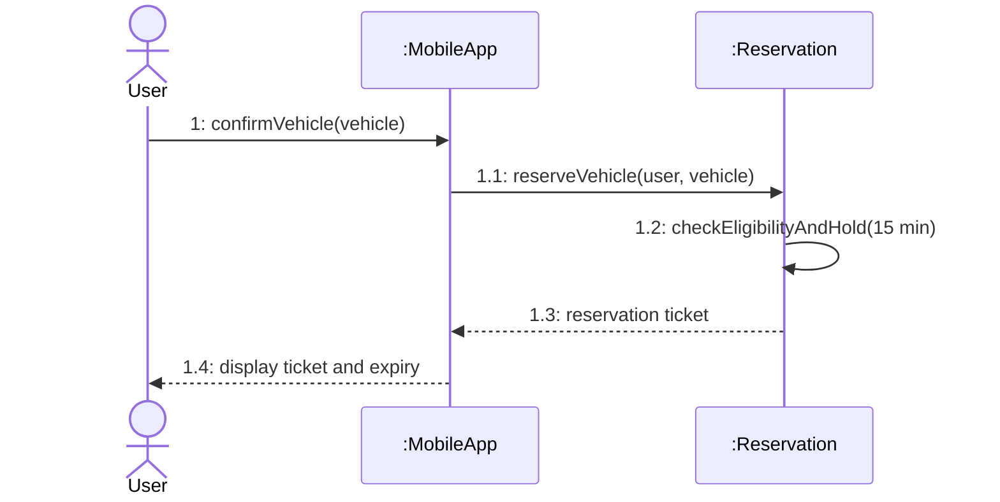

Checklist: User ở ngoài hệ thống; giữ xe và tạo phiếu diễn ra nguyên tử; hết hạn sau 15 phút. Mở `.drawio` trong VS Code bằng Draw.io Integration, hoặc nhập PlantUML qua **Advanced → PlantUML** trong Draw.io hay **File → Import → PlantUML** trong Visual Paradigm Online.

## SQ06 · Xử lý sự cố vận hành

Operator chọn sự cố đã ghi nhận, nhập kỹ thuật viên và lịch hẹn xử lý. Service kiểm tra sự cố đang mở và phân công bảo trì (`Investigating`), không tự xác minh cách ly vật lý qua API `handle` này. Báo cáo sự cố giữa chuyến của User dùng UC11A và giữ chuyến mở.

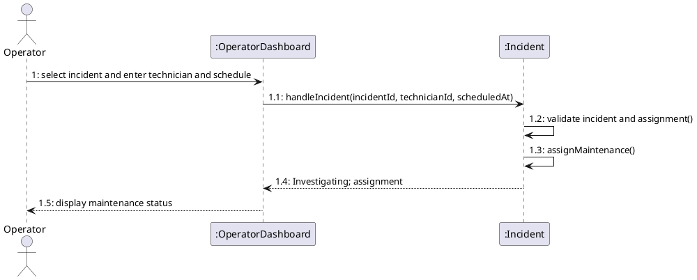

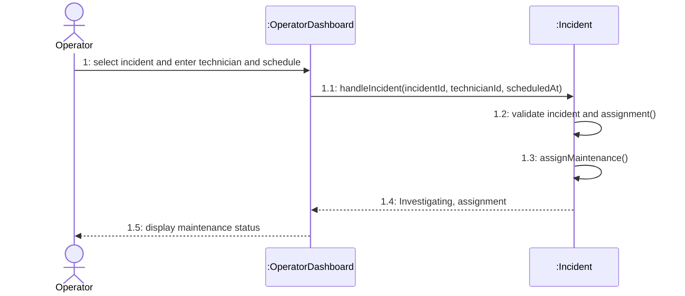

Checklist: Operator ở ngoài hệ thống; thao tác `handle` chuyển trạng thái sang `Investigating` và tạo phân công bảo trì; xác minh cách ly vật lý (`confirmIsolation`) và quy trình an toàn mục tiêu xem tại AD06. Mở `.drawio` trong VS Code bằng Draw.io Integration, hoặc nhập PlantUML qua **Advanced → PlantUML** trong Draw.io hay **File → Import → PlantUML** trong Visual Paradigm Online.

## SQ07 · Chạy mô phỏng và xem kết quả

Operator cấu hình kịch bản và chạy mô phỏng trên bản sao tách biệt (snapshot), không làm thay đổi tài nguyên thực. Trong demo HTTP, `POST /simulations` trả trực tiếp kết quả hoàn tất và `GET /simulations/{id}` cho phép UC14 mở lại các lần chạy đã lưu.

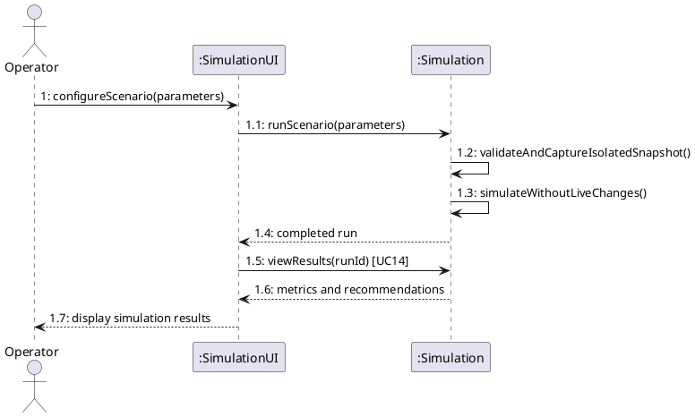

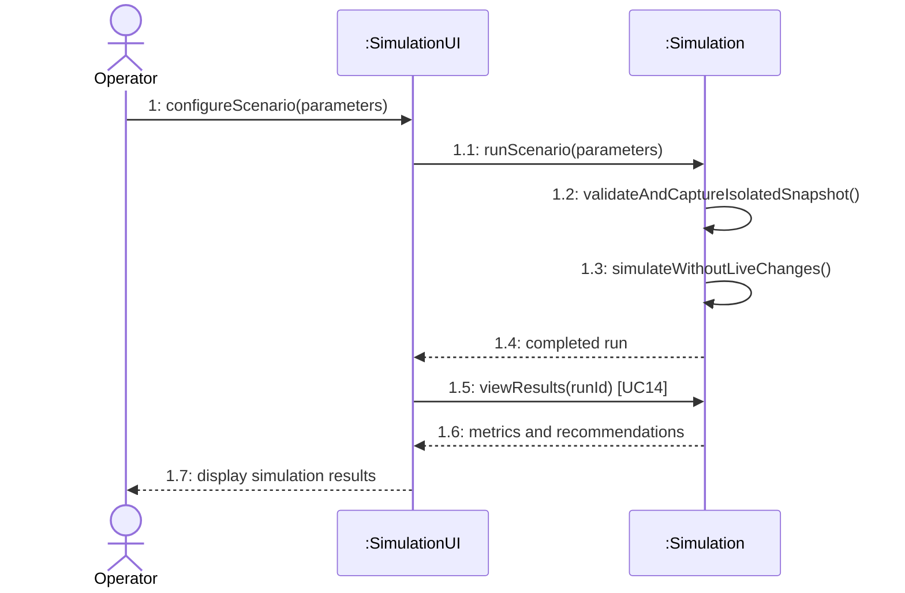

Checklist: Operator ở ngoài hệ thống; mô phỏng chạy trên snapshot cô lập; khuyến nghị không tự sửa trạng thái thực. Mở `.drawio` trong VS Code bằng Draw.io Integration, hoặc nhập PlantUML qua **Advanced → PlantUML** trong Draw.io hay **File → Import → PlantUML** trong Visual Paradigm Online.
