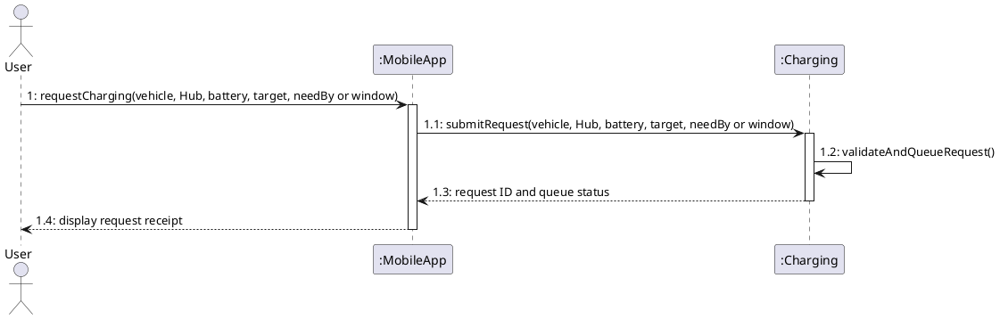
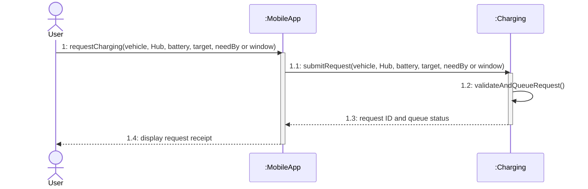
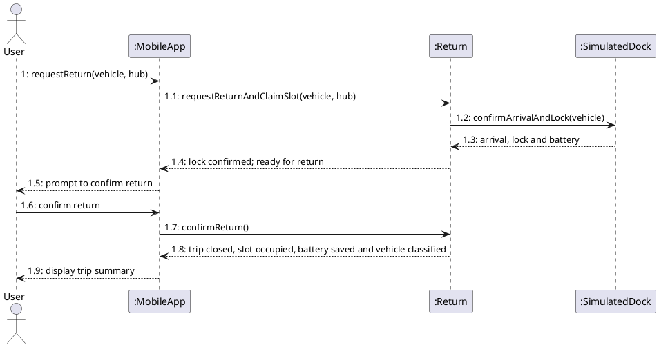
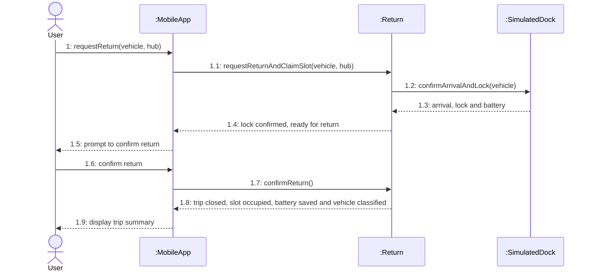

# Sequence Diagram

Editable diagrams are in `drawio/`.

Open a `.drawio` file in diagrams.net or the Draw.io extension for VS Code to edit it.

| Diagram | Draw.io |
| --- | --- |
| SQ01-Reserve_Vehicle | [Edit](drawio/SQ01-Reserve_Vehicle.drawio) |
| SQ02-Pick_Up_Vehicle | [Edit](drawio/SQ02-Pick_Up_Vehicle.drawio) |
| SQ03-Return_Vehicle | [Edit](drawio/SQ03-Return_Vehicle.drawio) |
| SQ04-Request_Charging | [Edit](drawio/SQ04-Request_Charging.drawio) |
| SQ05-Redistribute_Vehicles | [Edit](drawio/SQ05-Redistribute_Vehicles.drawio) |
| SQ06-Handle_Operational_Incident | [Edit](drawio/SQ06-Handle_Operational_Incident.drawio) |
| SQ07-Run_What_if_Simulation | [Edit](drawio/SQ07-Run_What_if_Simulation.drawio) |

## Phạm vi và truy vết

Bảy sơ đồ minh họa các luồng thành công được chọn. Các ngoại lệ và tương tác vòng đời tiếp theo nằm trong [đặc tả use case](../../requirements/PROJECT_SPECIFICATION.md) và [hợp đồng vòng đời](../01_Usecase_Diagram/LIFECYCLE_SCENARIOS.md).

| Sơ đồ | Use case | Điểm kết thúc được minh họa | Luồng tra cứu thêm |
| --- | --- | --- | --- |
| SQ01 | UC03 | Giữ xe 15 phút, trả phiếu và hạn giữ. | UC03 và FR-NI01 cho xe không khả dụng, hủy và hết hạn. |
| SQ02 | UC04 | Mở khóa được xác nhận, bắt đầu chuyến và giải phóng ô đỗ. | UC04 cho phiếu không hợp lệ, mở khóa chưa xác nhận và báo hư hại. |
| SQ03 | UC05 | Xác nhận xe đến và khóa, đóng chuyến và cập nhật ô đỗ. | UC05 cho Hub đầy, khóa chưa xác nhận, đối soát khi không thể xác nhận trả xe. |
| SQ04 | UC07 | Tiếp nhận yêu cầu hợp lệ, trả mã yêu cầu và trạng thái hàng đợi. | UC07 cho lịch hẹn, từ chối yêu cầu không hợp lệ và hủy trước kích hoạt. UC12 phân bổ cổng, khung giờ và công suất. UC07A dừng phiên đã kích hoạt. |
| SQ05 | UC10 | Lập lệnh Planned, giữ xe và sức chứa đích. | UC10 cho Hub đích thay thế và xác nhận xuất phát. UC10A xác nhận đến, UC10B hủy trước xuất phát. |
| SQ06 | UC11 | Đánh giá, cách ly và giao bảo trì trong lần xử lý đầu. | UC11 theo dõi tới khi xử lý xong. UC11A ghi nhận báo cáo của người đang đi và giữ chuyến mở. |
| SQ07 | UC13, UC14 | Chạy trên snapshot cô lập và hiển thị kết quả lần chạy đã hoàn tất. | UC14 có thể mở riêng. Áp dụng khuyến nghị đi qua UC10 hoặc UC12 với kiểm tra trạng thái thực. |

UC06-S1, UC06-S2 và UC06-S3 được mô tả trong [hợp đồng vòng đời](../01_Usecase_Diagram/LIFECYCLE_SCENARIOS.md) và [AD04](../03_Activity_Diagram/drawio/AD04-Reserve_Parking_and_Charging.drawio). Nếu mở rộng bộ sequence, ưu tiên UC06-S1, sau đó UC12 khi cần minh họa phân bổ.

## SQ04 · Tiếp nhận yêu cầu sạc

`validateAndQueueRequest()` kiểm tra quyền, dữ liệu yêu cầu, chuẩn đầu nối, cổng tương thích và công suất hiện tại trước khi ghi hàng đợi. Thiếu sức chứa hiện tại vẫn có thể tiếp nhận yêu cầu hợp lệ. Mã và trạng thái trả về thuộc yêu cầu sạc. UC12 xử lý phân bổ sau; phiên chỉ chuyển sang Active sau xác nhận cấp điện.

Kiểm tra SQ04 theo Ch6 gồm actor bên trái, lifeline nét đứt, activation theo thời gian, thông điệp yêu cầu nét liền và phản hồi nét đứt. Mở canvas bằng Draw.io Integration trong VS Code, hoặc nhập khối PlantUML bằng chức năng PlantUML trong Draw.io và Visual Paradigm Online.

## SQ03 · Confirm return after locking

The dock confirms arrival and lock and supplies battery data. The user confirms return before the system closes the trip, occupies the claimed slot, and classifies the vehicle.

