# Activity previews

The editable Draw.io canvases are the source. Separate PlantUML blocks represent independently triggered activities.

## AD01-Reserve_Vehicle

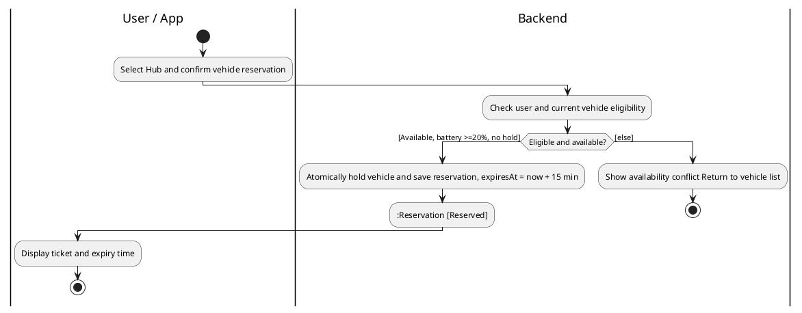

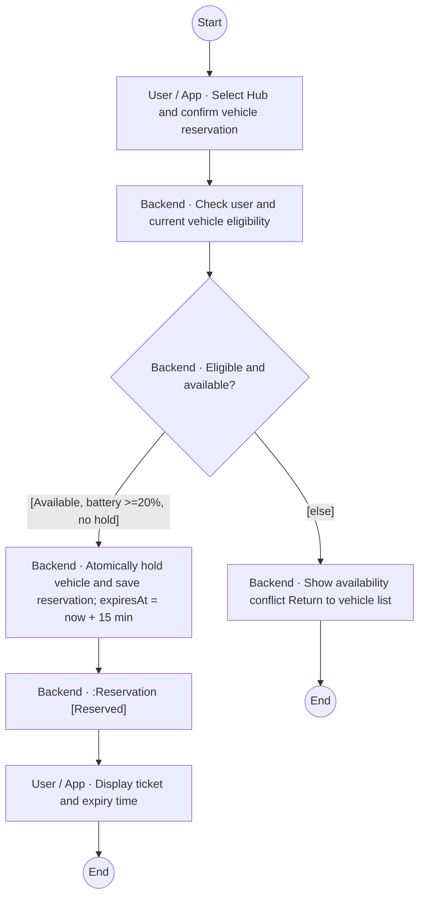

## AD02-Pick_Up_Vehicle

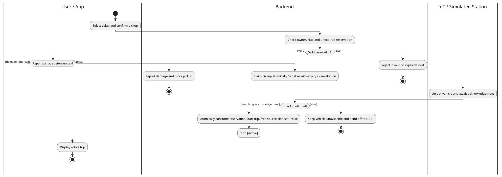

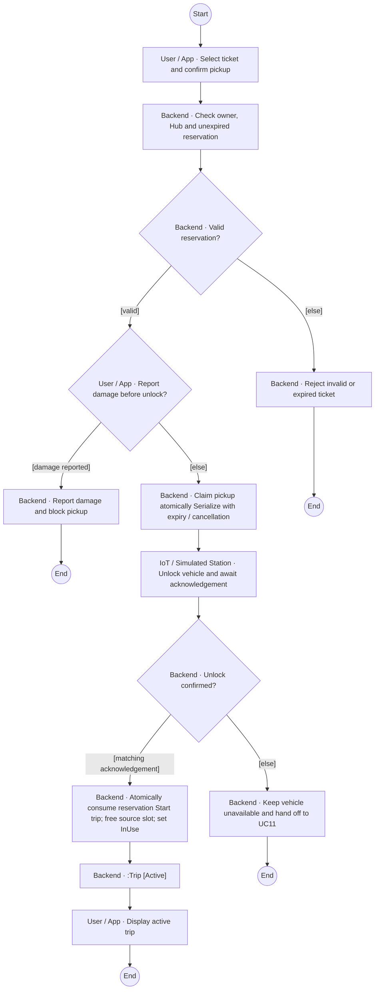

## AD03-Return_Vehicle

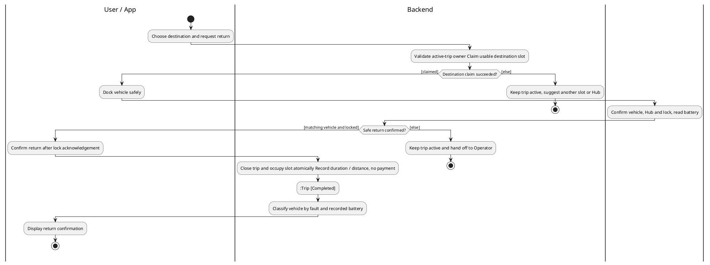

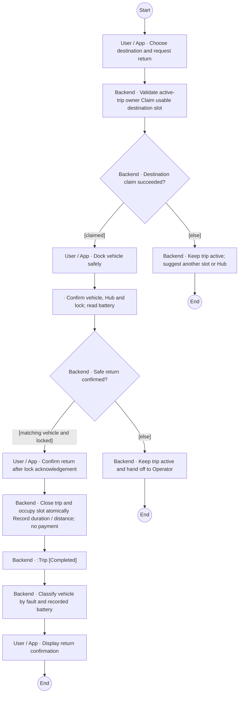

## AD04-Reserve_Parking_and_Charging

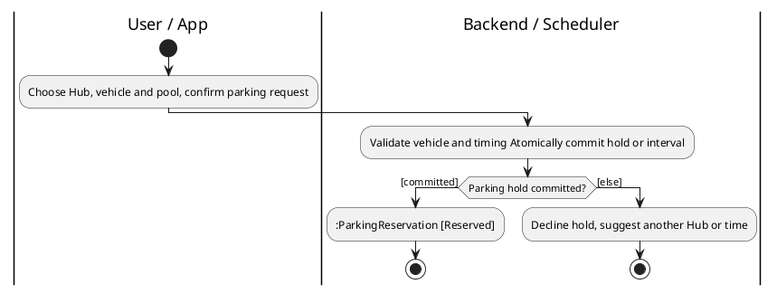

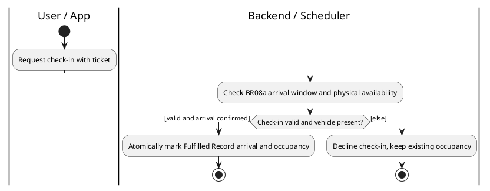

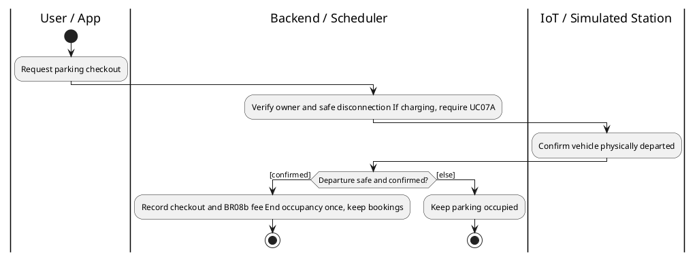

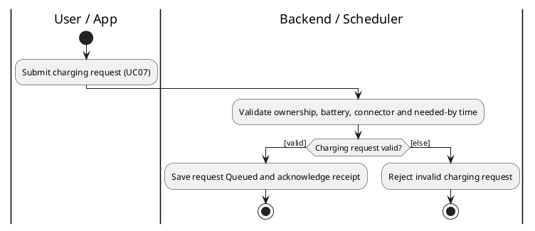

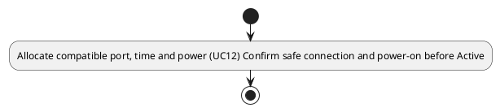

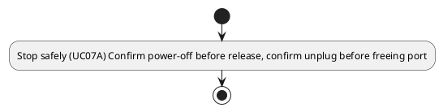

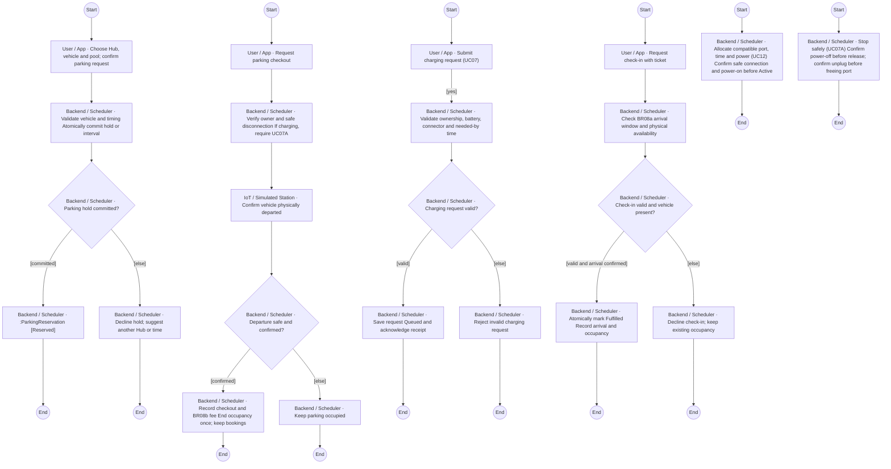

## AD05-Redistribute_Vehicles

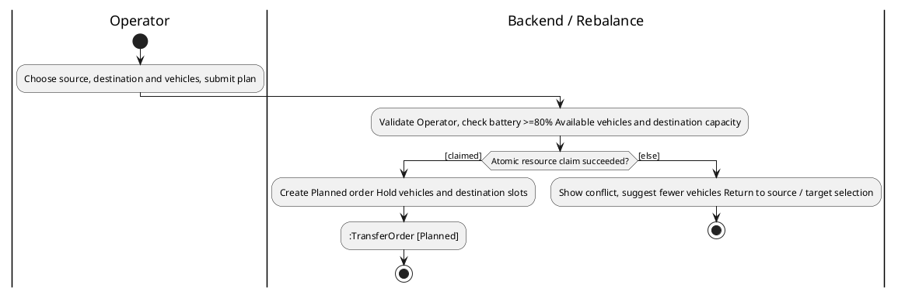

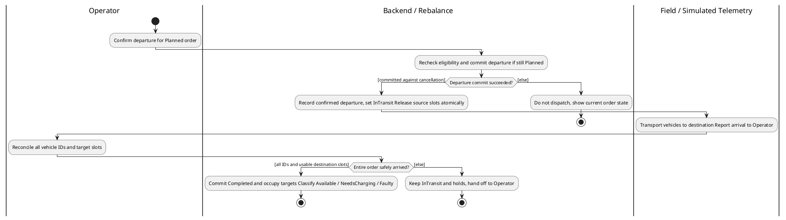

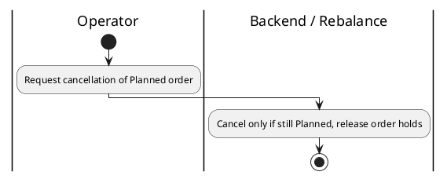

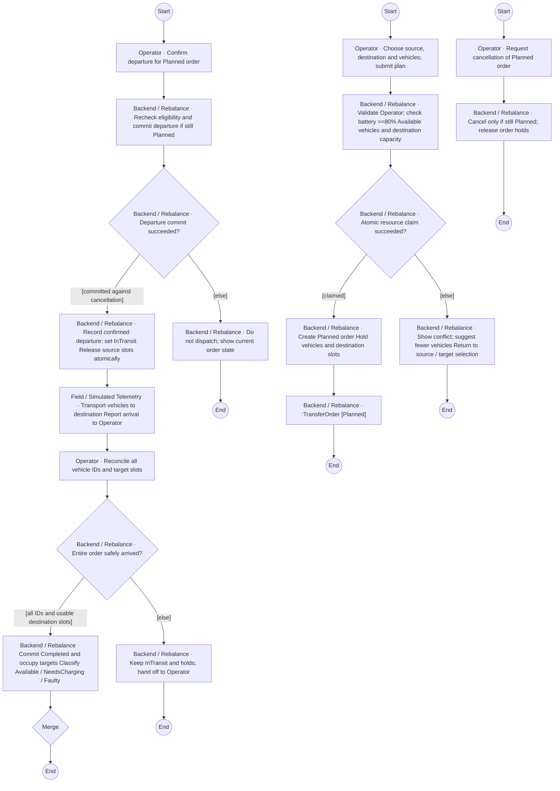

## AD06-Handle_Operational_Incident

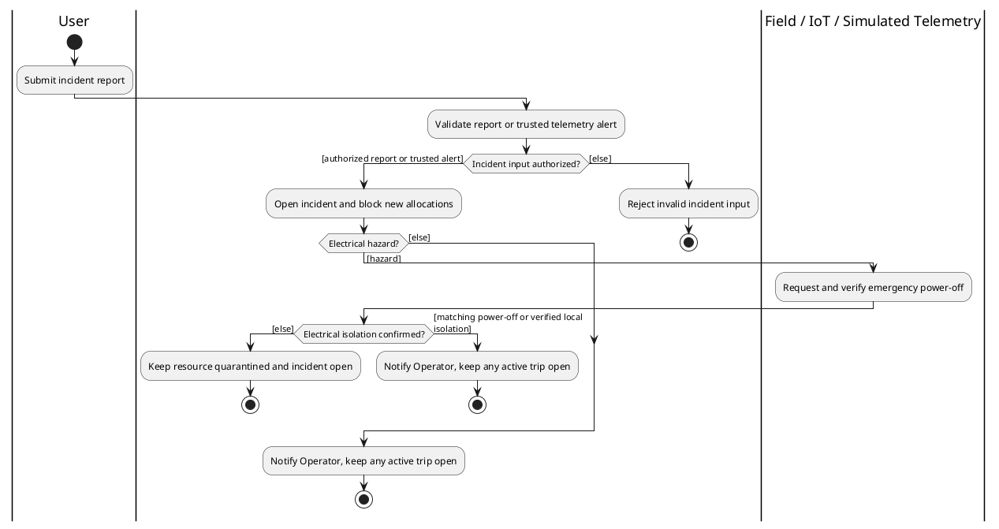

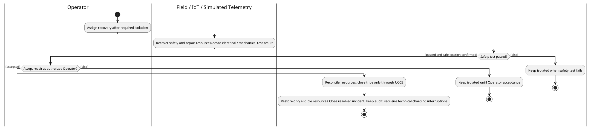

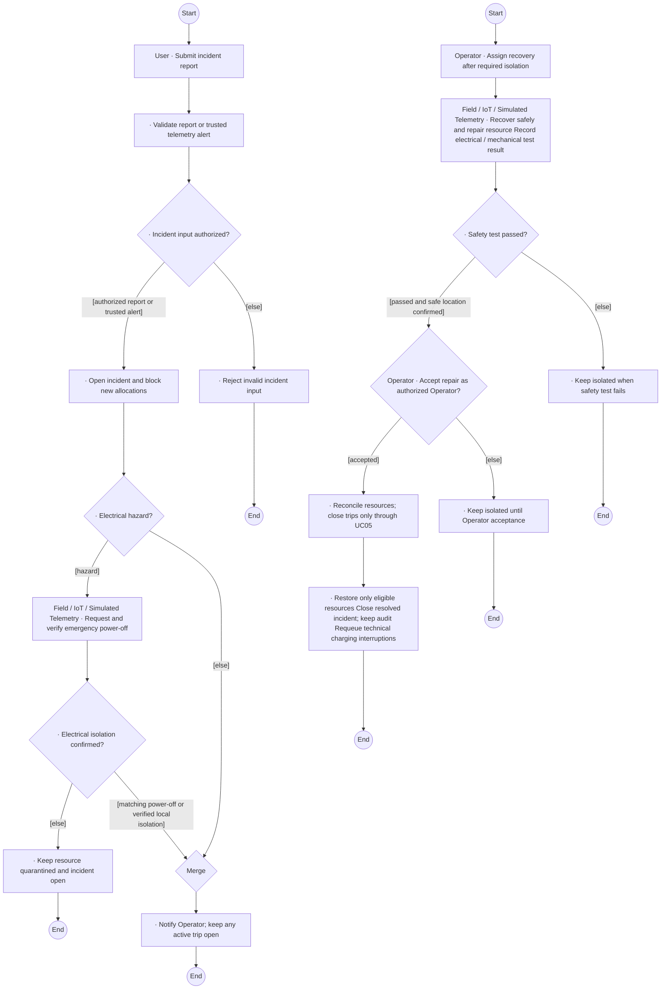

## AD07-Run_What_if_Simulation

```plantuml
@startuml
|Operator|
start
|Operator|
:Configure and run what-if scenario;
|Backend / Sandbox|
:Validate ranges, snapshot network Run simulation on isolated copy;
|Backend / Sandbox|
if (Run completed within deadline?) then ([completed])
|Backend / Sandbox|
::SimulationResult [Completed];
|Operator|
:Review KPIs and recommendations;
|Operator|
if (Apply recommendation?) then ([apply])
|Backend / Sandbox|
:Revalidate role and current live resources;
|Backend / Sandbox|
if (Recommendation still feasible?) then ([valid])
|Operational Services|
:Submit explicit UC10 Planned order or UC12 schedule change Do not copy sandbox state to live;
stop
else ([else])
|Backend / Sandbox|
:Report stale recommendation, keep live state;
stop
endif
else ([else])
|Operator|
:Review or export results without applying;
endif
stop
else ([else])
|Backend / Sandbox|
:Report unsuccessful run;
stop
endif
@enduml
```

```mermaid
flowchart TD
    n0((Start))
    n1["Operator · Configure and run what-if scenario"]
    n5["Backend / Sandbox · Validate ranges; snapshot network Run simulation on isolated copy"]
    n6{"Backend / Sandbox · Run completed within deadline?"}
    n7["Backend / Sandbox · :SimulationResult [Completed]"]
    n8["Operator · Review KPIs and recommendations"]
    n9{"Operator · Apply recommendation?"}
    n10["Backend / Sandbox · Revalidate role and current live resources"]
    n11{"Backend / Sandbox · Recommendation still feasible?"}
    n12["Operational Services · Submit explicit UC10 Planned order or UC12 schedule change Do not copy sandbox state to live"]
    n13["Backend / Sandbox · Report stale recommendation; keep live state"]
    n14((End))
    n15["Operator · Review or export results without applying"]
    n16{"Merge"}
    n17["Backend / Sandbox · Report unsuccessful run"]
    n18((End))
    n19((End))
    n0 --> n1
    n1 --> n5
    n5 --> n6
    n6 -->|"[completed]"| n7
    n7 --> n8
    n8 --> n9
    n9 -->|"[apply]"| n10
    n10 --> n11
    n11 -->|"[valid]"| n12
    n11 -->|"[else]"| n13
    n13 --> n14
    n9 -->|"[else]"| n15
    n12 --> n16
    n15 --> n16
    n6 -->|"[else]"| n17
    n17 --> n18
    n16 --> n19
```
