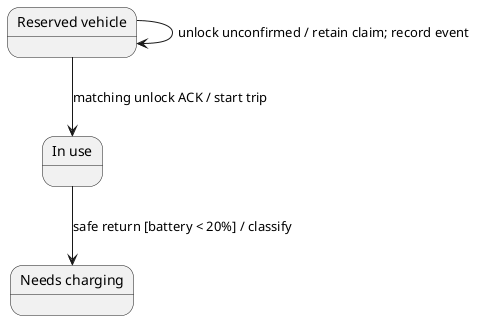
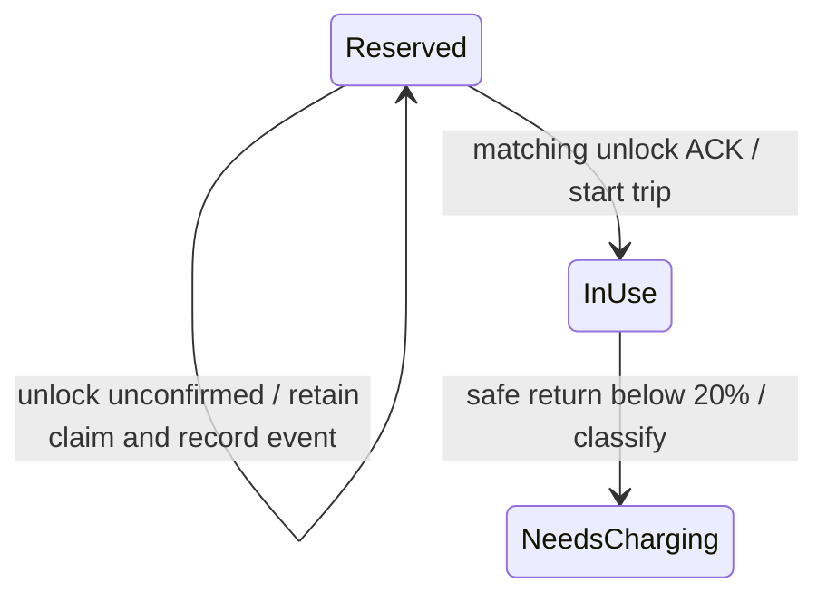
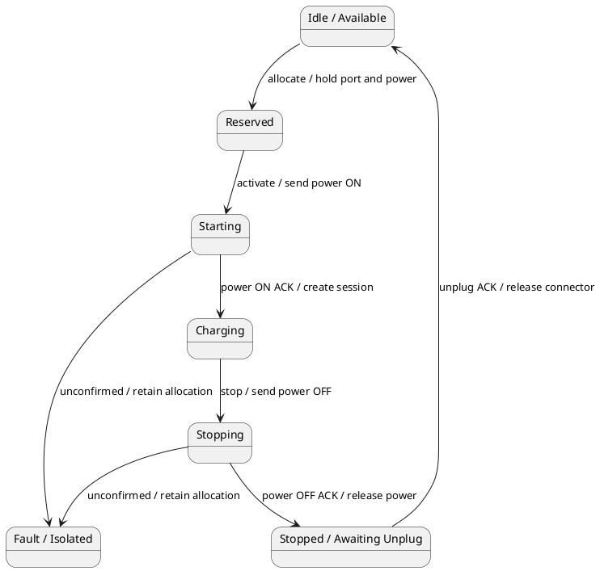
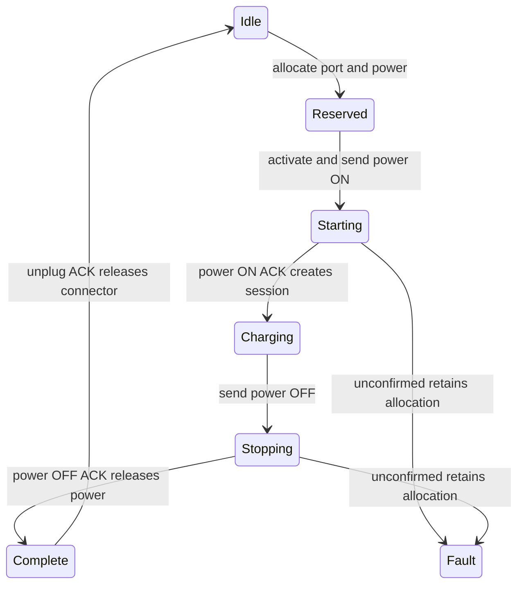

# Statechart Diagram

Editable diagrams are in `drawio/`.

Open a `.drawio` file in diagrams.net or the Draw.io extension for VS Code to edit it.

| Diagram | Draw.io |
| --- | --- |
| SC01-Vehicle_State_Machine | [Edit](drawio/SC01-Vehicle_State_Machine.drawio) |
| SC02-Charging_Point_State_Machine | [Edit](drawio/SC02-Charging_Point_State_Machine.drawio) |
| SC03-Reservation_and_Trip_State_Machine | [Edit](drawio/SC03-Reservation_and_Trip_State_Machine.drawio) |

## Semantics and demo boundaries

SC01 describes the vehicle lifecycle; SC03 describes the related reservation and trip lifecycle, so their states are not interchangeable. In the current demo, an unconfirmed pickup records `DeviceUnconfirmed` and keeps the vehicle Reserved with its pickup claim. The reservation enters `PickupUncertain`; the same command can later be reconciled with matching evidence. This does not by itself create an incident or set the vehicle Faulty. There is no public force-release endpoint for an uncertain claim. The SC03 path for releasing a claim after confirmed source lock/location represents a guarded domain capability, not an exposed demo workflow.

A low-battery return or transfer arrival classifies the vehicle `NeedsCharging`; this does not by itself create a charging request. A trip incident is stored for Operator review and leaves the trip active; external notification delivery is not implemented. Distance can be absent when the adapter provides no odometer evidence.

SC02 combines required safety conditions with service-level transitions. Allocation reserves the point and power; `activateAllocation` moves it through Starting to Charging only after power-on acknowledgement. A successful stop releases power but retains the connector in Complete until `confirmUnplug` succeeds; an unconfirmed unplug also quarantines the point in Fault. An unconfirmed command quarantines the point and retains uncertain allocation; the command runner may stop before three attempts on a reported fault. The current HTTP router exposes allocation and stop, but not activation, unplug confirmation, uncertain-allocation reconciliation or post-repair safety verification. Those methods have service tests; they are not a complete public UI workflow. The model's safe repair condition remains a team requirement; the current guard checks for no active session when entering Repair, while the Available transition additionally checks unresolved incidents, allocations and a safety acknowledgement. In `InventoryService`, `PATCH /operations/resources/:id` does not expose `Retired` transitions for vehicles (which instead support `DELETE` when idle) or charging points, even though the guard permits `Retired` when no active session or allocation remains.

The following focused previews show the corrected uncertainty and low-battery transitions; the full editable canvases remain the diagram sources.

Checklist: unconfirmed unlock preserves its claim, confirmed pickup creates one trip, low battery is classification rather than automatic request, and an incident report keeps the trip active. Open the `.drawio` source in VS Code using Draw.io Integration. Paste PlantUML via **Advanced → PlantUML** in Draw.io or **File → Import → PlantUML** in Visual Paradigm Online.

## SC02 · allocation and safe stop preview

Checklist: allocation precedes activation; power-on ACK precedes Active; power-off ACK releases power; unplug ACK releases the connector; failed acknowledgement preserves uncertainty. The preview is a subset of the editable SC02 canvas. Open the `.drawio` in VS Code with Draw.io Integration, or import PlantUML through **Advanced → PlantUML** in Draw.io or **File → Import → PlantUML** in Visual Paradigm Online.
