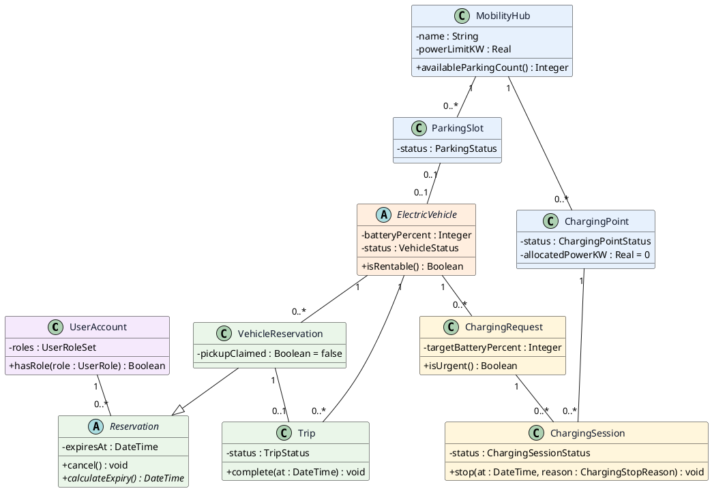
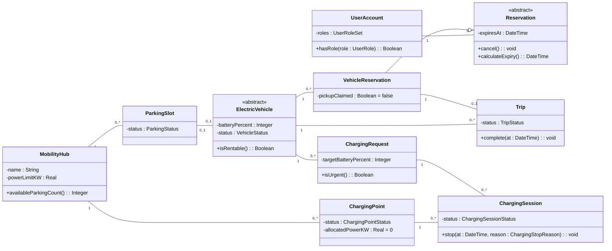

# Class Diagram

Editable diagrams are in `drawio/`.

Open a `.drawio` file in diagrams.net or the Draw.io extension for VS Code to edit it.

| Diagram | Draw.io |
| --- | --- |
| smart_emobility_class_diagram | [Edit](drawio/smart_emobility_class_diagram.drawio) |

## Tổng quan cho slide 16:9

[CD00 · Mô hình lớp tổng quan](drawio/CD00-Class_Overview_16x9.drawio) hiển thị 10 lớp đại diện với ba ngăn UML. Màu phân biệt tài khoản, đặt xe và chuyến đi, hạ tầng Hub, phương tiện và sạc điện. Tên lớp, chữ ký được chọn và bội số đều lấy từ [class catalog](../../../.agent/class-diagram/CLASS_CATALOG.md). Dùng mô hình đầy đủ bên trên để tra các lớp và liên kết đã lược bớt.

Mở nguồn bằng Draw.io Integration trong VS Code. Xuất ảnh tại **File → Export as → PNG/SVG → Size: Page**. Nhập PlantUML qua **Advanced → PlantUML** trong Draw.io hoặc **File → Import → PlantUML** trong Visual Paradigm Online.

PlantUML và bản xem trước Mermaid

