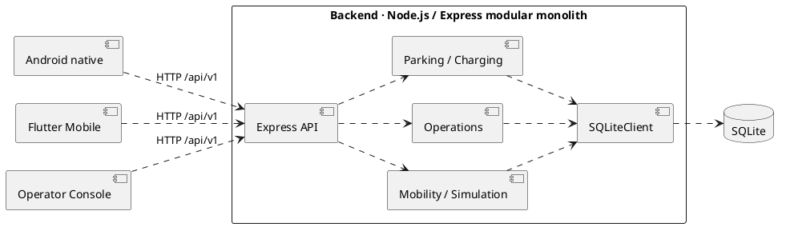
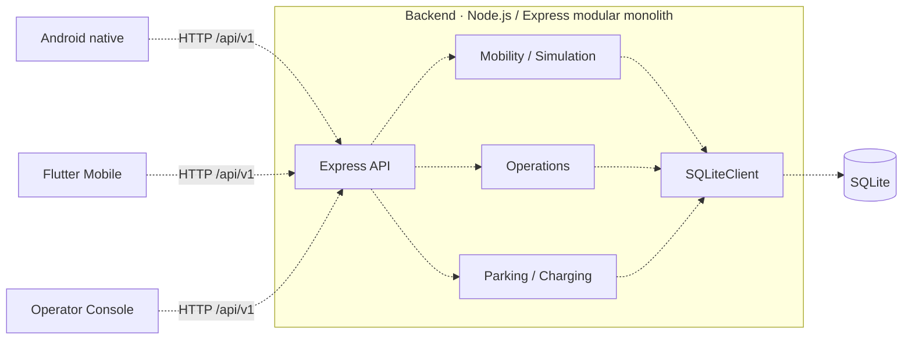

# DV01 — Component Diagram

[**Bản tổng quan 16:9**](DV01-Component_Overview_16x9.drawio) mô tả bản demo hiện tại. Android native, Flutter và Operator Console dùng HTTP `/api/v1`. Một ứng dụng Node.js / Express lắp ghép ba module và dùng chung adapter SQLite. Hình trụ SQLite biểu thị tệp dữ liệu cục bộ. Các phụ thuộc giữa module và adapter thiết bị được trình bày trong [bản chi tiết](component-diagram.drawio) và [PlantUML chi tiết](component-diagram.puml).

Nguồn đối chiếu: [Express composition root](../../../app/src/app.js), [hướng dẫn demo](../../../app/README.md) và [client Flutter](../../../app/flutter_mobile/README.md). Bản tổng quan dùng hình chữ nhật có stereotype và mũi tên dependency theo [ký pháp Component UML](https://www.visual-paradigm.com/guide/uml-unified-modeling-language/what-is-component-diagram/).

Mở tệp bằng Draw.io Integration trong VS Code. Xuất slide qua **File → Export as → PNG/SVG → Size: Page**. Nhập PlantUML qua **Advanced → PlantUML** trong Draw.io hoặc **File → Import → PlantUML** trong Visual Paradigm Online.

PlantUML và Mermaid cho bản tổng quan

