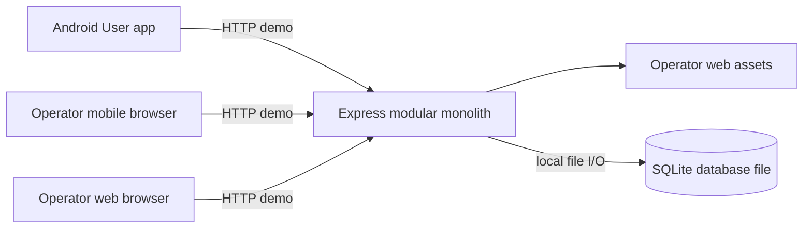

# Deployment View — demo hiện tại

[Sơ đồ Draw.io editable](DP01-deployment.drawio) mô tả cấu hình demo cục bộ: ứng dụng User Android, hai giao diện Operator trên browser, một tiến trình Express và file SQLite trên cùng host. Các thiết bị client có thể cùng nằm trên một máy qua emulator và browser. [Quyết định Development View](../../architecture/DECISION.md) ghi kiến trúc mục tiêu; sơ đồ này không khẳng định đã triển khai topology production.

## Node và artifact

| Thành phần | Cấu hình demo hiện tại |
| --- | --- |
| User Device | Android app trong `android/`, chạy trên Android runtime; app gọi API Express. |
| Operator Mobile Device | Browser mở `/operator-app.html`, được chuyển tới giao diện live mobile. |
| Operator Workstation | Browser mở `/operator-web.html`, được chuyển tới giao diện live desktop. |
| Application Host | Laptop hoặc máy chạy một tiến trình Node.js/Express; phục vụ API và frontend Operator. |
| Backend Application | Một modular monolith gồm Operations, Mobility/Simulation và Parking/Charging; adapter thiết bị có thể giả lập. |
| SQLite Database | File cục bộ do `DEMO_DB_PATH` chỉ định, truy cập trong tiến trình qua SQLite API; không có database server hoặc cổng TCP riêng. |

`npm run db:init --prefix app` tạo `app/db/.local/hub.sqlite`; `db:dashboard-demo` tạo file demo riêng. Đây là các lựa chọn dữ liệu, không phải tên file bắt buộc của backend. Tài khoản được cấp riêng qua file cấu hình `DEMO_ACCOUNTS_FILE`; phiên đăng nhập nằm trong bộ nhớ server. Chi tiết các lệnh nằm ở [app/README](../../../app/README.md) và [hướng dẫn demo](../../architecture/MINH_DEMO_GUIDE.md).

## Kết nối và phạm vi

Ba đường trên canvas là kết nối client–host của demo HTTP. Mặc định server lắng nghe `127.0.0.1:3000`; Android emulator dùng `10.0.2.2:3000`, còn địa chỉ host có thể cấu hình bằng `DEMO_HOST`/`DEMO_PORT`. Chạy HTTP local cần `DEMO_INSECURE_HTTP=1`. Server không tự cấu hình TLS; HTTPS là phương án triển khai cần cấu hình riêng, không phải mô tả launcher hiện tại. Hướng dẫn kết nối emulator, USB và Wi-Fi nằm trong [Android README](../../../android/README.md).

Frontend Assets trên host là các file web phục vụ Operator; Android app là artifact cài trên thiết bị, không do Express phục vụ như trang HTML. Các component ở cuối hình dùng để truy vết logic; chúng không đại diện thêm tiến trình. MapLibre/OpenFreeMap và các dịch vụ bản đồ/chỉ đường bên ngoài không được mở rộng trong sơ đồ triển khai lõi này; xem Android README và app README cho điều kiện sử dụng của từng giao diện. Không có thiết bị IoT thật hoặc dịch vụ thông báo ngoài được thể hiện là đã triển khai.

## PlantUML

```plantuml
@startuml
node "User Device" { node "Android Runtime" { artifact "Android User App" as android } }
node "Operator Mobile Device" { node "Web Browser" { artifact "Operator Mobile UI" as mobile } }
node "Operator Workstation" { node "Web Browser " { artifact "Operator Web UI" as web } }
node "Application Host" {
  node "Node.js Runtime" { artifact "Express demo application" as backend }
  artifact "Operator web assets" as assets
  database "SQLite database file" as db
}
android -- backend : HTTP (demo)
mobile -- backend : HTTP (demo)
web -- backend : HTTP (demo)
backend ..> assets : serves
backend ..> db : SQLite API / file I/O
@enduml
```



Checklist: Android chạy trong runtime Android; hai giao diện Operator chạy trong browser; cả ba kết nối tới một host; SQLite là file cục bộ, không phải server độc lập. Mở file `.drawio` trong VS Code bằng Draw.io Integration. Để nhập PlantUML, dùng **Advanced → PlantUML** trong Draw.io hoặc **File → Import → PlantUML** trong Visual Paradigm Online.
