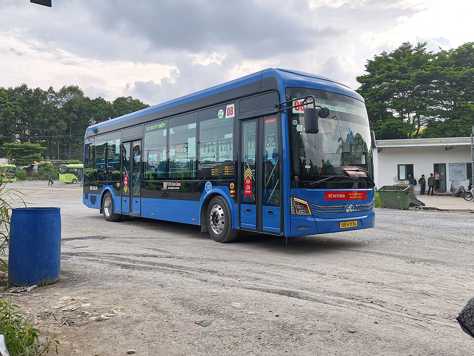
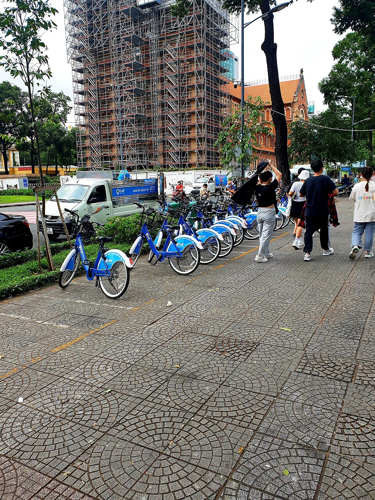
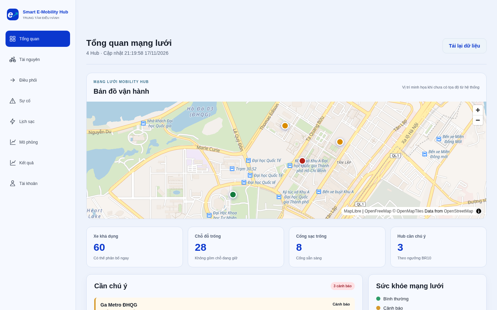

# Section 1 · Bài toán và mục tiêu

Từ cách sinh viên đi học hiện nay đến đề xuất xe điện dùng chung cho những chặng khó tiếp cận bằng xe buýt.

## Slide 4 · Sinh viên đi học bằng gì?

*Xe buýt tuyến 08, bến xe buýt Quận 8 – Đại học Quốc gia. Ảnh của Mrnhan16201, [Wikimedia Commons](https://commons.wikimedia.org/wiki/File:Futa_City_Bus_-_Route_08_-_Kim_Long_B80EV_%2876236%29.jpg), [CC BY-SA 4.0](https://creativecommons.org/licenses/by-sa/4.0/). Ảnh thu nhỏ.*

**Trên slide**

- **Xe cá nhân** — Chủ động đi thẳng đến trường, nhưng không phải sinh viên nào cũng có xe.
- **Xe buýt** — Phục vụ theo tuyến và điểm dừng. Một số điểm đến vẫn cần đi thêm một đoạn.

**Lời trình bày**

> Ở Khu đô thị ĐHQG-HCM, sinh viên có hai cách chính để đến trường là đi xe cá nhân hoặc đi xe buýt. Xe cá nhân giúp đi thẳng đến nơi, nhưng không phải bạn nào cũng có xe. Với xe buýt, có những chuyến mà điểm dừng vẫn cách xa nơi cần đến. Hãy hình dung một sinh viên ở ký túc xá cần sang khu học khác. Nếu bạn không có xe riêng và tuyến buýt không dừng gần nơi học, bạn sẽ đi tiếp bằng gì?

## Slide 5 · Từ xe đạp công cộng đến xe điện trong khu đô thị

*Xe đạp công cộng TNGo tại Quận 1, TP.HCM, năm 2022. Ảnh của Phương Huy, [Wikimedia Commons](https://commons.wikimedia.org/wiki/File:Q1_ng15th7n2022_%28xe_%C4%91%E1%BA%A1p_c%C3%B4ng_c%E1%BB%99ng%29_%281%29.jpg), [CC0 1.0](https://creativecommons.org/publicdomain/zero/1.0/).*

**Trên slide**

- **Mô hình đã có ở Việt Nam** — Xe đạp công cộng nhận và trả theo trạm. Hà Nội và TP.HCM đã bổ sung xe đạp điện.
- **Đề xuất cho ĐHQG-HCM** — Bố trí Hub xe điện dùng chung gần ký túc xá, trường học và điểm trung chuyển.

**Ký túc xá hoặc điểm trung chuyển → Nhận xe tại Hub → Trả xe tại Hub gần trường**

**Lời trình bày**

> Ảnh này cho thấy một trạm xe đạp công cộng ở TP.HCM. Mô hình nhận xe ở một trạm và trả ở trạm khác đã được triển khai ở nhiều đô thị Việt Nam. TNGo vẫn cho thuê xe đạp cơ và đã bổ sung xe đạp điện ở Hà Nội và TP.HCM. Nhóm áp dụng mô hình nhận và trả theo trạm vào nhu cầu đi học trong Khu đô thị ĐHQG-HCM. Sinh viên có thể lấy xe điện gần ký túc xá hoặc sau khi xuống xe buýt, rồi trả ở Hub gần nơi học. Để vận hành các Hub này, hệ thống cần theo dõi xe còn trống, mức pin, chỗ trả và cổng sạc.

[Mô hình xe đạp công cộng TNGo](https://www.tngo.vn/en) · [Dịch vụ xe đạp công cộng và xe đạp điện của TNGo](https://tngo.vn/usermanual) · [TNGo triển khai xe đạp điện tại TP.HCM](https://tngo.vn/vi/news/thong-bao-trai-nghiem-mien-phi-15-phut-xe-dap-dien-tngo-tai-tphcm.html)

## Slide 6 · Mục tiêu của Smart E-Mobility Hub

*Bảng điều khiển mạng lưới Hub trong bản demo. Vị trí và số liệu trên màn hình dùng để minh họa.*

**Trên slide**

- **Sinh viên** — Tìm xe còn trống, xem mức pin, giữ xe và kiểm tra chỗ trả.
- **Đơn vị vận hành** — Theo dõi xe, chỗ đỗ và cổng sạc để điều chuyển xe và lập lịch sạc.
- **Mô phỏng What-if** — Đánh giá khả năng phục vụ khi nhu cầu tăng trước khi quyết định điều phối.

**Lời trình bày**

> Giả sử nhiều sinh viên cùng đi từ ký túc xá đến trường trước giờ học. Hub ở ký túc xá có thể hết xe, Hub gần trường có thể hết chỗ trả, và một số xe vừa trả cần sạc. Smart E-Mobility Hub giúp sinh viên kiểm tra chuyến đi có khả thi hay không, đồng thời cho người vận hành biết nơi nào cần bổ sung xe, chỗ đỗ hoặc lịch sạc. Hệ thống còn cho phép thử tình huống nhu cầu tăng bằng mô phỏng What-if. Từ hai góc nhìn này, nhóm xác định các yêu cầu cho ứng dụng sinh viên và giao diện vận hành.

[Đề bài CO3001](../../references/04_BTL_SoftwareEngineering_HK261.pdf) · [Đặc tả dự án](../../requirements/PROJECT_SPECIFICATION.md)
