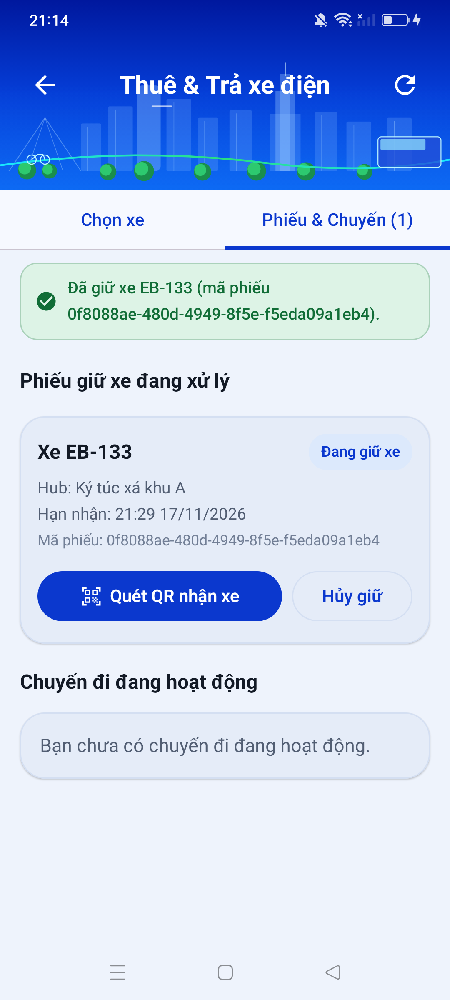
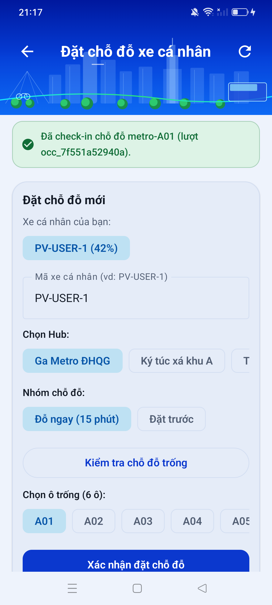
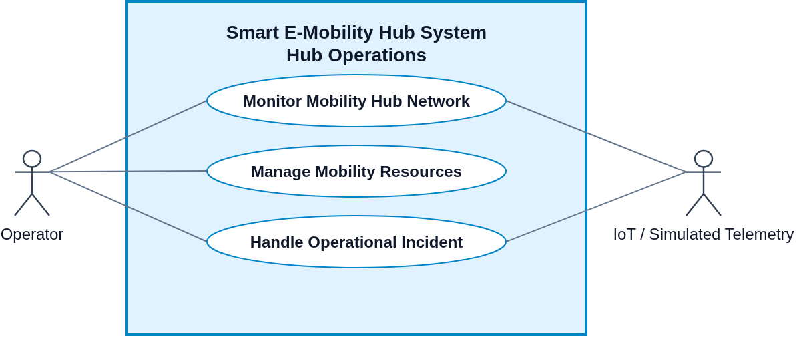
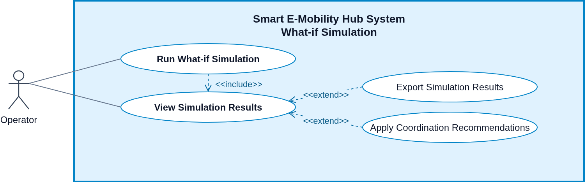
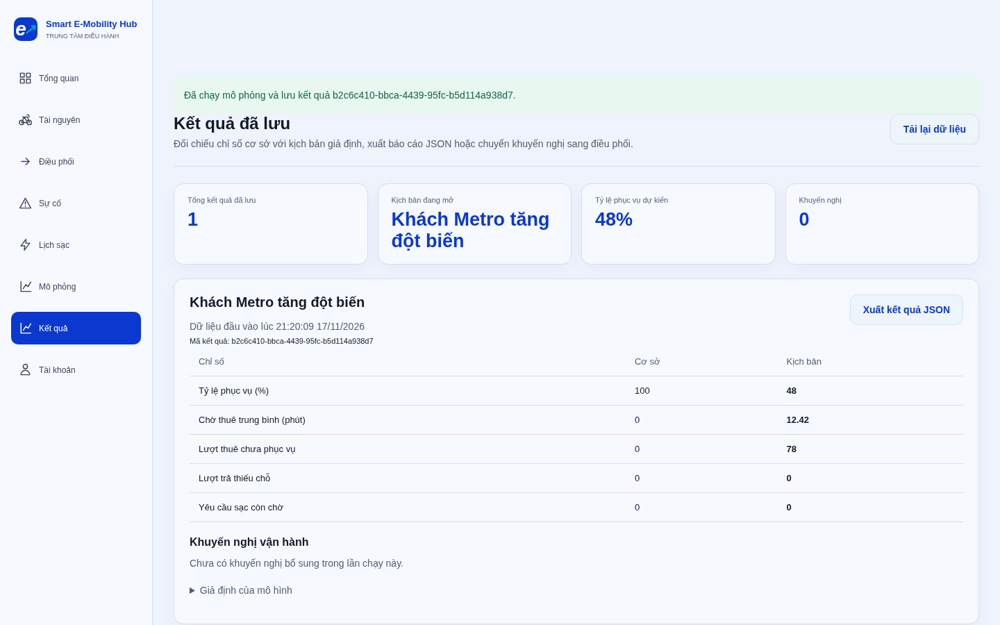

# Section 2 · Yêu cầu và phạm vi ứng dụng

Để sinh viên có thể lấy xe gần ký túc xá và trả gần trường, ứng dụng cần hỗ trợ những thao tác nào ở hai đầu chuyến đi?

## Slide 7 · Hệ thống cần đáp ứng những gì?

**Trên slide**

| Nhóm yêu cầu | Chức năng |
| --- | --- |
| Thuê xe dùng chung | Tìm Hub, xem xe và mức pin, giữ–nhận–trả xe | 
| Đỗ và sạc xe cá nhân | Đặt chỗ đỗ, ghi nhận xe vào/ra, gửi yêu cầu sạc | 
| Vận hành mạng lưới | Giám sát Hub, quản lý tài nguyên, điều chuyển xe, xử lý sự cố, lập lịch sạc | 
| Mô phỏng What-if | Chạy kịch bản giả định và xem kết quả | 

**Yêu cầu chất lượng** — Phân quyền theo vai trò, tránh cấp trùng xe hoặc chỗ đỗ, lưu dữ liệu nghiệp vụ qua lần khởi động lại.

**Lời trình bày**

> Nhóm chia 14 ca sử dụng chính thành bốn nhóm. Sinh viên có thể thuê xe dùng chung hoặc gửi và đăng ký sạc xe cá nhân. Người vận hành theo dõi tài nguyên, điều phối giữa các Hub và thử kịch bản khi nhu cầu thay đổi. Trong mọi luồng, hệ thống cần kiểm tra quyền trước khi xử lý, chỉ cấp xe hoặc chỗ đỗ cho một yêu cầu hợp lệ tại cùng thời điểm và lưu lại dữ liệu nghiệp vụ.

[Use Case toàn hệ thống](../../diagrams/01_Usecase_Diagram/drawio/system_use_cases.drawio)

## Slide 8 · Sinh viên làm được gì trên Android?

**Trên slide**

- **Xe dùng chung:** Tìm Hub → xem xe và mức pin → giữ xe → nhận xe theo mã → chọn chỗ và trả xe.
- **Xe cá nhân:** Đặt chỗ đỗ, check-in/check-out và gửi yêu cầu sạc.

**Lời trình bày**

> Trên Android, sinh viên chọn Hub và xe còn trống rồi nhận phiếu giữ xe. Khi đến Hub, bạn dùng mã xe để nhận xe. Đến nơi, bạn kiểm tra chỗ trống và chọn vị trí trả. Bản demo dùng thiết bị giả lập để xác nhận mở khóa khi nhận xe và khóa xe khi trả. Sinh viên đi xe cá nhân dùng luồng đặt chỗ riêng, xác nhận lúc vào và ra Hub, và có thể gửi yêu cầu sạc.

[Use Case · Thuê xe](../../diagrams/01_Usecase_Diagram/drawio/workflow_vehicle_rental.drawio)

## Slide 9 · Đơn vị vận hành làm được gì trên web?

**Trên slide**

- **Giám sát, tài nguyên và sự cố:** Xem tình trạng Hub, quản lý xe, chỗ đỗ và cổng sạc, phân công bảo trì.
- **Điều chuyển xe:** Lập lệnh giữa các Hub, xác nhận xe đến hoặc hủy lệnh theo trạng thái.
- **Lập lịch sạc:** Xếp hàng theo ưu tiên và phân bổ cổng tương thích trong giới hạn công suất.

**Lời trình bày**

> Bảng điều khiển web cho biết Hub nào thiếu xe hoặc sắp hết chỗ đỗ. Người vận hành có thể xem và quản lý tài nguyên từng Hub, lập lệnh bổ sung xe từ nơi khác hoặc phân công bảo trì khi có thiết bị lỗi. Với yêu cầu sạc, hệ thống dùng mức ưu tiên, độ tương thích của cổng và công suất còn lại để lập lịch phân bổ.

[Use Case · Vận hành Hub](../../diagrams/01_Usecase_Diagram/drawio/workflow_hub_operations.drawio)

## Slide 10 · What-if hỗ trợ quyết định như thế nào?

**Trên slide**

- **Chạy kịch bản:** Chọn một tình huống giả định, chẳng hạn khách đến ga Metro tăng đột biến.
- **Đọc kết quả:** So sánh tỷ lệ phục vụ và thời gian chờ giữa trạng thái cơ sở và kịch bản.
- **Xem phương án:** Khi có khuyến nghị điều chuyển, người vận hành có thể mở phương án và xác nhận tạo lệnh riêng.

**Lời trình bày**

> What-if lấy một bản chụp trạng thái mạng lưới để chạy tình huống giả định. Người vận hành có thể xem kết quả ngay hoặc mở lại kết quả đã lưu. Ảnh demo cho thấy tỷ lệ phục vụ và thời gian chờ thay đổi thế nào trong kịch bản khách Metro tăng đột biến. Dữ liệu vận hành giữ nguyên trong lúc mô phỏng. Nếu có khuyến nghị điều chuyển, hệ thống kiểm tra lại tài nguyên hiện tại khi người vận hành xác nhận tạo lệnh.

*Kết quả của một lượt chạy với dữ liệu demo.*

[Use Case · What-if](../../diagrams/01_Usecase_Diagram/drawio/workflow_what_if_simulation.drawio)

## Slide 11 · MVP đã triển khai đến đâu?

**Trên slide**

| Phạm vi | Trạng thái |
| --- | --- |
| **Đã có trong demo** | Luồng thuê xe, đỗ và gửi yêu cầu sạc trên Android. Giám sát, quản lý tài nguyên, điều chuyển, xử lý sự cố, lập lịch sạc và What-if trên web. Xác nhận thiết bị dùng dữ liệu giả lập. |
| **Còn giới hạn** | Kích hoạt phiên sạc, xác nhận tháo kết nối và xác minh cách ly thiết bị có xử lý ở tầng dịch vụ. Tích hợp IoT thật và gửi thông báo qua dịch vụ ngoài chưa được triển khai. |
| **Ngoài phạm vi MVP** | Đăng ký tự phục vụ, thanh toán và ứng dụng riêng cho kỹ thuật viên. Tài khoản và xe cá nhân được cấp sẵn để trình diễn. |

**Lời trình bày**

> Bản demo cho thấy các luồng chính của sinh viên và đơn vị vận hành. Chẳng hạn, sinh viên có thể gửi yêu cầu sạc và người vận hành có thể phân bổ cổng, còn bước xác nhận bắt đầu phiên sạc nằm ở tầng dịch vụ. Tương tự, phân công bảo trì trên web và xác minh thiết bị đã được cách ly là hai bước riêng. Nhóm dùng thiết bị giả lập để trình diễn những thao tác đã tích hợp vào giao diện.
>
> Luồng giữ–nhận–trả xe cho thấy vì sao nhóm cần mô hình hóa cả các bước xử lý lẫn trạng thái của xe và chỗ đỗ.

[Hợp đồng API](../../architecture/API_CONTRACTS.md) · [Đối chiếu hợp đồng và phạm vi demo](../../requirements/VERSION_2_CONTRACT_REVIEW.md)

[Đề bài CO3001](../../references/04_BTL_SoftwareEngineering_HK261.pdf) · [Đặc tả dự án](../../requirements/PROJECT_SPECIFICATION.md) · [Truy vết MVP](../../requirements/VERSION_2_TRACEABILITY.md)
