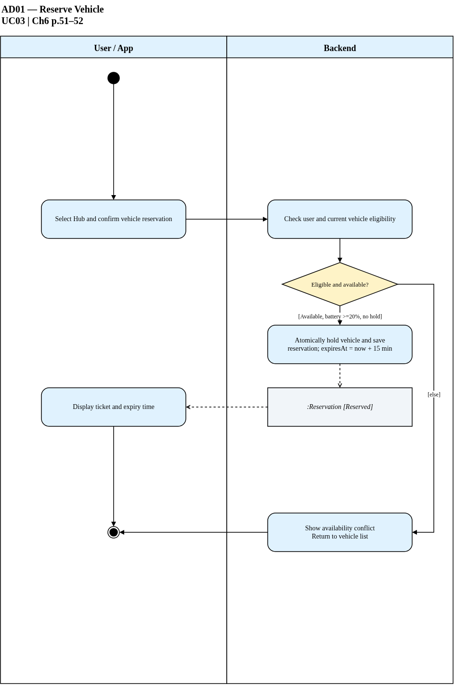
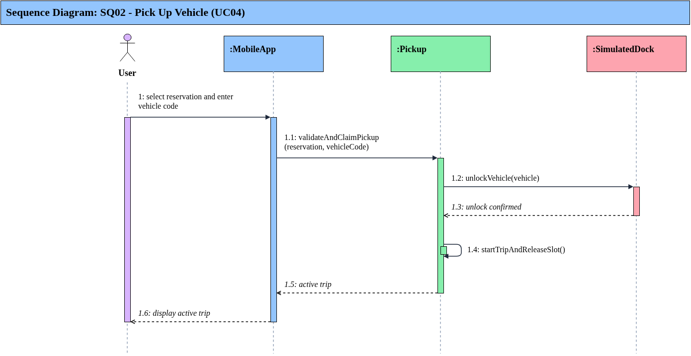
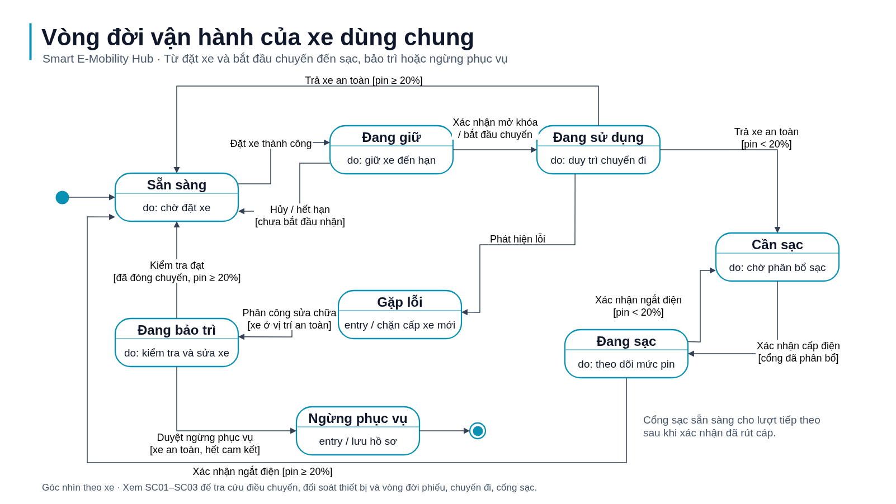
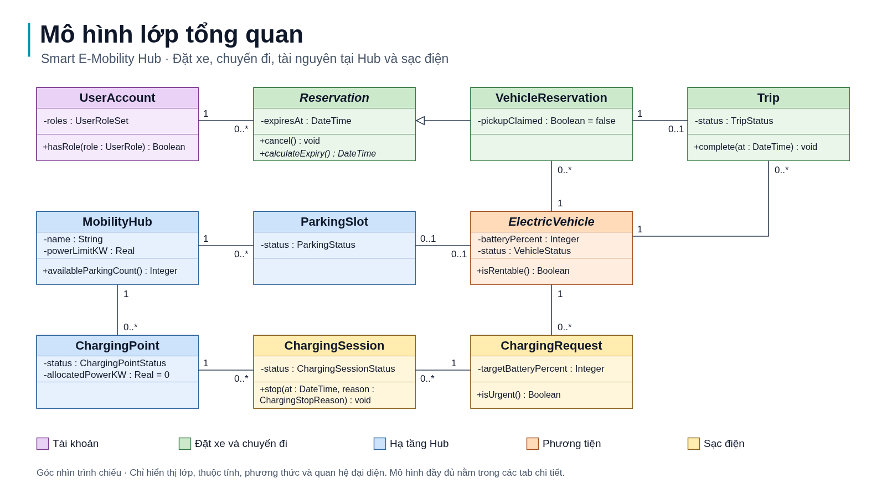
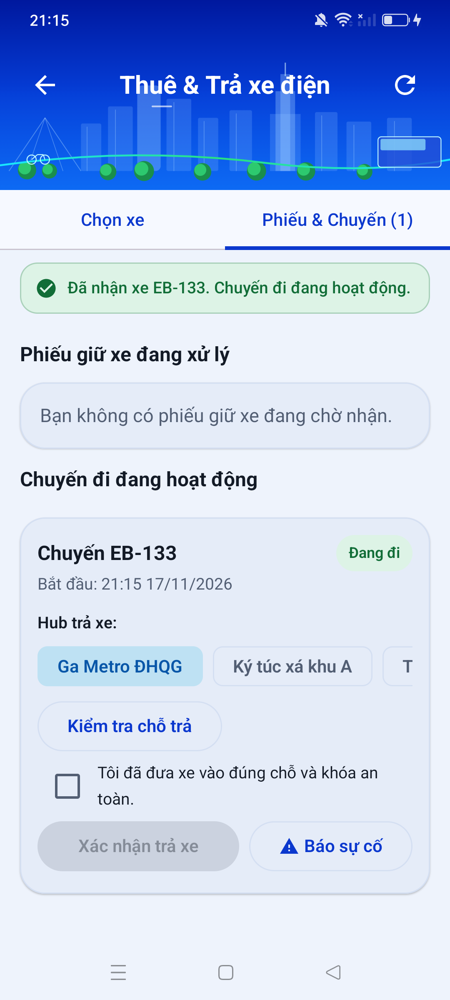

# Section 3 · Từ yêu cầu đến thiết kế

Nhóm làm việc theo hướng Agile, họp và điều chỉnh thiết kế qua nhiều vòng. Phần này dùng luồng giữ–nhận–trả xe để minh họa **Version 2**, phiên bản đang trình bày.

## Slide 12 · Thiết kế qua hai phiên bản

**Trên slide**

| | Nội dung |
| --- | --- |
| **Version 1** | Đặc tả ban đầu, Use Case và prototype để thống nhất phạm vi và luồng thao tác. |
| **Qua các buổi họp** | Rà soát tiến độ, thảo luận các thay đổi về luồng và ngoại lệ, rồi cập nhật đặc tả, UML và giao diện. |
| **Version 2 · Bản trình bày** | Làm rõ quy tắc giữ, nhận và trả xe. Đối chiếu lại yêu cầu và UML với các luồng chạy trên Android và web. |

**Lời trình bày**

> Nhóm làm việc theo hướng Agile. Từ bản đặc tả và prototype đầu tiên, nhóm họp trong quá trình làm để xem phần nào đã thống nhất và tình huống nào còn cần xử lý. Sau mỗi vòng rà soát, nhóm điều chỉnh những phần liên quan trong yêu cầu, sơ đồ và giao diện. Bài này trình bày Version 2. Một ví dụ là luồng thuê xe: giữ xe tạo một phiếu có hạn, còn chuyến đi chỉ bắt đầu khi có xác nhận mở khóa.

[Hồ sơ tiến độ Version 1](../SUBMISSION_PROGRESS_ARCHIVE.md) · [Quy định họp nhóm trong đặc tả](../../requirements/PROJECT_SPECIFICATION.md#7-quy-chuẩn-làm-việc-nhóm--họp-định-kỳ) · [Đối chiếu Version 2](../../requirements/VERSION_2_CONTRACT_REVIEW.md)

## Slide 13 · Activity Diagram — Khi nào giữ xe thành công?

**Trên slide**

**UC03 · Chọn xe → Kiểm tra khả dụng → Giữ xe và tạo phiếu 15 phút**

- **Xe đủ điều kiện:** Hệ thống giữ xe và lưu phiếu trong cùng một giao dịch.
- **Xe không còn khả dụng:** Ứng dụng báo xung đột và quay lại danh sách xe.

**Lời trình bày**

> Từ yêu cầu giữ xe, nhóm xác định hai nhánh trong Activity Diagram. Khi sinh viên chọn xe, hệ thống kiểm tra lại trạng thái và mức pin ngay lúc xác nhận. Nếu xe đủ điều kiện, hệ thống giữ xe và tạo phiếu có hạn 15 phút trong cùng một giao dịch. Nếu xe vừa được người khác giữ, ứng dụng báo xung đột để sinh viên chọn lại.

[AD01 · Đặt giữ xe](../../diagrams/03_Activity_Diagram/drawio/AD01-Reserve_Vehicle.drawio) · [AD02 · Nhận xe](../../diagrams/03_Activity_Diagram/drawio/AD02-Pick_Up_Vehicle.drawio) · [AD03 · Trả xe](../../diagrams/03_Activity_Diagram/drawio/AD03-Return_Vehicle.drawio)

## Slide 14 · Sequence Diagram — Ai xác nhận việc nhận xe?

**Trên slide**

**UC04 · Chọn phiếu và gửi mã xe → Kiểm tra phiếu → Xác nhận mở khóa → Bắt đầu chuyến**

**Lời trình bày**

> Sinh viên chọn phiếu rồi quét hoặc nhập mã xe trên Android. Hệ thống kiểm tra chủ phiếu, mã xe, Hub và hạn giữ trước khi yêu cầu dock giả lập mở khóa. Khi dock xác nhận, hệ thống mới bắt đầu chuyến và giải phóng chỗ đỗ ở Hub xuất phát. Nếu kết quả mở khóa chưa rõ, hệ thống giữ quyền nhận xe để đối soát.

[Danh mục Sequence Diagram · SQ02 và SQ03](../../diagrams/02_Sequence_Diagram/README.md)

## Slide 15 · State-chart — Xe đổi trạng thái khi nào?

**Trên slide**

- **Sẵn sàng → Đang giữ → Đang sử dụng**, khi giữ xe thành công và sau đó có xác nhận mở khóa.
- **Trả xe an toàn:** Xe về **Sẵn sàng** nếu pin từ 20% trở lên, hoặc chuyển sang **Cần sạc** nếu pin dưới 20%.

**Lời trình bày**

> State-chart nhìn cùng luồng đó từ phía chiếc xe. Giữ xe thành công đưa xe sang Đang giữ. Nếu phiếu bị hủy hoặc hết hạn trước khi bắt đầu nhận, xe có thể trở lại Sẵn sàng. Khi trả xe, hệ thống cần xác nhận đã đỗ và khóa an toàn trước khi đóng chuyến và ghi nhận chỗ đỗ đã có xe. Sau đó mức pin quyết định xe có thể phục vụ lượt tiếp theo hay cần sạc.

[Danh mục State-chart · Vòng đời xe dùng chung](../../diagrams/04_Statechart_Diagram/README.md) · [SC03 · Vòng đời phiếu giữ và chuyến đi](../../diagrams/04_Statechart_Diagram/drawio/SC03-Reservation_and_Trip_State_Machine.drawio)

## Slide 16 · Từ mô hình lớp đến màn hình Android

**Trên slide**

| Đối tượng | Dữ liệu trên Android |
| --- | --- |
| **VehicleReservation** | Phiếu giữ xe, mã xe và hạn nhận. |
| **Trip** | Trạng thái chuyến đi sau khi nhận xe, thao tác trả xe. |
| **ElectricVehicle và ParkingSlot** | Mức pin, xe khả dụng và chỗ đỗ có thể chọn khi trả. |

**Lời trình bày**

> Một xe có thể gắn với nhiều phiếu qua thời gian, còn một phiếu giữ tạo tối đa một chuyến. Vì vậy, trên Android, phiếu giữ có hạn nhận riêng và chuyến đang hoạt động xuất hiện sau khi nhận xe thành công. Khi trả xe, ứng dụng hỏi Hub và chỗ đỗ còn khả dụng. Từ mô hình này, phần tiếp theo giải thích cách Android, API và cơ sở dữ liệu phối hợp để giữ trạng thái nhất quán.

[Danh mục Class Diagram · Mô hình lớp](../../diagrams/05_Class_Diagram/README.md) · [Truy vết luồng Android và UML Version 2](../../requirements/VERSION_2_TRACEABILITY.md)
