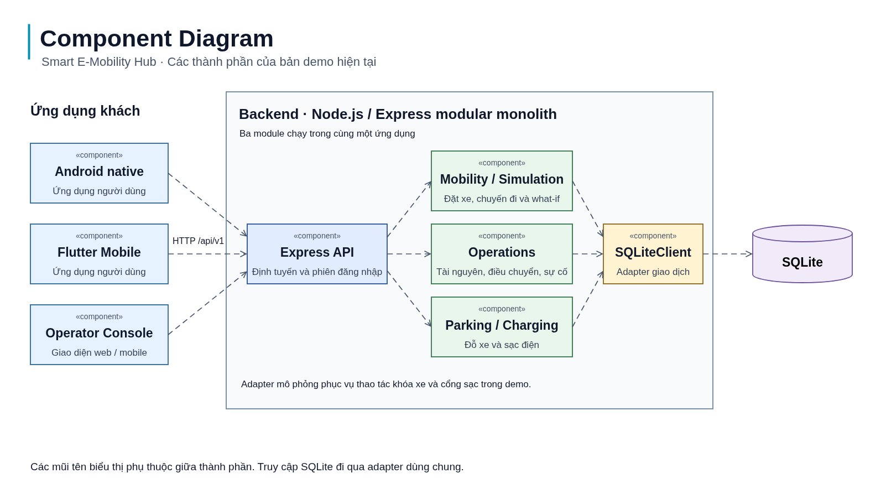
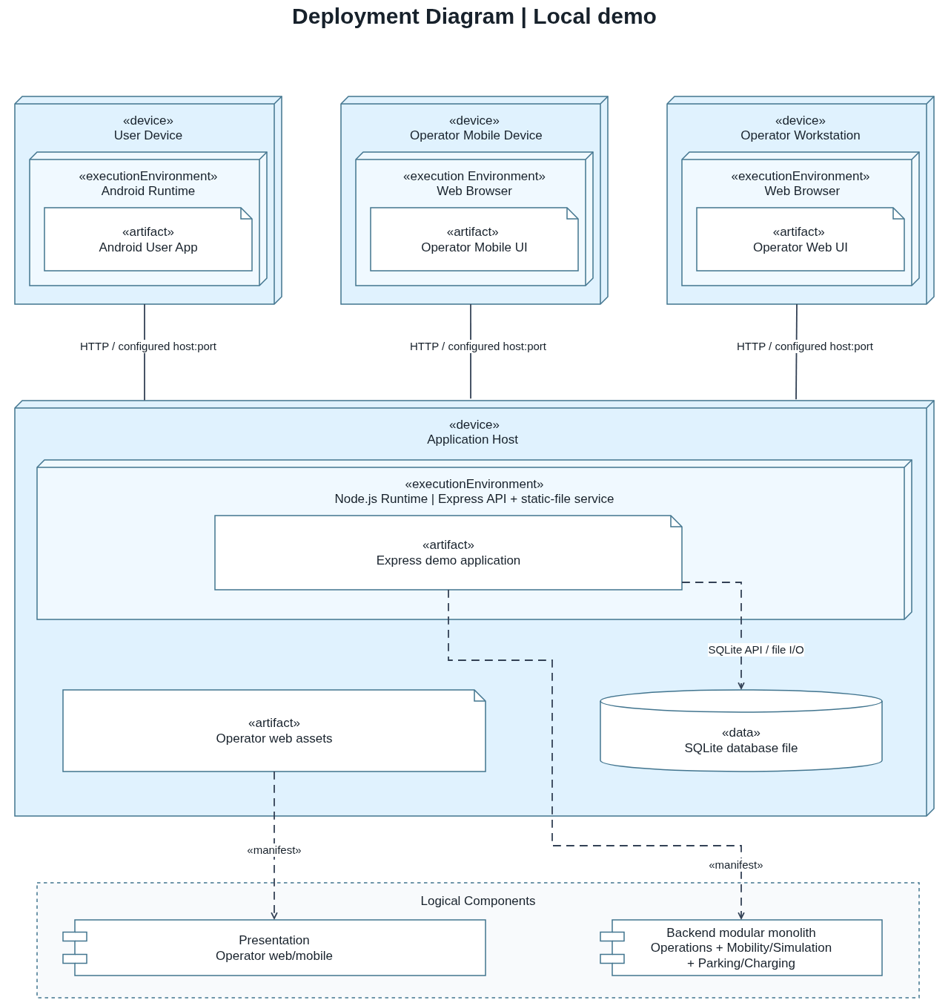
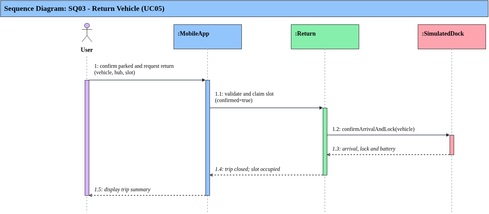

# Section 4 · Kiến trúc và hiện thực MVP

Tiếp nối luồng giữ–nhận–trả xe ở Section 3 bằng câu hỏi: Khi sinh viên bấm **Xác nhận trả xe**, các thành phần nào phối hợp để cập nhật chuyến đi và chỗ đỗ?

## Slide 17 · Một backend, ba module nghiệp vụ

**Trên slide**

- **Kiến trúc MVP:** Một ứng dụng Node.js/Express tổ chức theo modular monolith.
- **Ba module:** Mobility / Simulation, Operations và Parking / Charging.
- **Lý do chọn:** Một backend dễ lắp ghép cho demo. Các luồng liên quan dùng chung giao dịch khi cập nhật tài nguyên.

**Lời trình bày**

> Nhóm chọn một backend vì thuê xe, đặt chỗ đỗ và điều chuyển đều có thể cần cùng một tài nguyên tại Hub. Các module vẫn có trách nhiệm rõ ràng, còn thao tác cần cập nhật đồng thời có thể dùng chung giao dịch SQLite. Cách tổ chức này đơn giản hóa triển khai MVP. Các module cùng chạy và được triển khai như một ứng dụng.
>
> Theo mô hình 4+1, Use Case ở Section 2 là góc nhìn kịch bản. Activity ở Section 3 thể hiện Process View; Sequence và Class Diagram thể hiện Logical View. Phần này đi tiếp sang Development View và Physical View, dùng UC05 trả xe để nối các góc nhìn với nhau.

[Chương 7 · Quyết định kiến trúc và ảnh hưởng đến đặc tính hệ thống, tr. 11–13](../../slides/07_Ch7%20Architectural%20Design_2025.pdf#page=11) · [4+1 và ánh xạ UML, tr. 17–18](../../slides/07_Ch7%20Architectural%20Design_2025.pdf#page=17) · [Quyết định kiến trúc MVP](../../architecture/DECISION.md)

## Slide 18 · Development View — Mã nguồn được chia thế nào?

**Trên slide**

| Góc nhìn | Nội dung |
| --- | --- |
| **Thiết kế mục tiêu** | Năm tầng: Presentation, API / Interface, Application, Domain và Infrastructure. |
| **Version 2 đang chạy** | Mobility / Simulation xử lý thuê xe và What-if. Operations quản lý tài nguyên, điều chuyển và sự cố. Parking / Charging xử lý đỗ và sạc. |

**Lời trình bày**

> Component Diagram cho thấy trách nhiệm của từng thành phần và quan hệ phụ thuộc. Package Diagram cho thấy mã nguồn được đặt ở đâu. Trong thiết kế mục tiêu, giao diện gửi yêu cầu qua API, tầng Application điều phối ca sử dụng, Domain chứa quy tắc nghiệp vụ, còn Infrastructure cung cấp adapter lưu trữ và thiết bị. Trong demo Version 2, một Express app lắp ghép ba module. Mobility và Parking dùng chung giao diện quản lý tài nguyên do Operations cung cấp. Các module truy cập dữ liệu qua repository và lớp SQLite dùng chung. DV01 có cả client Flutter bổ sung; hai giao diện chính trong bài demo là Android native và Operator trên trình duyệt.

[Chương 7 · Development View, tr. 17–18](../../slides/07_Ch7%20Architectural%20Design_2025.pdf#page=17) · [Kiến trúc phân tầng, tr. 24–25](../../slides/07_Ch7%20Architectural%20Design_2025.pdf#page=24) · [Component Diagram · Nguồn Draw.io chi tiết](../../diagrams/06_Component_Diagram/component-diagram.drawio)

[DV02 · Package thiết kế mục tiêu](../../diagrams/07_Package_Diagram/DV02-Package_Diagram_New.drawio) · [Mã nguồn các module hiện tại](../../../app/src/modules/)

## Slide 19 · Physical View — Demo chạy ở đâu?

**Trên slide**

| Vị trí | Thành phần chạy |
| --- | --- |
| **Thiết bị hoặc emulator Android** | Ứng dụng sinh viên. |
| **Trình duyệt** | Giao diện Operator trên web hoặc mobile. |
| **Máy chạy demo** | Một tiến trình Node.js/Express phục vụ API HTTP và giao diện web. Tệp SQLite nằm trên cùng máy. |

**Lời trình bày**

> Deployment View cho biết phần mềm chạy ở đâu. Android và trình duyệt gọi cùng một máy chạy Express qua HTTP. Express phục vụ các màn hình Operator và các API nghiệp vụ. Backend đọc, ghi tệp SQLite cục bộ qua thư viện SQLite trong cùng tiến trình. DP01 mô tả cấu hình demo cục bộ.

[Chương 7 · Physical View và Deployment Diagram, tr. 17–18](../../slides/07_Ch7%20Architectural%20Design_2025.pdf#page=17) · [Mô hình Client–Server, tr. 29](../../slides/07_Ch7%20Architectural%20Design_2025.pdf#page=29) · [DP01 · Sơ đồ triển khai demo cục bộ](../../diagrams/deployment/DP01-deployment.drawio)

## Slide 20 · UC05 — Theo dấu một yêu cầu trả xe

**Trên slide**

1. **Android:** Chọn Hub và chỗ trả, xác nhận đã đỗ an toàn.
2. **Express API:** Nhận `POST /api/v1/trips/{id}/return`. Module Mobility kiểm tra chủ chuyến, trạng thái chuyến và giữ chỗ qua Operations.
3. **Dock giả lập:** Xác nhận xe đã đến, đã khóa và trả mức pin.
4. **SQLite:** Backend đóng chuyến, cập nhật xe và ghi nhận chỗ đỗ đã có xe.

**Lời trình bày**

> Khi sinh viên xác nhận trả xe, Android gửi mã Hub, mã chỗ đỗ và xác nhận đã đỗ. Express chuyển yêu cầu đến luồng trả xe. Module Mobility kiểm tra chuyến đang hoạt động và yêu cầu Operations giữ chỗ đích. Dock giả lập trả bằng chứng xe đã đến và khóa an toàn. Backend dùng bằng chứng này để hoàn tất cập nhật trong SQLite rồi trả kết quả cho Android. SQ03 cho thấy thứ tự tương tác; endpoint và giao dịch làm rõ cách luồng này được hiện thực.

**Sơ đồ tham chiếu trong Markdown**

[Chương 7 · Logical View và Sequence Diagram, tr. 18](../../slides/07_Ch7%20Architectural%20Design_2025.pdf#page=18) · [Danh mục Sequence Diagram · SQ03](../../diagrams/02_Sequence_Diagram/README.md) · [Hợp đồng HTTP của UC05](../../architecture/API_CONTRACTS.md)

## Slide 21 · Tranh chấp chỗ đỗ và xác nhận thiết bị

**Trên slide**

**Một chỗ đỗ, nhiều yêu cầu:** trả xe dùng chung, đặt chỗ xe cá nhân và điều chuyển xe có thể cùng cần chỗ tại Hub đích.

| Giai đoạn | Cách demo xử lý |
| --- | --- |
| **Giao dịch 1 · Giữ chỗ** | SQLite kiểm tra và giữ chỗ trong cùng giao dịch ghi. Yêu cầu đến sau phải dùng trạng thái mới. |
| **Ngoài giao dịch · Xác nhận thiết bị** | Backend gọi dock qua adapter giả lập. Trong lúc chờ, lệnh trả đã được lưu và chỗ vẫn được giữ. |
| **Giao dịch 2 · Hoàn tất** | Khi có xác nhận hợp lệ, backend cập nhật xe, chỗ đỗ và đóng chuyến trong cùng giao dịch. Nếu xác nhận chưa rõ, chuyến còn mở và chỗ được giữ để đối soát. |

**Lời trình bày**

> Giả sử một sinh viên đang trả xe đúng lúc người khác đặt chỗ đỗ hoặc người vận hành lập lệnh điều chuyển tới cùng ô đỗ. Backend mở giao dịch ghi bằng `BEGIN IMMEDIATE`, kiểm tra lại khả dụng rồi giữ chỗ. Nếu chỗ đã được giữ bởi yêu cầu khác, thao tác trả báo xung đột và chuyến vẫn đang mở. Sau khi giữ chỗ thành công, backend gọi adapter thiết bị bên ngoài giao dịch để tránh giữ khóa ghi trong lúc chờ phản hồi. Chỉ khi dock xác nhận an toàn, giao dịch cuối mới ghi nhận xe đã đỗ và hoàn tất chuyến.
>
> Phần tiếp theo trình diễn luồng vừa giải thích: sinh viên giữ xe, nhận xe, chọn chỗ và trả xe trên Android.

[Chương 7 · Repository Architecture, tr. 26–27](../../slides/07_Ch7%20Architectural%20Design_2025.pdf#page=26) · [Ranh giới giao dịch và adapter thiết bị của MVP](../../../app/src/modules/mobility-simulation/README.md) · [Kiểm thử tranh chấp sức chứa](../../../app/src/modules/mobility-simulation/tests/capacity-integration.test.js)
